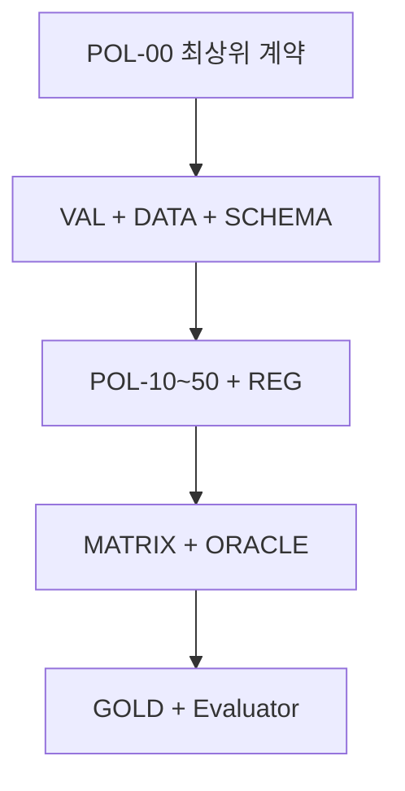

# 정책

상태: 시작 전

# 1. 최종 계약

- **판정 대상:** Order Item의 전액 환불 자격을 읽기 전용으로 판정
- **최종 출력:** SCHEMA-20 DecisionResult
- **입력 기준:** DATA-10과 SCHEMA-10을 충족한 canonical PolicyFacts
- **우선순위 기준:** REG-20의 terminal priority
- **판정 기준 구현:** ORACLE-10
- **정답 원장:** GOLD-10 작성·변경 계약과 GOLD-20 Representative-20
- **P0:** 계약 위반 시 build 실패
- **P1:** NOTICE-10에 기록하고 구현 결과를 관찰한 뒤 수치 기준 확정

# 2. 규범 적용 순서

| 단계 | 문서 | 구현자가 고정해야 할 내용 |
| --- | --- | --- |
| 1 | [POL-00 공통 판정 원칙](https://app.notion.com/p/3bc4a1a82b518108b43ae2e0e0f80d3d?pvs=21) | 범위, 결정론, 출력 불변식, 회사 귀책 override 경계 |
| 2 | [VAL-10](https://app.notion.com/p/3bc4a1a82b518177940cc385cde054ad?pvs=21), [DATA-10](https://app.notion.com/p/3bc4a1a82b5181a4b629dfc14efbab66?pvs=21), [SCHEMA-10](https://app.notion.com/p/3bc4a1a82b5181c783b3e18e12ac765e?pvs=21), [SCHEMA-20](https://app.notion.com/p/3bc4a1a82b5181e78773c7c962854082?pvs=21) | 검증 소유권, 입력 정규화, 필드 타입·도메인, 출력 Schema |
| 3 | [POL-10](https://app.notion.com/p/3bc4a1a82b51815fbc43ff90cfded3cc?pvs=21) ~ [POL-50](https://app.notion.com/p/3bc4a1a82b5181599508f0e4ff179390?pvs=21) | 조회·주문·환불이력, 상품·기간, 회사 귀책의 clause predicate |
| 4 | [REG-10](https://app.notion.com/p/3bc4a1a82b51812086dbdc05c06c82fc?pvs=21), [REG-20](https://app.notion.com/p/3bc4a1a82b5181868f6cd35fcad5c007?pvs=21), [MATRIX-10](https://app.notion.com/p/3bc4a1a82b5181338e67c71c87dc23c7?pvs=21) | reason code, terminal priority, 충돌·override 결과 |
| 5 | [ORACLE-10](https://app.notion.com/p/3bc4a1a82b51810f9346da4a163d690e?pvs=21) | 정렬·평가 순서와 deterministic reference algorithm |
| 6 | [GOLD-10](https://app.notion.com/p/3bc4a1a82b51810ba2eee5a0e8f9c1ae?pvs=21), [GOLD-20](https://app.notion.com/p/3bc4a1a82b518180970fff7fe8b2bd48?pvs=21) | 독립 검토된 expected_result, facts_hash, version vector |

# 3. 구현 알고리즘 계약

1. 원천 데이터를 DATA-10 규칙으로 canonical PolicyFacts에 매핑합니다.
2. VAL-10, SCHEMA-10 검증을 먼저 수행하고 오류 소유자를 하나로 고정합니다.
3. 의존 필드가 유효한 모든 clause predicate를 short-circuit 없이 평가합니다.
4. REG-20의 terminal match 중 최소 priority를 primary로 선택합니다.
5. matched, overridden, required_fields를 규정된 정렬 순서로 직렬화합니다.
6. SCHEMA-20 형식으로 DecisionResult를 생성하고 RFC 8785 JCS facts의 SHA-256을 facts_hash로 기록합니다.
7. 10개 version vector가 모두 일치할 때만 GOLD-20과 비교합니다.

<aside>
🚫

사용자 자연어, 현재 시각, 현재 회원등급, 모델 추론, Oracle·Gold 결과를 정책 사실로 사용하면 안 됩니다. 명시되지 않은 값을 추정하거나 구현자가 임의의 예외를 추가하는 것도 금지합니다.

</aside>

# 4. 문서 종속관계

세부 직접 의존과 변경 영향은 [DEP-10 문서 종속관계·변경 영향](https://app.notion.com/p/3bc4a1a82b5181538663c9b238ed959e?pvs=21)을 따릅니다. 상위 계약이 변경되면 모든 하위 산출물의 영향 범위와 version vector를 다시 검증합니다.

# 5. 최종 수락 기준

- [ ]  동일 PolicyFacts와 동일 version vector의 출력 byte가 항상 동일함
- [ ]  SCHEMA-10 입력과 SCHEMA-20 출력의 필수 필드·타입·도메인을 모두 검증함
- [ ]  primary는 matched terminal 중 REG-20 최소 priority이며 primary ∈ matched임
- [ ]  overridden ⊆ matched이고 회사 귀책 override 범위가 REG-20과 일치함
- [ ]  required_fields와 clause 목록이 지정된 순서로 정렬됨
- [ ]  Policy Agent가 Oracle·Gold·정답 결과에 접근하지 않음
- [ ]  Representative-20의 expected_result, facts_hash, version vector가 일치함
- [ ]  P0 위반을 build 실패로 처리함
- [ ]  P1 관찰 항목을 NOTICE-10의 로그 형식으로 수집함

# 6. 최종 문서

## 정책 원칙

[POL-00 공통 판정 원칙 및 출력 계약 v0.4 (1)](https://app.notion.com/p/POL-00-v0-4-1-3bd8e7a81b7b809083bdc0aef099bbb9?pvs=21)

[POL-10 조회·참조 무결성 정책 v0.4 (1)](https://app.notion.com/p/POL-10-v0-4-1-3bd8e7a81b7b801db2d2cf2686da05f9?pvs=21)

[POL-20 주문·환불 이력·금액 정책 v0.4 (1)](https://app.notion.com/p/POL-20-v0-4-1-3bd8e7a81b7b80b7bbbbdea19b1fb259?pvs=21)

[POL-30 상품·기간 제한 정책 v0.4 (1)](https://app.notion.com/p/POL-30-v0-4-1-3bd8e7a81b7b80ed985eed9fd26fbdf5?pvs=21)

[POL-40 회사 귀책 정책 v0.4 (1)](https://app.notion.com/p/POL-40-v0-4-1-3bd8e7a81b7b808ebb3cdb350eca1d33?pvs=21)

[POL-50 Evidence 검증 정책 v0.4 (1)](https://app.notion.com/p/POL-50-Evidence-v0-4-1-3bd8e7a81b7b8075af00e5c454b25d2b?pvs=21)

## 데이터·Schema·Registry

[DATA-10 정책 입력 데이터 계약 v0.4 (1)](https://app.notion.com/p/DATA-10-v0-4-1-3bd8e7a81b7b8009b189d11deac95096?pvs=21)

[SCHEMA-10 PolicyFacts JSON Schema v0.4 (1)](https://app.notion.com/p/SCHEMA-10-PolicyFacts-JSON-Schema-v0-4-1-3bd8e7a81b7b80889a59f26c1736497d?pvs=21)

## 정답데이터·검증·운영

[SCHEMA-20 DecisionResult JSON Schema v0.4 (1)](https://app.notion.com/p/SCHEMA-20-DecisionResult-JSON-Schema-v0-4-1-3bd8e7a81b7b801cb622cc06843da66c?pvs=21)

[REG-10 Clause·Reason Registry v0.4 (1)](https://app.notion.com/p/REG-10-Clause-Reason-Registry-v0-4-1-3bd8e7a81b7b80708542f3cfe707b7b8?pvs=21)

[ORACLE-10 결정론적 판정 Oracle v0.4 (1)](https://app.notion.com/p/ORACLE-10-Oracle-v0-4-1-3bd8e7a81b7b805e960bf8d3b8ee5a49?pvs=21)

[REG-20 전역 우선순위 Registry v0.4 (1)](https://app.notion.com/p/REG-20-Registry-v0-4-1-3bd8e7a81b7b800ca1aef13da60f1227?pvs=21)

[MATRIX-10 충돌·우선순위 매트릭스 v0.4 (1)](https://app.notion.com/p/MATRIX-10-v0-4-1-3bd8e7a81b7b80bf9078cec043e4d8fd?pvs=21)

[GOLD-10 Gold TestCase 작성·변경 계약 v0.4 (1)](https://app.notion.com/p/GOLD-10-Gold-TestCase-v0-4-1-3bd8e7a81b7b80e59844c7bc6de7127c?pvs=21)

[GOLD-20 Representative-20 실행 파일 v0.4 (1)](https://app.notion.com/p/GOLD-20-Representative-20-v0-4-1-3bd8e7a81b7b809d996dda9fd568a17b?pvs=21)

[VAL-10 검증 소유권·분기 의존성 v0.4 (1)](https://app.notion.com/p/VAL-10-v0-4-1-3bd8e7a81b7b80099100fb97f27a7f49?pvs=21)

[NOTICE-10 구현 후 관찰 주의사항 v0.4 (1)](https://app.notion.com/p/NOTICE-10-v0-4-1-3bd8e7a81b7b8007a6afd0a915d92232?pvs=21)

[DEP-10 문서 종속관계·변경 영향 v0.4 (1)](https://app.notion.com/p/DEP-10-v0-4-1-3bd8e7a81b7b80859daddaab8f72ee8e?pvs=21)