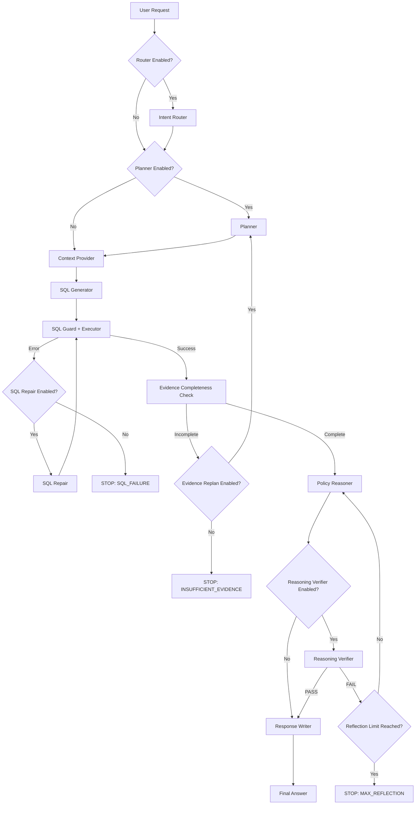

# 개선된 초기 Agent 기획서 v2

> 프로젝트 목적: 기존 Agent가 특정 세대의 LLM 한계를 보완하기 위해 갖고 있던 구조가, 더 성능이 높은 후속 LLM으로 교체된 뒤에도 여전히 필요한지 정량적으로 재평가하고, `KEEP / REMOVE / REDUCE / CONDITIONAL` 형태의 구조 변경을 추천하는 시스템을 위한 **연구용 Testbed Agent**를 구축한다.

---

# 0. 이번 개선판의 핵심 변경사항

기존 설계의 방향은 유지하되, 연구적으로 해석이 애매해질 수 있는 요소를 정리했다.

## 0.1 자동으로 반영한 수정사항

1. **Core Agent와 Experimental Scaffold를 분리**
   - “처음부터 일부러 복잡하게 만든 Agent”라는 비판을 피한다.
   - 실제 업무 수행에 필요한 Core와, 구형 LLM을 보완하기 위해 붙일 수 있는 보조 구조를 구분한다.

2. **Evidence 검증과 Reasoning 검증의 역할을 완전히 분리**
   - Evidence 단계는 “필요한 정보가 확보되었는가?”만 본다.
   - Reflection/Verifier 단계는 “확보된 정보를 올바르게 해석했는가?”만 본다.
   - 두 단계가 서로 같은 오류를 잡지 않도록 인터페이스를 제한한다.

3. **Policy를 단순 if문 수준에서 복합 정책으로 확장**
   - LLM Policy Reasoner를 사용할 이유가 생기도록 예외, 우선순위, 회원 등급, 카테고리 조건을 포함한다.
   - 단, Gold 정답은 여전히 Python 기반 deterministic oracle로 계산한다.

4. **Ablation 실험에서 한 번에 한 변수만 바뀌도록 설계**
   - Planner를 끌 때 Context가 함께 달라지는 문제를 제거한다.
   - 모든 ablation은 downstream 입력 인터페이스를 고정한다.

5. **Old Model에서 먼저 scaffold 유효성을 검증**
   - 구형 모델에서도 효과가 없던 component는 “모델 발전으로 불필요해진 구조”라고 주장하지 않는다.

6. **Fault Injection과 Natural Benchmark를 분리**
   - 자연적으로 발생하는 실패에서 scaffold utility를 측정하는 실험이 메인.
   - Fault Injection은 robustness test로만 사용한다.

7. **Self-Reflection의 평가 역할을 제한**
   - Reflection은 새로운 DB 조회를 요구하지 않는다.
   - 데이터 부족은 Evidence 단계에서만 처리한다.
   - Reflection은 오직 reasoning inconsistency와 policy application 오류만 검증한다.

8. **추천 결과를 단순 REMOVE/KEEP가 아니라 조건부 구조로 확장**
   - `KEEP`
   - `REMOVE`
   - `REDUCE`
   - `CONDITIONAL`
   - `REPLACE_WITH_CODE`
   를 구분할 수 있게 한다.

---

# 1. 연구 질문

이 프로젝트가 최종적으로 답해야 할 질문은 다음과 같다.

> **구형 LLM에서 성능 향상을 위해 필요했던 Agent scaffold가 신형 LLM에서도 동일한 효용을 가지는가?**

더 구체적으로는 다음을 측정한다.

1. Planner가 구형 모델에서는 필요한가?
2. 신형 모델에서도 Planner가 필요한가?
3. SQL Repair loop가 모델 성능 향상 후에도 필요한가?
4. Reflection loop 횟수를 줄여도 품질이 유지되는가?
5. Router가 신형 모델에서 제거 가능한가?
6. 특정 scaffold의 효용이 난이도에 따라 달라지는가?
7. 신형 모델에서는 어떤 구조를 유지하고 어떤 구조를 줄이는 것이 최적인가?

---

# 2. 초기 Agent의 정체

## 2.1 Agent 이름

**Order & Refund Policy Agent**

한국어: **주문·환불 정책 처리 Agent**

## 2.2 Agent의 역할

사용자가 주문, 배송, 취소, 환불에 대해 자연어로 질의하면 Agent가:

1. 요청을 이해하고,
2. 필요한 DB 정보를 조회하고,
3. 정책을 적용하고,
4. 결과를 판단하고,
5. 필요한 경우 스스로 오류를 수정하고,
6. 최종 응답을 생성한다.

## 2.3 중요한 점

이 Agent의 목적은 “최고 성능 고객상담 Agent”를 만드는 것이 아니다.

이 Agent는:

> **구형 LLM과 신형 LLM에서 Agent 구조의 필요성이 어떻게 달라지는지를 시험하기 위한 연구용 Testbed**

이다.

---

# 3. 구조 설계 원칙

## 3.1 Core와 Scaffold를 분리한다

### Core Components

업무 수행에 본질적으로 필요한 부분.

- Context Interface
- SQL Generator
- SQL Guard / Executor
- Policy Reasoner
- Final Response

### Experimental Scaffolds

모델 성능에 따라 필요성이 달라질 수 있는 부분.

- Intent Router
- Planner
- SQL Repair Loop
- Evidence Completeness Checker
- Reasoning Verifier / Reflection
- Reflection 반복 횟수
- Context Selection 방식

---

# 4. 최종 권장 Architecture



---

# 5. Core Agent

Core Agent는 모든 scaffold를 제거했을 때도 업무를 수행할 수 있어야 한다.

```text
User
 ↓
Context Provider
 ↓
SQL Generator
 ↓
SQL Guard + Executor
 ↓
Evidence Completeness Check
 ↓
Policy Reasoner
 ↓
Response
```

단, 여기서 Evidence Completeness Check는 **기본적으로 Code 기반 최소 검증**을 포함한다.

예:

```text
필수 field 존재 여부
NULL 여부
DB result empty 여부
```

이 최소 검증은 안전장치이므로 항상 유지한다.

Experimental Evidence Scaffold를 별도로 켜는 경우에만 LLM 기반 semantic evidence check를 추가한다.

---

# 6. 사용자 요청 처리 구조

## 6.1 입력

초기 버전은 single-turn 요청만 지원한다.

예:

```text
"A-10293 주문 환불 가능한가요?"
```

입력 객체:

```json
{
  "request_id": "REQ-0001",
  "user_query": "A-10293 주문 환불 가능한가요?"
}
```

---

# 7. N1 — Intent Router

## 7.1 목적

질의를 미리 정의한 업무 유형으로 분류한다.

초기 intent:

```text
ORDER_LOOKUP
REFUND_CHECK
CANCEL_CHECK
UNSUPPORTED
```

## 7.2 출력

```json
{
  "intent": "REFUND_CHECK",
  "confidence": 0.94
}
```

## 7.3 실험 목적

Router가 없을 때 Core Agent가 직접 요청을 처리해도 되는지 비교한다.

```text
Old Model:
Router ON vs OFF

New Model:
Router ON vs OFF
```

## 7.4 중요 통제 조건

Router OFF라고 해서 downstream input이 달라지면 안 된다.

권장 방법:

- Router ON: LLM intent 결과 사용
- Router OFF: user_query를 그대로 downstream으로 보내되, Context Provider가 query 기반 context selection 수행

즉 Router만 제거하고 나머지 입력 조건은 최대한 동일하게 유지한다.

---

# 8. N2 — Planner

## 8.1 목적

사용자 요청에 답하기 위해 필요한 정보와 처리 순서를 구조화한다.

출력 예:

```json
{
  "required_information": [
    "delivery_date",
    "product_category",
    "product_opened",
    "membership_level",
    "refund_history"
  ],
  "required_tables": [
    "orders",
    "shipments",
    "products",
    "customers",
    "refunds"
  ],
  "steps": [
    "retrieve order",
    "retrieve delivery state",
    "retrieve product condition",
    "retrieve membership",
    "retrieve prior refund",
    "apply refund policy"
  ]
}
```

## 8.2 Planner OFF 실험을 위한 인터페이스 고정

Planner OFF 시에도 Context Provider가 완전히 다른 동작을 하면 안 된다.

권장 두 모드:

### Mode A — Planner ON

```text
Question
+ Plan
→ Context Provider
```

### Mode B — Planner OFF

```text
Question
+ Empty Plan Object
→ 동일 Context Provider
```

Context Provider는 Planner가 없을 때 query 기반 fallback을 사용한다.

중요:

> Planner ablation에서 schema 양, policy 양, tool 권한까지 동시에 바뀌면 안 된다.

---

# 9. Context Provider

Context Provider는 DB schema와 policy context를 공급한다.

## 9.1 Context Mode

실험 가능하도록 최소 3가지 모드를 둔다.

```text
FULL_CONTEXT
RETRIEVED_CONTEXT
PLANNER_GUIDED_CONTEXT
```

### FULL_CONTEXT

모든 schema와 policy를 제공.

### RETRIEVED_CONTEXT

질문을 기준으로 관련 context만 선택.

### PLANNER_GUIDED_CONTEXT

Planner가 지정한 required_tables / policy type을 기준으로 선택.

## 9.2 연구 목적

신형 모델이 더 긴 context에서도 안정적으로 처리한다면 Retriever 필요성이 줄어들 수 있다.

반대로 신형 모델이라도 context selection이 여전히 도움이 될 수 있다.

---

# 10. SQL Generator

## 10.1 입력

```text
user_query
intent(optional)
plan(optional)
schema_context
```

## 10.2 출력

```json
{
  "sql": "SELECT ...",
  "expected_fields": [
    "delivery_date",
    "refundable",
    "membership_level"
  ]
}
```

## 10.3 역할

SQL Generator는 Core Component다.

주요 연구 대상은 “SQL Generator 제거”가 아니라:

- Planner의 도움
- Context 방식
- Repair loop의 도움

등이다.

---

# 11. SQL Guard + Executor

## 11.1 반드시 Code로 구현

LLM에 맡기지 않는다.

검사:

```text
SELECT only
INSERT 금지
UPDATE 금지
DELETE 금지
DROP 금지
ALTER 금지
multi-statement 차단
허용되지 않은 table 접근 차단
```

## 11.2 이유

deterministic하게 처리 가능한 부분을 일부러 LLM에 맡기면:

> “신형 모델 때문에 구조가 불필요해졌다”

가 아니라:

> “원래 설계를 잘못했다”

가 되기 때문이다.

---

# 12. SQL Repair Loop

## 12.1 동작

```text
SQL Generator
 ↓
Executor
 ↓ ERROR
SQL Repair
 ↓
Executor
```

## 12.2 입력

```text
failed_sql
error_type
error_message
schema_context
user_query
```

## 12.3 설정

```python
use_sql_repair = True
max_sql_retries = 0 | 1 | 2 | 3
```

## 12.4 측정

```text
Recovery Success Rate
Average Retry Count
Retry Marginal Gain
Retry Cost
Retry Latency
```

## 12.5 중요

SQL Repair는 자연적으로 발생한 오류에서의 성능과 Fault Injection에서의 성능을 분리해서 측정한다.

---

# 13. Evidence Completeness Check

기존 설계의 Evidence Critic 역할을 축소하고 명확하게 재정의한다.

## 13.1 Evidence 단계가 볼 수 있는 것

오직 다음만 검사한다.

```text
필수 데이터가 존재하는가?
필요한 field가 NULL인가?
결과가 비어 있는가?
요청 판단에 필요한 정보가 확보되었는가?
```

## 13.2 Evidence 단계가 보면 안 되는 것

다음은 금지한다.

```text
정책을 올바르게 적용했는가?
결론이 논리적으로 맞는가?
승인/거절 판단이 맞는가?
```

이건 Reasoning Verifier의 역할이다.

## 13.3 2단계 구현

### Level 1 — Code Check

항상 유지.

```python
required_fields <= returned_fields
```

### Level 2 — Semantic Evidence Checker

실험용 scaffold.

예:

```json
{
  "complete": false,
  "missing_information": [
    "whether product package was opened"
  ]
}
```

## 13.4 이유

Code 기반 검사와 LLM semantic 검사를 분리하면:

- 안전장치
- Agent scaffold

를 혼동하지 않는다.

---

# 14. 개선된 Policy 설계

기존의 단순 정책보다 복잡도를 높인다.

## 14.1 예시 Policy Set

### REFUND-01 — 기본 환불 기간

```text
일반 상품은 배송 완료 후 30일 이내 환불 가능.
```

### REFUND-02 — 전자제품 예외

```text
전자제품은 개봉 전 30일 이내 환불 가능하지만,
개봉된 경우 배송 완료 후 7일 이내만 환불 가능.
```

### REFUND-03 — 회원 혜택

```text
PREMIUM 회원은 일반 상품 환불 기간을 15일 연장할 수 있다.
```

### REFUND-04 — 회원 혜택 예외

```text
FINAL_SALE 상품에는 PREMIUM 환불 연장 혜택을 적용하지 않는다.
```

### REFUND-05 — 회사 귀책 예외

```text
오배송 또는 파손 배송이 확인된 경우 기간 제한과 관계없이 환불 검토 대상이다.
```

### REFUND-06 — 중복 환불 방지

```text
이미 환불 완료된 주문은 다시 환불할 수 없다.
```

### REFUND-07 — 결제 실패

```text
결제 실패 상태의 주문은 환불이 아니라 결제 오류 처리 대상으로 분류한다.
```

---

# 15. 왜 Policy를 복잡하게 하는가

정책이 다음과 같다면:

```python
if days <= 30:
    approve
```

LLM Policy Reasoner를 사용할 이유가 없다.

반면 복합 정책에서는 다음이 필요하다.

```text
배송일
상품 카테고리
개봉 여부
회원 등급
할인 유형
오배송 여부
환불 이력
```

그리고 여러 규칙의 우선순위를 해석해야 한다.

즉:

> **Gold는 deterministic하지만 Agent에게는 multi-condition reasoning 문제가 된다.**

---

# 16. Policy Oracle

정답은 반드시 별도 Python 코드로 계산한다.

예:

```python
def refund_oracle(case):
    if case.refund_status == "COMPLETED":
        return "REJECTED"

    if case.payment_status == "FAILED":
        return "PAYMENT_ERROR"

    if case.company_fault is True:
        return "APPROVED"

    limit = 30

    if case.category == "ELECTRONICS" and case.opened:
        limit = 7

    if (
        case.membership == "PREMIUM"
        and case.sale_type != "FINAL_SALE"
        and case.category != "ELECTRONICS"
    ):
        limit += 15

    if case.days_since_delivery <= limit:
        return "APPROVED"

    return "REJECTED"
```

중요:

> Agent의 이전 답변은 절대 Gold가 아니다.

---

# 17. Policy Reasoner

## 17.1 입력

```text
user_query
sql_result
policy_context
```

## 17.2 출력

```json
{
  "decision": "APPROVED",
  "applied_clauses": [
    "REFUND-01",
    "REFUND-03"
  ],
  "evidence": {
    "days_since_delivery": 34,
    "membership": "PREMIUM",
    "sale_type": "NORMAL"
  },
  "reason": "..."
}
```

## 17.3 핵심

Reasoner는 Core Component로 본다.

다만 추후 확장 실험으로:

```text
LLM Reasoner
vs
Rule Engine
vs
Hybrid
```

비교는 가능하다.

이 비교는 **선택적 확장 연구**로 둔다.

---

# 18. Reasoning Verifier / Reflection

기존 Self Reflection을 재정의한다.

## 18.1 역할

오직 reasoning correctness를 검증한다.

검사 대상:

```text
정책 누락
정책 우선순위 오류
evidence와 decision의 모순
잘못된 예외 적용
잘못된 날짜 조건 해석
```

## 18.2 금지

Reflection은 다음을 하면 안 된다.

```text
새로운 DB 조회 요청
누락된 field 검색
새로운 SQL 생성
```

데이터 부족은 Evidence 단계에서 이미 처리한다.

## 18.3 출력

```json
{
  "status": "FAIL",
  "reasoning_issues": [
    "REFUND-04 exception was ignored."
  ]
}
```

## 18.4 Loop

```text
Policy Reasoner
 ↓
Reasoning Verifier
 ↓ FAIL
Policy Reasoner
```

## 18.5 설정

```python
use_reasoning_verifier = True
max_reflections = 0 | 1 | 2 | 3
```

---

# 19. Reflection 실험에서 반드시 분리할 것

같은 모델이 reasoner와 verifier를 모두 맡으면 같은 오류가 반복될 수 있다.

최소 실험:

```text
Case A
Reasoner = MODEL_A
Verifier = MODEL_A

Case B
Reasoner = MODEL_A
Verifier = 동일 모델 + 별도 비판 전용 Prompt / Role

선택적 확장:
Reasoner = MODEL_A
Verifier = MODEL_B
```

단, Core 연구에서는 모델을 바꾸는 변수와 Verifier 모델을 바꾸는 변수를 동시에 건드리지 않는다.

---

# 20. Agent State

```python
class AgentState(TypedDict, total=False):

    request_id: str
    user_query: str

    intent: str
    intent_confidence: float

    plan: dict
    required_information: list[str]
    required_tables: list[str]

    schema_context: str
    policy_context: str
    context_mode: str

    sql: str
    sql_history: list[str]

    sql_result: list[dict]
    sql_success: bool
    sql_error_type: str | None
    sql_error_message: str | None
    sql_retry_count: int

    code_evidence_complete: bool
    semantic_evidence_complete: bool
    missing_information: list[str]
    evidence_replan_count: int

    policy_decision: str
    applied_policy_clauses: list[str]
    policy_reason: str
    policy_evidence: dict

    verifier_status: str
    verifier_issues: list[str]
    reflection_count: int

    final_answer: str

    stop_reason: str | None
    total_step_count: int

    trace: list[dict]
```

---

# 21. Config

```python
AGENT_CONFIG = {

    "use_router": True,
    "use_planner": True,

    "context_mode": "PLANNER_GUIDED_CONTEXT",

    "use_sql_repair": True,
    "max_sql_retries": 2,

    "use_semantic_evidence_checker": True,
    "max_evidence_replans": 1,

    "use_reasoning_verifier": True,
    "max_reflections": 2,

    "max_total_steps": 30,

    "max_total_tokens": None,
    "max_total_latency_ms": None
}
```

---

# 22. Model Config

```python
MODEL_CONFIG = {

    "router": "MODEL_A",
    "planner": "MODEL_A",

    "sql_generator": "MODEL_A",
    "sql_repair": "MODEL_A",

    "semantic_evidence_checker": "MODEL_A",

    "policy_reasoner": "MODEL_A",
    "reasoning_verifier": "MODEL_A",

    "response_writer": "MODEL_A"
}
```

---

# 23. Main Request Path

정상 처리:

```text
User
 ↓
Router(optional)
 ↓
Planner(optional)
 ↓
Context Provider
 ↓
SQL Generator
 ↓
SQL Executor
 ↓
Evidence Completeness
 ↓
Policy Reasoner
 ↓
Reasoning Verifier(optional)
 ↓
Response
```

---

# 24. Agent 내부 Loop

## 24.1 Loop A — SQL Repair

```text
SQL
 ↓
Execute
 ↓ ERROR
Repair
 ↓
Execute
```

종료:

```text
SUCCESS
MAX_SQL_RETRY
UNRECOVERABLE_ERROR
TOTAL_STEP_LIMIT
```

## 24.2 Loop B — Evidence Recovery

```text
SQL Result
 ↓
Evidence Check
 ↓ Missing
Planner / Context Replan
 ↓
SQL
 ↓
Execute
```

종료:

```text
COMPLETE
MAX_EVIDENCE_REPLAN
TOTAL_STEP_LIMIT
```

## 24.3 Loop C — Reasoning Reflection

```text
Policy Reasoner
 ↓
Verifier
 ↓ FAIL
Policy Reasoner
```

종료:

```text
PASS
MAX_REFLECTION
TOTAL_STEP_LIMIT
```

---

# 25. Loop 간 역할 충돌 방지 규칙

## SQL Repair

볼 수 있는 것:

```text
SQL syntax
schema mismatch
execution error
```

볼 수 없는 것:

```text
policy correctness
business decision
```

## Evidence Check

볼 수 있는 것:

```text
missing data
empty result
NULL evidence
```

볼 수 없는 것:

```text
decision correctness
```

## Reasoning Verifier

볼 수 있는 것:

```text
policy application
logical consistency
exception handling
```

볼 수 없는 것:

```text
새로운 DB 조회
새 SQL 생성
```

---

# 26. Logging

각 LLM Node:

```json
{
  "request_id": "REQ-0001",
  "node": "POLICY_REASONER",
  "model": "MODEL_A",
  "iteration": 0,
  "input_tokens": 1200,
  "output_tokens": 180,
  "latency_ms": 1700,
  "success": true,
  "error_type": null
}
```

Request 전체:

```json
{
  "request_id": "REQ-0001",
  "sql_correct": true,
  "policy_correct": true,
  "e2e_correct": true,
  "total_llm_calls": 6,
  "total_tokens": 6200,
  "total_latency_ms": 7200,
  "sql_retry_count": 1,
  "evidence_replan_count": 0,
  "reflection_count": 1,
  "stop_reason": "PASS"
}
```

---

# 27. 평가 지표

## 27.1 SQL Execution Accuracy

Gold SQL 문자열과 비교하지 않는다.

```text
Gold SQL 실행 결과
vs
Agent SQL 실행 결과
```

## 27.2 Policy Accuracy

```text
Policy Oracle
vs
Agent Policy Reasoner
```

## 27.3 End-to-End Accuracy

```text
SQL Correct
AND
Policy Correct
```

## 27.4 Recovery Success Rate

```text
복구 성공 건수 / 실제 실패 발생 건수
```

## 27.5 Unnecessary Loop Rate

처음부터 정답이었는데 추가 loop가 수행된 비율.

## 27.6 Cost

```text
LLM Calls
Input Tokens
Output Tokens
Latency
API Cost
```

---

# 28. Natural Benchmark와 Fault Injection 분리

## 28.1 Main Result — Natural Benchmark

LLM이 실제로 발생시킨 오류를 대상으로 평가.

예:

```text
SQL 자연 오류
Evidence 부족
Reasoning 오류
```

여기에서 scaffold의 실제 utility를 측정한다.

## 28.2 Robustness Result — Fault Injection

의도적으로 오류를 넣는다.

### SQL Fault

```text
잘못된 table
잘못된 column
잘못된 JOIN
```

### Evidence Fault

```text
필수 field 누락
NULL field
partial result
```

### Policy Fault

```text
잘못된 초기 decision
예외 rule 누락
우선순위 오류
```

중요:

> Fault Injection 결과를 scaffold의 “일반 성능 개선” 증거로 사용하지 않는다.

---

# 29. Old Model Baseline 검증

최종 Model Upgrade 실험 전에 반드시 수행한다.

## 29.1 목적

각 scaffold가 Legacy Model에서 실제로 유용했는지 확인한다.

예:

| Architecture | Old Model E2E |
|---|---:|
| Core | 76.0% |
| + Planner | 84.2% |
| + Repair | 89.1% |
| + Verifier | 92.5% |
| Full | 94.0% |

---

# 30. Legacy Utility Gate

다음 조건을 만족하지 못하는 component는 Model Evolution 분석 대상에서 제외한다.

예시 개념:

```text
Legacy Utility(component)
=
Quality_ON - Quality_OFF
```

예:

```text
Planner
Old Model Utility = +8.2%p
→ Valid Legacy Scaffold

Router
Old Model Utility = +0.2%p
→ 이미 Old Model에서도 불필요
→ Model Evolution 효과로 주장하지 않음
```

---

# 31. New Model Upgrade 실험

동일 Architecture를 유지한 상태에서 모델만 바꾼다.

통제:

```text
same prompt
same database
same policies
same tools
same test set
same temperature
same max_tokens
same context
same component config
```

변수:

```text
MODEL_A
→
MODEL_B
```

---

# 32. Ablation 설계

## 32.1 One-at-a-Time

```text
Full
- Router
- Planner
- Repair
- Semantic Evidence Checker
- Reasoning Verifier
```

---

# 33. Ablation 시 입력조건 고정

예:

### Planner ON

```text
Question
+ Planner Output
+ Context
```

### Planner OFF

```text
Question
+ Empty Planner Object
+ 동일 Context Interface
```

즉 한 실험에서 한 component만 바뀌게 한다.

---

# 34. Component Interaction 실험

핵심 scaffold 3개는 조합 실험을 수행한다.

추천:

```text
Planner
SQL Repair
Reasoning Verifier
```

가능한 조합:

```text
000
001
010
011
100
101
110
111
```

총 8개.

이 결과를 통해:

```text
Planner가 Verifier가 없을 때만 도움이 되는가?
Repair와 Planner가 상호보완적인가?
Verifier와 Planner가 중복되는가?
```

를 분석할 수 있다.

---

# 35. 난이도별 분석

전체 평균만 보면 안 된다.

질문 난이도:

```text
Easy
Medium
Hard
Extra Hard
```

각 component utility를 난이도별로 계산한다.

예:

```text
Planner Utility

Easy       +0.2%p
Medium     +1.3%p
Hard       +7.4%p
Extra Hard +11.2%p
```

이 경우 최종 추천은:

```text
Planner
→ Easy/Medium: REMOVE
→ Hard/Extra Hard: KEEP
```

즉 `CONDITIONAL` 추천이 된다.

---

# 36. 추천 유형

최종 시스템은 최소 다음을 지원한다.

## KEEP

제거 시 품질 저하가 큼.

## REMOVE

품질 향상은 거의 없고 비용만 증가.

## REDUCE

Loop 횟수 등은 줄일 수 있음.

예:

```text
Reflection 3 → 1
```

## CONDITIONAL

난이도/질문 유형에 따라 사용.

예:

```text
Planner
Easy  → OFF
Hard  → ON
```

## REPLACE_WITH_CODE

LLM일 필요가 없는 deterministic 작업.

예:

```text
SQL safety validation
output format validation
```

---

# 37. 추천 규칙의 기본 개념

단순 cost만 보고 삭제하지 않는다.

먼저 Quality Constraint를 확인한다.

개념:

```text
Quality Loss <= 허용 오차 δ
```

그리고:

```text
Cost Reduction
Latency Reduction
Token Reduction
LLM Call Reduction
```

을 본다.

---

# 38. 추천 예시

```text
Component:
Planner

Old Model Utility:
+9.8%p

New Model Utility:
+0.4%p

New Model Cost:
+1 LLM call
+1,300 tokens
+1.2 sec

Recommendation:
REMOVE

Reason:
New model preserves quality without planner.
```

---

# 39. Loop Recommendation 예시

```text
Reflection

Old Model:
0회 = 82%
1회 = 91%
2회 = 94%
3회 = 95%

New Model:
0회 = 95.1%
1회 = 96.5%
2회 = 96.6%
3회 = 96.6%

Recommendation:
REDUCE 3 → 1
```

---

# 40. Test Set 구조

```json
{
  "question_id": "Q001",
  "question": "A-10293 주문 환불 가능한가요?",
  "intent": "REFUND_CHECK",
  "difficulty": "medium",
  "required_tables": [
    "orders",
    "shipments",
    "products",
    "customers",
    "refunds"
  ],
  "required_fields": [
    "delivery_date",
    "category",
    "opened",
    "membership_level",
    "refund_status"
  ],
  "gold_sql": "SELECT ...",
  "gold_result": {},
  "gold_policy_decision": "APPROVED",
  "gold_policy_clauses": [
    "REFUND-01",
    "REFUND-03"
  ]
}
```

---

# 41. DB 구조

권장:

```text
customers
orders
products
shipments
payments
refunds
delivery_issues
```

---

# 42. 추가 권장 필드

## customers

```text
customer_id
membership_level
region
```

## products

```text
product_id
category
opened
sale_type
refundable
```

## shipments

```text
delivery_date
delivery_status
damaged
wrong_item
```

## refunds

```text
refund_status
request_date
```

---

# 43. 개발 단계

## Phase 1 — Core DB

- SQLite 생성
- synthetic data 생성
- Policy Oracle 생성
- 20개 test case

## Phase 2 — Minimal Core Agent

```text
Question
→ Context
→ SQL
→ DB
→ Policy
→ Answer
```

## Phase 3 — Planner / Router

추가 후 정상 동작 확인.

## Phase 4 — SQL Repair

자연 오류 + Fault Injection 테스트.

## Phase 5 — Evidence Check

Code evidence check 먼저.

그 다음 optional semantic checker.

## Phase 6 — Reasoning Verifier

Reasoning 오류만 검사하도록 제한.

## Phase 7 — Config / ON-OFF

모든 scaffold를 config로 제어.

## Phase 8 — Logging

Node별 trace 저장.

## Phase 9 — Old Model Baseline

Legacy Utility 측정.

## Phase 10 — New Model Upgrade

동일 실험 반복.

## Phase 11 — Migration Recommendation

KEEP / REMOVE / REDUCE / CONDITIONAL 생성.

---

# 44. 프로젝트 폴더 구조

```text
agent_project/

├── app.py
├── config.py

├── graph/
│   ├── state.py
│   ├── build_graph.py
│   └── routers.py

├── core/
│   ├── context_provider.py
│   ├── sql_generator.py
│   ├── sql_executor.py
│   ├── policy_reasoner.py
│   └── response_writer.py

├── scaffolds/
│   ├── intent_router.py
│   ├── planner.py
│   ├── sql_repair.py
│   ├── semantic_evidence_checker.py
│   └── reasoning_verifier.py

├── tools/
│   ├── database.py
│   ├── sql_guard.py
│   └── policy_loader.py

├── policies/
│   ├── policy_text.json
│   └── policy_oracle.py

├── evaluation/
│   ├── sql_eval.py
│   ├── policy_eval.py
│   ├── e2e_eval.py
│   ├── natural_benchmark.py
│   ├── fault_injection.py
│   ├── ablation_runner.py
│   ├── interaction_runner.py
│   └── migration_analyzer.py

├── observability/
│   ├── trace_logger.py
│   └── metrics.py

├── data/
│   ├── shop.db
│   └── test_cases.json

└── results/
    ├── baseline/
    ├── new_model/
    ├── ablation/
    └── migration/
```

---

# 45. Definition of Done

## 업무 수행

- [ ] 자연어 질의 입력
- [ ] SQL 생성
- [ ] SQLite 실행
- [ ] 복합 정책 reasoning
- [ ] 구조화된 decision 출력
- [ ] 사용자용 응답 생성

## Loop

- [ ] SQL Repair
- [ ] Evidence Recovery
- [ ] Reasoning Reflection
- [ ] Loop별 최대 횟수
- [ ] stop_reason 기록

## 실험

- [ ] Router ON/OFF
- [ ] Planner ON/OFF
- [ ] Repair ON/OFF
- [ ] Semantic Evidence Checker ON/OFF
- [ ] Reasoning Verifier ON/OFF
- [ ] Reflection 횟수 변경
- [ ] 모델 교체
- [ ] Node별 모델 변경 가능

## 평가

- [ ] SQL Execution Accuracy
- [ ] Policy Accuracy
- [ ] E2E Accuracy
- [ ] Token
- [ ] Cost
- [ ] Latency
- [ ] LLM Call Count
- [ ] Retry Count
- [ ] Reflection Count

## 연구 조건

- [ ] Old Model Legacy Utility 측정
- [ ] Low-utility legacy component 분리
- [ ] New Model 동일 ablation 수행
- [ ] 난이도별 utility 계산
- [ ] component interaction 실험
- [ ] migration recommendation 출력

---

# 46. 현재 시점에서 선택적으로 결정해야 할 항목

다음은 구조 문제가 아니라 **연구 설계 선택**이므로 지금 강제로 확정하지 않는다.

## 46.1 Old / New Model Pair

결정 필요.

선정 원칙:

- 동일 계열의 세대 차이
- reasoning/tool-use 능력 차이가 설명 가능
- API 사용 가능
- 실험 비용 감당 가능

---

## 46.2 허용 품질 저하 δ

예:

```text
0.5%p
1.0%p
2.0%p
```

얼마까지 quality loss를 허용할지 정해야 한다.

이 값은 최종 migration recommendation에 직접 영향을 준다.

---

## 46.3 Policy 난이도 수준

선택:

```text
Level 1
기본 조건 3~4개

Level 2
예외 + 회원 조건

Level 3
예외 + 우선순위 + 복수 정책 상호작용
```

초기 개발은 Level 1~2,
최종 실험은 Level 2~3 권장.

---

## 46.4 Dataset

선택지:

```text
직접 만든 synthetic 주문 DB
공개 Text-to-SQL dataset 일부 활용
혼합
```

초기 구현은 synthetic DB가 가장 빠르다.

최종 논문에서는 공개 benchmark 일부를 추가하면 외부 타당성이 높아진다.

---

## 46.5 Semantic Evidence Checker를 핵심 Scaffold로 둘지 여부

선택 가능.

### 선택 A

Code-based Evidence Check만 사용.

장점:
- 연구 구조가 단순
- 역할 중복 없음

### 선택 B

LLM Semantic Evidence Checker 추가.

장점:
- 더 복잡한 evidence sufficiency 실험 가능

권장:

> 초기 Agent에서는 Code Check를 기본으로 만들고, Semantic Checker는 실험 확장 기능으로 구현한다.

---

## 46.6 Response Writer를 연구 대상에 포함할지

권장:

> 구현은 하지만 핵심 architecture migration 분석에서는 제외.

Reason:
Response Writer는 업무 표현 layer에 가깝고 Planner/Repair/Reflection보다 모델 구조 변화와 직접적인 관련성이 약하다.

---

# 47. 나중에 고려할 확장 아이디어

## 47.1 Difficulty-aware Routing

```text
Easy
→ Minimal Agent

Hard
→ Full Agent
```

최종 시스템이 구조를 질문별로 동적으로 선택.

---

## 47.2 Hybrid Model Routing

```text
Easy Planner
→ Small Model

Hard SQL
→ Large Model
```

---

## 47.3 Automatic Architecture Search

가능한 scaffold 조합을 자동 탐색.

예:

```text
2^5 = 32 architecture combinations
```

---

## 47.4 Cross-Domain Validation

주문/환불 Agent에서 얻은 migration rule이 다른 Agent에서도 성립하는지 확인.

예:

```text
IT Helpdesk
HR Policy
Internal Data Analyst
```

이 단계는 후속 연구로 두는 것이 좋다.

---

# 48. 최종 권장 구조 요약

```text
========================================
CORE
========================================

User
 ↓
Context
 ↓
SQL Generator
 ↓
SQL Executor
 ↓
Evidence Minimum Check
 ↓
Policy Reasoner
 ↓
Response


========================================
EXPERIMENTAL SCAFFOLDS
========================================

Router
Planner
SQL Repair
Semantic Evidence Checker
Reasoning Verifier


========================================
LOOPS
========================================

SQL Error
→ Repair
→ Execute

Missing Evidence
→ Replan
→ Query

Reasoning Error
→ Re-Reason
→ Verify


========================================
RESEARCH
========================================

Old Model
→ Scaffold Utility 측정

New Model
→ 동일 Utility 측정

Utility 변화
→ Migration Recommendation

KEEP
REMOVE
REDUCE
CONDITIONAL
REPLACE_WITH_CODE
```

---

# 49. 최종 핵심 명제

이 프로젝트가 최종적으로 증명해야 할 것은:

> **신형 LLM이 더 좋은가?**

가 아니다.

증명해야 하는 것은:

> **LLM 능력이 향상되면 기존 Agent의 일부 scaffold가 더 이상 동일한 가치가 없을 수 있으며, 그 변화를 측정해 구조 변경을 자동 추천할 수 있는가?**

이다.

따라서 초기 Agent는 많은 기능을 넣는 것보다:

> **각 기능의 효용을 독립적으로 측정하고, 제거하고, 축소하고, 조건부로 사용할 수 있는 구조**

로 만드는 것이 가장 중요하다.
