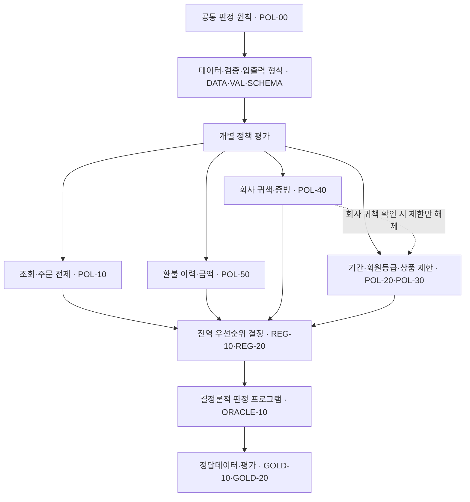
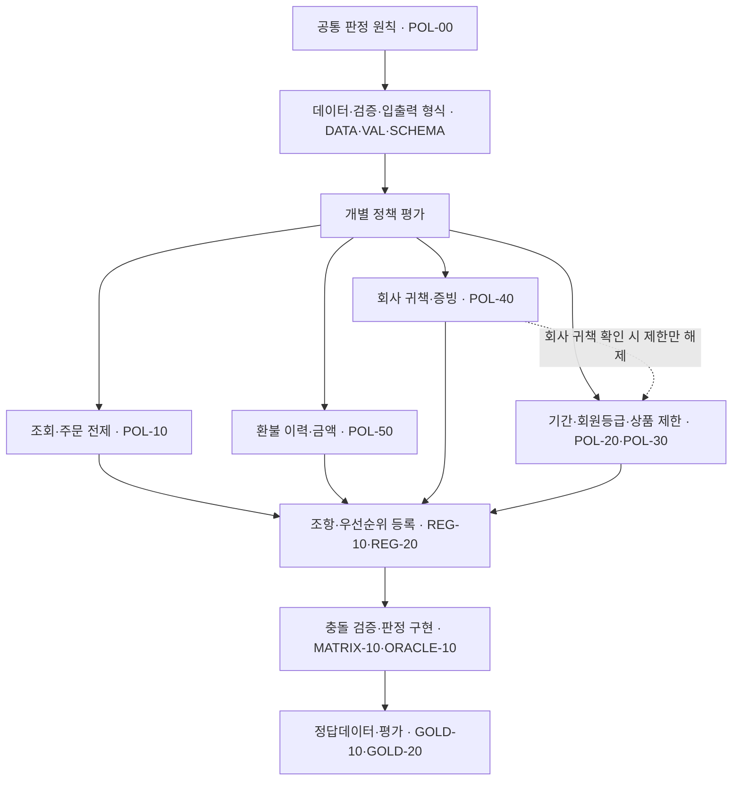

# 정책

> **통합 원본:** [Notion 페이지](https://www.notion.so/3bc8e7a81b7b80caabfed4d13e0ad51c)
> **포함 범위:** 상위 페이지 1개와 재귀적으로 발견된 하위 페이지 18개
> **통합 방식:** 하위 페이지 링크 위치에 각 페이지의 실제 본문을 펼쳐서 포함

## 1. 최종 계약

- **판정 대상:** Order Item의 전액 환불 자격을 읽기 전용으로 판정

- **최종 출력:** SCHEMA-20 DecisionResult

- **입력 기준:** DATA-10과 SCHEMA-10을 충족한 canonical PolicyFacts. JSON 파싱·Input Schema 실패는 판정 결과가 아니라 Harness의 INPUT_REJECTED

- **우선순위 기준:** REG-20의 terminal priority

- **판정 기준 구현:** ORACLE-10

- **정답 원장:** GOLD-10 작성·변경 계약과 발행 완료된 GOLD-20 Representative-20. 현재 v0.5 GOLD-20은 발행 대기이므로 재생성·독립 검토 전에는 baseline이 없음

- **P0:** 계약 위반 시 build 실패

- **P1:** 판정 의미를 바꾸지 않는 성능·운영 telemetry만 관찰. 정합성·보안·결정론 기준은 P0로 이미 고정

### 1.1 환불 정책

> 👤
>
> 아래 내용은 운영자·개발자·검토자가 다른 문서를 찾아보지 않아도 환불 정책과 판정 과정을 이해할 수 있도록 작성한 규범 문장입니다. 정책 번호는 구현과 시험에서 같은 규칙을 가리키기 위한 식별자입니다.

| 정책 | 적용 조건 | 판정과 후속 처리 |
| --- | --- | --- |
| REFUND-01 기본 기간 | 일반 회원의 일반 상품은 배송 완료일을 0일째로 계산하여 14일째까지 전액 환불할 수 있습니다. | 다른 거절 사유나 확인할 정보가 없으면 환불을 승인합니다. 15일째부터는 환불 가능 기간이 지났으므로 거절합니다. |
| REFUND-02 전자제품 개봉 제한 | 전자제품이 개봉된 것으로 확인되면 회원 등급이나 남은 환불 기간과 관계없이 일반 환불 대상에서 제외합니다. | 환불을 거절합니다. 다만 회사 책임으로 발생한 문제임이 확인되면 개봉 제한을 적용하지 않습니다. |
| REFUND-03 프리미엄 회원 기간 연장 | 주문 당시 프리미엄 회원은 배송 완료일을 0일째로 계산하여 30일째까지 전액 환불할 수 있습니다. | 다른 거절 사유나 확인할 정보가 없으면 환불을 승인합니다. 31일째부터는 환불 가능 기간이 지났으므로 거절합니다. 프리미엄 혜택은 최종 할인 판매 상품, 개봉 전자제품, 중복 환불 제한을 해제하지 않습니다. |
| REFUND-04 최종 할인 판매 제한 | 최종 할인 판매로 지정된 상품은 환불 기간 안이거나 프리미엄 회원이더라도 일반 환불 대상에서 제외합니다. | 환불을 거절합니다. 다만 회사 책임으로 발생한 문제임이 확인되면 이 제한을 적용하지 않습니다. |
| REFUND-05 회사 귀책 예외 | 오배송, 파손, 구성품 누락 또는 제품 결함이 회사의 인증된 증빙 시스템에서 확인된 경우 환불 예외 검토 대상입니다. | VERIFIED이면 기간 초과, Final Sale, 개봉 전자제품 제한만 해제합니다. 데이터·환불 이력·통화·금액 오류는 해제하지 않습니다. PENDING이면 증빙 검토를 기다리고, REJECTED이면 회사 귀책 예외만 제거한 뒤 일반 정책으로 판단합니다. 회사 귀책 반품비는 item 환불액에서 차감하지 않으며 실제 지급·회수는 별도 실행기가 처리합니다. |

**증빙 기각의 의미:** 증빙이 기각되었다는 이유만으로 환불을 즉시 거절하지 않습니다. 회사 귀책 예외를 적용하지 않는다는 뜻이며, 배송 후 경과 기간, 주문 당시 회원 등급, 상품 상태 및 환불 이력에 따라 최종 결과를 결정합니다. 포장 개봉만으로 고객 과실을 추정하거나, VERIFIED 회사 귀책을 이유로 중복 환불·통화·금액 오류를 무시할 수 없습니다.

> 📌
>
> **수치 규칙의 단일 기준:** 현재 정책은 일반 회원 14일, 프리미엄 회원 30일, 개봉 전자제품은 일반 환불 대상에서 제외하는 것으로 확정되어 있습니다. 외부 기획 초안에 있는 일반 상품 30일, 개봉 후 7일, 프리미엄 회원 15일 추가 연장 규칙은 현재 적용하지 않습니다. 수치를 변경하려면 정책 문서, 판정 프로그램, 정답데이터와 버전을 모두 함께 변경해야 합니다.

### 1.2 환불 판정이 진행되는 순서

1. **입력 계약을 확인합니다.** JSON 파싱, 필수 키, 기본 type 또는 JSON safe integer 범위가 틀리면 판정을 시작하지 않고 Harness가 INPUT_REJECTED로 기록합니다. SCHEMA-10을 통과한 뒤 발견되는 enum·null·범위·날짜 의미 오류만 UNDETERMINED 판정과 정보 확인 대상으로 처리합니다.

1. **필수 데이터를 조회합니다.** 주문, 주문 당시 고객 정보, 상품 정보와 배송 정보가 각각 정확히 한 건 존재하고 같은 주문을 가리키는지 확인합니다. 누락·중복·참조 불일치가 있으면 판정을 중단하고 데이터 확인을 요청합니다.

1. **주문 상태를 확인합니다.** 배송 완료 주문만 환불 정책을 계속 평가합니다. 결제 완료 또는 배송 중 주문은 취소 절차로 안내하고, 이미 취소된 주문은 새 환불 대상으로 처리하지 않습니다.

1. **같은 주문 항목의 환불 이력을 확인합니다.** `order_item_id`가 같은 이력만 사용합니다. 이미 승인·완료된 환불이 있으면 새 전액 환불을 거절하고, 처리 중 요청이 있으면 새 판정을 만들지 않습니다. 종료된 REJECTED 요청의 ID도 새 요청 ID로 재사용할 수 없습니다.

1. **통화와 요청 금액을 확인합니다.** `requested_amount=null`은 전액 요청을 뜻하는 명시적 sentinel이며 원래 facts에는 null로 남깁니다. 그 밖의 통화·금액 오류는 판정을 보류합니다. 결제액보다 큰 요청은 거절하고, 작은 요청은 수동 검토로 보내며, 같은 금액만 자동 전액 판정을 계속합니다.

1. **회사 귀책 증빙을 확인합니다.** 증빙이 확인 중이면 Evidence Service 검토 큐로 보내며 사용자나 Agent가 provenance를 만들 수 없습니다. 상태·사유·출처 조합이 모순되면 내부 데이터 복구 대상으로 보류합니다. VERIFIED이면 예외 적용 대상으로 표시하고, REJECTED이면 회사 귀책 예외만 적용하지 않은 채 일반 정책을 계속 평가합니다.

1. **회원 등급, 배송 후 경과 기간과 상품 상태를 확인합니다.** 일반 회원은 14일, 주문 당시 프리미엄 회원은 30일을 적용합니다. 최종 할인 판매 상품인지, 전자제품이 개봉되었는지도 함께 확인합니다.

1. **충돌하는 규칙의 우선순위를 적용합니다.** 데이터 오류, 기존 환불과 금액 문제는 회사 귀책보다 먼저 처리합니다. 이러한 문제가 없고 회사 귀책이 확인되면 기간 초과·최종 할인 판매·개봉 전자제품 제한을 적용하지 않고 승인합니다. 회사 귀책이 확인되지 않았으면 최종 할인 판매, 개봉 전자제품, 기간 초과 순으로 대표 거절 사유를 정합니다.

1. **최종 결과를 기록합니다.** 승인·거절·판정 보류 또는 다른 절차로의 전환 결과와 함께 적용된 모든 정책 근거, 사용한 사실, 데이터·정책·정답데이터 버전을 저장합니다. `required_fields`는 VAL-10 알고리즘으로만 파생하며 `/request/*`만 요청자에게, evidence와 내부 데이터 경로는 각각 담당 시스템 큐로 전달합니다.

## 2. 규범 적용 순서

| 단계 | 문서 | 구현자가 고정해야 할 내용 |
| --- | --- | --- |
| 1 | [POL-00 공통 판정 원칙](https://app.notion.com/p/3bc4a1a82b518108b43ae2e0e0f80d3d) | 범위, 결정론, 출력 불변식, 회사 귀책 override 경계 |
| 2 | [VAL-10](https://app.notion.com/p/3bc4a1a82b518177940cc385cde054ad), [DATA-10](https://app.notion.com/p/3bc4a1a82b5181a4b629dfc14efbab66), [SCHEMA-10](https://app.notion.com/p/3bc4a1a82b5181c783b3e18e12ac765e), [SCHEMA-20](https://app.notion.com/p/3bc4a1a82b5181e78773c7c962854082) | 검증 소유권, 입력 정규화, 필드 타입·도메인, 출력 Schema |
| 3 | [POL-10](https://app.notion.com/p/3bc4a1a82b51815fbc43ff90cfded3cc) ~ [POL-50](https://app.notion.com/p/3bc4a1a82b5181599508f0e4ff179390) | 조회·주문·환불이력, 상품·기간, 회사 귀책의 clause predicate |
| 4 | [REG-10](https://app.notion.com/p/3bc4a1a82b51812086dbdc05c06c82fc), [REG-20](https://app.notion.com/p/3bc4a1a82b5181868f6cd35fcad5c007), [MATRIX-10](https://app.notion.com/p/3bc4a1a82b5181338e67c71c87dc23c7) | reason code, terminal priority, 충돌·override 결과 |
| 5 | [ORACLE-10](https://app.notion.com/p/3bc4a1a82b51810f9346da4a163d690e) | 정렬·평가 순서와 deterministic reference algorithm |
| 6 | [GOLD-10](https://app.notion.com/p/3bc4a1a82b51810ba2eee5a0e8f9c1ae), [GOLD-20](https://app.notion.com/p/3bc4a1a82b518180970fff7fe8b2bd48) | 독립 검토된 expected_result, facts_hash, version vector |

## 3. 구현 알고리즘 계약

1. 원천 데이터를 DATA-10 규칙으로 canonical PolicyFacts에 매핑합니다.

1. Harness가 JSON parse와 SCHEMA-10을 검사합니다. 실패하면 INPUT_REJECTED로 종료하고 DecisionResult를 생성하지 않습니다.

1. Schema를 통과한 입력만 VAL-10 semantic validation으로 보내 오류 소유자를 하나로 고정합니다.

1. 의존 필드가 유효한 모든 clause predicate를 short-circuit 없이 평가합니다.

1. 업무 terminal이 없을 때만 POL-00.08 fallback을 추가하고, REG-20의 terminal match 중 최소 priority를 primary로 선택합니다.

1. matched, overridden, required_fields를 규정된 정렬·파생 순서로 직렬화합니다.

1. SCHEMA-20 형식으로 DecisionResult를 생성하고 RFC 8785 JCS facts의 SHA-256을 facts_hash로 기록합니다.

1. 10개 version vector가 모두 일치할 때만 GOLD-20과 비교합니다.

> 🚫
>
> 사용자 자연어, 현재 시각, 현재 회원등급, 모델 추론, Oracle·Gold 결과를 정책 사실로 사용하면 안 됩니다. 명시되지 않은 값을 추정하거나 구현자가 임의의 예외를 추가하는 것도 금지합니다.

## 4. 정책 종속관계 플로우차트



- POL-10의 조회·주문 전제와 POL-50의 환불 이력·금액 문제는 회사 귀책 예외보다 먼저 처리합니다.

- POL-40에서 회사 귀책이 확인되면 POL-20의 기간 초과와 POL-30의 최종 할인 판매·개봉 전자제품 제한만 해제합니다.

- 개별 정책은 자신의 조건과 결과를 정의하고, REG-20이 동시에 해당하는 정책 중 최종 대표 사유를 선택합니다.

- ORACLE-10은 이 관계를 코드로 실행하며, GOLD-10/20은 동일 입력에 대한 정답 결과를 고정합니다.

- 세부 직접 의존과 변경 영향은 [DEP-10 문서 종속관계·변경 영향](https://app.notion.com/p/3bc4a1a82b5181538663c9b238ed959e)을 따릅니다.

## 5. 구체 업무·산출물 계약

### 5.1 산출 기준

| 업무 | 해야 하는 일 | 완료 기준 |
| --- | --- | --- |
| 1. 시험용 데이터베이스 구축 | 고객, 주문, 상품, 배송, 환불의 다섯 표와 가상의 시험 기록을 만듭니다. 각 표가 어떤 값을 저장하고 서로 어떻게 연결되는지, 어떤 값이 반드시 필요하고 어떤 값은 비어 있을 수 있는지를 데이터 사전에 적습니다. | 모든 기록의 관계와 값 형식이 정해진 규칙을 지키고, 같은 초기 자료로 만들 때마다 내용이 같은 데이터베이스가 생성되어야 합니다. |
| 2. 다섯 가지 환불 정책 작성 | 기본 환불 기간, 개봉한 전자제품 제한, 프리미엄 회원의 기간 연장, 최종 할인 판매 제한, 회사 책임 예외를 각각 완전한 문장으로 작성하고 판정 프로그램이 실행하는 세부 규칙과 연결합니다. | 조건, 예외, 우선순위와 결과가 한 가지 뜻으로만 해석되어야 하며, 사람이 읽는 정책과 프로그램의 규칙이 서로 정확히 대응해야 합니다. |
| 3. 정답 판정 프로그램과 시험 작성 | 데이터베이스의 사실과 확정된 정책만으로 환불 결과를 계산하는 파이썬 프로그램을 만들고, 정책의 세부 규칙마다 독립 시험을 작성합니다. | 같은 입력에는 언제 실행해도 같은 결과가 나오고, 각 규칙의 정상 조건·경계 조건·예외 조건을 확인하는 시험이 모두 통과해야 합니다. |
| 4. 정답 사례 스무 건 구성 | 쉬움 여섯 건, 보통 여덟 건, 어려움 여섯 건으로 정확히 스무 건을 만듭니다. 각 사례에는 질문, 판단에 필요한 정보, 올바른 최종 판단, 판단에 적용된 정책 근거를 기록합니다. | 사례 수와 난도별 수량이 정확하고, 모든 사례가 실제로 존재하는 기록만 참조하며, 적힌 정보만으로 정답을 다시 계산할 수 있어야 합니다. |
| 5. 경계·예외·데이터 이상 사례 포함 | 환불 가능 마지막 날과 그 다음 날, 회사 책임 예외, 이미 처리된 환불, 필요한 값의 누락, 조회 결과가 한 건도 없는 경우, 여러 정책이 동시에 적용되는 경우를 포함합니다. | 각 유형이 적어도 한 사례 이상 존재하고, 어떤 규칙을 먼저 적용하며 어떤 결과를 내는지가 명확해야 합니다. 값을 추정하거나 구현자가 임의로 예외를 만들면 안 됩니다. |
| 6. 정답 노출 방지와 독립 검토 | 평가받는 에이전트가 정답 판정 프로그램과 정답 결과를 볼 수 없도록 분리합니다. 별도의 검토자는 데이터베이스 사실과 정책 원문만 보고 각 사례의 정답을 다시 판단합니다. | 정답 정보가 질문이나 입력 자료에 새어 나오지 않고, 프로그램이 계산한 결과와 독립 검토 결과가 스무 건 모두 일치해야 합니다. |
| 7. 버전 고정과 재현성 보장 | 정책, 데이터베이스, 정답 사례와 판정에 직접 영향을 주는 핵심 문서의 버전을 하나의 묶음으로 기록합니다. | 같은 버전 묶음과 같은 파일 내용으로 다시 실행하면 동일한 정답과 평가 결과가 나와야 하며, 서로 다른 버전이 섞이면 실행을 중단해야 합니다. |
| 8. 변경 이력과 영향 기록 | 정책이나 데이터가 바뀔 때 영향을 받는 정답 사례의 목록과 정답이 바뀐 이유를 변경 이력에 남깁니다. | 변경 전후의 차이, 영향을 받은 사례, 정답 변경 사유를 추적할 수 있어야 합니다. 영향받는 사례가 없다면 없다고 판단한 근거도 기록해야 합니다. |
| 9. 대형 확장판 준비 | 대형 확장판에서는 정책을 일곱 개 이상으로 늘리고 최고 난도 사례를 추가합니다. 정상적인 요청 사례와 고의로 누락·오염·충돌을 넣은 오류 주입 사례를 구분하여 구성합니다. | 정책 수, 난도별 사례 수, 정상 사례 수와 오류 주입 사례 수가 명시되어야 하며, 각 구분의 생성 기준과 평가 목적을 문서에서 확인할 수 있어야 합니다. |

> ✅
>
> **완료 판정:** 데이터, 정책 문장, 판정 프로그램, 규칙별 시험, 스무 건의 정답 사례, 독립 검토, 버전 묶음과 변경 이력이 모두 서로 일치해야 합니다. 하나라도 빠지거나 서로 다르면 이 업무는 완료되지 않은 것으로 봅니다.

### 5.2 개발자용 파일·필드 규격

- `customers`, `orders`, `products`, `shipments`, `refunds` 5개 테이블의 SQLite Schema와 synthetic seed를 DATA-10대로 구현

- REFUND-01~05를 REG-10의 공식 매핑과 POL/REG clause로 구현

- `policies/policy_oracle.py`와 `tests/test_policy_oracle_clauses.py` 작성

- `data/test_cases.json` 정확히 20건: Easy 6 / Medium 8 / Hard 6

- 모든 TestCase에 `question`, `required_fields`, `gold_decision`, `gold_clauses` 포함

- 경계값, 정책 예외, 중복 환불, `NULL`, empty result, 충돌 우선순위를 포함

- 데이터 누수 검사를 통과하고 Oracle 결과와 독립 수작업 검토가 일치

- `policy_version`, `db_version`, `testcase_version`과 core vector를 함께 태깅

- `CHANGELOG.md`에 영향 TestCase와 Gold 변경 사유 기록

- LARGE profile은 DEP-10의 정책 7개 이상·EXTRA_HARD·NATURAL/FAULT 조건을 충족

필수 파일은 `data/shop.db`, `data/test_cases.json`, `policies/policy_text.json`, `policies/policy_oracle.py`, `tests/test_policy_oracle_clauses.py`, `docs/data_dictionary.md`, `CHANGELOG.md`, `artifacts/version_manifest.json`입니다.

## 6. 최종 수락 기준

- [ ] 동일 PolicyFacts와 동일 version vector의 출력 byte가 항상 동일함

- [ ] SCHEMA-10 실패 입력은 INPUT_REJECTED이며 SCHEMA-20 출력을 만들지 않음

- [ ] SCHEMA-10 통과 입력과 SCHEMA-20 출력의 필수 필드·타입·도메인을 모두 검증함

- [ ] 주문 항목별 환불 이력만 사용하고 모든 금액이 JSON safe integer 범위임

- [ ] required_fields와 정보 요청 수신자가 VAL-10 소유권 규칙과 일치함

- [ ] primary는 matched terminal 중 REG-20 최소 priority이며 primary ∈ matched임

- [ ] overridden ⊆ matched이고 회사 귀책 override 범위가 REG-20과 일치함

- [ ] required_fields와 clause 목록이 지정된 순서로 정렬됨

- [ ] Policy Agent가 Oracle·Gold·정답 결과에 접근하지 않음

- [ ] Representative-20의 expected_result, facts_hash, version vector가 일치함

- [ ] P0 위반을 build 실패로 처리함

- [ ] P1 관찰 항목을 NOTICE-10의 로그 형식으로 수집함

## 7. 최종 문서

### 정책 원칙

## POL-00 공통 판정 원칙 및 출력 계약 v0.5 (1)

> 🔒
>
> **규범 상태:** v0.5 최종 규범본의 최상위 계약입니다. 세부 정책은 VAL-10과 REG-20을 포함해 이 문서와 충돌할 수 없습니다.

### 1. 목적과 범위

Order Item의 **전액 환불 자격을 읽기 전용으로 판정**합니다. 환불 실행, 주문 취소 실행, 부분환불 금액 산정, 원장 변경은 범위 밖입니다.

Policy Agent는 Oracle·Gold·정답 결과를 호출하거나 입력으로 사용할 수 없습니다.

### 2. 규범 문서

- [VAL-10 검증 소유권·분기 의존성](/p/3bd8e7a81b7b804582a5d3481b7d0ee7?pvs=25)

- [SCHEMA-10 PolicyFacts](/p/3bd8e7a81b7b80e0a3ebd357d6f506c6?pvs=25)

- [SCHEMA-20 DecisionResult](/p/3bd8e7a81b7b8054831bf50fee6ad089?pvs=25)

- [REG-20 전역 우선순위](/p/3bd8e7a81b7b8081a28bc2e70588209c?pvs=25)

### 3. 결정론

1. 동일 canonical PolicyFacts와 version vector에는 동일 byte의 DecisionResult를 반환합니다.

1. 현재 시각, 사용자 자연어, 현재 회원등급, 모델 추론을 정책 사실로 사용하지 않습니다.

1. 날짜는 trusted evaluation_date와 Asia/Seoul만 사용합니다.

1. JSON 파싱·Input Schema 오류는 판정 입력 거부로 처리하며 DecisionResult를 생성하지 않습니다. Schema를 통과한 null·enum·범위·상태·날짜 의미 오류만 각 POL 소유자가 판정합니다.

1. primary는 REG-20 terminal match 중 최소 priority입니다.

### 4. 출력 계약

SCHEMA-20의 모든 필드는 필수입니다. 단, 이 계약은 SCHEMA-10을 통과한 canonical PolicyFacts에만 적용합니다. JSON 파싱 또는 Input Schema 실패는 Harness의 `INPUT_REJECTED`이며 PolicyFacts, facts_hash, DecisionResult를 만들지 않습니다.

- `eligibility`, `case_status`, `next_action`

- `reason_code`, `primary_clause`

- `matched_clauses`, `overridden_clauses`

- `required_fields`: RFC 6901 JSON Pointer 사전순

- `facts`: SCHEMA-10의 canonical PolicyFacts 전체

- `facts_hash`: SHA-256(RFC 8785 JCS facts)

- `versions`: 고정 version vector

### 5. Clause 집합

의존 필드가 유효한 predicate는 short-circuit 없이 모두 평가합니다.

- matched: 참인 모든 clause, 중복 제거·사전순

- primary: matched terminal 중 REG-20 최소 priority

- overridden: primary가 POL-40.01일 때 matched의 POL-30.01, POL-30.02, POL-20.06

- POL-00.08: 다른 terminal predicate가 하나도 matched되지 않았을 때만 마지막 fallback으로 matched에 추가

`primary ∈ matched`, `overridden ⊆ matched`를 강제합니다. overridden은 matched에서 제거하지 않습니다.

### 6. 회사 귀책

Schema·조회/참조·주문·환불이력·금액·evidence·tier·상품 데이터 오류는 회사 귀책보다 우선합니다. VERIFIED 회사 귀책은 유효한 데이터에서 기간·Final Sale·개봉 제한만 override합니다.

유일한 예외는 `delivered_at=null`이며 VERIFIED인 경우 기간 predicate를 평가하지 않고 승인할 수 있습니다.

### 7. Version vector

- policy-v0.5

- input-schema-v0.5

- output-schema-v0.5

- registry-v0.5

- adapter-v0.5

- evidence-validator-v2

- oracle-v0.5

- gold-v0.5

- suite-v0.5

- evaluator-v0.5

위 10개 core vector 중 하나라도 다르면 동일 baseline으로 비교하지 않습니다. 실행 bundle은 추가로 policy_version, db_version, testcase_version과 산출물 SHA-256을 DEP-10 manifest에 기록하며, 이 값이 다르면 동일 재현 실행이 아닙니다.

### 8. 최종 승인

모든 유효성 검증을 통과하고 더 높은 priority terminal이 없으면 POL-00.08 REFUND_ELIGIBLE입니다.

P0 계약 위반은 build 실패입니다. [NOTICE-10](/p/3bd8e7a81b7b80ec9475e20ed9582855?pvs=25)의 P1은 구현 후 관찰합니다.

## POL-10 조회·참조 무결성 정책 v0.5 (1)

> 🧭
>
> **사람이 읽는 전제조건:** 환불 가능 여부를 판단하려면 주문, 주문 당시 고객 정보, 상품 정보와 배송 정보가 각각 정확히 한 건 존재하고 모두 같은 주문을 가리켜야 합니다. 정보가 빠졌거나 중복되었거나 서로 다른 주문을 가리키면 임의로 값을 선택하지 않습니다. 이 경우 최종 판정을 보류하고 정확한 데이터를 확인하도록 요청합니다.

### 0. 결과를 바로 이해하는 규칙

- 배송이 완료된 주문이면 환불 기간, 상품 제한, 회사 귀책과 환불 이력을 차례로 확인합니다.

- 결제만 완료되었거나 배송 중인 주문이면 환불 승인 여부를 판단하지 않고 주문 취소 절차로 안내합니다. `ROUTE_TO_CANCEL`은 취소 가능성을 승인한다는 뜻이 아니라 별도 취소 정책으로 전달한다는 라우팅 코드입니다.

- 이미 취소된 주문이면 새 환불 대상으로 처리하지 않고 추가 조치 없이 종료합니다.

- 주문·고객·상품·배송 정보가 없거나 두 건 이상이면 어느 값을 사용할지 임의로 결정하지 않고 판정을 보류한 뒤 데이터 확인을 요청합니다.

- 배송 정보는 있지만 배송 완료일이 기록되어 있지 않으면 판정을 보류하고 배송 완료일 확인을 요청합니다. 다만 회사 책임으로 발생한 문제임이 확인된 경우에는 환불 기간을 계산하지 않고 나머지 승인 조건을 계속 확인합니다.

### 1. 조회 단위

request.order_item_id로 다음 네 단위를 조회합니다.

- order_item_order

- customer_snapshot

- product

- shipment

각 count와 객체 null 여부는 VAL-10의 iff 규칙을 따릅니다.

### 2. 조회 결과 조항

| 조건 | 조항·reason | 결과 |
| --- | --- | --- |
| count↔object 불일치 | POL-10.14 INCONSISTENT_LOOKUP_RESULT | UNDETERMINED |
| 참조키 불일치 | POL-10.15 ENTITY_REFERENCE_MISMATCH | UNDETERMINED |
| snapshot ID 불일치 | POL-10.16 SNAPSHOT_REFERENCE_MISMATCH | UNDETERMINED |
| order 0 / 2+ | POL-10.01 / POL-10.09 | ORDER_NOT_FOUND / NON_UNIQUE_ORDER |
| customer 0 / 2+ | POL-10.02 / POL-10.10 | CUSTOMER_DATA_MISSING / NON_UNIQUE_CUSTOMER |
| product 0 / 2+ | POL-10.03 / POL-10.11 | PRODUCT_DATA_MISSING / NON_UNIQUE_PRODUCT |
| shipment 0 / 2+ | POL-10.04 / POL-10.12 | SHIPMENT_DATA_MISSING / NON_UNIQUE_SHIPMENT |

### 3. 참조키

- request.order_item_id = order.order_item_id = shipment.order_item_id

- order.customer_id = customer_snapshot.customer_id

- order.product_id = product.product_id

- order.order_snapshot_id = customer_snapshot.order_snapshot_id = product.order_snapshot_id

### 4. Order 상태

| order_status | 결과 |
| --- | --- |
| PAID / SHIPPED | POL-10.05 CANCEL_FLOW_REQUIRED · NOT_APPLICABLE · OUT_OF_SCOPE · ROUTE_TO_CANCEL |
| CANCELLED | POL-10.06 ORDER_CANCELLED · NOT_APPLICABLE · COMPLETED · NONE |
| DELIVERED | 후속 평가 |
| 그 외/null | POL-10.07 INVALID_ORDER_STATUS |

PAID 또는 SHIPPED인데 delivered_at이 non-null이면 POL-10.08 INCONSISTENT_ORDER_SHIPMENT_STATE입니다.

CANCELLED라는 사실만으로 기존 환불 이력을 정상 취소 환급이라고 추정하지 않습니다. POL-10.06은 현재 요청이 환불 자격 판정 범위 밖이라는 뜻이며, 기존 원장의 업무 의미는 별도 취소·원장 시스템이 확인합니다.

### 5. delivered_at

- non-null: 회사 귀책과 관계없이 ISO 날짜시각 파싱과 미래 날짜를 검증

- null + VERIFIED 회사 귀책: 허용, 기간 미평가

- null + 그 외: POL-10.13 DELIVERED_AT_MISSING

### 6. 이름 표준

원천 `orders.status`는 adapter에서 `order.order_status`로 변환합니다. 정책·Oracle·Gold는 canonical 이름만 사용합니다.

### 7. 우선순위

문서 순서가 아니라 [REG-20](/p/3bd8e7a81b7b8081a28bc2e70588209c?pvs=25)의 priority만 규범입니다.

## POL-20 기간·회원등급 정책 v0.5 (1)

> 📅
>
> **사람이 읽는 기간 정책:** 일반 회원은 배송 완료 후 14일째까지, 주문 당시 프리미엄 회원은 30일째까지 전액 환불할 수 있습니다. 배송 완료일 당일은 0일째로 계산하며 14일째와 30일째도 환불 가능 기간에 포함합니다.

### 0. 조건·판정·예외

- 일반 회원은 배송 완료일부터 14일째까지 다른 거절 사유나 확인할 정보가 없으면 환불을 승인합니다. 15일째부터는 환불 가능 기간이 지났으므로 거절합니다.

- 주문 당시 프리미엄 회원은 배송 완료일부터 30일째까지 다른 거절 사유나 확인할 정보가 없으면 환불을 승인합니다. 31일째부터는 환불 가능 기간이 지났으므로 거절합니다.

- 회원 등급은 현재 등급이 아니라 주문할 때 저장된 회원 등급만 사용합니다.

- 회사 책임으로 발생한 문제임이 확인되면 환불 가능 기간이 지났더라도 기간 초과 제한을 적용하지 않습니다.

- 회원 등급이 기록되어 있지 않거나 허용되지 않은 값이고, 날짜를 읽을 수 없거나 배송 완료일이 평가일보다 미래이면 최종 판정을 보류하고 올바른 회원 등급이나 날짜를 확인하도록 요청합니다. 회사 귀책이 확인되었더라도 잘못된 값을 임의로 고치지 않습니다.

- 배송 완료일이 기록되어 있지 않으면 일반적으로 최종 판정을 보류하고 배송 완료일 확인을 요청합니다. 다만 회사 책임으로 발생한 문제임이 확인된 경우에만 환불 기간을 계산하지 않고 나머지 승인 조건을 계속 확인합니다.

### 1. 등급 규칙

주문 snapshot의 `customer_tier_at_order`만 사용합니다.

- STANDARD: POL-20.01 STANDARD_TIER_RULE_SELECTED, day 0~14

- PREMIUM: POL-20.02 PREMIUM_TIER_RULE_SELECTED, day 0~30

- null/기타: POL-20.03 INVALID_CUSTOMER_TIER

POL-20.01/02는 “기간 내”가 아니라 어떤 tier 규칙을 선택했는지를 뜻합니다. day 15/31에도 해당 tier clause는 matched입니다.

### 2. 날짜 소유권

SCHEMA-10의 format은 annotation-only입니다. 정책 계층은 `evaluation_date`, `ordered_at`, 두 snapshot의 `snapshotted_at`, non-null `delivered_at`, 그리고 VERIFIED/REJECTED의 `verified_at`을 엄격한 RFC 3339로 파싱합니다.

- 문자열 파싱 실패 또는 존재하지 않는 달력 날짜: POL-20.05 INVALID_DATE_FORMAT

- 시간대가 없는 date-time, leap second, 24:00 표기: POL-20.05

- delivered_at null: POL-10.13 또는 VERIFIED 특례

### 3. 시간 순서와 계산

모든 date-time을 UTC instant로 정규화한 뒤 다음을 모두 강제합니다.

1. `customer_snapshot.snapshotted_at = product.snapshotted_at = order.ordered_at`. 주문 후 수정된 현재값을 주문 snapshot으로 사용할 수 없습니다.

1. non-null `shipment.delivered_at >= order.ordered_at`.

1. `order.ordered_at`, 두 `snapshotted_at`, non-null `delivered_at`, 필요한 `verified_at`은 Asia/Seoul에서 `evaluation_date` 다음 날 00:00:00보다 이전이어야 합니다.

1. non-null delivered_at이 있으면 VERIFIED/REJECTED의 `verified_at >= delivered_at`; delivered_at null 특례에서는 `verified_at >= ordered_at`만 강제합니다.

위 시간 순서 위반은 POL-20.04 INVALID_DATE_ORDER입니다.

기간은 `delivered_at`과 `evaluation_date`를 Asia/Seoul 달력 날짜로 변환해 `elapsed_days = evaluation_date - delivered_date`로 계산합니다. 시·분·초를 24시간 단위로 나누지 않습니다.

| 등급 | 경계 | 판정 |
| --- | --- | --- |
| STANDARD | 14 / 15 | 기간 내 / POL-20.06 |
| PREMIUM | 30 / 31 | 기간 내 / POL-20.06 |

### 4. 회사 귀책

유효한 POL-40.01은 POL-20.06만 override합니다.

invalid tier/date는 data validation이므로 override하지 않습니다.

delivered_at null VERIFIED이면 기간 predicate 자체를 평가하지 않으며 임의 날짜를 만들지 않습니다.

### 5. 결과

일반 케이스의 POL-20.06 RETURN_WINDOW_EXPIRED는 INELIGIBLE · READY · REJECT_REFUND입니다. 전역 primary는 REG-20으로 결정합니다.

## POL-30 상품·기간 제한 정책 v0.5 (1)

> 📦
>
> **사람이 읽는 상품 정책:** 최종 할인 판매 상품과 개봉된 전자제품은 일반 환불 대상이 아닙니다. 다만 회사 책임으로 발생한 문제임이 확인되면 두 제한을 적용하지 않습니다.

### 0. 조건·판정·예외

- 상품이 최종 할인 판매로 지정되어 있으면 환불 기간 안이거나 프리미엄 회원이어도 환불을 거절합니다.

- 전자제품이 개봉된 것으로 확인되면 남은 환불 기간이나 회원 등급에 관계없이 환불을 거절합니다.

- 전자제품이 개봉되지 않았고 다른 거절 사유나 확인할 정보가 없으며 적용 기간 안이면 환불을 승인할 수 있습니다.

- 오배송·파손·구성품 누락·제품 결함이 회사 책임으로 확인되면 최종 할인 판매와 개봉 전자제품 제한을 적용하지 않습니다.

- 상품 분류, 최종 할인 판매 여부 또는 전자제품의 개봉 여부가 기록되어 있지 않거나 잘못되어 있으면 거짓으로 간주하지 않습니다. 최종 판정을 보류하고 정확한 상품 정보를 확인하도록 요청합니다.

- 최종 할인 판매, 전자제품 개봉, 기간 초과가 동시에 해당하면 세 사실을 모두 기록합니다. 회사 귀책이 확인되지 않으면 최종 결과는 환불 거절입니다.

### 1. Core 상품 검증

회사 귀책보다 먼저 평가합니다.

- category 허용값: ELECTRONICS, FASHION, HOME, BEAUTY, OTHER

- category null/기타: POL-30.03 INVALID_PRODUCT_CATEGORY

- final_sale null: POL-30.05 FINAL_SALE_UNKNOWN

- final_sale type 오류: S0 Input Contract 소유이며 DecisionResult를 생성하지 않음

- ELECTRONICS의 package_opened null: POL-30.04 PACKAGE_OPENED_UNKNOWN

- 비전자제품은 package_opened 값이 null이어도 유효

### 2. 제한 predicate

- final_sale=true: POL-30.01 FINAL_SALE_RESTRICTED

- category=ELECTRONICS && package_opened=true: POL-30.02 OPENED_ELECTRONICS

일반 케이스는 INELIGIBLE · READY · REJECT_REFUND입니다.

### 3. 회사 귀책

POL-40.01은 유효한 상품 사실에서 POL-30.01/02만 override합니다.

invalid category, final_sale unknown, ELECTRONICS package_opened unknown은 override하지 않습니다.

### 4. 다중 일치

Final Sale, 개봉 전자제품, 기간 초과는 동시에 matched가 될 수 있습니다.

- 일반: REG-20 priority 700 → 701 → 720

- VERIFIED: primary POL-40.01 priority 600, 세 제한 중 실제 matched만 overridden

### 5. 구현 금지

상품 필드가 null일 때 false로 기본화하거나, 회사 귀책을 이유로 상품 데이터 검증을 생략하면 P0 위반입니다.

## POL-40 회사 귀책 정책 v0.5 · 한국어 규정 보강 r1 (1)

> 🧾
>
> **회사 귀책 예외:** 회사의 인증된 Evidence Service가 오배송·배송 중 파손·필수 구성품 누락·제품 결함을 VERIFIED로 확인한 경우에만 적용합니다. 이 예외는 기간 초과·Final Sale·개봉 전자제품 제한만 해제하며, 데이터·환불 이력·통화·금액·증빙 오류는 해제하지 않습니다.

### 0. 고객·운영자가 읽는 회사 귀책 환불 규정

> 📘
>
> **한국어 규정 보강 r1:** 아래 문장은 POL-40.01~08의 의미를 운영자가 임의로 넓히거나 줄이지 못하도록 풀어 쓴 규범입니다. Clause predicate·priority·DecisionResult 결과는 v0.5와 동일합니다.

#### 0.1 회사 귀책으로 인정하는 경우

회사의 인증된 Evidence Service가 다음 사유 중 하나를 VERIFIED로 확인한 경우에만 회사 귀책으로 인정합니다.

1. 주문한 상품과 실제 배송된 상품이 다른 경우

1. 배송 과정에서 상품이 파손된 경우

1. 상품 설명상 필수 구성품이 배송 시점부터 누락된 경우

1. 정상적인 설치·사용이 어려운 제조 또는 기능 결함이 확인된 경우

고객의 주장, 상담 메모, 자유 입력 문장, 사진 한 장만으로는 VERIFIED를 만들 수 없습니다.

#### 0.2 회사 귀책으로 인정하지 않는 경우

다음 사유는 Evidence Service가 별도의 회사 귀책 사유를 확인하지 않는 한 회사 귀책으로 보지 않습니다.

- 고객의 단순 변심, 색상·크기·사용감에 대한 주관적 불만

- 고객의 사용 부주의, 임의 수리·개조, 분실 또는 오염으로 발생한 손상

- 정상적인 마모, 사용 환경이나 호환성 문제

- 배송 후 고객이 구성품을 분실한 경우

- 가격 변동, 할인 종료, 다른 판매처와의 가격 차이

- 출처·검증자·검증 시각을 확인할 수 없는 자료

포장을 열었다는 사실만으로 고객 과실을 추정하지 않습니다. 오배송·누락·결함 확인을 위해 필요한 범위에서 개봉한 경우에는 VERIFIED 회사 귀책의 적용을 막지 않습니다.

#### 0.3 여러 문제가 동시에 제기된 경우

원천 증빙에 여러 문제가 있더라도 canonical `issue_code`는 하나만 기록합니다. Evidence Service는 `WRONG_ITEM → DAMAGED → MISSING_PARTS → DEFECTIVE` 순서에서 가장 앞선 확인 사유를 대표 코드로 선택합니다. 나머지 확인 사유는 감사 로그에 남기며, 대표 코드 선택이 환불 승인 여부나 환불액을 바꾸지는 않습니다.

#### 0.4 증빙 상태별 기본 원칙

| 증빙 상태 | 정책 의미 | 판정과 후속 처리 |
| --- | --- | --- |
| 회사 귀책 사유 없음 | 오배송·파손 등 회사 귀책 사유가 제기되지 않았습니다. | 배송 후 경과 기간, 주문 당시 회원 등급과 상품 상태에 따른 일반 정책으로 판단합니다. |
| 증빙 확인 중 | 오배송·파손 등 사유는 제기되었지만 회사 시스템의 확인이 끝나지 않았습니다. | 환불을 승인하거나 거절하지 않습니다. 최종 판정을 보류하고 증빙 확인을 요청합니다. |
| 회사 귀책 확인 완료 | 인정 사유와 증빙 출처가 모두 유효하고 회사 책임으로 발생한 문제임이 확인되었습니다. | 환불 기간 초과, 최종 할인 판매와 개봉 전자제품 제한을 적용하지 않습니다. 더 먼저 확인해야 하는 데이터·환불 이력·통화·금액 문제가 없으면 환불을 승인합니다. |
| 증빙 기각 | 제출된 증빙이 회사 귀책을 입증하지 못했습니다. | 회사 귀책 예외만 적용하지 않습니다. 증빙 기각만으로 환불을 거절하지 않고 배송 후 경과 기간, 주문 당시 회원 등급과 상품 상태에 따른 일반 정책으로 계속 판단합니다. |
| 증빙 정보의 상태 또는 조합 오류 | 증빙 상태, 사유, 검증자, 검증 시각과 출처가 서로 모순되거나 신뢰할 수 없습니다. | 값을 임의로 고치지 않습니다. 최종 판정을 보류하고 올바른 증빙 정보를 확인하도록 요청합니다. |

#### 0.5 VERIFIED 회사 귀책의 효과

- 환불 기간 초과, Final Sale, 개봉 전자제품 제한만 해제합니다.

- 주문·고객·상품·배송 정보의 누락·중복·참조 불일치, 이미 처리 중이거나 완료된 환불, 잘못된 통화·금액·이력, 증빙 자체의 오류는 해제하지 않습니다.

- VERIFIED에는 별도의 임의 유효기간을 추가하지 않습니다. 이 v0.5 규범은 인증된 VERIFIED가 유효하면 기간 제한을 해제하며, 운영자가 30일·90일 같은 기간을 임의로 만들 수 없습니다.

- 회사 귀책 반품은 Returns Service가 지정한 계약 택배사의 회수 또는 회사 제공 반품 라벨을 사용합니다. 이 표준 회수비·반품 배송비는 회사 측 부담이며 고객의 item 환불액에서 차감하지 않습니다. 고객이 사전 승인 없이 선택한 별도 택배·특급 서비스 비용은 자동 환급하지 않으며, trusted authorization이 있을 때만 별도 비용 원장에서 처리합니다.

- ELIGIBLE·APPROVE_REFUND는 전액 환불 자격 승인입니다. 실제 지급은 trusted Returns Service의 `RECEIVED` 또는 `WAIVED_BY_POLICY` 상태가 있어야 합니다. 자유 입력 메모나 운영자의 구두 판단으로 회수를 면제할 수 없습니다. Oracle은 상품 회수나 돈의 지급을 실행하지 않습니다.

#### 0.6 증빙 상태별 처리 원칙

- NONE: 회사 귀책 예외를 적용하지 않고 일반 환불 정책으로 판단합니다.

- PENDING: 승인·거절을 만들지 않고 Evidence Service 검토가 끝날 때까지 기다립니다.

- VERIFIED: 회사 귀책 예외를 적용하되, 더 높은 priority의 데이터·이력·금액 문제가 없을 때만 승인합니다.

- REJECTED: 회사 귀책 예외만 제거하고 일반 환불 정책으로 다시 판단합니다. REJECTED 자체는 환불 거절 사유가 아닙니다.

- 상태 또는 provenance 오류: 값을 추정하거나 보정하지 않고 내부 데이터 복구 대상으로 보류합니다.

#### 0.7 대표 사례

| 사실 | 결과 | 이유 |
| --- | --- | --- |
| VERIFIED 오배송 + 기간 초과 | 승인 가능 | 기간 초과만 override |
| VERIFIED 파손 + Final Sale + 개봉 | 승인 가능 | 세 제한을 모두 override |
| PENDING 파손 주장 | 판정 보류 | 검증 완료 전 승인·거절 금지 |
| REJECTED 증빙 + 일반 기간 내 | 일반 정책으로 계속 평가 | 증빙 기각만으로 거절하지 않음 |
| VERIFIED 결함 + 이미 완료된 환불 | 새 환불 거절 | ALREADY_REFUNDED가 회사 귀책보다 우선 |
| VERIFIED 오배송 + 통화 불일치 | 판정 보류 | 통화 오류를 회사 귀책으로 덮을 수 없음 |
| 개봉 사실만 있고 인증된 결함 없음 | 회사 귀책 아님 | 일반 상품·기간 정책으로 판단 |

#### 0.8 외부 운영 사례 참고 — 비규범

- [쿠팡 이용약관](https://www.coupang.com/np/policies/terms): 하자·오배송 등 귀책 당사자가 반품·교환 비용을 부담하는 구조를 참고했습니다.

- [쿠팡 취소·반품 안내](https://www.coupang.com/np/etc/returnPolicy): 파손·불량·오배송, 회수와 검수, 상품 상태별 제한을 분리하는 구조를 참고했습니다.

- [Amazon Return Policy](https://www.amazon.com/gp/help/customer/display.html?nodeId=GKM69DUUYKQWKWX7): 파손·결함·오배송의 반품 비용 처리 구조를 참고했습니다.

외부 서비스의 기간·금액·상품별 예외는 이 testbed에 자동 적용되지 않습니다. 이 문서의 POL/REG clause만 규범입니다.

### 1. Issue code

DAMAGED, WRONG_ITEM, MISSING_PARTS, DEFECTIVE만 유효합니다.

### 2. Evidence 상태기계

| status | issue_code | verified_by/at/source | attested |
| --- | --- | --- | --- |
| NONE | null | 모두 null | false |
| PENDING | 유효 code | 모두 null | false |
| VERIFIED | 유효 code | 모두 non-null | true |
| REJECTED | 유효 code | 모두 non-null | true |

VERIFIED/REJECTED의 verified_at은 Asia/Seoul 기준 `evaluation_date` 다음 날 00:00:00보다 이전이어야 합니다. 이 반개구간 규칙으로 소수초를 포함한 시각도 동일하게 처리합니다.

### 3. 오류 소유권과 평가 순서

1. status enum 밖: POL-40.07 INVALID_EVIDENCE_STATUS

1. non-null 미등록 issue_code: POL-40.05 INVALID_ISSUE_CODE

1. 유효 status/code에서 null·non-null·attested 상태 조합 위반: POL-40.04 INCONSISTENT_FAULT_EVIDENCE

1. VERIFIED/REJECTED에서 provenance 세 필드 중 하나 이상 null: POL-40.06 EVIDENCE_PROVENANCE_MISSING

1. provenance가 모두 존재하지만 attested=false, verifier 또는 source가 allowlist 밖, 서명 검증 실패: POL-40.08 UNTRUSTED_EVIDENCE_PROVENANCE

1. PENDING: POL-40.02 FAULT_EVIDENCE_REQUIRED — 승인·거절을 보류하고 Evidence Service 검토 큐로 전달합니다. 사용자나 Agent에게 attestation 생성을 요청하지 않습니다.

1. REJECTED: POL-40.03 EVIDENCE_REJECTED_NO_OVERRIDE — 회사 귀책 예외만 적용하지 않으며, 이 상태만으로 환불을 거절하지 않고 일반 정책 평가를 계속합니다.

앞 단계가 유효해야 다음 predicate를 평가하므로 같은 결함을 POL-40.04와 POL-40.05 등으로 중복 소유하지 않습니다.

### 4. VERIFIED

상태기계와 evidence-validator-v2 검사를 통과하면 POL-40.01 VERIFIED_COMPANY_FAULT입니다.

override 가능: POL-30.01, POL-30.02, POL-20.06.

override 불가: Schema·조회/참조·주문·이력·금액·evidence·tier·상품 데이터 오류.

### 5. delivered_at 특례

VERIFIED이고 delivered_at=null이면 기간을 평가하지 않고 POL-40.01로 승인할 수 있습니다. Shipment 객체와 모든 core facts는 여전히 유효해야 합니다.

### 6. 신뢰 경계

Agent/사용자는 provenance와 attested를 생성·수정할 수 없습니다. adapter가 인증된 Evidence Service 결과를 주입하고 evidence-validator-v2가 `verified_by`, `evidence_source`, attestation 서명과 검증 시각을 모두 확인합니다. verifier 또는 source allowlist 변경은 evidence validator version을 올리지 않고 적용할 수 없습니다.

## POL-50 환불 이력·금액 통제 정책 v0.5 · 한국어 규정 보강 r1 (1)

> 💳
>
> **환불 이력·금액 통제:** 같은 주문 상품의 canonical 원장과 순결제액만 사용합니다. 중복·진행 중 환불을 다시 처리하지 않고, 초과 환불을 거절하며, 부분 환불은 수동 검토로 분리합니다. 회사 귀책도 이 통제를 해제하지 않습니다.

### 0. 고객·운영자가 읽는 환불 이력·금액 통제 규정

> 📘
>
> **한국어 규정 보강 r1:** 아래 규정은 POL-50.01~11을 자연어로 풀어 쓴 단일 해석 기준입니다. Clause predicate·priority·DecisionResult 결과는 v0.5와 동일합니다.

#### 0.1 어떤 환불 이력을 사용하는가

- 현재 요청과 같은 `order_item_id`의 이력만 사용합니다. 같은 주문의 다른 상품 이력은 현재 상품을 차단하지 않습니다.

- 이력은 refund_id 기준으로 정렬한 canonical 원장만 사용합니다. 상담 메모, 고객 진술 또는 다른 시스템 화면을 원장 대신 사용하지 않습니다.

- 같은 refund_id가 두 번 있거나, 다른 order_item_id를 가리키거나, 금액·통화·상태가 손상된 이력은 정상 이력 중 하나를 임의로 선택하지 않고 판정을 보류합니다.

#### 0.2 상태별 처리

- 기존 환불이 APPROVED 또는 COMPLETED이면 새 전액 환불 요청을 거절하고 추가 환불 조치를 하지 않습니다.

- 기존 환불이 REQUESTED이면 새 승인·거절을 만들지 않고 기존 요청의 처리가 끝날 때까지 기다립니다.

- 기존 이력이 REJECTED뿐이면 중복 환불로 보지 않고 새 요청에 일반 정책을 적용합니다.

- 현재 refund_request_id가 기존 REJECTED 이력의 refund_id와 같으면 종료된 요청 ID 재사용으로 처리합니다. 새 요청에는 새 ID가 필요합니다.

- REQUESTED·APPROVED·COMPLETED 상태의 이력이 두 건 이상이면 어느 이력이 최신인지 추정하지 않고 원장 오류로 판정을 보류합니다.

#### 0.3 실제 결제액의 의미

- `paid_item_amount`는 쿠폰·즉시할인·주문할인의 항목별 배분을 반영한 해당 주문 상품의 원장상 순결제액입니다.

- 상품 원가, 현재 판매가, `unit_price × quantity`, 할인 전 표시가격을 환불 기준으로 사용하지 않습니다.

- 최초 배송비, 반품 배송비, 쿠폰 복원, 포인트·기프트 잔액의 지급수단별 복원은 item 환불액과 별도 원장 항목입니다. 값이 입력에 없으면 더하거나 빼지 않습니다.

#### 0.4 요청 금액 처리

- `requested_amount=null`은 누락 오류가 아니라 “해당 상품의 순결제액 전액 요청”을 뜻합니다. 비교할 때만 `effective_requested_amount=paid_item_amount`를 사용하고 원래 facts의 null은 유지합니다.

- effective 요청액이 순결제액보다 크면 초과 환불이므로 거절합니다.

- effective 요청액이 순결제액보다 작으면 부분 환불이므로 자동 판정을 중단하고 담당자의 수동 검토로 보냅니다.

- effective 요청액이 순결제액과 같으면 전액 조건을 통과시키고 다른 정책을 계속 평가합니다.

- 요청액이나 결제액이 0 이하이거나 JSON safe integer 범위를 벗어나면 값을 반올림·절삭하지 않습니다.

#### 0.5 통화 처리

- request.currency와 order.currency는 모두 KRW여야 합니다.

- 두 통화가 다르면 어느 값을 맞다고 선택하지 않고 CURRENCY_MISMATCH로 보류합니다.

- 둘 중 하나가 null이거나 KRW가 아니면 UNSUPPORTED_CURRENCY로 보류합니다.

- 환율을 조회하거나 다른 통화를 KRW로 임의 환산하지 않습니다.

#### 0.6 회사 귀책과 금액 통제

- VERIFIED 회사 귀책도 이미 승인·완료된 환불, 처리 중 요청, 원장 오류, 통화 오류, 초과·부분 환불 범위를 해제하지 않습니다.

- 회사 귀책인 경우 표준 반품 배송비는 회사 측이 부담하며 item 순결제액에서 차감하지 않습니다. 배송비 지급은 별도 실행 원장에서 처리합니다.

- 환불 자격 승인과 실제 지급은 다릅니다. Oracle은 APPROVE_REFUND를 반환할 뿐 원결제수단 환급, 쿠폰 복원, 포인트 복원 또는 회수 완료를 실행하지 않습니다.

- 실행기는 원결제수단 환급만 자동 실행합니다. 원결제수단이 만료·해지되어 사용할 수 없으면 자동으로 계좌·포인트·크레딧으로 바꾸지 않고 `PAYMENT_METHOD_REVIEW` 상태로 지급을 보류합니다. 별도 versioned 지급수단 계약과 고객 확인이 완료된 뒤에만 재개합니다.

#### 0.7 대표 사례

| 이력·금액 사실 | 결과 | 후속 처리 |
| --- | --- | --- |
| 이력 없음 + requested_amount null | 전액 조건 통과 | 다른 정책 계속 평가 |
| REJECTED 이력만 존재 + 새 request ID | 중복 아님 | 일반 정책 계속 평가 |
| REQUESTED 이력 존재 | 새 판정 금지 | 기존 요청 완료 대기 |
| APPROVED 또는 COMPLETED 이력 존재 | 새 환불 거절 | 추가 지급 없음 |
| 요청액이 순결제액보다 큼 | 거절 | 초과 환불 방지 |
| 요청액이 순결제액보다 작음 | 자동 판정 범위 밖 | 수동 부분환불 검토 |
| 다른 order_item_id의 완료 환불 | 현재 항목에 영향 없음 | 현재 항목 이력만 평가 |
| VERIFIED 회사 귀책 + 완료 환불 | 새 환불 거절 | 중복 환불 제한 우선 |
| request KRW + order USD | 판정 보류 | 통화 원장 확인 |

#### 0.8 금지되는 임의 처리

- APPROVED와 COMPLETED 중 하나를 “더 최신일 것”이라고 추정

- 결제액이 없을 때 표시가격이나 현재 가격으로 대체

- 부분 환불을 전액 환불로 올림 처리

- 초과 요청액을 결제액으로 자동 절삭

- 환율·반품비·쿠폰 금액을 임의 계산해 item 환불액에서 차감

- 회사 귀책이라는 이유로 중복 환불이나 통화 오류를 무시

#### 0.9 외부 운영 사례 참고 — 비규범

- [쿠팡 이용약관](https://www.coupang.com/np/policies/terms)과 [취소·반품 안내](https://www.coupang.com/np/etc/returnPolicy): 귀책별 비용 부담, 할인 적용 후 금액, 회수·검수 상태 분리 구조를 참고했습니다.

- [Amazon Return Policy](https://www.amazon.com/gp/help/customer/display.html?nodeId=GKM69DUUYKQWKWX7)과 [Amazon Refund Timelines](https://www.amazon.com/gp/help/customer/display.html?nodeId=GKQNFKFK5CF3C54B): 파손·오배송 비용 처리와 원결제수단 중심 환급 구조를 참고했습니다.

외부 서비스의 구체적인 기간·수수료·대체 지급수단은 이 testbed에 자동 적용되지 않습니다. 이 문서와 REG-20만 규범입니다.

### 1. 환불 이력 무결성과 요청 ID

각 record는 `refund_id`, `order_item_id`, `status`, `amount`, `currency`를 가지며 반드시 현재 `request.order_item_id`와 같은 항목을 가리켜야 합니다.

1. 빈/중복 refund_id, 항목 참조 불일치, null·0 이하·안전 정수 범위 초과·결제액 초과 amount, 주문 통화와 다른 currency: POL-50.10 INVALID_REFUND_HISTORY_RECORD. status enum 오류는 이 조항에서 제외합니다.

1. status enum 밖: POL-50.03 INVALID_REFUND_STATUS.

1. REQUESTED/APPROVED/COMPLETED 상태의 record는 합계 최대 1건입니다. 둘 이상이면 원장 상태 충돌이므로 POL-50.10입니다. REJECTED는 여러 건일 수 있습니다.

1. 현재 `refund_request_id`가 REJECTED record의 refund_id와 같으면 POL-50.11 REFUND_REQUEST_ID_REUSED입니다. 종료된 요청 ID를 새 요청에 재사용할 수 없습니다.

1. 현재 ID와 같은 REQUESTED/APPROVED/COMPLETED record는 새 요청이 아니라 같은 요청의 재조회로 보고 각각 POL-50.02 또는 POL-50.01을 적용합니다.

1. 다른 ID의 APPROVED/COMPLETED가 존재해도 POL-50.01입니다. 기존 금액이 부분액이어도 새 전액 환불은 합계가 결제액을 초과할 수 있으므로 이 testbed에서는 자동 승인하지 않습니다.

1. 다른 ID의 REQUESTED가 존재하면 POL-50.02입니다.

1. REJECTED만 존재하고 현재 ID와 충돌하지 않으면 새 요청 평가를 계속하며 별도 matched clause는 없습니다.

### 2. 금액 type 소유권

requested_amount/paid_item_amount가 integer 또는 null이 아니거나 JSON safe integer 범위를 벗어나면 S0 Input Contract가 거부하고 DecisionResult를 생성하지 않습니다.

POL-50.04는 Schema를 통과한 null·0 이하 등 domain amount 오류만 소유합니다.

### 3. 통화·금액 순서

1. request.currency와 order.currency가 둘 다 non-null이고 다름: POL-50.09 CURRENCY_MISMATCH

1. 둘 중 null 또는 KRW 아님: POL-50.08 UNSUPPORTED_CURRENCY

1. paid_item_amount null/≤0/`2^53-1` 초과 또는 requested_amount non-null이면서 ≤0/`2^53-1` 초과: POL-50.04 INVALID_REFUND_AMOUNT

1. requested_amount null: 비교용 `effective_requested_amount=paid_item_amount`. PolicyFacts와 facts_hash에는 원래 null을 유지

1. effective 요청액 > 결제액: POL-50.05 REFUND_AMOUNT_EXCEEDS_PAID

1. 0 < effective 요청액 < 결제액: POL-50.06 PARTIAL_REFUND_OUT_OF_SCOPE

1. effective 요청액 = 결제액: POL-50.07 FULL_REFUND_AMOUNT_VALID

`unit_price × quantity`는 사용하지 않습니다.

### 4. 결과

- REFUND_REQUEST_ID_REUSED: NOT_APPLICABLE · COMPLETED · NONE

- ALREADY_REFUNDED: INELIGIBLE · COMPLETED · NONE

- REFUND_IN_PROGRESS: NOT_APPLICABLE · WAITING · WAIT_EXISTING_REQUEST

- 초과: INELIGIBLE · READY · REJECT_REFUND

- 부분: NOT_APPLICABLE · OUT_OF_SCOPE · ROUTE_TO_MANUAL_REVIEW

### 5. 회사 귀책과 환불 실행

POL-40.01도 환불 이력·통화·금액을 override하지 않습니다.

정책과 Oracle은 원장을 변경하지 않습니다. 별도 실행기는 refund_request_id 멱등키, 원결제수단 우선, item 순결제액 상한, trusted Returns Service의 `RECEIVED|WAIVED_BY_POLICY`, 트랜잭션 재검증을 함께 사용합니다. 실행 직전 APPROVED/COMPLETED/REQUESTED 이력을 다시 읽어 동시 요청으로 인한 이중 지급을 차단해야 합니다. 원결제수단을 사용할 수 없거나 return disposition을 확인할 수 없으면 지급을 보류하며 운영자가 값을 대신 입력할 수 없습니다.

### 데이터·Schema·Registry

## DATA-10 정책 입력 데이터 계약 v0.5 (1)

> 🧩
>
> 원천 DB는 adapter-v0.5가 단 하나의 canonical PolicyFacts로 변환합니다. 정책은 원천 열을 직접 읽지 않습니다.

### 1. 객체

| 객체 | 핵심 필드 | 소유자 |
| --- | --- | --- |
| trusted_context | evaluation_date, timezone | Harness/서버 |
| request | refund_request_id, order_item_id, requested_amount, currency | 요청+서버 |
| lookup_counts | order_item_order, customer_snapshot, product, shipment | adapter |
| order | 참조 ID, snapshot ID, ordered_at, status, paid amount | 주문 snapshot |
| customer_snapshot | customer_id, snapshot ID, tier, timestamp | 주문 snapshot |
| product | product_id, snapshot ID, category, final_sale, timestamp | 주문 snapshot |
| shipment | order_item_id, delivered_at, opened, issue, evidence | 배송/Evidence Service |
| refund_history | refund_id, order_item_id, status, amount, currency | 환불 원장 |

### 2. 조회 표현

모든 최상위 키는 존재합니다. count=1이면 객체 non-null, count≠1이면 객체 null입니다. 이 iff가 깨지면 POL-10.14입니다.

### 3. 관계와 snapshot

VAL-10의 참조키 등식과 order_snapshot_id 등식을 강제합니다. customer/product 값은 현재 master가 아니라 주문 시점 snapshot입니다.

### 4. 원천 매핑

- orders.status → order.order_status

- 결제 배분 실제액 → order.paid_item_amount. 결제 원장이 확정한 쿠폰·즉시할인·주문할인의 항목별 배분을 반영한 item 순결제액을 그대로 사용하며 adapter나 운영자가 재계산하지 않음. 최초 배송비·반품 배송비·쿠폰 복원·지급수단별 복원액은 포함하지 않음

- customers.tier 현재값 → 사용 금지

- order snapshot tier → customer_tier_at_order

- 물리 스키마에서는 `ordered_at`을 snapshot commit 시각으로 사용하여 `customer_snapshot.snapshotted_at`과 `product.snapshotted_at`에 동일하게 매핑

- unit_price × quantity → 사용 금지

### 5. 신뢰 경계

evaluation_date, snapshot, refund_history, evidence provenance/attested는 Agent·사용자 입력으로 덮어쓸 수 없습니다. evidence-validator-v2 허용 목록과 adapter-v0.5를 version vector에 기록합니다.

### 6. 정규화

- 빈 문자열은 null

- 날짜시각은 유효한 경우 UTC Z

- refund_history는 refund_id 사전순

- 모든 금액은 JSON safe integer 범위(`-2^53+1`~`2^53-1`)의 JSON integer이며, 업무상 유효 금액은 1 이상

- 요청액 null은 비교용 effective amount만 결제액 전액으로 계산하고 PolicyFacts의 null은 유지

### 7. 물리 DB 계약: data/shop.db

SQLite는 아래 5개 테이블만 정책 원천으로 사용합니다. `PRAGMA foreign_keys=ON`은 필수이며, DDL 변경은 `db_version`과 데이터 사전을 함께 변경합니다.

```sql
PRAGMA foreign_keys = ON;

CREATE TABLE customers (
  customer_id TEXT PRIMARY KEY,
  tier TEXT NOT NULL CHECK (tier IN ('STANDARD', 'PREMIUM'))
);

CREATE TABLE products (
  product_id TEXT PRIMARY KEY,
  category TEXT NOT NULL CHECK (category IN ('ELECTRONICS','FASHION','HOME','BEAUTY','OTHER')),
  final_sale INTEGER NOT NULL CHECK (final_sale IN (0,1)),
  unit_price_krw INTEGER NOT NULL CHECK (unit_price_krw BETWEEN 1 AND 9007199254740991)
);

CREATE TABLE orders (
  order_item_id TEXT PRIMARY KEY,
  order_id TEXT NOT NULL,
  customer_id TEXT NOT NULL REFERENCES customers(customer_id),
  product_id TEXT NOT NULL REFERENCES products(product_id),
  order_snapshot_id TEXT NOT NULL UNIQUE,
  ordered_at TEXT NOT NULL,
  status TEXT NOT NULL CHECK (status IN ('PAID','SHIPPED','DELIVERED','CANCELLED')),
  customer_tier_at_order TEXT NOT NULL CHECK (customer_tier_at_order IN ('STANDARD','PREMIUM')),
  product_category_at_order TEXT NOT NULL CHECK (product_category_at_order IN ('ELECTRONICS','FASHION','HOME','BEAUTY','OTHER')),
  product_final_sale_at_order INTEGER NOT NULL CHECK (product_final_sale_at_order IN (0,1)),
  paid_item_amount INTEGER NOT NULL CHECK (paid_item_amount BETWEEN 1 AND 9007199254740991),
  currency TEXT NOT NULL CHECK (currency = 'KRW')
);

CREATE TABLE shipments (
  shipment_id TEXT PRIMARY KEY,
  order_item_id TEXT NOT NULL UNIQUE REFERENCES orders(order_item_id),
  shipped_at TEXT,
  delivered_at TEXT,
  package_opened INTEGER CHECK (package_opened IS NULL OR package_opened IN (0,1)),
  issue_code TEXT CHECK (issue_code IS NULL OR issue_code IN ('DAMAGED','WRONG_ITEM','MISSING_PARTS','DEFECTIVE')),
  evidence_status TEXT NOT NULL CHECK (evidence_status IN ('NONE','PENDING','VERIFIED','REJECTED')),
  verified_by TEXT,
  verified_at TEXT,
  evidence_source TEXT,
  attested INTEGER NOT NULL CHECK (attested IN (0,1))
);

CREATE TABLE refunds (
  refund_id TEXT PRIMARY KEY,
  order_item_id TEXT NOT NULL REFERENCES orders(order_item_id),
  requested_at TEXT NOT NULL,
  status TEXT NOT NULL CHECK (status IN ('REQUESTED','APPROVED','REJECTED','COMPLETED')),
  amount INTEGER NOT NULL CHECK (amount BETWEEN 1 AND 9007199254740991),
  currency TEXT NOT NULL CHECK (currency = 'KRW')
);

CREATE INDEX idx_orders_order ON orders(order_id);
CREATE INDEX idx_orders_customer ON orders(customer_id);
CREATE INDEX idx_orders_product ON orders(product_id);
CREATE INDEX idx_refunds_item_status ON refunds(order_item_id, status);
```

#### 7.1 물리 DB와 PolicyFacts의 경계

- `customers`와 `products`는 참조 무결성 확인용 master입니다.

- 정책 값은 `orders`의 주문 시점 snapshot 열과 `shipments`, `refunds`에서 읽습니다. 현재 master 값으로 snapshot을 덮어쓰지 않습니다.

- 현재 환불 요청의 `refund_request_id`, `requested_amount`, `currency`는 `data/test_cases.json`의 request 입력입니다. 판정 전에는 `refunds`에 INSERT하지 않습니다.

- 주문은 Order Item 단위 행이며 같은 `order_id`에 여러 `order_item_id`가 있을 수 있습니다. 배송과 환불 이력은 반드시 `order_item_id`로 조회하여 다른 항목의 환불이 현재 항목을 차단하지 않게 합니다.

- `shop.db`는 유효한 DDL 제약을 유지합니다. type/domain-invalid 사례는 DB 제약을 완화하지 않고 PolicyFacts 단위 fixture로 테스트합니다.

### 8. Synthetic record 계약

1. Representative-20의 `evaluation_date`는 각 레코드에 명시하며 현재 시각에서 만들지 않습니다.

1. 각 TestCase는 다른 `order_id`와 `order_item_id`를 사용해 환불 이력과 배송 상태가 서로 오염되지 않게 합니다.

1. 일반 규칙은 모든 외래키와 대상 ID가 존재해야 합니다.

1. `ORDER_NOT_FOUND` 사례만 orders/customer/product/shipment 행이 모두 없고, `SHIPMENT_DATA_MISSING` 사례만 orders는 존재하되 shipment 행이 없습니다.

1. NULL 사례는 행 부재와 구분합니다. 예: shipment 행 존재 + `delivered_at=NULL`.

1. non-unique 조회는 운영 DDL을 깨지 않고 별도 adapter fixture에서 count=2로 표현합니다.

1. seed 생성 순서와 정렬은 customers → products → orders → shipments → refunds, 각 테이블 primary key 사전순입니다.

#### 8.1 필수 seed family

- 기간 경계: Standard day 0/14/15, Premium day 30/31

- 상품 제한: Final Sale, 개봉 전자제품, 두 제한 동시

- 환불 이력: REQUESTED, APPROVED, COMPLETED, REJECTED-only

- 회사 귀책: PENDING, VERIFIED, REJECTED, provenance invalid

- 데이터 오류: 주문 없음, 배송 empty result, 배송일 NULL

- 금액: null 전액 기본화, 초과, 부분환불

### 9. 최종 적용 기준

Canonical PolicyFacts는 이 문서와 SCHEMA-10의 필드·정규화·검증 규칙을 모두 충족해야 합니다. 다른 형식의 fixture나 Gold는 baseline 입력으로 사용할 수 없습니다.

## SCHEMA-10 PolicyFacts JSON Schema v0.5 (1)

### 1. 역할

전송 구조·required/additional property·기본 type·minLength를 검사합니다. `format`은 문서화 annotation이며 assertion을 끕니다. 날짜 의미 오류는 POL-20이 판정합니다.

### 2. JSON Schema

```json
{
  "$schema": "https://json-schema.org/draft/2020-12/schema",
  "$id": "urn:order-refund-testbed:policy-facts:v0.5",
  "title": "PolicyFacts v0.5",
  "type": "object",
  "additionalProperties": false,
  "required": ["trusted_context", "request", "lookup_counts", "order", "customer_snapshot", "product", "shipment", "refund_history"],
  "properties": {
    "trusted_context": {
      "type": "object",
      "additionalProperties": false,
      "required": ["evaluation_date", "timezone"],
      "properties": {
        "evaluation_date": {"type": "string", "format": "date"},
        "timezone": {"const": "Asia/Seoul"}
      }
    },
    "request": {
      "type": "object",
      "additionalProperties": false,
      "required": ["refund_request_id", "order_item_id", "requested_amount", "currency"],
      "properties": {
        "refund_request_id": {"type": "string", "minLength": 1},
        "order_item_id": {"type": "string", "minLength": 1},
        "requested_amount": {"type": ["integer", "null"], "minimum": -9007199254740991, "maximum": 9007199254740991},
        "currency": {"type": ["string", "null"]}
      }
    },
    "lookup_counts": {
      "type": "object",
      "additionalProperties": false,
      "required": ["order_item_order", "customer_snapshot", "product", "shipment"],
      "properties": {
        "order_item_order": {"type": "integer", "minimum": 0, "maximum": 9007199254740991},
        "customer_snapshot": {"type": "integer", "minimum": 0, "maximum": 9007199254740991},
        "product": {"type": "integer", "minimum": 0, "maximum": 9007199254740991},
        "shipment": {"type": "integer", "minimum": 0, "maximum": 9007199254740991}
      }
    },
    "order": {
      "type": ["object", "null"],
      "additionalProperties": false,
      "required": ["order_id", "order_item_id", "customer_id", "product_id", "order_snapshot_id", "ordered_at", "order_status", "paid_item_amount", "currency"],
      "properties": {
        "order_id": {"type": "string", "minLength": 1},
        "order_item_id": {"type": "string", "minLength": 1},
        "customer_id": {"type": "string", "minLength": 1},
        "product_id": {"type": "string", "minLength": 1},
        "order_snapshot_id": {"type": "string", "minLength": 1},
        "ordered_at": {"type": "string", "format": "date-time"},
        "order_status": {"type": ["string", "null"]},
        "paid_item_amount": {"type": ["integer", "null"], "minimum": -9007199254740991, "maximum": 9007199254740991},
        "currency": {"type": ["string", "null"]}
      }
    },
    "customer_snapshot": {
      "type": ["object", "null"],
      "additionalProperties": false,
      "required": ["customer_id", "order_snapshot_id", "customer_tier_at_order", "snapshotted_at"],
      "properties": {
        "customer_id": {"type": "string", "minLength": 1},
        "order_snapshot_id": {"type": "string", "minLength": 1},
        "customer_tier_at_order": {"type": ["string", "null"]},
        "snapshotted_at": {"type": "string", "format": "date-time"}
      }
    },
    "product": {
      "type": ["object", "null"],
      "additionalProperties": false,
      "required": ["product_id", "order_snapshot_id", "category", "final_sale", "snapshotted_at"],
      "properties": {
        "product_id": {"type": "string", "minLength": 1},
        "order_snapshot_id": {"type": "string", "minLength": 1},
        "category": {"type": ["string", "null"]},
        "final_sale": {"type": ["boolean", "null"]},
        "snapshotted_at": {"type": "string", "format": "date-time"}
      }
    },
    "shipment": {
      "type": ["object", "null"],
      "additionalProperties": false,
      "required": ["shipment_id", "order_item_id", "delivered_at", "package_opened", "issue_code", "evidence"],
      "properties": {
        "shipment_id": {"type": "string", "minLength": 1},
        "order_item_id": {"type": "string", "minLength": 1},
        "delivered_at": {"type": ["string", "null"], "format": "date-time"},
        "package_opened": {"type": ["boolean", "null"]},
        "issue_code": {"type": ["string", "null"]},
        "evidence": {
          "type": "object",
          "additionalProperties": false,
          "required": ["evidence_status", "verified_by", "verified_at", "evidence_source", "provenance_attested"],
          "properties": {
            "evidence_status": {"type": "string"},
            "verified_by": {"type": ["string", "null"]},
            "verified_at": {"type": ["string", "null"], "format": "date-time"},
            "evidence_source": {"type": ["string", "null"]},
            "provenance_attested": {"type": "boolean"}
          }
        }
      }
    },
    "refund_history": {
      "type": "array",
      "items": {
        "type": "object",
        "additionalProperties": false,
        "required": ["refund_id", "order_item_id", "status", "amount", "currency"],
        "properties": {
          "refund_id": {"type": "string", "minLength": 1},
          "order_item_id": {"type": "string", "minLength": 1},
          "status": {"type": ["string", "null"]},
          "amount": {"type": ["integer", "null"], "minimum": -9007199254740991, "maximum": 9007199254740991},
          "currency": {"type": ["string", "null"]}
        }
      }
    }
  }
}
```

### 3. Semantic 후검증

Schema 통과 후 VAL-10 순서로 count↔object, 참조키, snapshot, order/refund/money/evidence/product/tier/date를 검증합니다. Schema 실패 입력은 SCHEMA-20 결과로 변환하지 않고 Harness에서 `INPUT_REJECTED`로 기록합니다.

### 4. 설정 고정

draft 2020-12, format assertion=false, additionalProperties enforcement=true입니다. 설정이 다르면 input-schema-v0.5로 표시할 수 없습니다.

### 정답데이터·검증·운영

## SCHEMA-20 DecisionResult JSON Schema v0.5 (1)

### 1. 역할

Evaluator가 구조적으로 정확 비교할 유일한 출력 Schema입니다. `facts`는 SCHEMA-10을 그대로 참조하며 필드 생략·추가를 허용하지 않습니다. 따라서 JSON 파싱 또는 SCHEMA-10 실패 입력에는 이 결과를 생성할 수 없고, Harness가 별도 `INPUT_REJECTED`로 기록합니다.

### 2. JSON Schema

```json
{
  "$schema": "https://json-schema.org/draft/2020-12/schema",
  "$id": "urn:order-refund-testbed:decision-result:v0.5",
  "title": "DecisionResult v0.5",
  "type": "object",
  "additionalProperties": false,
  "required": [
    "eligibility",
    "case_status",
    "next_action",
    "reason_code",
    "primary_clause",
    "matched_clauses",
    "overridden_clauses",
    "required_fields",
    "facts",
    "facts_hash",
    "versions"
  ],
  "properties": {
    "eligibility": {
      "enum": [
        "ELIGIBLE",
        "INELIGIBLE",
        "UNDETERMINED",
        "NOT_APPLICABLE"
      ]
    },
    "case_status": {
      "enum": [
        "READY",
        "WAITING",
        "COMPLETED",
        "OUT_OF_SCOPE"
      ]
    },
    "next_action": {
      "enum": [
        "APPROVE_REFUND",
        "REJECT_REFUND",
        "REQUEST_INFO",
        "WAIT_EXISTING_REQUEST",
        "ROUTE_TO_CANCEL",
        "ROUTE_TO_MANUAL_REVIEW",
        "NONE"
      ]
    },
    "reason_code": {
      "type": "string",
      "pattern": "^[A-Z][A-Z0-9_]+$"
    },
    "primary_clause": {
      "type": "string",
      "pattern": "^POL-[0-9]{2}\\.[0-9]{2}$"
    },
    "matched_clauses": {
      "type": "array",
      "items": {
        "type": "string",
        "pattern": "^POL-[0-9]{2}\\.[0-9]{2}$"
      },
      "uniqueItems": true
    },
    "overridden_clauses": {
      "type": "array",
      "items": {
        "type": "string",
        "pattern": "^POL-[0-9]{2}\\.[0-9]{2}$"
      },
      "uniqueItems": true
    },
    "required_fields": {
      "type": "array",
      "items": {
        "type": "string",
        "pattern": "^(/([^/~]|~0|~1)*)*$"
      },
      "uniqueItems": true
    },
    "facts": {
      "$ref": "urn:order-refund-testbed:policy-facts:v0.5"
    },
    "facts_hash": {
      "type": "string",
      "pattern": "^[a-f0-9]{64}$"
    },
    "versions": {
      "type": "object",
      "additionalProperties": false,
      "required": [
        "policy_version",
        "input_schema_version",
        "output_schema_version",
        "rule_registry_version",
        "adapter_version",
        "evidence_validator_version",
        "oracle_version",
        "gold_version",
        "suite_version",
        "evaluator_version"
      ],
      "properties": {
        "policy_version": {
          "const": "policy-v0.5"
        },
        "input_schema_version": {
          "const": "input-schema-v0.5"
        },
        "output_schema_version": {
          "const": "output-schema-v0.5"
        },
        "rule_registry_version": {
          "const": "registry-v0.5"
        },
        "adapter_version": {
          "const": "adapter-v0.5"
        },
        "evidence_validator_version": {
          "const": "evidence-validator-v2"
        },
        "oracle_version": {
          "const": "oracle-v0.5"
        },
        "gold_version": {
          "const": "gold-v0.5"
        },
        "suite_version": {
          "const": "suite-v0.5"
        },
        "evaluator_version": {
          "const": "evaluator-v0.5"
        }
      }
    }
  }
}
```

### 3. Schema 밖의 정렬·파생 제약

JSON Schema가 표현하지 못하는 배열 정렬, `required_fields` 파생, RFC 8785 직렬화는 VAL-10이 규범입니다.

- matched/overridden/required_fields: 중복 없는 사전순

- overridden_clauses ⊆ matched_clauses

- primary_clause ∈ matched_clauses

- reason_code는 primary_clause의 REG-20 reason_code와 정확히 같음

- eligibility·case_status·next_action은 primary_clause의 REG-20 결과 튜플과 정확히 같음

- facts는 Oracle 입력 canonical PolicyFacts와 RFC 8785 canonical equivalent

- facts_hash는 canonical facts의 SHA-256

### 4. Validator 설정

SCHEMA-10과 SCHEMA-20을 동일 validator에 URI로 preload합니다. draft 2020-12, format assertion off, unknown format 허용 설정을 사용합니다.

## REG-10 Clause·Reason Registry v0.5 (1)

> 📒
>
> 이 문서는 사람 검토용 의미 등록부입니다. primary 순서는 REG-20만 규범입니다.

### 공통

- S0 INPUT_REJECTED — Harness 상태이며 DecisionResult clause가 아님

- POL-00.08 REFUND_ELIGIBLE

### 조회·주문

- POL-10.01~04: ORDER/CUSTOMER/PRODUCT/SHIPMENT missing

- POL-10.05 CANCEL_FLOW_REQUIRED

- POL-10.06 ORDER_CANCELLED

- POL-10.07 INVALID_ORDER_STATUS

- POL-10.08 INCONSISTENT_ORDER_SHIPMENT_STATE

- POL-10.09~12: NON_UNIQUE_ORDER/CUSTOMER/PRODUCT/SHIPMENT

- POL-10.13 DELIVERED_AT_MISSING

- POL-10.14 INCONSISTENT_LOOKUP_RESULT

- POL-10.15 ENTITY_REFERENCE_MISMATCH

- POL-10.16 SNAPSHOT_REFERENCE_MISMATCH

### Tier·날짜

- POL-20.01 STANDARD_TIER_RULE_SELECTED — nonterminal

- POL-20.02 PREMIUM_TIER_RULE_SELECTED — nonterminal

- POL-20.03 INVALID_CUSTOMER_TIER

- POL-20.04 INVALID_DATE_ORDER

- POL-20.05 INVALID_DATE_FORMAT

- POL-20.06 RETURN_WINDOW_EXPIRED

### 상품

- POL-30.01 FINAL_SALE_RESTRICTED

- POL-30.02 OPENED_ELECTRONICS

- POL-30.03 INVALID_PRODUCT_CATEGORY

- POL-30.04 PACKAGE_OPENED_UNKNOWN

- POL-30.05 FINAL_SALE_UNKNOWN

### Evidence

- POL-40.01 VERIFIED_COMPANY_FAULT

- POL-40.02 FAULT_EVIDENCE_REQUIRED

- POL-40.03 EVIDENCE_REJECTED_NO_OVERRIDE — nonterminal

- POL-40.04 INCONSISTENT_FAULT_EVIDENCE

- POL-40.05 INVALID_ISSUE_CODE

- POL-40.06 EVIDENCE_PROVENANCE_MISSING

- POL-40.07 INVALID_EVIDENCE_STATUS

- POL-40.08 UNTRUSTED_EVIDENCE_PROVENANCE

### 환불·금액

- POL-50.01 ALREADY_REFUNDED

- POL-50.02 REFUND_IN_PROGRESS

- POL-50.03 INVALID_REFUND_STATUS

- POL-50.04 INVALID_REFUND_AMOUNT

- POL-50.05 REFUND_AMOUNT_EXCEEDS_PAID

- POL-50.06 PARTIAL_REFUND_OUT_OF_SCOPE

- POL-50.07 FULL_REFUND_AMOUNT_VALID — nonterminal

- POL-50.08 UNSUPPORTED_CURRENCY

- POL-50.09 CURRENCY_MISMATCH

- POL-50.10 INVALID_REFUND_HISTORY_RECORD

- POL-50.11 REFUND_REQUEST_ID_REUSED

### REFUND-01~05 공식 정책 ID

REFUND ID는 외부 요구사항과 `policy_text.json`의 안정 ID이며, 실제 판정 clause의 단일 원장은 POL/REG입니다. 구현 코드에 별도 조건을 복제하지 않습니다.

| 정책 ID | 고정 의미 | 규범 clause | 정확한 결과 |
| --- | --- | --- | --- |
| REFUND-01 | 기본 기간 | POL-20.01, POL-20.06, POL-00.08 | STANDARD는 elapsed day 0~14 포함. 더 높은 priority terminal이 없으면 승인, day 15 이상은 RETURN_WINDOW_EXPIRED. |
| REFUND-02 | 전자제품 개봉 제한 | POL-30.02 | category=ELECTRONICS AND package_opened=true이면 거절. REFUND-05 VERIFIED만 override. |
| REFUND-03 | Premium 기간 연장 | POL-20.02, POL-20.06, POL-00.08 | 주문 snapshot tier=PREMIUM이면 elapsed day 0~30 포함. 상품 제한·중복 환불은 해제하지 않음. |
| REFUND-04 | Final Sale 제한 | POL-30.01 | final_sale=true이면 거절. Premium·미개봉만으로 해제할 수 없고 REFUND-05 VERIFIED만 override. |
| REFUND-05 | 회사 귀책 | POL-40.01~08 | VERIFIED만 POL-30.01, POL-30.02, POL-20.06을 override. Input Contract·조회·참조·환불이력·금액·evidence 오류는 override하지 않음. |

#### REFUND ID 직렬화

`policies/policy_text.json`은 각 REFUND ID마다 `title`, `predicate_clauses`, `depends_on_fields`, `override_scope`, `policy_version`을 포함합니다. 사람이 쓴 설명과 clause가 다르면 clause/REG가 우선이며 build를 실패시켜 설명을 수정합니다.

### 규칙

미등록 reason/clause 또는 REFUND ID를 출력할 수 없습니다. 의미·결과 튜플 변경 시 REG-10, REG-20, Oracle, Gold, policy_text.json을 함께 갱신합니다.

## ORACLE-10 결정론적 판정 Oracle v0.5 (1)

> 🚫
>
> Policy Agent는 Oracle을 호출할 수 없습니다. Oracle은 Gold 생성과 사후 평가 전용입니다.

### 1. 계약

입력: SCHEMA-10 PolicyFacts v0.5.

출력: SCHEMA-20 DecisionResult v0.5.

검증·priority: VAL-10, REG-20.

### 2. 결정 절차

1. Harness가 JSON parse와 Input Schema를 검사합니다. 실패하면 `INPUT_REJECTED`를 기록하고 Oracle을 호출하지 않으며 DecisionResult를 만들지 않습니다.

1. Schema-valid canonical PolicyFacts만 Oracle 입력으로 수신

1. count↔object·reference·snapshot·order-item refund-history integrity

1. 모든 core domain validation

1. 의존 필드가 유효한 predicate를 short-circuit 없이 평가

1. 다른 업무 terminal이 없을 때만 POL-00.08 fallback 추가

1. matched terminal 중 최소 REG-20 priority를 primary

1. POL-40.01이면 실제 matched 제한만 overridden에도 기록

1. VAL-10 알고리즘으로 outcome tuple과 required_fields 구성

1. facts, facts_hash, version vector 구성 및 Output Schema 검증

1. RFC 8785 JCS byte 생성

### 3. 날짜·Schema 설정

Input/Output validator는 draft 2020-12, format assertion off입니다. non-null 날짜 파싱은 policy layer가 소유합니다.

### 4. Canonicalization

- 날짜시각 UTC Z

- refund_history refund_id 사전순

- requested_amount null은 유지하고 effective_requested_amount만 내부 파생

- 모든 clause/path 배열 중복 제거·사전순

- facts_hash = lowercase SHA-256(JCS(facts))

- 최종 결과도 JCS

동일 fixture를 100회 및 Java/Python/JS reference에서 실행해 byte diff 0건이어야 합니다.

### 5. 비교 필드

SCHEMA-20 전체를 비교합니다. 자연어 설명은 출력 Schema에 없으며 채점하지 않습니다.

### 6. 격리

Oracle과 Agent는 코드 모듈·DB 권한·캐시·네트워크 endpoint를 공유하지 않습니다. Agent 입력에는 Oracle/Gold 결과를 넣지 않습니다.

### 7. 부작용 금지

Oracle은 읽기 전용입니다. 실행기는 별도 멱등키·트랜잭션·재검증을 사용합니다.

### 8. 구현 파일 계약

- 규범 구현: `policies/policy_oracle.py`

- 공개 함수: `decide(policy_facts: dict) -> dict`

- 허용 입력: 함수 인자와 versioned policy registry만

- 금지 입력: 현재 시각, 환경별 locale, 사용자 자연어, 네트워크, LLM, Gold/정답 파일

- 금지 부작용: DB write, 파일 write, random, 전역 mutable cache

- 날짜 기준: `policy_facts.trusted_context.evaluation_date`와 `Asia/Seoul`

- 반환값: SCHEMA-20 전체 필드. 예외나 자연어 fallback을 반환값으로 사용하지 않음

- 함수 전제조건 위반: Schema-invalid 인자를 직접 넘기면 typed `InputContractError`를 raise하며 DecisionResult처럼 직렬화하지 않음

### 9. Clause 단위 테스트 계약

테스트 파일은 `tests/test_policy_oracle_clauses.py`로 고정하고 Python 표준 `unittest`만으로 실행 가능해야 합니다.

1. REG-10의 모든 DecisionResult terminal clause가 최소 1회 primary가 됩니다. S0 INPUT_REJECTED는 별도 Harness 테스트로 검증합니다.

1. 모든 nonterminal clause는 predicate true와 false가 각각 최소 1회 실행됩니다.

1. Standard 14/15, Premium 30/31, 미래 배송일, NULL 배송일을 각각 독립 테스트합니다.

1. Final Sale, 개봉 전자제품, 기간 초과의 단독·동시 일치와 VERIFIED override를 테스트합니다.

1. REQUESTED/APPROVED/COMPLETED/REJECTED, 중복 refund_id, order_item_id 오염, 종료된 request ID 재사용을 테스트합니다.

1. 금액 `2^53-1` 경계와 이를 1 초과한 S0 거부를 언어별로 테스트합니다.

1. 주문 없음, shipment empty result, count=2, object/count 불일치를 구분합니다.

1. priority swap, 경계 ±1, override disable, predicate negate mutation을 각각 최소 1개 Gold가 검출해야 합니다.

1. 동일 입력 100회 결과의 JCS byte와 facts_hash가 모두 동일해야 합니다.

수락 명령은 `python -m unittest discover -s tests -p 'test_*.py'`이며 exit code 0이 아니면 완료가 아닙니다.

### 10. 구현 완료 증거

`policy_oracle.py`, 테스트 결과, REG coverage report, mutation 결과, 파일 SHA-256을 변경 로그에 기록합니다. 문서만 작성된 상태를 구현 완료로 표시할 수 없습니다.

## REG-20 전역 우선순위 Registry v0.5 (1)

> 📐
>
> 모든 구현은 matched terminal 중 priority 숫자가 가장 작은 조항을 primary로 선택합니다. 동일 priority는 금지합니다.

### 1. 전역 레지스트리

| priority | clause | reason_code | 종결 여부 |
| --- | --- | --- | --- |
| 110 | POL-10.14 | INCONSISTENT_LOOKUP_RESULT | terminal |
| 111 | POL-10.15 | ENTITY_REFERENCE_MISMATCH | terminal |
| 112 | POL-10.16 | SNAPSHOT_REFERENCE_MISMATCH | terminal |
| 120 | POL-10.01 | ORDER_NOT_FOUND | terminal |
| 121 | POL-10.09 | NON_UNIQUE_ORDER | terminal |
| 130 | POL-10.02 | CUSTOMER_DATA_MISSING | terminal |
| 131 | POL-10.10 | NON_UNIQUE_CUSTOMER | terminal |
| 140 | POL-10.03 | PRODUCT_DATA_MISSING | terminal |
| 141 | POL-10.11 | NON_UNIQUE_PRODUCT | terminal |
| 150 | POL-10.04 | SHIPMENT_DATA_MISSING | terminal |
| 151 | POL-10.12 | NON_UNIQUE_SHIPMENT | terminal |
| 160 | POL-10.07 | INVALID_ORDER_STATUS | terminal |
| 161 | POL-10.08 | INCONSISTENT_ORDER_SHIPMENT_STATE | terminal |
| 170 | POL-10.05 | CANCEL_FLOW_REQUIRED | terminal |
| 171 | POL-10.06 | ORDER_CANCELLED | terminal |
| 200 | POL-50.10 | INVALID_REFUND_HISTORY_RECORD | terminal |
| 201 | POL-50.03 | INVALID_REFUND_STATUS | terminal |
| 212 | POL-50.11 | REFUND_REQUEST_ID_REUSED | terminal |
| 210 | POL-50.01 | ALREADY_REFUNDED | terminal |
| 211 | POL-50.02 | REFUND_IN_PROGRESS | terminal |
| 300 | POL-50.09 | CURRENCY_MISMATCH | terminal |
| 301 | POL-50.08 | UNSUPPORTED_CURRENCY | terminal |
| 310 | POL-50.04 | INVALID_REFUND_AMOUNT | terminal |
| 311 | POL-50.05 | REFUND_AMOUNT_EXCEEDS_PAID | terminal |
| 312 | POL-50.06 | PARTIAL_REFUND_OUT_OF_SCOPE | terminal |
| 320 | POL-50.07 | FULL_REFUND_AMOUNT_VALID | nonterminal |
| 400 | POL-40.07 | INVALID_EVIDENCE_STATUS | terminal |
| 401 | POL-40.04 | INCONSISTENT_FAULT_EVIDENCE | terminal |
| 402 | POL-40.05 | INVALID_ISSUE_CODE | terminal |
| 403 | POL-40.02 | FAULT_EVIDENCE_REQUIRED | terminal |
| 404 | POL-40.06 | EVIDENCE_PROVENANCE_MISSING | terminal |
| 405 | POL-40.08 | UNTRUSTED_EVIDENCE_PROVENANCE | terminal |
| 410 | POL-40.03 | EVIDENCE_REJECTED_NO_OVERRIDE | nonterminal |
| 500 | POL-20.03 | INVALID_CUSTOMER_TIER | terminal |
| 501 | POL-30.03 | INVALID_PRODUCT_CATEGORY | terminal |
| 502 | POL-30.05 | FINAL_SALE_UNKNOWN | terminal |
| 503 | POL-30.04 | PACKAGE_OPENED_UNKNOWN | terminal |
| 510 | POL-20.05 | INVALID_DATE_FORMAT | terminal |
| 511 | POL-20.04 | INVALID_DATE_ORDER | terminal |
| 512 | POL-10.13 | DELIVERED_AT_MISSING | terminal |
| 520 | POL-20.01 | STANDARD_TIER_RULE_SELECTED | nonterminal |
| 521 | POL-20.02 | PREMIUM_TIER_RULE_SELECTED | nonterminal |
| 600 | POL-40.01 | VERIFIED_COMPANY_FAULT | terminal |
| 700 | POL-30.01 | FINAL_SALE_RESTRICTED | terminal |
| 701 | POL-30.02 | OPENED_ELECTRONICS | terminal |
| 720 | POL-20.06 | RETURN_WINDOW_EXPIRED | terminal |
| 800 | POL-00.08 | REFUND_ELIGIBLE | terminal |

### 2. 선택 알고리즘

1. 의존 필드가 유효한 모든 predicate를 평가해 matched 집합 생성

1. 업무 terminal이 하나도 없을 때만 POL-00.08을 fallback terminal로 matched에 추가

1. fallback 추가 후에도 terminal이 없으면 명세 오류로 build 실패

1. terminal=true인 matched 중 최소 priority를 primary로 선택

1. primary=POL-40.01이면 matched의 POL-30.01, POL-30.02, POL-20.06 중 실제 일치한 항목만 overridden에도 기록

1. primary와 overridden은 matched에 남으며 overridden은 matched의 부분집합

### 3. 종결 결과 튜플

| reason group | eligibility | case_status | next_action |
| --- | --- | --- | --- |
| 모든 조회·참조·데이터 invalid/missing/non-unique, FAULT_EVIDENCE_REQUIRED | UNDETERMINED | WAITING | REQUEST_INFO |
| CANCEL_FLOW_REQUIRED | NOT_APPLICABLE | OUT_OF_SCOPE | ROUTE_TO_CANCEL |
| ORDER_CANCELLED, REFUND_REQUEST_ID_REUSED | NOT_APPLICABLE | COMPLETED | NONE |
| ALREADY_REFUNDED | INELIGIBLE | COMPLETED | NONE |
| REFUND_IN_PROGRESS | NOT_APPLICABLE | WAITING | WAIT_EXISTING_REQUEST |
| REFUND_AMOUNT_EXCEEDS_PAID, FINAL_SALE_RESTRICTED, OPENED_ELECTRONICS, RETURN_WINDOW_EXPIRED | INELIGIBLE | READY | REJECT_REFUND |
| PARTIAL_REFUND_OUT_OF_SCOPE | NOT_APPLICABLE | OUT_OF_SCOPE | ROUTE_TO_MANUAL_REVIEW |
| VERIFIED_COMPANY_FAULT, REFUND_ELIGIBLE | ELIGIBLE | READY | APPROVE_REFUND |

nonterminal clause는 결과 튜플을 갖지 않으며 primary가 될 수 없습니다.

### 4. 변경 규칙

priority, terminal 여부, reason 결과 튜플 변경은 registry_version을 올리고 MATRIX·Oracle·Gold 전체를 재생성합니다. 구현 코드에 REG-20 밖의 숨은 우선순위를 둘 수 없습니다.

## MATRIX-10 충돌·우선순위 매트릭스 v0.5 (1)

> ✅
>
> 예시 행보다 REG-20의 전역 priority가 우선합니다. 아래는 특히 오해하기 쉬운 충돌을 고정합니다.

| 동시 조건 | primary | 처리 |
| --- | --- | --- |
| JSON 파싱/Input Schema 오류 + 정책 값 오류 | Harness INPUT_REJECTED | DecisionResult와 Domain reason을 만들지 않음 |
| count=1 + 객체 null | POL-10.14 | missing으로 추정하지 않음 |
| request/order/shipment item ID 불일치 | POL-10.15 | 업무 정책 미평가 |
| snapshot ID 불일치 | POL-10.16 | 현재값으로 보정 금지 |
| VERIFIED + final_sale/category/tier 오류 | 해당 data error | 회사 귀책 override 금지 |
| VERIFIED + delivered_at null | POL-40.01 | 기간 미평가, 승인 가능 |
| VERIFIED + delivered_at invalid non-null | POL-20.05/04 | 날짜 오류가 우선 |
| VERIFIED + 기간초과 + Final Sale + 개봉 | POL-40.01 | 세 제한 matched·overridden |
| VERIFIED + APPROVED/COMPLETED | POL-50.01 | 중복 환불 금지 |
| VERIFIED + 부분/초과 | POL-50.06/05 | 금액 정책 우선 |
| 미등록 evidence status + invalid issue | POL-40.07 | REG-20 최소 priority |
| Final Sale + 개봉 + 기간초과 | POL-30.01 | 세 clause matched |
| CANCELLED + 완료 환불 | POL-10.06 | NOT_APPLICABLE; 이력을 취소 환급이라고 추정하지 않음 |
| 환불 손상 record + COMPLETED | POL-50.10 | 원장 무결성 우선 |
| 통화 불일치 + 비KRW | POL-50.09 | KRW인 authoritative 쪽은 유지하고 수정할 쪽만 required_fields에 기록 |
| requested_amount NULL + 유효 결제액 | 후속 일반 정책 | null을 전액 sentinel로 사용하고 facts에는 null 유지 |
| refund_history의 다른 order_item_id | POL-50.10 | 다른 항목 이력 적용 금지 |
| 현재 request ID = 기존 REJECTED ID | POL-50.11 | 종료된 멱등키 재사용 금지 |
| REJECTED ID 재사용 + 다른 APPROVED/COMPLETED 이력 | POL-50.01 | priority 210이 ID 재사용 212보다 우선하여 중복 전액 환불을 차단 |
| snapshot 시각 불일치 또는 배송이 주문보다 이름 | POL-20.04 | 현재값/시각을 추정하지 않음 |

### 자의성 방지

새 조합은 코드에 숨은 if를 추가하지 않습니다. 기존 REG-20 priority로 해결되지 않을 때만 재현 fixture와 함께 MATRIX·REG를 개정합니다.

## GOLD-10 Gold TestCase 작성·변경 계약 v0.5 (1)

> 🎯
>
> Gold는 모범답안 문장이 아니라 고정 PolicyFacts에 대한 SCHEMA-20 DecisionResult와 version vector의 immutable snapshot입니다.

### 1. 두 Suite

1. **Representative-20:** [GOLD-20 실행 파일](/p/3bd8e7a81b7b80d682eecb43b5e2d492?pvs=25) — 데모·회귀·사람 검토

1. **Rule-contract suite:** REG-20 전체 terminal/nonterminal, Schema, cardinality, evidence 조합, MATRIX, mutation 검출

20건만으로 정책 완전성을 주장하지 않습니다.

### 2. 필수 레코드

- `testcase_id`: 고유하고 변경하지 않는 ID

- `difficulty`: EASY, MEDIUM, HARD

- `question`: Agent에게 전달되는 질문

- `target_ids`: order_id, order_item_id와 필요한 참조 ID

- `required_fields`: expected_result.required_fields와 byte-for-byte 동일한 파생 필드

- `gold_decision`: expected_result.eligibility에서 아래 표로 파생한 최종 판정

- `gold_clauses`: expected_result.matched_clauses와 동일한 파생 필드

- `description`, `coverage_tags`

- `policy_facts`: SCHEMA-10 전체

- `expected_result`: SCHEMA-20 전체. SCHEMA-10 실패 fixture는 expected_result가 없고 별도 Harness expectation `INPUT_REJECTED`를 사용

- `policy_version`, `db_version`, `testcase_version`과 10개 core version vector

- 파일 SHA-256과 생성 로그

`required_fields`, `gold_decision`, `gold_clauses`는 사람이 별도로 편집하지 않습니다. Oracle 결과에서 생성하고 expected_result와 불일치하면 build를 실패시킵니다.

| expected_result.eligibility | gold_decision |
| --- | --- |
| ELIGIBLE | APPROVE |
| INELIGIBLE | REJECT |
| UNDETERMINED | NEED_MORE_INFO |
| NOT_APPLICABLE | NOT_APPLICABLE |

### 3. Representative-20 완료 Gate

- 정확히 20건: Easy 6 / Medium 8 / Hard 6

- 모든 레코드에 question, required_fields, gold_decision, gold_clauses 포함

- 각 expected_result에 facts와 facts_hash 포함

- primary/matched/overridden 구조 검증 완료

- data/shop.db 조회 결과와 PolicyFacts가 일치

- Oracle 생성 후 사람이 독립 검토

- 아래 20건 계약과 첨부 JSON이 일치하고 새 SHA-256이 기록되어야 완료

| ID | 난이도 | 필수 시나리오 | 주요 기대 결과 |
| --- | --- | --- | --- |
| G-001 | EASY | Standard day 0 | APPROVE |
| G-002 | EASY | Standard day 14 | APPROVE |
| G-003 | EASY | Premium day 30 | APPROVE |
| G-004 | EASY | 일반 상품 day 7 | APPROVE |
| G-005 | EASY | 미개봉 전자제품 | APPROVE |
| G-006 | EASY | requested_amount NULL 전액 sentinel·facts null 유지 | APPROVE |
| G-007 | MEDIUM | Standard day 15 | REJECT |
| G-008 | MEDIUM | Premium day 31 | REJECT |
| G-009 | MEDIUM | 개봉 전자제품 | REJECT |
| G-010 | MEDIUM | Final Sale | REJECT |
| G-011 | MEDIUM | COMPLETED 중복 환불 | REJECT |
| G-012 | MEDIUM | REQUESTED 진행 중 | NOT_APPLICABLE |
| G-013 | MEDIUM | VERIFIED 귀책이 기간 초과 override | APPROVE |
| G-014 | MEDIUM | VERIFIED 귀책이 Final Sale+개봉 override | APPROVE |
| G-015 | HARD | shipment 존재, delivered_at NULL | NEED_MORE_INFO |
| G-016 | HARD | order 존재, shipment empty result | NEED_MORE_INFO |
| G-017 | HARD | order empty result | NEED_MORE_INFO |
| G-018 | HARD | PENDING 회사 귀책 evidence | NEED_MORE_INFO |
| G-019 | HARD | Evidence 상태기계 불일치 | NEED_MORE_INFO |
| G-020 | HARD | 중복 환불+VERIFIED 귀책 충돌 | REJECT; ALREADY_REFUNDED 우선 |

### 4. Rule-contract coverage gate

- REG-20 모든 terminal reason 최소 1건

- 모든 nonterminal predicate의 true/false 최소 1건

- lookup count 0/1/2와 object null/non-null 조합

- 참조키·snapshot ID 일치/불일치

- Input Schema 거부는 Harness expectation으로, Output Schema 오류는 Evaluator 거부로 분리

- Standard 14/15, Premium 30/31

- evidence 완전 상태기계와 invalid 조합

- refund status/record·amount·currency·order_item_id·request ID 재사용 조합

- JSON safe integer `2^53-1` 경계와 초과 입력 거부

- MATRIX 모든 행

- priority swap, 경계 ±1, override disable, predicate negate 등록 mutation 검출률 100%

### 5. 작성·승인

Oracle 출력만 복사해 승인하지 않습니다. 사람 검토자는 policy_facts, primary priority, matched dependency, override 범위를 독립 검토합니다.

정책·Schema·Registry·Adapter·Oracle 변경 시 영향 fixture를 재생성하고 새 SHA-256을 기록합니다. 현재 v0.4 첨부 Gold는 v0.5 입력/출력 계약과 호환되지 않으므로 재생성 전 baseline으로 사용할 수 없습니다.

### 6. ID 존재와 empty result의 충돌 해소

- 원칙: TestCase의 모든 외래키와 대상 ID는 shop.db에 존재합니다.

- 유일한 예외: `coverage_tags`에 `ORDER_NOT_FOUND` 또는 `SHIPMENT_DATA_MISSING`을 가진 사례.

- ORDER_NOT_FOUND는 대상 order_id가 존재하지 않아야 합니다.

- SHIPMENT_DATA_MISSING은 order_id는 존재하고 shipment 행만 없어야 합니다.

- NULL 사례는 행이 존재하고 해당 열만 NULL이어야 합니다.

- 예외 태그 없이 ID가 없거나, 예외 태그와 실제 DB 상태가 다르면 fixture 오류로 build를 실패시킵니다.

### 7. 데이터 누수·모순 Gate

- Agent 입력에는 expected_result, gold_decision, gold_clauses, Oracle 모듈 경로, Gold 파일 경로가 없어야 합니다.

- Agent와 Oracle은 DB 계정·cache·network endpoint를 공유하지 않습니다.

- policy_text와 Oracle predicate가 다르면 테스트를 수정하지 않고 정책/코드 중 잘못된 쪽을 변경합니다.

- 동일 사실에 서로 다른 Gold가 존재하면 testcase_version 발행을 중단합니다.

- Oracle 출력만 보고 수작업 검토 완료로 표시할 수 없습니다.

### 8. 변경 로그

모든 변경은 `CHANGELOG.md`에 다음을 기록합니다.

- change_id, timestamp, 변경 사유

- policy_version, db_version, testcase_version의 before/after

- 영향받는 testcase_id 전체 목록

- gold_decision/gold_clauses의 before/after와 변경 근거

- 재생성한 파일 SHA-256

- 독립 검토자와 검토 결과

영향 TestCase가 0건이면 `affected_testcase_ids: []`와 0건인 논리적 근거를 기록합니다.

### 9. 최종 기준

Baseline에는 SCHEMA-10 PolicyFacts, SCHEMA-20 DecisionResult, facts_hash, 3개 artifact version tag와 10개 core version vector를 모두 충족한 Gold만 사용합니다.

## GOLD-20 Representative-20 실행 파일 v0.5 — 발행 대기 (1)

> 🚫
>
> **v0.5 baseline 미발행:** 현재 첨부된 `gold_v0.4_representative20.json`은 legacy 참고 자료입니다. v0.5의 Order Item 환불 이력, Input Contract, 새 clause·version vector와 호환되지 않으므로 평가 baseline으로 사용하면 안 됩니다.

### 1. Legacy Gold 파일 — 사용 금지

[gold_v0.4_representative20.json](attachment:cd2fd667-01b9-4d34-ab0f-7d6fd7a74d6f:gold_v0.4_representative20.json)

- Legacy artifact version: v0.4

- TestCase 수: 20

- 난이도: Easy 6 / Medium 8 / Hard 6

- JSON SHA-256: `98041803dbd8352ab0487e9072bbe14325b1c045a6ec4302074727bfcda4c81f`

- canonical JSONL SHA-256: `cfcfb8aa9a25aa64183feb09c95a8d8abcf035684646011080bc974233650489`

### 2. v0.5 목표 레코드 구조

- testcase_id, difficulty, question, target_ids, description, coverage_tags

- required_fields = expected_result.required_fields

- gold_decision = expected_result.eligibility의 GOLD-10 고정 매핑

- gold_clauses = expected_result.matched_clauses

- policy_facts: SCHEMA-10 전체

- expected_result: SCHEMA-20 전체

- expected_result.facts는 policy_facts와 canonical equivalent

- facts_hash는 SHA-256(JCS facts)

- policy_version, db_version, testcase_version과 10개 core version vector

### 3. 목표 분포

- Easy 6: G-001~G-006

- Medium 8: G-007~G-014

- Hard 6: G-015~G-020

- 각 ID의 고정 시나리오와 gold_decision은 GOLD-10의 Representative-20 완료 Gate를 단일 원장으로 사용합니다.

- 첨부 파일의 분포나 내용이 GOLD-10과 다르면 첨부 파일을 교체하고 새 SHA-256을 기록합니다.

### 4. 생성 검증

- testcase_id 20개 unique

- primary_clause ∈ matched_clauses

- overridden_clauses ⊆ matched_clauses

- facts_hash 64자리 lowercase hex

- policy_facts와 expected_result.facts drift 0건

- G-014 primary=POL-40.01, matched에 Final Sale·개봉 포함, 두 제한 모두 overridden

- G-020 primary=POL-50.01, 회사 귀책보다 ALREADY_REFUNDED가 우선, overridden_clauses는 empty

### 5. Legacy 파일의 한계

첨부 v0.4 파일은 기록 보존용이며 데모·회귀·평가에 사용할 수 없습니다. v0.5 전체 reason·cardinality·Input Contract·evidence 조합·order_item_id 오염·request ID 재사용·priority mutation은 새 Rule-contract suite로 검증해야 합니다.

### 6. v0.5 발행 Gate

- DATA/SCHEMA/POL/REG/Oracle v0.5 구현 완료

- Representative-20 전건 재생성 및 facts_hash 재계산

- `policy-v0.5`, `input-schema-v0.5`, `output-schema-v0.5`, `registry-v0.5`, `adapter-v0.5`, `evidence-validator-v2`, `oracle-v0.5`, `gold-v0.5`, `suite-v0.5`, `evaluator-v0.5` 일치

- GOLD-10의 독립 검토 완료

- 새 파일명과 JSON/canonical JSONL SHA-256 기록

이 다섯 조건을 모두 충족하기 전에는 이 페이지 상태를 “발행 완료”로 바꿀 수 없습니다.

## VAL-10 검증 소유권·분기 의존성 v0.5 (1)

> 🔒
>
> 동일한 오류를 JSON Schema와 정책이 중복 판정하지 않도록 각 오류의 소유 계층을 하나로 고정합니다.

### 1. 검증 계층

| 계층 | 소유 오류 | 표준 결과 |
| --- | --- | --- |
| S0 Input Contract | JSON 파싱, required/additional property, 기본 type, minLength, JSON safe integer 범위 | Harness INPUT_REJECTED · DecisionResult 없음 |
| S1 Adapter Integrity | 조회 건수↔객체 불일치, 참조키, snapshot ID | POL-10.14~16 |
| S2 Domain Validation | null, enum, 범위, 상태 조합, 날짜 파싱 | 각 POL 문서의 reason code |
| S3 Rule Match | 유효 사실에 대한 제한·예외 predicate | REG-20 priority로 primary 선택 |
| S4 Output Schema | DecisionResult 구조·정렬·해시·버전 | Evaluator 입력 거부 |

### 2. 충돌 금지 규칙

- JSON 파싱·required/additional property·기본 type·safe-integer 범위 오류는 S0가 소유하며 DecisionResult를 만들지 않습니다. POL-30/50 등은 이 오류를 다시 판정하지 않습니다.

- JSON Schema의 `format`은 **annotation-only**입니다. validator에서 format assertion을 반드시 끄고, 실제 날짜 파싱 실패는 POL-20.05가 소유합니다.

- null은 type이 허용된 필드에서만 Domain Validation이 처리합니다.

- 같은 결함은 하나의 reason 소유자만 가집니다. 여러 독립 결함은 각각 matched될 수 있으며 primary만 REG-20 priority로 하나를 선택합니다.

### 3. 조회·객체 일관성

각 엔터티 E에 대해 다음을 강제합니다.

- `lookup_counts.E = 1`이면 E 객체는 non-null

- `lookup_counts.E ≠ 1`이면 E 객체는 null

- 위반 시 POL-10.14

- count 0은 missing 조항, count 2 이상은 non-unique 조항과 match

### 4. 참조 무결성

모두 같아야 합니다.

- `request.order_item_id = order.order_item_id = shipment.order_item_id`

- `order.customer_id = customer_snapshot.customer_id`

- `order.product_id = product.product_id`

불일치 시 POL-10.15입니다.

`order.order_snapshot_id = customer_snapshot.order_snapshot_id = product.order_snapshot_id`가 아니면 POL-10.16입니다.

각 `refund_history[i].order_item_id`는 `request.order_item_id` 및 `order.order_item_id`와 같아야 합니다. 다르면 POL-50.10이며 다른 주문 항목의 이력을 현재 항목에 적용하지 않습니다.

### 5. 항상 검증하는 core

Schema, 조회/참조, 주문 상태, 환불 이력, 통화·금액, evidence 상태/provenance, customer tier, product category/final_sale, 전자제품 package_opened, 날짜 파싱·시간 순서는 회사 귀책보다 먼저 검증합니다. 모든 금액은 절댓값 `2^53-1` 이하의 JSON safe integer여야 하며 이를 넘는 입력은 S0에서 거부합니다.

### 6. 유일한 branch-local 예외

`delivered_at = null`은 VERIFIED 회사 귀책이면 허용합니다. 그 외에는 POL-10.13입니다. 값이 non-null이면 회사 귀책 여부와 관계없이 파싱·미래 날짜를 검증합니다.

따라서 VERIFIED + `final_sale=null`, invalid tier/category, package_opened unknown은 승인하지 않고 해당 데이터 오류가 primary입니다.

### 7. Evidence 완전 상태기계

| status | issue_code | provenance |
| --- | --- | --- |
| NONE | null | 세 필드 null, attested=false |
| PENDING | 유효 code | 세 필드 null, attested=false |
| VERIFIED | 유효 code | 세 필드 non-null, attested=true, verified_at≤평가일 종료 |
| REJECTED | 유효 code | 세 필드 non-null, attested=true, verified_at≤평가일 종료 |

평가 순서는 status enum → issue_code enum → 상태 조합 → provenance 존재 → provenance 신뢰입니다. 앞 단계가 유효할 때만 다음 predicate를 평가합니다. 표 밖 조합은 POL-40.04, VERIFIED/REJECTED의 provenance null은 POL-40.06, provenance가 모두 있지만 attestation·검증자·source·서명이 불신이면 POL-40.08입니다. `verified_by`와 `evidence_source`는 결과의 `evidence_validator_version`이 가리키는 허용 목록에 포함되어야 합니다.

### 8. required_fields 파생과 정보 요청의 수신자

`required_fields`는 사람이 임의 작성하지 않고 다음 알고리즘으로 파생합니다.

1. primary의 `next_action`이 REQUEST_INFO가 아니면 항상 빈 배열입니다.

1. REQUEST_INFO이면 matched terminal 중 결과가 REQUEST_INFO인 모든 조항에서 실패한 최소 필드 경로를 합집합합니다. primary 하나의 경로만 넣어 반복 문의를 만들지 않습니다.

1. lookup iff 오류는 실패한 `/lookup_counts/<name>`과 대응 객체 경로, missing/non-unique는 대응 객체 경로, 참조 불일치는 실제로 다른 양쪽 경로를 포함합니다.

1. refund/evidence/product/tier/date 오류는 검증에 실패한 정확한 leaf 경로를 포함합니다. PENDING evidence는 상태와 provenance 다섯 경로를 포함하되 사용자가 직접 채우지 않습니다.

1. 통화 불일치는 KRW인 authoritative 쪽은 제외하고 수정이 필요한 쪽만 포함합니다. 양쪽 모두 비KRW이고 서로 다르면 두 경로를 모두 포함합니다.

1. refund_history 배열 경로는 refund_id 사전순 정규화 후 index를 사용합니다.

1. 중복 제거 후 RFC 6901 문자열 사전순으로 정렬합니다.

`REQUEST_INFO`는 최종 사용자에게 무조건 질문하라는 뜻이 아닙니다. DATA-10 소유권으로 수신자를 고정합니다.

- `/request/*`: 요청자 입력 보정 큐

- `/shipment/evidence/*`: Evidence Service 검토 큐

- `/trusted_context/*`, `/lookup_counts/*`, `/order/*`, `/customer_snapshot/*`, `/product/*`, `/shipment/*`, `/refund_history/*`: 내부 데이터 복구 큐

Agent나 사용자는 trusted/internal/evidence 필드를 직접 수정할 수 없습니다.

### 9. Canonicalization

- 날짜시각은 UTC `Z`로 정규화

- refund_history는 refund_id 오름차순

- `requested_amount=null`은 facts에 그대로 두고 비교용 effective amount만 파생

- clause·required_fields 배열은 중복 제거 후 사전순

- required_fields는 RFC 6901 JSON Pointer

- facts와 DecisionResult는 RFC 8785 JCS

- `facts_hash = lowercase hex SHA-256(JCS(facts))`

## NOTICE-10 구현 후 관찰 주의사항 v0.5 (1)

> 🧪
>
> 아래 표는 구현 후 실행할 P0 검증과 P1 운영 관찰을 함께 관리합니다. 행 이름의 등급이 규범이며, P0 기준은 임의로 완화할 수 없습니다.

### 구현 후 검증·관찰 항목

| 주의사항 | 구현 후 확인 | 판정 기준 |
| --- | --- | --- |
| P0 · matched_clauses 과다/누락 | Oracle과 Agent의 clause set diff | REG-20 predicate별 불일치 0건 |
| P0 · Evidence 비정상 조합 | 상태기계 전 조합 테스트 | VAL-10 밖 조합 승인 0건 |
| P0 · REQUEST_INFO 수신자 오라우팅 | VAL-10 required_fields와 DATA-10 소유권 비교 | internal/evidence 경로가 사용자 큐로 간 건수 0 |
| P0 · Canonical JSON 차이 | 언어별 Java/Python/JS golden byte 비교 | 동일 fixture byte diff 0건 |
| P0 · 금액 정수 범위 구현 일치 | `2^53-1` 경계와 초과 입력을 Java/Python/JS에서 비교 | 경계값 동일, 초과 입력 INPUT_REJECTED 100% |
| P1 · 성능·단락 평가 | 전 predicate 평가 비용과 latency | 정확도를 바꾸는 short-circuit 금지 |
| P0 · Rule-contract mutation 검출 | priority swap, 경계 ±1, override disable, predicate negate | 등록 mutation 검출률 100%; 하나라도 미검출이면 build 실패 |

### 운영 규칙

- P0 행의 기준 미달은 즉시 build 실패입니다.

- P1은 개발자가 임의 정책으로 해소하지 않습니다.

- 관찰 로그에는 fixture ID, version vector, primary/matched/overridden, 실행 언어를 기록합니다.

- 정책 변경 제안은 재현 fixture와 Oracle/Agent diff를 첨부해 검토합니다.

- P1 발견은 즉시 실패가 아니라 검증 backlog이며, P0 불일치는 즉시 build 실패입니다.

## DEP-10 문서 종속관계·변경 영향 v0.5 (1)

### 1. 정책·문서 종속관계



> 🔁
>
> 정책 문서가 우선순위 등록부에 의존하는 순환 구조를 만들지 않습니다. POL-10~50이 조건과 의미를 먼저 정의하고, REG-10/20이 그 조항을 등록하고 우선순위를 부여합니다.

### 2. 직접 의존

| 문서 | 직접 의존 | 의존 이유 |
| --- | --- | --- |
| DATA-10 | POL-00, VAL-10 | 정책 입력의 출처·정규화·신뢰 경계를 정의 |
| SCHEMA-10 | DATA-10, VAL-10 | 정책 입력 형식을 기계적으로 고정 |
| SCHEMA-20 | SCHEMA-10, POL-00, VAL-10 | 판정 결과와 불변식을 고정 |
| POL-10~50 | POL-00, VAL-10, DATA-10, SCHEMA-10 | 공통 원칙과 유효한 입력을 사용해 각 정책 조건·결과를 정의 |
| REG-10 | POL-10~50 | 정책 문서가 정의한 조항과 사유를 등록 |
| REG-20 | POL-10~50, REG-10, SCHEMA-20 | 동시에 성립한 정책의 대표 사유와 최종 결과를 결정 |
| MATRIX-10 | POL-10~50, REG-20 | 정책 충돌과 회사 귀책 예외 조합을 검증 |
| ORACLE-10 | VAL-10, SCHEMA-10/20, POL-10~50, REG-10/20, MATRIX-10 | 모든 규범을 결정론적 코드로 실행 |
| GOLD-10/20 | DATA·SCHEMA·POL·REG·MATRIX·ORACLE 전체 | 고정 입력에 대한 정답 결과와 버전을 저장 |
| NOTICE-10 | 구현 로그, 판정 프로그램과 Agent 결과 차이 | 구현 후 관찰할 항목을 관리 |

### 3. 변경 영향

- VAL/Schema 변경 → Adapter, 모든 정책, Oracle, Gold, Evaluator

- Order Item 식별자·환불 이력 변경 → DATA DDL/seed, Adapter, SCHEMA-10, POL-50, Oracle, Gold 전체

- REG-20 priority 변경 → MATRIX, Oracle, Gold 전체

- POL 변경 → REG 의미·MATRIX·영향 fixture

- Evidence validator 변경 → version vector, Evidence Gold 전체

- Gold 파일 변경 → SHA-256, baseline, evaluator cache

### 4. 버전 규칙

10개 version vector 중 하나라도 다르면 동일 baseline이 아닙니다. 모든 실행 결과와 Gold에는 전체 vector와 산출물 SHA-256을 기록합니다.

### 5. 현재 상태

- P0 v0.5 정책/Schema/priority 규범: 문서 정합화 완료

- Order Item 단위 5개 물리 테이블 DDL·Synthetic seed 계약: v0.5로 개정, 구현 재생성 필요

- REFUND-01~05 공식 매핑: 완료

- Representative-20 첨부 파일: v0.4 legacy이며 v0.5로 재생성·독립 검토 전 baseline 금지

- `policy_oracle.py`와 clause 단위 테스트: v0.5 구현 산출물 검증 필요

- Rule-contract suite 자동 생성: 구현 단계

- P1: NOTICE-10에서 런타임 관찰

### 6. 필수 산출물과 소유 문서

| 경로 | 규범 소유자 | 완료 증거 |
| --- | --- | --- |
| data/shop.db | DATA-10 | 5-table schema, FK check, seed hash |
| data/test_cases.json | GOLD-10/20 | 20건·6/8/6·필수 필드·파일 hash |
| policies/policy_text.json | REG-10 + POL 전체 | REFUND-01~05 매핑과 policy_version |
| `policies/policy_oracle.py` | ORACLE-10 | 결정론·Schema·priority 단위 테스트 |
| `tests/test_policy_oracle_clauses.py` | ORACLE-10 | REG clause coverage와 test exit 0 |
| `docs/data_dictionary.md` | DATA-10 + SCHEMA-10 | 5개 테이블의 type, null, FK, 정책 매핑 |
| `CHANGELOG.md` | GOLD-10 + DEP-10 | 영향 TestCase와 Gold 변경 사유 |
| artifacts/version_manifest.json | DEP-10 | version tags, core vector, 모든 SHA-256 |

### 7. 재현성 태그

각 실행은 다음 값을 한 묶음으로 저장합니다.

- artifact tags: `policy_version`, `db_version`, `testcase_version`

- SCHEMA-20의 10개 core version vector

- shop.db, test_cases.json, policy_text.json, `policy_oracle.py`의 SHA-256

- Python major/minor와 SQLite version

artifact tag, core vector, hash 중 하나라도 다르면 동일 baseline 재실행으로 간주하지 않습니다.

### 8. 대형 확장 규칙

`artifacts/version_manifest.json`의 `release_profile`은 `BASE` 또는 `LARGE`만 허용하며 정책 소유자가 명시합니다. 구현자가 데이터 크기로 추정하지 않습니다.

`release_profile=LARGE`이면 모두 필수입니다.

1. 정책 ID 수 7개 이상

1. difficulty enum에 `EXTRA_HARD` 포함

1. 각 TestCase에 `source_split=NATURAL|FAULT` 포함

1. `extra_hard_count`, `natural_count`, `fault_count`를 manifest에 양의 정수로 명시

1. 세 count의 합과 전체 TestCase 수가 일치

1. NATURAL은 모든 core record가 유효한 자연 정책 사례, FAULT는 결측·NULL·비고유·상태 불일치 등 의도적 fault injection 사례

count 기본값은 없습니다. 하나라도 누락되면 LARGE release를 발행할 수 없습니다.

## 원본 페이지

- [정책](https://www.notion.so/3bc8e7a81b7b80caabfed4d13e0ad51c)
- [POL-00 공통 판정 원칙 및 출력 계약 v0.5 (1)](https://www.notion.so/3bd8e7a81b7b8078b5a1fb416339557d)
- [POL-10 조회·참조 무결성 정책 v0.5 (1)](https://www.notion.so/3bd8e7a81b7b8091a6cdd17fb82fa3c4)
- [POL-20 기간·회원등급 정책 v0.5 (1)](https://www.notion.so/3bd8e7a81b7b800e9136de0bd21ac191)
- [POL-30 상품·기간 제한 정책 v0.5 (1)](https://www.notion.so/3bd8e7a81b7b8060b1fae9078beae320)
- [POL-40 회사 귀책 정책 v0.5 · 한국어 규정 보강 r1 (1)](https://www.notion.so/3bd8e7a81b7b80318188de1827d87243)
- [POL-50 환불 이력·금액 통제 정책 v0.5 · 한국어 규정 보강 r1 (1)](https://www.notion.so/3bd8e7a81b7b80e0bf6cfd5b2747bd88)
- [DATA-10 정책 입력 데이터 계약 v0.5 (1)](https://www.notion.so/3bd8e7a81b7b800bab80c9f37ff59c6c)
- [SCHEMA-10 PolicyFacts JSON Schema v0.5 (1)](https://www.notion.so/3bd8e7a81b7b80e0a3ebd357d6f506c6)
- [SCHEMA-20 DecisionResult JSON Schema v0.5 (1)](https://www.notion.so/3bd8e7a81b7b8054831bf50fee6ad089)
- [REG-10 Clause·Reason Registry v0.5 (1)](https://www.notion.so/3bd8e7a81b7b803698ebc62b38c1ffa7)
- [ORACLE-10 결정론적 판정 Oracle v0.5 (1)](https://www.notion.so/3bd8e7a81b7b80be82ecff235da386e7)
- [REG-20 전역 우선순위 Registry v0.5 (1)](https://www.notion.so/3bd8e7a81b7b8081a28bc2e70588209c)
- [MATRIX-10 충돌·우선순위 매트릭스 v0.5 (1)](https://www.notion.so/3bd8e7a81b7b804b99bdc9792cb24aef)
- [GOLD-10 Gold TestCase 작성·변경 계약 v0.5 (1)](https://www.notion.so/3bd8e7a81b7b8089a1faeab94481d389)
- [GOLD-20 Representative-20 실행 파일 v0.5 — 발행 대기 (1)](https://www.notion.so/3bd8e7a81b7b80d682eecb43b5e2d492)
- [VAL-10 검증 소유권·분기 의존성 v0.5 (1)](https://www.notion.so/3bd8e7a81b7b804582a5d3481b7d0ee7)
- [NOTICE-10 구현 후 관찰 주의사항 v0.5 (1)](https://www.notion.so/3bd8e7a81b7b80ec9475e20ed9582855)
- [DEP-10 문서 종속관계·변경 영향 v0.5 (1)](https://www.notion.so/3bd8e7a81b7b80b8b034df0dd592fd60)
