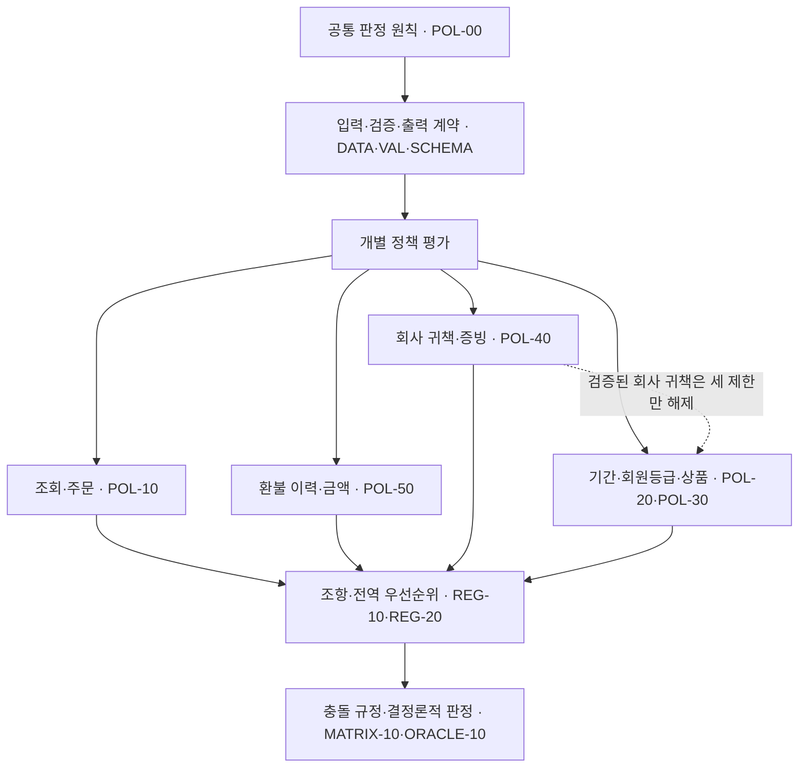

# Order & Refund Testbed 정책 통합 명세 v0.5

> **문서 상태:** 최종 정책 규범 통합본  
> **정책 버전:** `policy-v0.5`  
> **기준 문서:** [Order & Refund Testbed — 최종 정책 명세 v0.5](https://app.notion.com/p/3bc4a1a82b5180259902f5edc778f2eb)  
> **포함 범위:** 공통 원칙, REFUND-01~05, 입력 사실, 검증 책임, 조항, 전역 우선순위, 충돌 처리, 출력 계약, 결정론 및 문서 종속관계  
> **제외 범위:** 정답 사례, 기대 판정, 정답데이터, 데이터베이스 레코드와 평가 결과

---

## 1. 목적과 판정 범위

이 정책은 **주문 상품 한 건의 전액 환불 자격**을 읽기 전용으로 판단하기 위한 규범이다.

- 판정 단위는 주문 전체가 아니라 `order_item_id`로 식별되는 주문 상품 한 건이다.
- 정책은 전액 환불 자격만 판단한다.
- 실제 환불 지급, 주문 취소 실행, 부분 환불 금액 산정, 상품 회수 실행, 원장 변경은 범위 밖이다.
- 판정 프로그램은 현재 시각, 사용자 자유 입력 문장, 현재 회원 등급, 모델 추론을 정책 사실로 사용할 수 없다.
- 입력 형식 자체가 잘못된 경우에는 정책 판정 결과를 만들지 않고 입력 단계에서 거부한다.
- 같은 정규화된 입력 사실과 같은 버전 묶음에는 항상 동일한 판정 결과를 반환해야 한다.

### 1.1 최종 판정의 의미

| 판정 | 의미 | 일반적인 후속 처리 |
|---|---|---|
| 환불 가능 | 정책상 전액 환불 자격이 있음 | 전액 환불 승인 절차로 전달 |
| 환불 불가 | 정책상 거절 사유가 확정됨 | 환불 거절 |
| 추가 확인 필요 | 필수 정보가 누락·불일치·오류 상태임 | 정확한 정보 또는 내부 데이터 복구 요청 |
| 환불 정책 적용 대상 아님 | 취소 절차, 진행 중 요청, 부분 환불 등 다른 절차의 대상임 | 취소·대기·수동 검토 등 지정 절차로 전달 |

---

## 2. REFUND-01~05 공식 정책

### 2.1 REFUND-01 — 기본 환불 기간

일반 회원의 일반 상품은 배송 완료일을 0일째로 계산하여 **14일째까지** 전액 환불할 수 있다.

- 배송 완료 당일은 0일째다.
- 14일째는 환불 가능 기간에 포함한다.
- 15일째부터는 환불 가능 기간이 지난 것으로 판단한다.
- 다른 거절 사유나 확인할 정보가 없으면 기간 안의 전액 환불을 승인한다.
- 기간은 시·분·초를 24시간 단위로 나누지 않고 `Asia/Seoul` 달력 날짜 차이로 계산한다.
- 검증된 회사 귀책은 기간 초과 제한만 해제할 수 있다. 잘못된 날짜나 회원 등급은 해제하지 않는다.

**규범 조항:** `POL-20.01`, `POL-20.06`, `POL-00.08`

### 2.2 REFUND-02 — 개봉한 전자제품 제한

상품 분류가 전자제품이고 포장이 개봉된 것으로 확인되면 회원 등급이나 남은 환불 기간과 관계없이 일반 환불을 거절한다.

- 전자제품이 아니면 개봉 여부를 이 제한의 조건으로 사용하지 않는다.
- 전자제품의 개봉 여부가 기록되어 있지 않으면 미개봉으로 추정하지 않는다.
- 상품 분류 또는 개봉 여부가 잘못되거나 누락되면 판정을 보류하고 정확한 정보를 요청한다.
- 검증된 회사 귀책만 이 제한을 해제할 수 있다.

**규범 조항:** `POL-30.02`

### 2.3 REFUND-03 — 프리미엄 회원 환불 기간 연장

주문 당시 프리미엄 회원은 배송 완료일을 0일째로 계산하여 **30일째까지** 전액 환불할 수 있다.

- 배송 완료 당일은 0일째다.
- 30일째는 환불 가능 기간에 포함한다.
- 31일째부터는 환불 가능 기간이 지난 것으로 판단한다.
- 현재 회원 등급이 아니라 주문 당시 저장된 회원 등급만 사용한다.
- 프리미엄 혜택은 최종 할인 판매, 개봉 전자제품, 중복 환불, 통화 또는 금액 제한을 해제하지 않는다.
- 검증된 회사 귀책은 기간 초과 제한만 해제할 수 있다.

**규범 조항:** `POL-20.02`, `POL-20.06`, `POL-00.08`

### 2.4 REFUND-04 — 최종 할인 판매 상품 제한

최종 할인 판매로 지정된 상품은 환불 기간 안이거나 프리미엄 회원이더라도 일반 환불을 거절한다.

- 프리미엄 회원 또는 미개봉이라는 사실만으로 이 제한을 해제할 수 없다.
- 최종 할인 판매 여부가 기록되어 있지 않으면 일반 상품으로 추정하지 않는다.
- 최종 할인 판매 여부가 누락되거나 잘못되면 판정을 보류하고 정확한 정보를 요청한다.
- 검증된 회사 귀책만 이 제한을 해제할 수 있다.

**규범 조항:** `POL-30.01`

### 2.5 REFUND-05 — 회사 귀책 예외

회사의 인증된 증빙 시스템이 다음 사유 중 하나를 회사 책임으로 검증한 경우에만 회사 귀책 예외를 적용한다.

1. 주문한 상품과 실제 배송된 상품이 다른 경우
2. 배송 과정에서 상품이 파손된 경우
3. 상품 설명상 필수 구성품이 배송 시점부터 누락된 경우
4. 정상적인 설치·사용이 어려운 제조 또는 기능 결함이 확인된 경우

고객 주장, 상담 메모, 자유 입력 문장 또는 출처가 확인되지 않은 자료만으로는 회사 귀책을 확정할 수 없다.

#### 회사 귀책으로 보지 않는 경우

별도의 회사 귀책 사유가 검증되지 않은 다음 사유는 회사 귀책으로 보지 않는다.

- 단순 변심, 색상·크기·사용감에 관한 주관적 불만
- 고객의 사용 부주의, 임의 수리·개조, 분실 또는 오염으로 발생한 손상
- 정상적인 마모, 사용 환경 또는 호환성 문제
- 배송 후 고객이 구성품을 분실한 경우
- 가격 변동, 할인 종료, 다른 판매처와의 가격 차이
- 검증자·검증 시각·출처를 확인할 수 없는 자료

포장을 열었다는 사실만으로 고객 과실을 추정하지 않는다. 오배송·누락·결함 확인에 필요한 범위에서 개봉했더라도 검증된 회사 귀책의 적용을 막지 않는다.

#### 회사 귀책 예외가 해제하는 제한

검증된 회사 귀책은 다음 세 제한만 해제한다.

- `POL-20.06` 환불 기간 초과
- `POL-30.01` 최종 할인 판매
- `POL-30.02` 개봉한 전자제품

다음 문제는 회사 귀책으로 해제할 수 없다.

- 입력 형식 오류
- 주문·고객·상품·배송 조회의 누락·중복·참조 불일치
- 주문 상태 오류
- 이미 완료되었거나 처리 중인 환불
- 환불 이력 손상
- 통화·금액 오류
- 증빙 상태·출처 오류
- 회원 등급, 상품 분류, 최종 할인 판매 여부, 전자제품 개봉 여부의 데이터 오류

**규범 조항:** `POL-40.01`~`POL-40.08`

---

## 3. 정책 입력 사실과 신뢰 경계

정책은 원천 데이터베이스 열을 직접 해석하지 않고 정규화된 `PolicyFacts`만 입력으로 사용한다.

| 객체 | 정책에 필요한 핵심 사실 | 신뢰 소유자 |
|---|---|---|
| `trusted_context` | 평가 기준일, 시간대 | 실행 서버·Harness |
| `request` | 환불 요청 ID, 주문 상품 ID, 요청액, 통화 | 요청 계층과 서버 |
| `lookup_counts` | 주문·고객 스냅샷·상품·배송 조회 건수 | Adapter |
| `order` | 주문·참조 ID, 스냅샷 ID, 주문 시각·상태, 순결제액·통화 | 주문 시점 스냅샷 |
| `customer_snapshot` | 주문 당시 회원 등급과 스냅샷 시각 | 주문 시점 스냅샷 |
| `product` | 주문 당시 상품 분류·최종 할인 판매 여부 | 주문 시점 스냅샷 |
| `shipment` | 배송 완료일, 개봉 여부, 문제 사유와 증빙 | 배송 시스템·Evidence Service |
| `refund_history` | 같은 주문 상품의 기존 환불 ID·상태·금액·통화 | 환불 원장 |

### 3.1 입력 사실 사용 원칙

- 현재 고객 등급이나 현재 상품 마스터 값으로 주문 시점 스냅샷을 덮어쓰지 않는다.
- 환불 금액은 해당 주문 상품의 할인 배분 후 순결제액을 사용한다.
- `unit_price × quantity`, 현재 판매가 또는 할인 전 표시가격을 환불 기준으로 사용하지 않는다.
- 최초 배송비, 반품 배송비, 쿠폰 복원, 포인트·기프트 잔액은 상품 환불액과 별도 원장 항목이다.
- 빈 문자열은 정규화 계층에서 `null`로 처리한다.
- 유효한 날짜시각은 UTC `Z`로 정규화한다.
- 환불 이력은 `refund_id` 사전순으로 정렬한다.
- 평가 기준일, 주문 스냅샷, 환불 이력, 증빙 출처와 신뢰 확인값은 사용자나 Agent가 수정할 수 없다.

---

## 4. 검증 책임과 오류 소유권

동일한 오류를 여러 계층이 중복 판정하지 않도록 오류 소유자를 하나로 고정한다.

| 계층 | 소유 오류 | 처리 |
|---|---|---|
| S0 입력 계약 | JSON 파싱, 필수·추가 속성, 기본 자료형, 빈 문자열 제한, 안전 정수 범위 | 입력 거부, 정책 판정 결과 없음 |
| S1 Adapter 무결성 | 조회 건수와 객체 불일치, 참조키, 스냅샷 ID | `POL-10.14`~`POL-10.16` |
| S2 업무 데이터 검증 | `null`, 허용값, 범위, 상태 조합, 날짜 파싱과 시간 순서 | 각 정책 문서의 오류 조항 |
| S3 정책 규칙 평가 | 유효한 사실에 대한 제한·예외 조건 | 전역 우선순위로 대표 조항 선택 |
| S4 출력 검증 | 결과 구조, 배열 정렬, 해시, 버전 | 평가 입력 거부 |

### 4.1 핵심 원칙

- JSON 구조 또는 기본 자료형이 잘못된 입력은 업무 오류 코드로 바꾸지 않는다.
- 날짜의 JSON Schema `format`은 설명용이며, 실제 날짜 파싱 오류는 `POL-20.05`가 소유한다.
- 자료형이 허용한 `null`만 업무 데이터 검증에서 처리한다.
- 서로 독립적인 오류는 동시에 일치 조항에 기록할 수 있다.
- 최종 대표 조항만 전역 우선순위로 하나를 선택한다.
- 검증된 회사 귀책이어도 핵심 데이터 검증을 생략하지 않는다.

---

## 5. 상세 정책 조항

## 5.1 POL-10 — 조회·참조 무결성과 주문 상태

### 조회 건수와 객체

각 조회 단위는 다음 조건을 만족해야 한다.

- 조회 건수가 1이면 대응 객체가 존재해야 한다.
- 조회 건수가 1이 아니면 대응 객체는 `null`이어야 한다.
- 이 관계가 깨지면 값을 임의 선택하지 않고 `POL-10.14 INCONSISTENT_LOOKUP_RESULT`로 처리한다.

| 조회 결과 | 주문 | 고객 스냅샷 | 상품 | 배송 |
|---|---|---|---|---|
| 0건 | `POL-10.01` | `POL-10.02` | `POL-10.03` | `POL-10.04` |
| 2건 이상 | `POL-10.09` | `POL-10.10` | `POL-10.11` | `POL-10.12` |

### 참조키

다음 값은 서로 같아야 한다.

- `request.order_item_id = order.order_item_id = shipment.order_item_id`
- `order.customer_id = customer_snapshot.customer_id`
- `order.product_id = product.product_id`

불일치하면 `POL-10.15 ENTITY_REFERENCE_MISMATCH`다.

다음 스냅샷 ID도 서로 같아야 한다.

- `order.order_snapshot_id`
- `customer_snapshot.order_snapshot_id`
- `product.order_snapshot_id`

불일치하면 `POL-10.16 SNAPSHOT_REFERENCE_MISMATCH`다.

### 주문 상태

| 주문 상태 | 정책 결과 |
|---|---|
| `DELIVERED` | 환불 정책 계속 평가 |
| `PAID`, `SHIPPED` | `POL-10.05 CANCEL_FLOW_REQUIRED`; 환불 판단 대신 취소 절차로 전달 |
| `CANCELLED` | `POL-10.06 ORDER_CANCELLED`; 새 환불 대상으로 처리하지 않음 |
| 그 외 또는 `null` | `POL-10.07 INVALID_ORDER_STATUS` |

`PAID` 또는 `SHIPPED`인데 배송 완료일이 존재하면 `POL-10.08 INCONSISTENT_ORDER_SHIPMENT_STATE`다.

### 배송 완료일 누락

- 배송 완료일이 존재하면 회사 귀책 여부와 관계없이 날짜 형식과 미래 날짜 여부를 검증한다.
- 배송 완료일이 `null`이고 회사 귀책이 검증되지 않았으면 `POL-10.13 DELIVERED_AT_MISSING`이다.
- 배송 완료일이 `null`이어도 회사 귀책이 검증된 경우에는 날짜를 만들지 않고 기간 조건을 평가하지 않은 채 나머지 조건을 계속 확인할 수 있다.

## 5.2 POL-20 — 회원 등급·날짜·환불 기간

### 회원 등급 선택

- 주문 당시 등급이 `STANDARD`이면 `POL-20.01 STANDARD_TIER_RULE_SELECTED`를 기록하고 0~14일 규칙을 선택한다.
- 주문 당시 등급이 `PREMIUM`이면 `POL-20.02 PREMIUM_TIER_RULE_SELECTED`를 기록하고 0~30일 규칙을 선택한다.
- 등급이 `null`이거나 허용값이 아니면 `POL-20.03 INVALID_CUSTOMER_TIER`다.
- `POL-20.01`과 `POL-20.02`는 기간 안이라는 뜻이 아니라 적용할 기간 규칙을 선택했다는 비종결 조항이다.

### 날짜 파싱

다음 값은 엄격한 RFC 3339로 파싱한다.

- `evaluation_date`
- `order.ordered_at`
- 고객·상품 스냅샷의 `snapshotted_at`
- 값이 존재하는 `shipment.delivered_at`
- 증빙 상태가 `VERIFIED` 또는 `REJECTED`일 때의 `verified_at`

존재하지 않는 달력 날짜, 시간대 없는 날짜시각, 윤초, `24:00` 표기 등은 `POL-20.05 INVALID_DATE_FORMAT`이다.

### 시간 순서

모든 날짜시각을 UTC 시점으로 바꾼 뒤 다음을 강제한다.

1. 고객 스냅샷 시각과 상품 스냅샷 시각은 주문 시각과 같아야 한다.
2. 배송 완료 시각은 주문 시각보다 빠를 수 없다.
3. 필요한 모든 시각은 `Asia/Seoul` 기준 평가일 다음 날 00:00보다 이전이어야 한다.
4. 배송 완료일이 있으면 증빙 검증 시각은 배송 완료 시각보다 빠를 수 없다.
5. 배송 완료일 `null` 특례에서는 증빙 검증 시각이 주문 시각보다 빠를 수 없다.

위반하면 `POL-20.04 INVALID_DATE_ORDER`다.

### 기간 계산

`elapsed_days = evaluation_date의 서울 달력 날짜 - delivered_at의 서울 달력 날짜`로 계산한다.

| 주문 당시 등급 | 환불 가능 | 기간 초과 |
|---|---:|---:|
| `STANDARD` | 0~14일 | 15일 이상 |
| `PREMIUM` | 0~30일 | 31일 이상 |

기간을 초과하면 `POL-20.06 RETURN_WINDOW_EXPIRED`다. 검증된 회사 귀책은 이 조항만 해제하며 잘못된 등급이나 날짜는 해제하지 않는다.

## 5.3 POL-30 — 상품 상태와 일반 환불 제한

### 상품 데이터 검증

- 허용 상품 분류: `ELECTRONICS`, `FASHION`, `HOME`, `BEAUTY`, `OTHER`
- 상품 분류가 `null` 또는 미등록 값이면 `POL-30.03 INVALID_PRODUCT_CATEGORY`
- 최종 할인 판매 여부가 `null`이면 `POL-30.05 FINAL_SALE_UNKNOWN`
- 전자제품의 개봉 여부가 `null`이면 `POL-30.04 PACKAGE_OPENED_UNKNOWN`
- 비전자제품의 개봉 여부는 `null`이어도 유효하다.

### 제한 조건

- `final_sale = true`이면 `POL-30.01 FINAL_SALE_RESTRICTED`
- `category = ELECTRONICS`이고 `package_opened = true`이면 `POL-30.02 OPENED_ELECTRONICS`

최종 할인 판매, 개봉 전자제품, 기간 초과는 동시에 일치할 수 있다. 검증된 회사 귀책은 실제로 일치한 `POL-30.01`, `POL-30.02`만 해제하며 상품 데이터 오류는 해제하지 않는다.

## 5.4 POL-40 — 회사 귀책과 증빙

### 허용 문제 코드

- `WRONG_ITEM`
- `DAMAGED`
- `MISSING_PARTS`
- `DEFECTIVE`

여러 문제가 동시에 확인되더라도 대표 코드는 `WRONG_ITEM → DAMAGED → MISSING_PARTS → DEFECTIVE` 순서에서 가장 앞선 항목 하나를 선택한다. 나머지는 감사 로그에 남기며 대표 코드 선택은 환불 자격이나 금액을 바꾸지 않는다.

### 증빙 상태기계

| 상태 | 문제 코드 | 검증자·시각·출처 | 신뢰 확인값 | 처리 |
|---|---|---|---|---|
| `NONE` | `null` | 모두 `null` | `false` | 회사 귀책 예외 없이 일반 정책 평가 |
| `PENDING` | 유효 코드 | 모두 `null` | `false` | `POL-40.02`; 증빙 확인 완료까지 판정 보류 |
| `VERIFIED` | 유효 코드 | 모두 존재 | `true` | 신뢰 검증 통과 시 `POL-40.01` |
| `REJECTED` | 유효 코드 | 모두 존재 | `true` | `POL-40.03`; 회사 귀책 예외만 제거하고 일반 정책 평가 |

### 증빙 오류 평가 순서

1. 미등록 상태: `POL-40.07 INVALID_EVIDENCE_STATUS`
2. 미등록 문제 코드: `POL-40.05 INVALID_ISSUE_CODE`
3. 상태·코드·`null`·신뢰 확인값 조합 오류: `POL-40.04 INCONSISTENT_FAULT_EVIDENCE`
4. `VERIFIED`·`REJECTED`의 검증자·검증 시각·출처 누락: `POL-40.06 EVIDENCE_PROVENANCE_MISSING`
5. 출처가 존재하지만 서명, 검증자, 출처 또는 신뢰 확인이 실패함: `POL-40.08 UNTRUSTED_EVIDENCE_PROVENANCE`
6. `PENDING`: `POL-40.02 FAULT_EVIDENCE_REQUIRED`
7. `REJECTED`: `POL-40.03 EVIDENCE_REJECTED_NO_OVERRIDE`

앞 단계가 유효할 때만 다음 조건을 평가한다. 하나의 결함을 여러 증빙 오류 조항이 중복 소유하지 않는다. 구체적인 검증자·출처 허용 목록과 서명 검사는 `evidence-validator-v2`가 소유하며 구현자가 값을 임의 추가할 수 없다.

### VERIFIED의 효과와 경계

유효한 `VERIFIED`만 `POL-40.01 VERIFIED_COMPANY_FAULT`가 된다.

- 환불 기간 초과, 최종 할인 판매, 개봉 전자제품 제한만 해제한다.
- 별도의 30일·90일 같은 임의 유효기간을 추가하지 않는다.
- 배송 완료일이 `null`이면 기간을 계산하지 않고 승인 조건을 계속 확인할 수 있다.
- 주문·상품·배송 핵심 사실과 환불 이력·통화·금액은 여전히 유효해야 한다.
- `REJECTED`는 환불 거절 사유가 아니다. 회사 귀책 예외를 적용하지 않는다는 뜻이다.
- `PENDING` 상태에서 사용자나 Agent에게 신뢰 확인값 생성을 요청하지 않는다. Evidence Service 검토 큐로 전달한다.

### 회수·비용·실행 경계

- 회사 귀책 반품의 표준 회수비와 반품 배송비는 회사가 부담하며 상품 환불액에서 차감하지 않는다.
- 고객이 사전 승인 없이 선택한 별도 택배·특급 비용은 자동 환급하지 않는다.
- 환불 자격 승인과 실제 지급은 서로 다른 단계다.
- 실제 지급은 신뢰된 Returns Service의 `RECEIVED` 또는 `WAIVED_BY_POLICY` 상태를 요구한다.
- 자유 입력 메모나 운영자의 구두 판단으로 회수를 면제할 수 없다.
- 정책 판정 프로그램은 상품 회수나 돈의 지급을 실행하지 않는다.

## 5.5 POL-50 — 환불 이력·통화·금액 통제

### 환불 이력 범위와 무결성

- 현재 요청과 같은 `order_item_id`의 환불 이력만 사용한다.
- 같은 주문의 다른 상품 환불은 현재 상품을 차단하지 않는다.
- 환불 이력은 `refund_id` 사전순의 정규 원장만 사용한다.
- 빈·중복 환불 ID, 다른 주문 상품 참조, 잘못된 금액·통화, 활성 이력 충돌은 `POL-50.10 INVALID_REFUND_HISTORY_RECORD`다.
- 미등록 환불 상태는 `POL-50.03 INVALID_REFUND_STATUS`다.
- `REQUESTED`, `APPROVED`, `COMPLETED` 이력은 합계 최대 한 건이어야 한다.
- 현재 요청 ID가 기존 `REJECTED` 이력의 ID와 같으면 `POL-50.11 REFUND_REQUEST_ID_REUSED`다.

### 기존 상태별 처리

| 기존 이력 | 처리 |
|---|---|
| `APPROVED` 또는 `COMPLETED` | `POL-50.01 ALREADY_REFUNDED`; 새 전액 환불 거절 |
| `REQUESTED` | `POL-50.02 REFUND_IN_PROGRESS`; 새 판단을 만들지 않고 기존 처리 대기 |
| `REJECTED`만 존재 | 요청 ID가 재사용되지 않았다면 일반 정책 계속 평가 |

### 통화

1. 요청 통화와 주문 통화가 모두 존재하지만 서로 다르면 `POL-50.09 CURRENCY_MISMATCH`다.
2. 둘 중 하나가 `null`이거나 `KRW`가 아니면 `POL-50.08 UNSUPPORTED_CURRENCY`다.
3. 환율을 조회하거나 다른 통화를 임의로 원화로 바꾸지 않는다.

### 금액

- `paid_item_amount`는 할인 배분 후 해당 주문 상품의 순결제액이다.
- 요청액 `null`은 누락이 아니라 순결제액 전액 요청을 뜻한다.
- 비교할 때만 유효 요청액을 순결제액으로 계산하며 원래 입력의 `null`은 유지한다.
- 결제액 또는 명시된 요청액이 0 이하이거나 안전 정수 범위를 벗어나면 `POL-50.04 INVALID_REFUND_AMOUNT`다.
- 요청액이 순결제액보다 크면 `POL-50.05 REFUND_AMOUNT_EXCEEDS_PAID`로 거절한다.
- 요청액이 순결제액보다 작으면 `POL-50.06 PARTIAL_REFUND_OUT_OF_SCOPE`로 수동 검토에 전달한다.
- 요청액이 순결제액과 같으면 `POL-50.07 FULL_REFUND_AMOUNT_VALID`를 기록하고 다른 정책을 계속 평가한다.
- 부분 환불을 전액으로 올림하거나 초과 요청액을 결제액으로 자동 절삭하지 않는다.

### 회사 귀책과 실행 경계

검증된 회사 귀책도 기존 환불, 처리 중 요청, 이력 오류, 통화 오류, 초과·부분 환불 조건을 해제하지 않는다.

- 정책은 원결제수단 환급, 쿠폰·포인트 복원, 회수 완료 또는 지급을 실행하지 않는다.
- 원결제수단을 사용할 수 없으면 계좌·포인트·크레딧으로 임의 전환하지 않고 지급수단 검토 상태로 보류한다.
- 실제 실행기는 환불 요청 ID를 멱등키로 사용하고 지급 직전에 기존 환불 이력을 다시 확인해야 한다.

---

## 6. 전역 조항 우선순위

동시에 여러 종결 조항이 일치하면 **우선순위 숫자가 가장 작은 조항**을 대표 조항으로 선택한다. 동일 우선순위는 허용하지 않는다.

| 우선순위 | 조항 | 사유 코드 | 종결 여부 |
|---:|---|---|---|
| 110 | `POL-10.14` | `INCONSISTENT_LOOKUP_RESULT` | 종결 |
| 111 | `POL-10.15` | `ENTITY_REFERENCE_MISMATCH` | 종결 |
| 112 | `POL-10.16` | `SNAPSHOT_REFERENCE_MISMATCH` | 종결 |
| 120 | `POL-10.01` | `ORDER_NOT_FOUND` | 종결 |
| 121 | `POL-10.09` | `NON_UNIQUE_ORDER` | 종결 |
| 130 | `POL-10.02` | `CUSTOMER_DATA_MISSING` | 종결 |
| 131 | `POL-10.10` | `NON_UNIQUE_CUSTOMER` | 종결 |
| 140 | `POL-10.03` | `PRODUCT_DATA_MISSING` | 종결 |
| 141 | `POL-10.11` | `NON_UNIQUE_PRODUCT` | 종결 |
| 150 | `POL-10.04` | `SHIPMENT_DATA_MISSING` | 종결 |
| 151 | `POL-10.12` | `NON_UNIQUE_SHIPMENT` | 종결 |
| 160 | `POL-10.07` | `INVALID_ORDER_STATUS` | 종결 |
| 161 | `POL-10.08` | `INCONSISTENT_ORDER_SHIPMENT_STATE` | 종결 |
| 170 | `POL-10.05` | `CANCEL_FLOW_REQUIRED` | 종결 |
| 171 | `POL-10.06` | `ORDER_CANCELLED` | 종결 |
| 200 | `POL-50.10` | `INVALID_REFUND_HISTORY_RECORD` | 종결 |
| 201 | `POL-50.03` | `INVALID_REFUND_STATUS` | 종결 |
| 210 | `POL-50.01` | `ALREADY_REFUNDED` | 종결 |
| 211 | `POL-50.02` | `REFUND_IN_PROGRESS` | 종결 |
| 212 | `POL-50.11` | `REFUND_REQUEST_ID_REUSED` | 종결 |
| 300 | `POL-50.09` | `CURRENCY_MISMATCH` | 종결 |
| 301 | `POL-50.08` | `UNSUPPORTED_CURRENCY` | 종결 |
| 310 | `POL-50.04` | `INVALID_REFUND_AMOUNT` | 종결 |
| 311 | `POL-50.05` | `REFUND_AMOUNT_EXCEEDS_PAID` | 종결 |
| 312 | `POL-50.06` | `PARTIAL_REFUND_OUT_OF_SCOPE` | 종결 |
| 320 | `POL-50.07` | `FULL_REFUND_AMOUNT_VALID` | 비종결 |
| 400 | `POL-40.07` | `INVALID_EVIDENCE_STATUS` | 종결 |
| 401 | `POL-40.04` | `INCONSISTENT_FAULT_EVIDENCE` | 종결 |
| 402 | `POL-40.05` | `INVALID_ISSUE_CODE` | 종결 |
| 403 | `POL-40.02` | `FAULT_EVIDENCE_REQUIRED` | 종결 |
| 404 | `POL-40.06` | `EVIDENCE_PROVENANCE_MISSING` | 종결 |
| 405 | `POL-40.08` | `UNTRUSTED_EVIDENCE_PROVENANCE` | 종결 |
| 410 | `POL-40.03` | `EVIDENCE_REJECTED_NO_OVERRIDE` | 비종결 |
| 500 | `POL-20.03` | `INVALID_CUSTOMER_TIER` | 종결 |
| 501 | `POL-30.03` | `INVALID_PRODUCT_CATEGORY` | 종결 |
| 502 | `POL-30.05` | `FINAL_SALE_UNKNOWN` | 종결 |
| 503 | `POL-30.04` | `PACKAGE_OPENED_UNKNOWN` | 종결 |
| 510 | `POL-20.05` | `INVALID_DATE_FORMAT` | 종결 |
| 511 | `POL-20.04` | `INVALID_DATE_ORDER` | 종결 |
| 512 | `POL-10.13` | `DELIVERED_AT_MISSING` | 종결 |
| 520 | `POL-20.01` | `STANDARD_TIER_RULE_SELECTED` | 비종결 |
| 521 | `POL-20.02` | `PREMIUM_TIER_RULE_SELECTED` | 비종결 |
| 600 | `POL-40.01` | `VERIFIED_COMPANY_FAULT` | 종결 |
| 700 | `POL-30.01` | `FINAL_SALE_RESTRICTED` | 종결 |
| 701 | `POL-30.02` | `OPENED_ELECTRONICS` | 종결 |
| 720 | `POL-20.06` | `RETURN_WINDOW_EXPIRED` | 종결 |
| 800 | `POL-00.08` | `REFUND_ELIGIBLE` | 종결 |

### 6.1 종결 결과 묶음

| 대표 사유 | 자격 | 사건 상태 | 후속 처리 |
|---|---|---|---|
| 조회·참조·데이터 누락·불일치·오류, 증빙 확인 필요 | 추가 확인 필요 | 대기 | 정보 확인 요청 |
| 취소 절차 필요 | 환불 정책 적용 대상 아님 | 범위 밖 | 취소 절차로 전달 |
| 주문 취소됨, 종료된 환불 요청 ID 재사용 | 환불 정책 적용 대상 아님 | 완료 | 추가 조치 없음 |
| 이미 승인·완료된 환불 | 환불 불가 | 완료 | 추가 조치 없음 |
| 기존 환불 진행 중 | 환불 정책 적용 대상 아님 | 대기 | 기존 요청 완료 대기 |
| 초과 환불, 최종 할인 판매, 개봉 전자제품, 기간 초과 | 환불 불가 | 판정 준비 완료 | 환불 거절 |
| 부분 환불 | 환불 정책 적용 대상 아님 | 범위 밖 | 수동 검토로 전달 |
| 검증된 회사 귀책, 일반 승인 | 환불 가능 | 판정 준비 완료 | 전액 환불 승인 절차로 전달 |

---

## 7. 조항 집합과 대표 조항 선택

1. 의존 필드가 유효한 모든 정책 조건을 중간 종료 없이 평가한다.
2. 참인 모든 조항을 `matched_clauses`에 중복 없이 기록한다.
3. 업무 종결 조항이 하나도 없을 때만 `POL-00.08 REFUND_ELIGIBLE`을 마지막 승인 조항으로 추가한다.
4. 종결 조항 중 전역 우선순위 숫자가 가장 작은 조항을 `primary_clause`로 선택한다.
5. 대표 조항이 `POL-40.01`이면 실제로 일치한 `POL-30.01`, `POL-30.02`, `POL-20.06`만 `overridden_clauses`에도 기록한다.
6. 해제된 조항도 `matched_clauses`에서 제거하지 않는다.

다음 불변식을 항상 만족해야 한다.

- `primary_clause ∈ matched_clauses`
- `overridden_clauses ⊆ matched_clauses`
- 모든 조항 배열은 중복 없이 사전순으로 정렬

---

## 8. 추가 확인 필드 산정 규칙

추가 확인이 필요한 필드는 사람이 임의 작성하지 않고 다음 알고리즘으로 산정한다.

1. 최종 후속 처리가 정보 확인 요청이 아니면 `required_fields`는 빈 배열이다.
2. 정보 확인 요청이면 일치한 모든 정보 요청 종결 조항에서 실제로 실패한 최소 필드 경로를 합친다.
3. 대표 조항 하나의 필드만 넣지 않는다. 한 번의 요청으로 확인 가능한 모든 독립 오류 필드를 포함한다.
4. 조회 건수와 객체 불일치는 실패한 조회 건수 경로와 대응 객체 경로를 함께 포함한다.
5. 참조 불일치는 실제로 서로 다른 양쪽 필드 경로를 포함한다.
6. 상품·회원 등급·날짜·증빙·환불 이력 오류는 실패한 정확한 말단 필드를 포함한다.
7. 통화 불일치에서는 이미 `KRW`인 신뢰 가능한 쪽을 제외하고 수정이 필요한 쪽만 포함한다.
8. 환불 이력 배열 경로는 `refund_id` 사전순 정규화 후의 인덱스를 사용한다.
9. RFC 6901 JSON Pointer 형식으로 중복 제거 후 사전순 정렬한다.

정보 확인의 수신자도 데이터 소유권으로 고정한다.

| 경로 | 확인 책임 |
|---|---|
| `/request/*` | 요청자 입력 보정 큐 |
| `/shipment/evidence/*` | Evidence Service 검토 큐 |
| 신뢰 문맥·조회·주문·스냅샷·상품·배송·환불 이력 | 내부 데이터 복구 큐 |

사용자나 Agent는 내부 신뢰 필드 또는 증빙 출처 필드를 직접 수정할 수 없다.

---

## 9. 대표 충돌 처리

| 동시에 성립한 조건 | 대표 처리 |
|---|---|
| 입력 형식 오류와 업무 값 오류 | 입력 단계에서 거부하고 정책 결과를 만들지 않음 |
| 조회 건수 1건인데 객체 `null` | `POL-10.14`; 누락으로 추정하지 않음 |
| 요청·주문·배송의 주문 상품 ID 불일치 | `POL-10.15`; 업무 정책으로 진행하지 않음 |
| 스냅샷 ID 불일치 | `POL-10.16`; 현재값으로 보정하지 않음 |
| 검증된 회사 귀책과 회원 등급·상품 데이터 오류 | 해당 데이터 오류가 우선; 회사 귀책으로 해제하지 않음 |
| 검증된 회사 귀책과 배송 완료일 `null` | 기간을 평가하지 않고 `POL-40.01` 승인 가능 |
| 검증된 회사 귀책과 유효하지 않은 배송 완료일 | 날짜 오류가 우선 |
| 검증된 회사 귀책과 기간 초과·최종 할인 판매·개봉 | `POL-40.01`; 세 제한 중 실제 일치 항목을 해제 목록에 기록 |
| 검증된 회사 귀책과 완료 환불 | `POL-50.01`; 중복 환불 금지가 우선 |
| 검증된 회사 귀책과 부분·초과 요청액 | 금액 정책이 우선 |
| 최종 할인 판매·개봉·기간 초과 | 세 조항 모두 기록하고 `POL-30.01`을 대표 사유로 선택 |
| 취소된 주문과 완료 환불 | `POL-10.06`; 기존 환불을 취소 환급이라고 추정하지 않음 |
| 손상된 환불 이력과 완료 상태 | `POL-50.10`; 원장 무결성이 우선 |
| 요청액 `null`과 유효한 순결제액 | 전액 요청으로 비교하되 입력 사실의 `null` 유지 |
| 종료된 요청 ID 재사용과 다른 완료 환불 | `POL-50.01`이 `POL-50.11`보다 우선 |

새로운 충돌 조합을 코드의 숨은 조건문으로 해결하면 안 된다. 기존 전역 우선순위로 해결되지 않는 경우에만 정책·우선순위·충돌 규정을 함께 개정한다.

---

## 10. 결정론적 판정 절차

1. JSON 파싱과 입력 구조를 검증한다. 실패하면 정책 결과를 생성하지 않는다.
2. 입력 구조가 유효한 정규 `PolicyFacts`만 받는다.
3. 조회 건수와 객체, 참조키와 스냅샷 ID를 검증한다.
4. 주문 상태, 환불 이력, 통화·금액, 증빙, 회원 등급, 상품과 날짜의 핵심 업무 값을 검증한다.
5. 의존 필드가 유효한 모든 정책 조건을 중간 종료 없이 평가한다.
6. 다른 업무 종결 조항이 없을 때만 일반 승인 조항을 추가한다.
7. 일치한 종결 조항 중 전역 우선순위 숫자가 가장 작은 조항을 대표 조항으로 선택한다.
8. 검증된 회사 귀책이 대표 조항이면 실제로 일치한 세 제한만 해제 목록에 기록한다.
9. 대표 조항의 결과 묶음과 추가 확인 필드를 생성한다.
10. 입력 사실 전체, 사실 해시와 버전 묶음을 결과에 포함한다.
11. 출력 구조와 불변식을 검증한 뒤 정규 JSON 바이트를 생성한다.

판정 구현의 공개 함수는 `decide(policy_facts: dict) -> dict` 형식을 따른다. 입력 구조가 잘못된 인자를 직접 넘기면 정책 결과 대신 명시적인 입력 계약 오류를 발생시켜야 한다.

---

## 11. 출력 계약

유효한 입력에 대한 최종 결과는 다음 필드를 모두 포함해야 한다.

| 필드 | 의미 |
|---|---|
| `eligibility` | 환불 가능·불가·추가 확인·적용 대상 아님 |
| `case_status` | 준비 완료·대기·완료·범위 밖 |
| `next_action` | 승인·거절·정보 요청·기존 요청 대기·취소·수동 검토·없음 |
| `reason_code` | 대표 조항의 등록된 사유 코드 |
| `primary_clause` | 전역 우선순위로 선택한 대표 종결 조항 |
| `matched_clauses` | 참인 모든 정책 조항 |
| `overridden_clauses` | 회사 귀책으로 해제된 실제 일치 제한 |
| `required_fields` | 추가 확인이 필요한 정확한 필드 경로 |
| `facts` | 판정에 사용한 정규 입력 사실 전체 |
| `facts_hash` | 정규 입력 사실의 SHA-256 |
| `versions` | 정책·스키마·등록부·Adapter·검증기·판정기의 버전 묶음 |

결과는 다음을 만족해야 한다.

- `reason_code`는 대표 조항의 등록된 사유 코드와 같아야 한다.
- 자격·사건 상태·후속 처리는 대표 조항의 등록된 결과 묶음과 같아야 한다.
- `facts`는 실제 판정 입력과 정규적으로 동일해야 한다.
- `facts_hash`는 RFC 8785 JCS 방식으로 직렬화한 `facts`의 소문자 SHA-256이다.
- 조항과 필드 배열은 중복 없이 사전순으로 정렬한다.

---

## 12. 정규화와 재현성

- 날짜시각은 UTC `Z`로 정규화한다.
- 환불 이력은 `refund_id` 사전순으로 정렬한다.
- 요청액 `null`은 입력 사실에 그대로 유지하고 비교용 전액만 내부에서 파생한다.
- 조항·해제·추가 확인 배열은 중복 제거 후 사전순으로 정렬한다.
- 입력 사실과 최종 결과는 RFC 8785 JCS로 직렬화한다.
- 같은 입력을 반복 실행했을 때 결과 바이트와 사실 해시가 달라지면 안 된다.
- 판정 프로그램은 파일·DB 쓰기, 현재 시각, 난수, 환경별 로케일, 네트워크, LLM, 전역 변경 가능 캐시를 사용하지 않는다.

### 12.1 핵심 버전 묶음

| 구성요소 | 버전 |
|---|---|
| 정책 | `policy-v0.5` |
| 입력 형식 | `input-schema-v0.5` |
| 출력 형식 | `output-schema-v0.5` |
| 조항·우선순위 등록부 | `registry-v0.5` |
| Adapter | `adapter-v0.5` |
| 증빙 검증기 | `evidence-validator-v2` |
| 판정 프로그램 | `oracle-v0.5` |

하나라도 다르면 동일한 정책 기준의 결과로 비교할 수 없다.

---

## 13. 정책 종속관계

개별 정책은 자신의 조건과 의미를 먼저 정의하고, 등록부가 조항을 등록하고 우선순위를 부여한다. 정책이 등록부에 의존하면서 등록부도 정책에 의존하는 순환 구조를 만들면 안 된다.

---

## 14. 구현자가 임의로 판단하면 안 되는 사항

- 누락된 값을 `false`, 0, 일반 회원 또는 일반 상품으로 기본화하지 않는다.
- 두 건 이상의 조회 결과 중 하나를 임의로 선택하지 않는다.
- 현재 회원 등급이나 현재 상품 정보로 주문 스냅샷을 대체하지 않는다.
- 증빙 기각을 환불 거절로 바꾸지 않는다.
- 회사 귀책이라는 이유로 중복 환불, 통화·금액 또는 데이터 오류를 무시하지 않는다.
- 최종 할인 판매, 개봉 전자제품, 기간 초과가 동시에 성립할 때 하나만 기록하지 않는다.
- 요청액 `null`을 금액 누락 오류로 처리하지 않는다.
- 부분 환불을 전액으로 올림하거나 초과 요청액을 결제액으로 줄이지 않는다.
- 환율, 반품비, 쿠폰·포인트 금액을 임의 계산하지 않는다.
- 정책 문서에 없는 예외 기간, 증빙 유효기간 또는 우선순위를 코드에 추가하지 않는다.
- 사용자나 Agent가 내부 신뢰 정보와 증빙 출처를 생성·수정하도록 허용하지 않는다.
- 실제 환불 실행이나 원장 변경을 정책 판정 함수에 포함하지 않는다.

---

## 15. 규범 출처

- [최종 정책 허브 v0.5](https://app.notion.com/p/3bc4a1a82b5180259902f5edc778f2eb)
- [POL-00 공통 판정 원칙](https://app.notion.com/p/3bc4a1a82b518108b43ae2e0e0f80d3d)
- [POL-10 조회·참조 무결성](https://app.notion.com/p/3bc4a1a82b51815fbc43ff90cfded3cc)
- [POL-20 기간·회원등급](https://app.notion.com/p/3bc4a1a82b5181deabf9f14db19b0c94)
- [POL-30 상품·기간 제한](https://app.notion.com/p/3bc4a1a82b5181dc9490d2a9896be414)
- [POL-40 회사 귀책](https://app.notion.com/p/3bc4a1a82b518125a9b3d2e211c2faf1)
- [POL-50 환불 이력·금액](https://app.notion.com/p/3bc4a1a82b5181599508f0e4ff179390)
- [DATA-10 정책 입력 계약](https://app.notion.com/p/3bc4a1a82b5181a4b629dfc14efbab66)
- [SCHEMA-10 PolicyFacts](https://app.notion.com/p/3bc4a1a82b5181c783b3e18e12ac765e)
- [SCHEMA-20 DecisionResult](https://app.notion.com/p/3bc4a1a82b5181e78773c7c962854082)
- [VAL-10 검증 소유권](https://app.notion.com/p/3bc4a1a82b518177940cc385cde054ad)
- [REG-10 조항·사유 등록부](https://app.notion.com/p/3bc4a1a82b51812086dbdc05c06c82fc)
- [REG-20 전역 우선순위](https://app.notion.com/p/3bc4a1a82b5181868f6cd35fcad5c007)
- [MATRIX-10 충돌 매트릭스](https://app.notion.com/p/3bc4a1a82b5181338e67c71c87dc23c7)
- [ORACLE-10 결정론적 판정 계약](https://app.notion.com/p/3bc4a1a82b51810f9346da4a163d690e)
- [DEP-10 문서 종속관계](https://app.notion.com/p/3bc4a1a82b5181538663c9b238ed959e)
