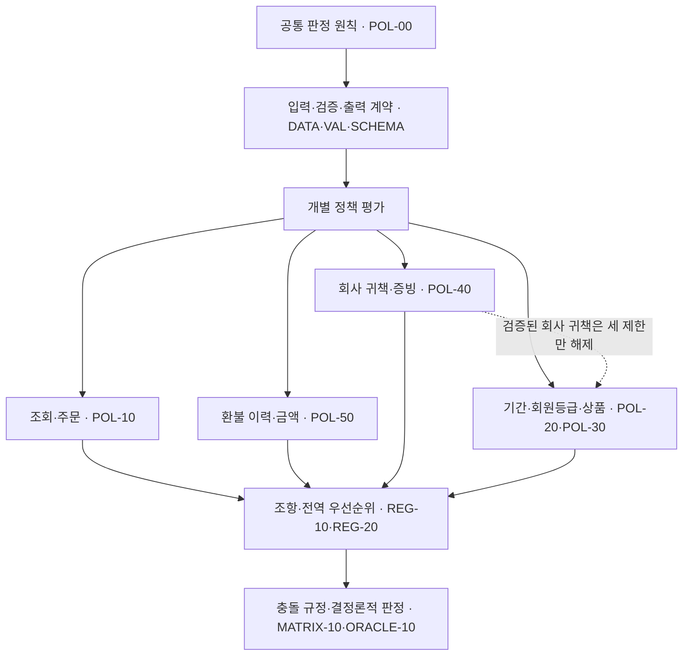
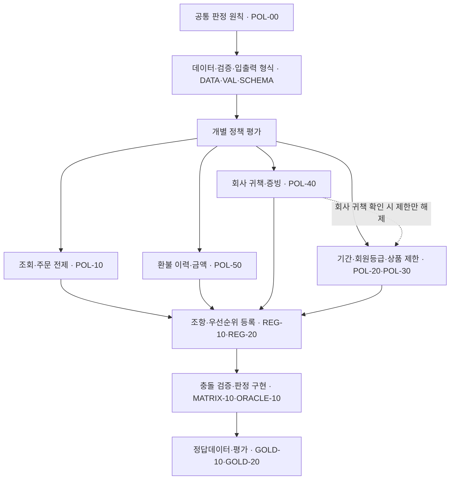

# Order & Refund Testbed 정책 통합 명세 v0.5

> **문서 상태:** 최종 정책 규범 통합본  
> **정책 버전:** `policy-v0.5`  
> **문서 형태:** 외부 Notion 접속이 필요 없는 독립형 단일 Markdown 규범본  
> **포함 범위:** 공통 원칙, REFUND-01~05, 입력·출력 Schema, 검증 책임, 47개 조항, 전역 우선순위, 충돌 처리, Oracle·Gold 계약, 운영 주의사항 및 문서 종속관계  
> **내장 범위:** 정책 허브의 하위 문서 18개 전문. 실제 DB 레코드와 외부 첨부 파일의 바이트는 포함하지 않음

> **완결성:** 이 파일 안의 정책과 계약을 읽기 위해 Notion 페이지를 별도로 열거나 불러올 필요가 없다.

---

## 1. 목적과 판정 범위

이 정책은 **주문 상품 한 건의 전액 환불 자격**을 읽기 전용으로 판단하기 위한 규범이다.

- 판정 단위는 주문 전체가 아니라 `order_item_id`로 식별되는 주문 상품 한 건이다.
- 정책은 전액 환불 자격만 판단한다.
- 실제 환불 지급, 주문 취소 실행, 부분 환불 금액 산정, 상품 회수 실행, 원장 변경은 범위 밖이다.
- 판정 프로그램은 현재 시각, 사용자 자유 입력 문장, 현재 회원 등급, 모델 추론을 정책 사실로 사용할 수 없다.
- 입력 형식 자체가 잘못된 경우에는 정책 판정 결과를 만들지 않고 입력 단계에서 거부한다.
- 같은 정규화된 입력 사실과 같은 버전 묶음에는 항상 동일한 판정 결과를 반환해야 한다.

### 1.1 최종 판정의 의미

| 판정 | 의미 | 일반적인 후속 처리 |
|---|---|---|
| 환불 가능 | 정책상 전액 환불 자격이 있음 | 전액 환불 승인 절차로 전달 |
| 환불 불가 | 정책상 거절 사유가 확정됨 | 환불 거절 |
| 추가 확인 필요 | 필수 정보가 누락·불일치·오류 상태임 | 정확한 정보 또는 내부 데이터 복구 요청 |
| 환불 정책 적용 대상 아님 | 취소 절차, 진행 중 요청, 부분 환불 등 다른 절차의 대상임 | 취소·대기·수동 검토 등 지정 절차로 전달 |

---

## 2. REFUND-01~05 공식 정책

### 2.1 REFUND-01 — 기본 환불 기간

일반 회원의 일반 상품은 배송 완료일을 0일째로 계산하여 **14일째까지** 전액 환불할 수 있다.

- 배송 완료 당일은 0일째다.
- 14일째는 환불 가능 기간에 포함한다.
- 15일째부터는 환불 가능 기간이 지난 것으로 판단한다.
- 다른 거절 사유나 확인할 정보가 없으면 기간 안의 전액 환불을 승인한다.
- 기간은 시·분·초를 24시간 단위로 나누지 않고 `Asia/Seoul` 달력 날짜 차이로 계산한다.
- 검증된 회사 귀책은 기간 초과 제한만 해제할 수 있다. 잘못된 날짜나 회원 등급은 해제하지 않는다.

**규범 조항:** `POL-20.01`, `POL-20.06`, `POL-00.08`

### 2.2 REFUND-02 — 개봉한 전자제품 제한

상품 분류가 전자제품이고 포장이 개봉된 것으로 확인되면 회원 등급이나 남은 환불 기간과 관계없이 일반 환불을 거절한다.

- 전자제품이 아니면 개봉 여부를 이 제한의 조건으로 사용하지 않는다.
- 전자제품의 개봉 여부가 기록되어 있지 않으면 미개봉으로 추정하지 않는다.
- 상품 분류 또는 개봉 여부가 잘못되거나 누락되면 판정을 보류하고 정확한 정보를 요청한다.
- 검증된 회사 귀책만 이 제한을 해제할 수 있다.

**규범 조항:** `POL-30.02`

### 2.3 REFUND-03 — 프리미엄 회원 환불 기간 연장

주문 당시 프리미엄 회원은 배송 완료일을 0일째로 계산하여 **30일째까지** 전액 환불할 수 있다.

- 배송 완료 당일은 0일째다.
- 30일째는 환불 가능 기간에 포함한다.
- 31일째부터는 환불 가능 기간이 지난 것으로 판단한다.
- 현재 회원 등급이 아니라 주문 당시 저장된 회원 등급만 사용한다.
- 프리미엄 혜택은 최종 할인 판매, 개봉 전자제품, 중복 환불, 통화 또는 금액 제한을 해제하지 않는다.
- 검증된 회사 귀책은 기간 초과 제한만 해제할 수 있다.

**규범 조항:** `POL-20.02`, `POL-20.06`, `POL-00.08`

### 2.4 REFUND-04 — 최종 할인 판매 상품 제한

최종 할인 판매로 지정된 상품은 환불 기간 안이거나 프리미엄 회원이더라도 일반 환불을 거절한다.

- 프리미엄 회원 또는 미개봉이라는 사실만으로 이 제한을 해제할 수 없다.
- 최종 할인 판매 여부가 기록되어 있지 않으면 일반 상품으로 추정하지 않는다.
- 최종 할인 판매 여부가 누락되거나 잘못되면 판정을 보류하고 정확한 정보를 요청한다.
- 검증된 회사 귀책만 이 제한을 해제할 수 있다.

**규범 조항:** `POL-30.01`

### 2.5 REFUND-05 — 회사 귀책 예외

회사의 인증된 증빙 시스템이 다음 사유 중 하나를 회사 책임으로 검증한 경우에만 회사 귀책 예외를 적용한다.

1. 주문한 상품과 실제 배송된 상품이 다른 경우
2. 배송 과정에서 상품이 파손된 경우
3. 상품 설명상 필수 구성품이 배송 시점부터 누락된 경우
4. 정상적인 설치·사용이 어려운 제조 또는 기능 결함이 확인된 경우

고객 주장, 상담 메모, 자유 입력 문장 또는 출처가 확인되지 않은 자료만으로는 회사 귀책을 확정할 수 없다.

#

### 회사 귀책으로 보지 않는 경우

별도의 회사 귀책 사유가 검증되지 않은 다음 사유는 회사 귀책으로 보지 않는다.

- 단순 변심, 색상·크기·사용감에 관한 주관적 불만
- 고객의 사용 부주의, 임의 수리·개조, 분실 또는 오염으로 발생한 손상
- 정상적인 마모, 사용 환경 또는 호환성 문제
- 배송 후 고객이 구성품을 분실한 경우
- 가격 변동, 할인 종료, 다른 판매처와의 가격 차이
- 검증자·검증 시각·출처를 확인할 수 없는 자료

포장을 열었다는 사실만으로 고객 과실을 추정하지 않는다. 오배송·누락·결함 확인에 필요한 범위에서 개봉했더라도 검증된 회사 귀책의 적용을 막지 않는다.

#

### 회사 귀책 예외가 해제하는 제한

검증된 회사 귀책은 다음 세 제한만 해제한다.

- `POL-20.06` 환불 기간 초과
- `POL-30.01` 최종 할인 판매
- `POL-30.02` 개봉한 전자제품

다음 문제는 회사 귀책으로 해제할 수 없다.

- 입력 형식 오류
- 주문·고객·상품·배송 조회의 누락·중복·참조 불일치
- 주문 상태 오류
- 이미 완료되었거나 처리 중인 환불
- 환불 이력 손상
- 통화·금액 오류
- 증빙 상태·출처 오류
- 회원 등급, 상품 분류, 최종 할인 판매 여부, 전자제품 개봉 여부의 데이터 오류

**규범 조항:** `POL-40.01`~`POL-40.08`

---

## 3. 정책 입력 사실과 신뢰 경계

정책은 원천 데이터베이스 열을 직접 해석하지 않고 정규화된 `PolicyFacts`만 입력으로 사용한다.

| 객체 | 정책에 필요한 핵심 사실 | 신뢰 소유자 |
|---|---|---|
| `trusted_context` | 평가 기준일, 시간대 | 실행 서버·Harness |
| `request` | 환불 요청 ID, 주문 상품 ID, 요청액, 통화 | 요청 계층과 서버 |
| `lookup_counts` | 주문·고객 스냅샷·상품·배송 조회 건수 | Adapter |
| `order` | 주문·참조 ID, 스냅샷 ID, 주문 시각·상태, 순결제액·통화 | 주문 시점 스냅샷 |
| `customer_snapshot` | 주문 당시 회원 등급과 스냅샷 시각 | 주문 시점 스냅샷 |
| `product` | 주문 당시 상품 분류·최종 할인 판매 여부 | 주문 시점 스냅샷 |
| `shipment` | 배송 완료일, 개봉 여부, 문제 사유와 증빙 | 배송 시스템·Evidence Service |
| `refund_history` | 같은 주문 상품의 기존 환불 ID·상태·금액·통화 | 환불 원장 |

### 3.1 입력 사실 사용 원칙

- 현재 고객 등급이나 현재 상품 마스터 값으로 주문 시점 스냅샷을 덮어쓰지 않는다.
- 환불 금액은 해당 주문 상품의 할인 배분 후 순결제액을 사용한다.
- `unit_price × quantity`, 현재 판매가 또는 할인 전 표시가격을 환불 기준으로 사용하지 않는다.
- 최초 배송비, 반품 배송비, 쿠폰 복원, 포인트·기프트 잔액은 상품 환불액과 별도 원장 항목이다.
- 빈 문자열은 정규화 계층에서 `null`로 처리한다.
- 유효한 날짜시각은 UTC `Z`로 정규화한다.
- 환불 이력은 `refund_id` 사전순으로 정렬한다.
- 평가 기준일, 주문 스냅샷, 환불 이력, 증빙 출처와 신뢰 확인값은 사용자나 Agent가 수정할 수 없다.

---

## 4. 검증 책임과 오류 소유권

동일한 오류를 여러 계층이 중복 판정하지 않도록 오류 소유자를 하나로 고정한다.

| 계층 | 소유 오류 | 처리 |
|---|---|---|
| S0 입력 계약 | JSON 파싱, 필수·추가 속성, 기본 자료형, 빈 문자열 제한, 안전 정수 범위 | 입력 거부, 정책 판정 결과 없음 |
| S1 Adapter 무결성 | 조회 건수와 객체 불일치, 참조키, 스냅샷 ID | `POL-10.14`~`POL-10.16` |
| S2 업무 데이터 검증 | `null`, 허용값, 범위, 상태 조합, 날짜 파싱과 시간 순서 | 각 정책 문서의 오류 조항 |
| S3 정책 규칙 평가 | 유효한 사실에 대한 제한·예외 조건 | 전역 우선순위로 대표 조항 선택 |
| S4 출력 검증 | 결과 구조, 배열 정렬, 해시, 버전 | 평가 입력 거부 |

### 4.1 핵심 원칙

- JSON 구조 또는 기본 자료형이 잘못된 입력은 업무 오류 코드로 바꾸지 않는다.
- 날짜의 JSON Schema `format`은 설명용이며, 실제 날짜 파싱 오류는 `POL-20.05`가 소유한다.
- 자료형이 허용한 `null`만 업무 데이터 검증에서 처리한다.
- 서로 독립적인 오류는 동시에 일치 조항에 기록할 수 있다.
- 최종 대표 조항만 전역 우선순위로 하나를 선택한다.
- 검증된 회사 귀책이어도 핵심 데이터 검증을 생략하지 않는다.

---

## 5. 상세 정책 조항

## 5.1 POL-10 — 조회·참조 무결성과 주문 상태

### 조회 건수와 객체

각 조회 단위는 다음 조건을 만족해야 한다.

- 조회 건수가 1이면 대응 객체가 존재해야 한다.
- 조회 건수가 1이 아니면 대응 객체는 `null`이어야 한다.
- 이 관계가 깨지면 값을 임의 선택하지 않고 `POL-10.14 INCONSISTENT_LOOKUP_RESULT`로 처리한다.

| 조회 결과 | 주문 | 고객 스냅샷 | 상품 | 배송 |
|---|---|---|---|---|
| 0건 | `POL-10.01` | `POL-10.02` | `POL-10.03` | `POL-10.04` |
| 2건 이상 | `POL-10.09` | `POL-10.10` | `POL-10.11` | `POL-10.12` |

### 참조키

다음 값은 서로 같아야 한다.

- `request.order_item_id = order.order_item_id = shipment.order_item_id`
- `order.customer_id = customer_snapshot.customer_id`
- `order.product_id = product.product_id`

불일치하면 `POL-10.15 ENTITY_REFERENCE_MISMATCH`다.

다음 스냅샷 ID도 서로 같아야 한다.

- `order.order_snapshot_id`
- `customer_snapshot.order_snapshot_id`
- `product.order_snapshot_id`

불일치하면 `POL-10.16 SNAPSHOT_REFERENCE_MISMATCH`다.

### 주문 상태

| 주문 상태 | 정책 결과 |
|---|---|
| `DELIVERED` | 환불 정책 계속 평가 |
| `PAID`, `SHIPPED` | `POL-10.05 CANCEL_FLOW_REQUIRED`; 환불 판단 대신 취소 절차로 전달 |
| `CANCELLED` | `POL-10.06 ORDER_CANCELLED`; 새 환불 대상으로 처리하지 않음 |
| 그 외 또는 `null` | `POL-10.07 INVALID_ORDER_STATUS` |

`PAID` 또는 `SHIPPED`인데 배송 완료일이 존재하면 `POL-10.08 INCONSISTENT_ORDER_SHIPMENT_STATE`다.

### 배송 완료일 누락

- 배송 완료일이 존재하면 회사 귀책 여부와 관계없이 날짜 형식과 미래 날짜 여부를 검증한다.
- 배송 완료일이 `null`이고 회사 귀책이 검증되지 않았으면 `POL-10.13 DELIVERED_AT_MISSING`이다.
- 배송 완료일이 `null`이어도 회사 귀책이 검증된 경우에는 날짜를 만들지 않고 기간 조건을 평가하지 않은 채 나머지 조건을 계속 확인할 수 있다.

## 5.2 POL-20 — 회원 등급·날짜·환불 기간

### 회원 등급 선택

- 주문 당시 등급이 `STANDARD`이면 `POL-20.01 STANDARD_TIER_RULE_SELECTED`를 기록하고 0~14일 규칙을 선택한다.
- 주문 당시 등급이 `PREMIUM`이면 `POL-20.02 PREMIUM_TIER_RULE_SELECTED`를 기록하고 0~30일 규칙을 선택한다.
- 등급이 `null`이거나 허용값이 아니면 `POL-20.03 INVALID_CUSTOMER_TIER`다.
- `POL-20.01`과 `POL-20.02`는 기간 안이라는 뜻이 아니라 적용할 기간 규칙을 선택했다는 비종결 조항이다.

### 날짜 파싱

다음 값은 엄격한 RFC 3339로 파싱한다.

- `evaluation_date`
- `order.ordered_at`
- 고객·상품 스냅샷의 `snapshotted_at`
- 값이 존재하는 `shipment.delivered_at`
- 증빙 상태가 `VERIFIED` 또는 `REJECTED`일 때의 `verified_at`

존재하지 않는 달력 날짜, 시간대 없는 날짜시각, 윤초, `24:00` 표기 등은 `POL-20.05 INVALID_DATE_FORMAT`이다.

### 시간 순서

모든 날짜시각을 UTC 시점으로 바꾼 뒤 다음을 강제한다.

1. 고객 스냅샷 시각과 상품 스냅샷 시각은 주문 시각과 같아야 한다.
2. 배송 완료 시각은 주문 시각보다 빠를 수 없다.
3. 필요한 모든 시각은 `Asia/Seoul` 기준 평가일 다음 날 00:00보다 이전이어야 한다.
4. 배송 완료일이 있으면 증빙 검증 시각은 배송 완료 시각보다 빠를 수 없다.
5. 배송 완료일 `null` 특례에서는 증빙 검증 시각이 주문 시각보다 빠를 수 없다.

위반하면 `POL-20.04 INVALID_DATE_ORDER`다.

### 기간 계산

`elapsed_days = evaluation_date의 서울 달력 날짜 - delivered_at의 서울 달력 날짜`로 계산한다.

| 주문 당시 등급 | 환불 가능 | 기간 초과 |
|---|---:|---:|
| `STANDARD` | 0~14일 | 15일 이상 |
| `PREMIUM` | 0~30일 | 31일 이상 |

기간을 초과하면 `POL-20.06 RETURN_WINDOW_EXPIRED`다. 검증된 회사 귀책은 이 조항만 해제하며 잘못된 등급이나 날짜는 해제하지 않는다.

## 5.3 POL-30 — 상품 상태와 일반 환불 제한

### 상품 데이터 검증

- 허용 상품 분류: `ELECTRONICS`, `FASHION`, `HOME`, `BEAUTY`, `OTHER`
- 상품 분류가 `null` 또는 미등록 값이면 `POL-30.03 INVALID_PRODUCT_CATEGORY`
- 최종 할인 판매 여부가 `null`이면 `POL-30.05 FINAL_SALE_UNKNOWN`
- 전자제품의 개봉 여부가 `null`이면 `POL-30.04 PACKAGE_OPENED_UNKNOWN`
- 비전자제품의 개봉 여부는 `null`이어도 유효하다.

### 제한 조건

- `final_sale = true`이면 `POL-30.01 FINAL_SALE_RESTRICTED`
- `category = ELECTRONICS`이고 `package_opened = true`이면 `POL-30.02 OPENED_ELECTRONICS`

최종 할인 판매, 개봉 전자제품, 기간 초과는 동시에 일치할 수 있다. 검증된 회사 귀책은 실제로 일치한 `POL-30.01`, `POL-30.02`만 해제하며 상품 데이터 오류는 해제하지 않는다.

## 5.4 POL-40 — 회사 귀책과 증빙

### 허용 문제 코드

- `WRONG_ITEM`
- `DAMAGED`
- `MISSING_PARTS`
- `DEFECTIVE`

여러 문제가 동시에 확인되더라도 대표 코드는 `WRONG_ITEM → DAMAGED → MISSING_PARTS → DEFECTIVE` 순서에서 가장 앞선 항목 하나를 선택한다. 나머지는 감사 로그에 남기며 대표 코드 선택은 환불 자격이나 금액을 바꾸지 않는다.

### 증빙 상태기계

| 상태 | 문제 코드 | 검증자·시각·출처 | 신뢰 확인값 | 처리 |
|---|---|---|---|---|
| `NONE` | `null` | 모두 `null` | `false` | 회사 귀책 예외 없이 일반 정책 평가 |
| `PENDING` | 유효 코드 | 모두 `null` | `false` | `POL-40.02`; 증빙 확인 완료까지 판정 보류 |
| `VERIFIED` | 유효 코드 | 모두 존재 | `true` | 신뢰 검증 통과 시 `POL-40.01` |
| `REJECTED` | 유효 코드 | 모두 존재 | `true` | `POL-40.03`; 회사 귀책 예외만 제거하고 일반 정책 평가 |

### 증빙 오류 평가 순서

1. 미등록 상태: `POL-40.07 INVALID_EVIDENCE_STATUS`
2. 미등록 문제 코드: `POL-40.05 INVALID_ISSUE_CODE`
3. 상태·코드·`null`·신뢰 확인값 조합 오류: `POL-40.04 INCONSISTENT_FAULT_EVIDENCE`
4. `VERIFIED`·`REJECTED`의 검증자·검증 시각·출처 누락: `POL-40.06 EVIDENCE_PROVENANCE_MISSING`
5. 출처가 존재하지만 서명, 검증자, 출처 또는 신뢰 확인이 실패함: `POL-40.08 UNTRUSTED_EVIDENCE_PROVENANCE`
6. `PENDING`: `POL-40.02 FAULT_EVIDENCE_REQUIRED`
7. `REJECTED`: `POL-40.03 EVIDENCE_REJECTED_NO_OVERRIDE`

앞 단계가 유효할 때만 다음 조건을 평가한다. 하나의 결함을 여러 증빙 오류 조항이 중복 소유하지 않는다. 구체적인 검증자·출처 허용 목록과 서명 검사는 `evidence-validator-v2`가 소유하며 구현자가 값을 임의 추가할 수 없다.

### VERIFIED의 효과와 경계

유효한 `VERIFIED`만 `POL-40.01 VERIFIED_COMPANY_FAULT`가 된다.

- 환불 기간 초과, 최종 할인 판매, 개봉 전자제품 제한만 해제한다.
- 별도의 30일·90일 같은 임의 유효기간을 추가하지 않는다.
- 배송 완료일이 `null`이면 기간을 계산하지 않고 승인 조건을 계속 확인할 수 있다.
- 주문·상품·배송 핵심 사실과 환불 이력·통화·금액은 여전히 유효해야 한다.
- `REJECTED`는 환불 거절 사유가 아니다. 회사 귀책 예외를 적용하지 않는다는 뜻이다.
- `PENDING` 상태에서 사용자나 Agent에게 신뢰 확인값 생성을 요청하지 않는다. Evidence Service 검토 큐로 전달한다.

### 회수·비용·실행 경계

- 회사 귀책 반품의 표준 회수비와 반품 배송비는 회사가 부담하며 상품 환불액에서 차감하지 않는다.
- 고객이 사전 승인 없이 선택한 별도 택배·특급 비용은 자동 환급하지 않는다.
- 환불 자격 승인과 실제 지급은 서로 다른 단계다.
- 실제 지급은 신뢰된 Returns Service의 `RECEIVED` 또는 `WAIVED_BY_POLICY` 상태를 요구한다.
- 자유 입력 메모나 운영자의 구두 판단으로 회수를 면제할 수 없다.
- 정책 판정 프로그램은 상품 회수나 돈의 지급을 실행하지 않는다.

## 5.5 POL-50 — 환불 이력·통화·금액 통제

### 환불 이력 범위와 무결성

- 현재 요청과 같은 `order_item_id`의 환불 이력만 사용한다.
- 같은 주문의 다른 상품 환불은 현재 상품을 차단하지 않는다.
- 환불 이력은 `refund_id` 사전순의 정규 원장만 사용한다.
- 빈·중복 환불 ID, 다른 주문 상품 참조, 잘못된 금액·통화, 활성 이력 충돌은 `POL-50.10 INVALID_REFUND_HISTORY_RECORD`다.
- 미등록 환불 상태는 `POL-50.03 INVALID_REFUND_STATUS`다.
- `REQUESTED`, `APPROVED`, `COMPLETED` 이력은 합계 최대 한 건이어야 한다.
- 현재 요청 ID가 기존 `REJECTED` 이력의 ID와 같으면 `POL-50.11 REFUND_REQUEST_ID_REUSED`다.

### 기존 상태별 처리

| 기존 이력 | 처리 |
|---|---|
| `APPROVED` 또는 `COMPLETED` | `POL-50.01 ALREADY_REFUNDED`; 새 전액 환불 거절 |
| `REQUESTED` | `POL-50.02 REFUND_IN_PROGRESS`; 새 판단을 만들지 않고 기존 처리 대기 |
| `REJECTED`만 존재 | 요청 ID가 재사용되지 않았다면 일반 정책 계속 평가 |

### 통화

1. 요청에 기록된 통화와 주문 원장에 기록된 통화가 모두 존재하지만 서로 다르면 어느 쪽이 맞는지 임의로 선택하지 않습니다. `POL-50.09 CURRENCY_MISMATCH`로 처리하고 통화 정보를 확인합니다.
2. 요청 통화 또는 주문 통화가 기록되어 있지 않거나, 둘 중 하나라도 `KRW`가 아니면 지원하지 않는 통화로 보고 `POL-50.08 UNSUPPORTED_CURRENCY`로 처리합니다.
3. 정책 판정 과정에서는 환율을 조회하지 않습니다. 다른 통화를 임의로 `KRW`로 환산하거나 금액을 보정해서 판정을 계속하지 않습니다.

### 금액

- `paid_item_amount`는 할인 배분 후 해당 주문 상품의 순결제액이다.
- 요청액 `null`은 누락이 아니라 순결제액 전액 요청을 뜻한다.
- 비교할 때만 유효 요청액을 순결제액으로 계산하며 원래 입력의 `null`은 유지한다.
- 결제액 또는 명시된 요청액이 0 이하이거나 안전 정수 범위를 벗어나면 `POL-50.04 INVALID_REFUND_AMOUNT`다.
- 요청액이 순결제액보다 크면 `POL-50.05 REFUND_AMOUNT_EXCEEDS_PAID`로 거절한다.
- 요청액이 순결제액보다 작으면 `POL-50.06 PARTIAL_REFUND_OUT_OF_SCOPE`로 수동 검토에 전달한다.
- 요청액이 순결제액과 같으면 `POL-50.07 FULL_REFUND_AMOUNT_VALID`를 기록하고 다른 정책을 계속 평가한다.
- 부분 환불을 전액으로 올림하거나 초과 요청액을 결제액으로 자동 절삭하지 않는다.

### 회사 귀책과 실행 경계

검증된 회사 귀책도 기존 환불, 처리 중 요청, 이력 오류, 통화 오류, 초과·부분 환불 조건을 해제하지 않는다.

- 정책은 원결제수단 환급, 쿠폰·포인트 복원, 회수 완료 또는 지급을 실행하지 않는다.
- 원결제수단을 사용할 수 없으면 계좌·포인트·크레딧으로 임의 전환하지 않고 지급수단 검토 상태로 보류한다.
- 실제 실행기는 환불 요청 ID를 멱등키로 사용하고 지급 직전에 기존 환불 이력을 다시 확인해야 한다.

---

## 6. 전역 조항 우선순위

동시에 여러 종결 조항이 일치하면 **우선순위 숫자가 가장 작은 조항**을 대표 조항으로 선택한다. 동일 우선순위는 허용하지 않는다.

| 우선순위 | 조항 | 사유 코드 | 종결 여부 |
|---:|---|---|---|
| 110 | `POL-10.14` | `INCONSISTENT_LOOKUP_RESULT` | 종결 |
| 111 | `POL-10.15` | `ENTITY_REFERENCE_MISMATCH` | 종결 |
| 112 | `POL-10.16` | `SNAPSHOT_REFERENCE_MISMATCH` | 종결 |
| 120 | `POL-10.01` | `ORDER_NOT_FOUND` | 종결 |
| 121 | `POL-10.09` | `NON_UNIQUE_ORDER` | 종결 |
| 130 | `POL-10.02` | `CUSTOMER_DATA_MISSING` | 종결 |
| 131 | `POL-10.10` | `NON_UNIQUE_CUSTOMER` | 종결 |
| 140 | `POL-10.03` | `PRODUCT_DATA_MISSING` | 종결 |
| 141 | `POL-10.11` | `NON_UNIQUE_PRODUCT` | 종결 |
| 150 | `POL-10.04` | `SHIPMENT_DATA_MISSING` | 종결 |
| 151 | `POL-10.12` | `NON_UNIQUE_SHIPMENT` | 종결 |
| 160 | `POL-10.07` | `INVALID_ORDER_STATUS` | 종결 |
| 161 | `POL-10.08` | `INCONSISTENT_ORDER_SHIPMENT_STATE` | 종결 |
| 170 | `POL-10.05` | `CANCEL_FLOW_REQUIRED` | 종결 |
| 171 | `POL-10.06` | `ORDER_CANCELLED` | 종결 |
| 200 | `POL-50.10` | `INVALID_REFUND_HISTORY_RECORD` | 종결 |
| 201 | `POL-50.03` | `INVALID_REFUND_STATUS` | 종결 |
| 210 | `POL-50.01` | `ALREADY_REFUNDED` | 종결 |
| 211 | `POL-50.02` | `REFUND_IN_PROGRESS` | 종결 |
| 212 | `POL-50.11` | `REFUND_REQUEST_ID_REUSED` | 종결 |
| 300 | `POL-50.09` | `CURRENCY_MISMATCH` | 종결 |
| 301 | `POL-50.08` | `UNSUPPORTED_CURRENCY` | 종결 |
| 310 | `POL-50.04` | `INVALID_REFUND_AMOUNT` | 종결 |
| 311 | `POL-50.05` | `REFUND_AMOUNT_EXCEEDS_PAID` | 종결 |
| 312 | `POL-50.06` | `PARTIAL_REFUND_OUT_OF_SCOPE` | 종결 |
| 320 | `POL-50.07` | `FULL_REFUND_AMOUNT_VALID` | 비종결 |
| 400 | `POL-40.07` | `INVALID_EVIDENCE_STATUS` | 종결 |
| 401 | `POL-40.04` | `INCONSISTENT_FAULT_EVIDENCE` | 종결 |
| 402 | `POL-40.05` | `INVALID_ISSUE_CODE` | 종결 |
| 403 | `POL-40.02` | `FAULT_EVIDENCE_REQUIRED` | 종결 |
| 404 | `POL-40.06` | `EVIDENCE_PROVENANCE_MISSING` | 종결 |
| 405 | `POL-40.08` | `UNTRUSTED_EVIDENCE_PROVENANCE` | 종결 |
| 410 | `POL-40.03` | `EVIDENCE_REJECTED_NO_OVERRIDE` | 비종결 |
| 500 | `POL-20.03` | `INVALID_CUSTOMER_TIER` | 종결 |
| 501 | `POL-30.03` | `INVALID_PRODUCT_CATEGORY` | 종결 |
| 502 | `POL-30.05` | `FINAL_SALE_UNKNOWN` | 종결 |
| 503 | `POL-30.04` | `PACKAGE_OPENED_UNKNOWN` | 종결 |
| 510 | `POL-20.05` | `INVALID_DATE_FORMAT` | 종결 |
| 511 | `POL-20.04` | `INVALID_DATE_ORDER` | 종결 |
| 512 | `POL-10.13` | `DELIVERED_AT_MISSING` | 종결 |
| 520 | `POL-20.01` | `STANDARD_TIER_RULE_SELECTED` | 비종결 |
| 521 | `POL-20.02` | `PREMIUM_TIER_RULE_SELECTED` | 비종결 |
| 600 | `POL-40.01` | `VERIFIED_COMPANY_FAULT` | 종결 |
| 700 | `POL-30.01` | `FINAL_SALE_RESTRICTED` | 종결 |
| 701 | `POL-30.02` | `OPENED_ELECTRONICS` | 종결 |
| 720 | `POL-20.06` | `RETURN_WINDOW_EXPIRED` | 종결 |
| 800 | `POL-00.08` | `REFUND_ELIGIBLE` | 종결 |

### 6.1 종결 결과 묶음

| 대표 사유 | 자격 | 사건 상태 | 후속 처리 |
|---|---|---|---|
| 조회·참조·데이터 누락·불일치·오류, 증빙 확인 필요 | 추가 확인 필요 | 대기 | 정보 확인 요청 |
| 취소 절차 필요 | 환불 정책 적용 대상 아님 | 범위 밖 | 취소 절차로 전달 |
| 주문 취소됨, 종료된 환불 요청 ID 재사용 | 환불 정책 적용 대상 아님 | 완료 | 추가 조치 없음 |
| 이미 승인·완료된 환불 | 환불 불가 | 완료 | 추가 조치 없음 |
| 기존 환불 진행 중 | 환불 정책 적용 대상 아님 | 대기 | 기존 요청 완료 대기 |
| 초과 환불, 최종 할인 판매, 개봉 전자제품, 기간 초과 | 환불 불가 | 판정 준비 완료 | 환불 거절 |
| 부분 환불 | 환불 정책 적용 대상 아님 | 범위 밖 | 수동 검토로 전달 |
| 검증된 회사 귀책, 일반 승인 | 환불 가능 | 판정 준비 완료 | 전액 환불 승인 절차로 전달 |

---

## 7. 조항 집합과 대표 조항 선택

1. 의존 필드가 유효한 모든 정책 조건을 중간 종료 없이 평가한다.
2. 참인 모든 조항을 `matched_clauses`에 중복 없이 기록한다.
3. 업무 종결 조항이 하나도 없을 때만 `POL-00.08 REFUND_ELIGIBLE`을 마지막 승인 조항으로 추가한다.
4. 종결 조항 중 전역 우선순위 숫자가 가장 작은 조항을 `primary_clause`로 선택한다.
5. 대표 조항이 `POL-40.01`이면 실제로 일치한 `POL-30.01`, `POL-30.02`, `POL-20.06`만 `overridden_clauses`에도 기록한다.
6. 해제된 조항도 `matched_clauses`에서 제거하지 않는다.

다음 불변식을 항상 만족해야 한다.

- `primary_clause ∈ matched_clauses`
- `overridden_clauses ⊆ matched_clauses`
- 모든 조항 배열은 중복 없이 사전순으로 정렬

---

## 8. 추가 확인 필드 산정 규칙

추가 확인이 필요한 필드는 사람이 임의 작성하지 않고 다음 알고리즘으로 산정한다.

1. 최종 후속 처리가 정보 확인 요청이 아니면 `required_fields`는 빈 배열이다.
2. 정보 확인 요청이면 일치한 모든 정보 요청 종결 조항에서 실제로 실패한 최소 필드 경로를 합친다.
3. 대표 조항 하나의 필드만 넣지 않는다. 한 번의 요청으로 확인 가능한 모든 독립 오류 필드를 포함한다.
4. 조회 건수와 객체 불일치는 실패한 조회 건수 경로와 대응 객체 경로를 함께 포함한다.
5. 참조 불일치는 실제로 서로 다른 양쪽 필드 경로를 포함한다.
6. 상품·회원 등급·날짜·증빙·환불 이력 오류는 실패한 정확한 말단 필드를 포함한다.
7. 통화 불일치에서는 이미 `KRW`인 신뢰 가능한 쪽을 제외하고 수정이 필요한 쪽만 포함한다.
8. 환불 이력 배열 경로는 `refund_id` 사전순 정규화 후의 인덱스를 사용한다.
9. RFC 6901 JSON Pointer 형식으로 중복 제거 후 사전순 정렬한다.

정보 확인의 수신자도 데이터 소유권으로 고정한다.

| 경로 | 확인 책임 |
|---|---|
| `/request/*` | 요청자 입력 보정 큐 |
| `/shipment/evidence/*` | Evidence Service 검토 큐 |
| 신뢰 문맥·조회·주문·스냅샷·상품·배송·환불 이력 | 내부 데이터 복구 큐 |

사용자나 Agent는 내부 신뢰 필드 또는 증빙 출처 필드를 직접 수정할 수 없다.

---

## 9. 대표 충돌 처리

| 동시에 성립한 조건 | 대표 처리 |
|---|---|
| 입력 형식 오류와 업무 값 오류 | 입력 단계에서 거부하고 정책 결과를 만들지 않음 |
| 조회 건수 1건인데 객체 `null` | `POL-10.14`; 누락으로 추정하지 않음 |
| 요청·주문·배송의 주문 상품 ID 불일치 | `POL-10.15`; 업무 정책으로 진행하지 않음 |
| 스냅샷 ID 불일치 | `POL-10.16`; 현재값으로 보정하지 않음 |
| 검증된 회사 귀책과 회원 등급·상품 데이터 오류 | 해당 데이터 오류가 우선; 회사 귀책으로 해제하지 않음 |
| 검증된 회사 귀책과 배송 완료일 `null` | 기간을 평가하지 않고 `POL-40.01` 승인 가능 |
| 검증된 회사 귀책과 유효하지 않은 배송 완료일 | 날짜 오류가 우선 |
| 검증된 회사 귀책과 기간 초과·최종 할인 판매·개봉 | `POL-40.01`; 세 제한 중 실제 일치 항목을 해제 목록에 기록 |
| 검증된 회사 귀책과 완료 환불 | `POL-50.01`; 중복 환불 금지가 우선 |
| 검증된 회사 귀책과 부분·초과 요청액 | 금액 정책이 우선 |
| 최종 할인 판매·개봉·기간 초과 | 세 조항 모두 기록하고 `POL-30.01`을 대표 사유로 선택 |
| 취소된 주문과 완료 환불 | `POL-10.06`; 기존 환불을 취소 환급이라고 추정하지 않음 |
| 손상된 환불 이력과 완료 상태 | `POL-50.10`; 원장 무결성이 우선 |
| 요청액 `null`과 유효한 순결제액 | 전액 요청으로 비교하되 입력 사실의 `null` 유지 |
| 종료된 요청 ID 재사용과 다른 완료 환불 | `POL-50.01`이 `POL-50.11`보다 우선 |

새로운 충돌 조합을 코드의 숨은 조건문으로 해결하면 안 된다. 기존 전역 우선순위로 해결되지 않는 경우에만 정책·우선순위·충돌 규정을 함께 개정한다.

---

## 10. 결정론적 판정 절차

1. JSON 파싱과 입력 구조를 검증한다. 실패하면 정책 결과를 생성하지 않는다.
2. 입력 구조가 유효한 정규 `PolicyFacts`만 받는다.
3. 조회 건수와 객체, 참조키와 스냅샷 ID를 검증한다.
4. 주문 상태, 환불 이력, 통화·금액, 증빙, 회원 등급, 상품과 날짜의 핵심 업무 값을 검증한다.
5. 의존 필드가 유효한 모든 정책 조건을 중간 종료 없이 평가한다.
6. 다른 업무 종결 조항이 없을 때만 일반 승인 조항을 추가한다.
7. 일치한 종결 조항 중 전역 우선순위 숫자가 가장 작은 조항을 대표 조항으로 선택한다.
8. 검증된 회사 귀책이 대표 조항이면 실제로 일치한 세 제한만 해제 목록에 기록한다.
9. 대표 조항의 결과 묶음과 추가 확인 필드를 생성한다.
10. 입력 사실 전체, 사실 해시와 버전 묶음을 결과에 포함한다.
11. 출력 구조와 불변식을 검증한 뒤 정규 JSON 바이트를 생성한다.

판정 구현의 공개 함수는 `decide(policy_facts: dict) -> dict` 형식을 따른다. 입력 구조가 잘못된 인자를 직접 넘기면 정책 결과 대신 명시적인 입력 계약 오류를 발생시켜야 한다.

---

## 11. 출력 계약

유효한 입력에 대한 최종 결과는 다음 필드를 모두 포함해야 한다.

| 필드 | 의미 |
|---|---|
| `eligibility` | 환불 가능·불가·추가 확인·적용 대상 아님 |
| `case_status` | 준비 완료·대기·완료·범위 밖 |
| `next_action` | 승인·거절·정보 요청·기존 요청 대기·취소·수동 검토·없음 |
| `reason_code` | 대표 조항의 등록된 사유 코드 |
| `primary_clause` | 전역 우선순위로 선택한 대표 종결 조항 |
| `matched_clauses` | 참인 모든 정책 조항 |
| `overridden_clauses` | 회사 귀책으로 해제된 실제 일치 제한 |
| `required_fields` | 추가 확인이 필요한 정확한 필드 경로 |
| `facts` | 판정에 사용한 정규 입력 사실 전체 |
| `facts_hash` | 정규 입력 사실의 SHA-256 |
| `versions` | 정책·스키마·등록부·Adapter·검증기·판정기의 버전 묶음 |

결과는 다음을 만족해야 한다.

- `reason_code`는 대표 조항의 등록된 사유 코드와 같아야 한다.
- 자격·사건 상태·후속 처리는 대표 조항의 등록된 결과 묶음과 같아야 한다.
- `facts`는 실제 판정 입력과 정규적으로 동일해야 한다.
- `facts_hash`는 RFC 8785 JCS 방식으로 직렬화한 `facts`의 소문자 SHA-256이다.
- 조항과 필드 배열은 중복 없이 사전순으로 정렬한다.

---

## 12. 정규화와 재현성

- 날짜시각은 UTC `Z`로 정규화한다.
- 환불 이력은 `refund_id` 사전순으로 정렬한다.
- 요청액 `null`은 입력 사실에 그대로 유지하고 비교용 전액만 내부에서 파생한다.
- 조항·해제·추가 확인 배열은 중복 제거 후 사전순으로 정렬한다.
- 입력 사실과 최종 결과는 RFC 8785 JCS로 직렬화한다.
- 같은 입력을 반복 실행했을 때 결과 바이트와 사실 해시가 달라지면 안 된다.
- 판정 프로그램은 파일·DB 쓰기, 현재 시각, 난수, 환경별 로케일, 네트워크, LLM, 전역 변경 가능 캐시를 사용하지 않는다.

### 12.1 핵심 버전 묶음

| 구성요소 | 버전 |
|---|---|
| 정책 | `policy-v0.5` |
| 입력 형식 | `input-schema-v0.5` |
| 출력 형식 | `output-schema-v0.5` |
| 조항·우선순위 등록부 | `registry-v0.5` |
| Adapter | `adapter-v0.5` |
| 증빙 검증기 | `evidence-validator-v2` |
| 판정 프로그램 | `oracle-v0.5` |

하나라도 다르면 동일한 정책 기준의 결과로 비교할 수 없다.

---

## 13. 정책 종속관계



개별 정책은 자신의 조건과 의미를 먼저 정의하고, 등록부가 조항을 등록하고 우선순위를 부여한다. 정책이 등록부에 의존하면서 등록부도 정책에 의존하는 순환 구조를 만들면 안 된다.

---

## 14. 구현자가 임의로 판단하면 안 되는 사항

- 누락된 값을 `false`, 0, 일반 회원 또는 일반 상품으로 기본화하지 않는다.
- 두 건 이상의 조회 결과 중 하나를 임의로 선택하지 않는다.
- 현재 회원 등급이나 현재 상품 정보로 주문 스냅샷을 대체하지 않는다.
- 증빙 기각을 환불 거절로 바꾸지 않는다.
- 회사 귀책이라는 이유로 중복 환불, 통화·금액 또는 데이터 오류를 무시하지 않는다.
- 최종 할인 판매, 개봉 전자제품, 기간 초과가 동시에 성립할 때 하나만 기록하지 않는다.
- 요청액 `null`을 금액 누락 오류로 처리하지 않는다.
- 부분 환불을 전액으로 올림하거나 초과 요청액을 결제액으로 줄이지 않는다.
- 환율, 반품비, 쿠폰·포인트 금액을 임의 계산하지 않는다.
- 정책 문서에 없는 예외 기간, 증빙 유효기간 또는 우선순위를 코드에 추가하지 않는다.
- 사용자나 Agent가 내부 신뢰 정보와 증빙 출처를 생성·수정하도록 허용하지 않는다.
- 실제 환불 실행이나 원장 변경을 정책 판정 함수에 포함하지 않는다.

---

## 15. 내장된 하위 규범 문서 전문

아래에는 정책 허브의 하위 문서 18개를 한 파일에서 읽을 수 있도록 정리했다. 외부 Notion 링크와 내부 임베딩용 주석은 제거했다. 각 하위 문서에는 개발자가 실제 구현 순서를 이해할 수 있도록 한국어 동작 설명을 추가했으며, 조항 ID와 JSON 필드명처럼 코드와 연결되는 식별자는 그대로 유지한다.


### 15.1 내장 문서 목록

- `POL-00` — POL-00 공통 판정 원칙 및 출력 계약 v0.5
- `POL-10` — POL-10 조회·참조 무결성 정책 v0.5
- `POL-20` — POL-20 기간·회원등급 정책 v0.5
- `POL-30` — POL-30 상품·기간 제한 정책 v0.5
- `POL-40` — POL-40 회사 귀책 정책 v0.5 · 한국어 규정 보강 r1
- `POL-50` — POL-50 환불 이력·금액 통제 정책 v0.5 · 한국어 규정 보강 r1
- `DATA-10` — DATA-10 정책 입력 데이터 계약 v0.5
- `SCHEMA-10` — SCHEMA-10 PolicyFacts JSON Schema v0.5
- `SCHEMA-20` — SCHEMA-20 DecisionResult JSON Schema v0.5
- `REG-10` — REG-10 Clause·Reason Registry v0.5
- `ORACLE-10` — ORACLE-10 결정론적 판정 Oracle v0.5
- `REG-20` — REG-20 전역 우선순위 Registry v0.5
- `MATRIX-10` — MATRIX-10 충돌·우선순위 매트릭스 v0.5
- `GOLD-10` — GOLD-10 Gold TestCase 작성·변경 계약 v0.5
- `GOLD-20` — GOLD-20 Representative-20 실행 파일 발행 계약 v0.5
- `VAL-10` — VAL-10 검증 소유권·분기 의존성 v0.5
- `NOTICE-10` — NOTICE-10 구현 후 관찰 주의사항 v0.5
- `DEP-10` — DEP-10 문서 종속관계·변경 영향 v0.5

#

### 15.1.1 개발자가 이 문서를 읽는 방법

이 Markdown 문서는 **사람이 정책을 이해하고 구현하기 위한 설명서**로 사용합니다.  
조항 ID, JSON 필드명, 상태 코드처럼 코드와 연결해야 하는 식별자는 그대로 남기지만, 정책 동작은 가능한 한 한국어 문장으로 설명합니다. AI Agent가 직접 소비할 조건식·우선순위·상태 코드는 별도의 JSON 규칙 파일로 분리할 수 있습니다.

문서에 남아 있는 기술 용어는 다음 의미로 읽습니다.

| 기술 표현 | 이 문서에서의 의미 |
| --- | --- |
| `override` | 해당 제한을 예외로 보고 **적용하지 않음** |
| `predicate` | 어떤 정책 조항이 성립하는지 확인하는 **조건** |
| `matched` / `matched_clauses` | 실제 입력에서 **조건이 성립한 조항 목록** |
| `primary` / `primary_clause` | 여러 조항 중 **최종 결과를 대표하는 조항** |
| `terminal` | 단독으로 승인·거절·보류 등 **최종 결과를 결정할 수 있는 조항** |
| `validation` | 입력값이 누락·오류 없이 사용할 수 있는지 확인하는 **데이터 유효성 검사** |
| `canonical` | 여러 원천 값을 하나의 규칙으로 맞춘 **정규화된 표준 형태** |
| `snapshot` | 현재 값이 아니라 **주문 당시 저장해 둔 값** |
| `null` | 해당 값이 **기록되어 있지 않음** |
| `priority` | 여러 조항이 동시에 성립할 때 대표 조항을 고르는 **우선순위 숫자** |

> **작성 원칙:** 사람용 설명에서는 “무엇을 확인한다 → 어떤 경우에 해당한다 → 어떻게 처리한다” 순서로 서술합니다. 기계 판정을 위해 필요한 정확한 코드값은 조항 ID와 JSON Schema에 유지합니다.

### 15.2 POL-00 공통 판정 원칙 및 출력 계약 v0.5

> **규범 상태:** v0.5 최종 규범본의 최상위 계약입니다. 세부 정책은 VAL-10과 REG-20을 포함해 이 문서와 충돌할 수 없습니다.

#

### 개발자가 구현할 때의 동작 순서

1. 먼저 입력 JSON이 올바른 구조인지 확인합니다. 구조가 틀리면 환불 가능 여부를 계산하지 않고 입력 오류로 종료합니다.
2. 구조가 정상이라면 조회·참조 관계, 주문 상태, 기존 환불 이력, 금액·통화, 증빙, 회원 등급, 상품 상태, 날짜를 각각 담당 정책에 따라 검사합니다.
3. 사용할 수 있는 데이터에 대해서는 한 조건이 맞았다고 평가를 멈추지 말고, 성립하는 정책 조항을 끝까지 모두 확인합니다.
4. 최종 결과를 결정할 수 있는 조항이 여러 개라면 `REG-20`의 우선순위 숫자가 가장 작은 조항을 대표 사유로 선택합니다.
5. 회사 귀책이 대표 사유가 된 경우에는 실제로 성립한 **기간 초과·최종 할인 판매·개봉 전자제품 제한만** 적용하지 않습니다.
6. 최종 결과에는 판정, 대표 사유, 성립한 모든 조항, 적용하지 않은 제한, 추가 확인 필드, 실제 입력 사실, 해시와 버전을 함께 기록합니다.

> **구현 경계:** 이 함수는 “환불 자격을 판단”하기만 합니다. 실제 환불 지급, 주문 취소, 원장 수정은 실행하지 않습니다.

### 1. 목적과 범위
Order Item의 **전액 환불 자격을 읽기 전용으로 판정**합니다. 환불 실행, 주문 취소 실행, 부분환불 금액 산정, 원장 변경은 범위 밖입니다.
Policy Agent는 Oracle·Gold·정답 결과를 호출하거나 입력으로 사용할 수 없습니다.
### 2. 규범 문서
- VAL-10 검증 소유권·분기 의존성
- SCHEMA-10 PolicyFacts
- SCHEMA-20 DecisionResult
- REG-20 전역 우선순위
### 3. 결정론
1. 같은 정규화된 `PolicyFacts`와 같은 버전 묶음을 입력하면 언제 실행해도 완전히 같은 `DecisionResult`를 반환해야 합니다.
2. 현재 시각, 사용자 자연어, 현재 회원등급, 모델 추론을 정책 사실로 사용하지 않습니다.
3. 날짜 계산에는 서버가 제공한 신뢰 가능한 `evaluation_date`와 `Asia/Seoul` 시간대만 사용합니다.
4. JSON을 읽을 수 없거나 입력 구조가 스키마와 맞지 않으면 정책 판정을 시작하지 않고 입력 오류로 종료합니다. 입력 구조는 정상하지만 값이 누락되었거나 허용값·범위·상태·날짜 의미가 잘못된 경우에만 각 정책이 해당 오류를 판단합니다.
5. 최종 결과를 결정할 수 있는 성립 조항이 여러 개라면 `REG-20`에서 우선순위 숫자가 가장 작은 조항을 대표 조항으로 선택합니다.
### 4. 출력 계약
`SCHEMA-20`의 결과 필드는 모두 필수입니다. 다만 이 결과는 `SCHEMA-10` 입력 구조 검사를 통과한 정규화된 `PolicyFacts`에 대해서만 만듭니다. JSON 파싱이나 입력 구조 검사에 실패하면 Harness가 `INPUT_REJECTED`로 기록하고 `PolicyFacts`, `facts_hash`, `DecisionResult`는 생성하지 않습니다.
- `eligibility`, `case_status`, `next_action`
- `reason_code`, `primary_clause`
- `matched_clauses`, `overridden_clauses`
- `required_fields`: RFC 6901 JSON Pointer 사전순
- `facts`: `SCHEMA-10` 규칙에 따라 정규화되어 실제 판정에 사용된 `PolicyFacts` 전체
- `facts_hash`: SHA-256(RFC 8785 JCS facts)
- `versions`: 고정 버전 묶음
### 5. 성립 조항 목록
정책 조건을 확인하는 데 필요한 입력값이 정상이라면, 한 조건이 먼저 성립하더라도 중간에 멈추지 않고 확인 가능한 조건을 끝까지 모두 평가합니다.
- `matched_clauses`: 실제 입력에서 조건이 성립한 모든 조항을 중복 없이 모아 사전순으로 정렬
- `primary_clause`: 최종 결과를 결정할 수 있는 성립 조항 중 `REG-20` 우선순위 숫자가 가장 작은 대표 조항
- `overridden_clauses`: 대표 조항이 `POL-40.01`일 때, 실제로 성립했지만 회사 귀책 예외로 적용하지 않는 `POL-30.01`, `POL-30.02`, `POL-20.06` 조항
- `POL-00.08`: 거절·보류·범위 밖 등 다른 최종 결과 조항이 하나도 성립하지 않았을 때만 마지막 일반 승인 조항으로 추가
`primary_clause`는 반드시 `matched_clauses` 안에 있어야 하고, `overridden_clauses`는 `matched_clauses`의 일부여야 합니다. 회사 귀책으로 제한을 적용하지 않더라도 그 제한이 실제로 성립했다는 기록은 `matched_clauses`에서 삭제하지 않습니다.
### 6. 회사 귀책
입력 구조, 조회·참조 관계, 주문 상태, 환불 이력, 금액·통화, 증빙, 회원 등급, 상품 데이터에 오류가 있으면 회사 귀책 예외보다 먼저 처리합니다. 회사 귀책이 검증된 경우에도 데이터가 정상일 때만 기간 초과·최종 할인 판매·개봉 전자제품 제한을 적용하지 않을 수 있습니다.
예외적으로 `delivered_at`이 기록되어 있지 않아도 회사 귀책이 검증된 경우에는 배송일을 임의로 만들지 않고 환불 기간 계산을 생략한 채 나머지 승인 조건을 계속 확인할 수 있습니다.
### 7. 버전 묶음
- policy-v0.5
- input-schema-v0.5
- output-schema-v0.5
- registry-v0.5
- adapter-v0.5
- evidence-검사기-v2
- oracle-v0.5
- gold-v0.5
- suite-v0.5
- evaluator-v0.5
핵심 버전 10개 중 하나라도 다르면 같은 정책 기준의 결과로 비교하지 않습니다. 실행 묶음에는 `policy_version`, `db_version`, `testcase_version`과 산출물 SHA-256을 `DEP-10` manifest에 함께 기록하며, 이 값이 다르면 동일한 재현 실행으로 보지 않습니다.
### 8. 최종 승인
모든 데이터 검사를 통과하고 더 우선하는 거절·보류·범위 밖 조항이 없다면 `POL-00.08 REFUND_ELIGIBLE`로 승인합니다.
P0 계약 위반은 build 실패입니다. NOTICE-10의 P1은 구현 후 관찰합니다.


### 15.3 POL-10 조회·참조 무결성 정책 v0.5

> **사람이 읽는 전제조건:** 환불 가능 여부를 판단하려면 주문, 주문 당시 고객 정보, 상품 정보와 배송 정보가 각각 정확히 한 건 존재하고 모두 같은 주문을 가리켜야 합니다. 정보가 빠졌거나 중복되었거나 서로 다른 주문을 가리키면 임의로 값을 선택하지 않습니다. 이 경우 최종 판정을 보류하고 정확한 데이터를 확인하도록 요청합니다.

#

### 개발자가 구현할 때의 동작 순서

1. `request.order_item_id`를 기준으로 주문, 주문 당시 고객 정보, 상품 정보, 배송 정보를 조회합니다.
2. 네 조회 결과가 각각 정확히 한 건인지 확인합니다. 한 건이면 객체가 반드시 있어야 하고, 0건 또는 여러 건이면 객체를 임의로 선택하지 않습니다.
3. 요청·주문·배송이 같은 주문 상품을 가리키는지, 고객·상품·스냅샷 참조가 서로 일치하는지 확인합니다.
4. 주문 상태가 `DELIVERED`일 때만 일반 환불 정책 평가를 계속합니다. `PAID` 또는 `SHIPPED`이면 취소 절차로 보내고, `CANCELLED`이면 새 환불 판정을 만들지 않습니다.
5. 배송 완료일이 없으면 원칙적으로 정확한 배송 정보를 다시 확인합니다. 단, 회사 귀책이 검증된 경우에는 배송일을 추정하지 않고 기간 계산을 생략한 채 나머지 조건을 계속 확인할 수 있습니다.

> **구현 핵심:** “정확히 한 건의 데이터가 존재하고, 모든 데이터가 같은 주문 상품을 가리키는가?”를 먼저 통과해야 이후 환불 규칙을 적용합니다.

### 0. 결과를 바로 이해하는 규칙
- 배송이 완료된 주문이면 환불 기간, 상품 제한, 회사 귀책과 환불 이력을 차례로 확인합니다.
- 결제만 완료되었거나 배송 중인 주문이면 환불 승인 여부를 판단하지 않고 주문 취소 절차로 안내합니다. `ROUTE_TO_CANCEL`은 취소 가능성을 승인한다는 뜻이 아니라 별도 취소 정책으로 전달한다는 라우팅 코드입니다.
- 이미 취소된 주문이면 새 환불 대상으로 처리하지 않고 추가 조치 없이 종료합니다.
- 주문·고객·상품·배송 정보가 없거나 두 건 이상이면 어느 값을 사용할지 임의로 결정하지 않고 판정을 보류한 뒤 데이터 확인을 요청합니다.
- 배송 정보는 있지만 배송 완료일이 기록되어 있지 않으면 판정을 보류하고 배송 완료일 확인을 요청합니다. 다만 회사 책임으로 발생한 문제임이 확인된 경우에는 환불 기간을 계산하지 않고 나머지 승인 조건을 계속 확인합니다.
### 1. 조회 단위
request.order_item_id로 다음 네 단위를 조회합니다.
- order_item_order
- customer_snapshot
- product
- shipment
각 조회 건수와 객체 존재 여부는 정확히 대응해야 합니다. 조회 건수가 1이면 해당 객체가 반드시 있어야 하고, 1이 아니면 객체는 없어야 합니다. 이 관계가 깨지면 `POL-10.14`로 처리합니다.
### 2. 조회 결과 조항


| 조건 | 조항·사유 코드 | 결과 |
| --- | --- | --- |
| count↔object 불일치 | POL-10.14 INCONSISTENT_LOOKUP_RESULT | UNDETERMINED |
| 참조키 불일치 | POL-10.15 ENTITY_REFERENCE_MISMATCH | UNDETERMINED |
| snapshot ID 불일치 | POL-10.16 SNAPSHOT_REFERENCE_MISMATCH | UNDETERMINED |
| order 0 / 2+ | POL-10.01 / POL-10.09 | ORDER_NOT_FOUND / NON_UNIQUE_ORDER |
| customer 0 / 2+ | POL-10.02 / POL-10.10 | CUSTOMER_DATA_MISSING / NON_UNIQUE_CUSTOMER |
| product 0 / 2+ | POL-10.03 / POL-10.11 | PRODUCT_DATA_MISSING / NON_UNIQUE_PRODUCT |
| shipment 0 / 2+ | POL-10.04 / POL-10.12 | SHIPMENT_DATA_MISSING / NON_UNIQUE_SHIPMENT |


### 3. 참조키
- request.order_item_id = order.order_item_id = shipment.order_item_id
- order.customer_id = customer_snapshot.customer_id
- order.product_id = product.product_id
- order.order_snapshot_id = customer_snapshot.order_snapshot_id = product.order_snapshot_id
### 4. 주문 상태


| order_status | 결과 |
| --- | --- |
| PAID / SHIPPED | POL-10.05 CANCEL_FLOW_REQUIRED · NOT_APPLICABLE · OUT_OF_SCOPE · ROUTE_TO_CANCEL |
| CANCELLED | POL-10.06 ORDER_CANCELLED · NOT_APPLICABLE · COMPLETED · NONE |
| DELIVERED | 후속 평가 |
| 그 외/null | POL-10.07 INVALID_ORDER_STATUS |


주문 상태가 `PAID` 또는 `SHIPPED`인데 배송 완료일이 기록되어 있다면 주문 상태와 배송 정보가 서로 모순되므로 `POL-10.08 INCONSISTENT_ORDER_SHIPMENT_STATE`로 처리합니다.
CANCELLED라는 사실만으로 기존 환불 이력을 정상 취소 환급이라고 추정하지 않습니다. POL-10.06은 현재 요청이 환불 자격 판정 범위 밖이라는 뜻이며, 기존 원장의 업무 의미는 별도 취소·원장 시스템이 확인합니다.
### 5. 배송 완료일 (`delivered_at`)
- 배송 완료일 값이 있으면: 회사 귀책 여부와 관계없이 날짜 형식과 미래 날짜 여부를 검증합니다.
- 배송 완료일 값이 없고 회사 귀책이 검증되었으면: 값을 허용하되 환불 기간은 계산하지 않습니다.
- 배송 완료일 값이 없고 회사 귀책이 검증되지 않았으면: `POL-10.13 DELIVERED_AT_MISSING`으로 처리합니다.
### 6. 이름 표준
원천 DB의 `orders.status`는 Adapter에서 표준 필드인 `order.order_status`로 변환합니다. 정책, Oracle, Gold는 이 표준 필드명만 사용합니다.
### 7. 우선순위
여러 조항이 동시에 성립할 때는 문서에 적힌 순서가 아니라 `REG-20`의 우선순위 숫자로 대표 조항을 결정합니다.


### 15.4 POL-20 기간·회원등급 정책 v0.5

> **사람이 읽는 기간 정책:** 일반 회원은 배송 완료 후 14일째까지, 주문 당시 프리미엄 회원은 30일째까지 전액 환불할 수 있습니다. 배송 완료일 당일은 0일째로 계산하며 14일째와 30일째도 환불 가능 기간에 포함합니다.

#

### 개발자가 구현할 때의 동작 순서

1. 회원 등급은 현재 등급이 아니라 **주문 당시 저장된 회원 등급**만 사용합니다.
2. 일반 회원은 배송 완료일을 0일째로 하여 14일째까지, 프리미엄 회원은 30일째까지 환불 기간으로 인정합니다.
3. 날짜 문자열을 실제 날짜로 읽을 수 있는지 먼저 확인하고, 주문·스냅샷·배송·증빙 검증 시각의 앞뒤 관계가 올바른지 검사합니다.
4. 환불 기간은 시·분·초 차이가 아니라 `Asia/Seoul` 기준 달력 날짜 차이로 계산합니다.
5. 기간을 넘긴 경우 `POL-20.06`을 기록합니다.
6. 검증된 회사 귀책이 있으면 **기간 초과 제한만 적용하지 않습니다.** 회원 등급이나 날짜 데이터 자체가 잘못된 경우는 예외 처리하지 않습니다.
7. 배송 완료일이 없고 회사 귀책이 검증된 경우에는 임의의 배송일을 만들어 넣지 않습니다. 이 경우 환불 기간 계산 자체를 생략하고 다른 승인 조건을 계속 확인합니다.

> **구현 핵심:** 회사 귀책은 “환불 기간을 넘긴 것”에 대한 예외일 뿐, 잘못된 회원 등급이나 날짜 데이터를 정상으로 바꾸는 예외가 아닙니다.

### 0. 조건·판정·예외
- 일반 회원은 배송 완료일부터 14일째까지 다른 거절 사유나 확인할 정보가 없으면 환불을 승인합니다. 15일째부터는 환불 가능 기간이 지났으므로 거절합니다.
- 주문 당시 프리미엄 회원은 배송 완료일부터 30일째까지 다른 거절 사유나 확인할 정보가 없으면 환불을 승인합니다. 31일째부터는 환불 가능 기간이 지났으므로 거절합니다.
- 회원 등급은 현재 등급이 아니라 주문할 때 저장된 회원 등급만 사용합니다.
- 회사 책임으로 발생한 문제임이 확인되면 환불 가능 기간이 지났더라도 기간 초과 제한을 적용하지 않습니다.
- 회원 등급이 기록되어 있지 않거나 허용되지 않은 값이고, 날짜를 읽을 수 없거나 배송 완료일이 평가일보다 미래이면 최종 판정을 보류하고 올바른 회원 등급이나 날짜를 확인하도록 요청합니다. 회사 귀책이 확인되었더라도 잘못된 값을 임의로 고치지 않습니다.
- 배송 완료일이 기록되어 있지 않으면 일반적으로 최종 판정을 보류하고 배송 완료일 확인을 요청합니다. 다만 회사 책임으로 발생한 문제임이 확인된 경우에만 환불 기간을 계산하지 않고 나머지 승인 조건을 계속 확인합니다.
### 1. 등급 규칙
회원 등급은 현재값이 아니라 주문 당시 저장된 `customer_tier_at_order`만 사용합니다.
- `STANDARD`: `POL-20.01 STANDARD_TIER_RULE_SELECTED`를 기록하고 배송 완료일부터 0~14일 규칙을 적용합니다.
- `PREMIUM`: `POL-20.02 PREMIUM_TIER_RULE_SELECTED`를 기록하고 배송 완료일부터 0~30일 규칙을 적용합니다.
- 회원 등급이 없거나 허용되지 않은 값이면 `POL-20.03 INVALID_CUSTOMER_TIER`로 처리합니다.
`POL-20.01`과 `POL-20.02`는 “현재 환불 기간 안에 있다”는 뜻이 아니라 STANDARD와 PREMIUM 중 어떤 기간 규칙을 적용했는지 기록하는 조항입니다. 따라서 15일째나 31일째처럼 기간을 넘긴 경우에도 해당 회원 등급 선택 조항은 성립한 조항 목록에 남습니다.
### 2. 날짜 소유권
`SCHEMA-10`에 표시된 날짜 `format`은 문서화를 위한 정보입니다. 실제 날짜 유효성은 정책 단계에서 검사하며, `evaluation_date`, `ordered_at`, 두 스냅샷의 `snapshotted_at`, 값이 있는 `delivered_at`, `VERIFIED` 또는 `REJECTED` 상태의 `verified_at`을 RFC 3339 규칙에 맞게 엄격히 읽습니다.
- 문자열 파싱 실패 또는 존재하지 않는 달력 날짜: POL-20.05 INVALID_DATE_FORMAT
- 시간대 정보가 없는 날짜시각, 윤초 표기, `24:00` 표기처럼 허용하지 않는 날짜 표현은 `POL-20.05`로 처리합니다.
- `delivered_at`이 없으면 원칙적으로 `POL-10.13`이며, 회사 귀책이 검증된 경우에만 배송일 없이 기간 계산을 생략하는 예외를 적용합니다.
### 3. 시간 순서와 계산
날짜시각 비교 오류를 피하기 위해 모든 날짜시각을 같은 UTC 시점으로 변환한 뒤 아래 시간 순서를 확인합니다.
1. 고객 스냅샷 시각과 상품 스냅샷 시각은 주문 시각과 같아야 합니다. 주문 후 수정된 현재값을 주문 당시 정보처럼 사용하면 안 됩니다.
2. 배송 완료일이 기록되어 있다면 배송 완료 시각은 주문 시각보다 빠를 수 없습니다.
3. 주문 시각, 두 스냅샷 시각, 배송 완료 시각, 필요한 증빙 검증 시각은 `Asia/Seoul` 기준 평가일 다음 날 00:00보다 이전이어야 합니다. 즉 평가 기준일보다 미래의 데이터를 사용하면 안 됩니다.
4. 배송 완료일이 있으면 증빙 검증 시각은 배송 완료 시각보다 빠를 수 없습니다. 배송 완료일이 없는 회사 귀책 예외에서는 증빙 검증 시각이 주문 시각보다 빠르지만 않으면 됩니다.
위 시간 순서 위반은 POL-20.04 INVALID_DATE_ORDER입니다.
기간은 `delivered_at`과 `evaluation_date`를 Asia/Seoul 달력 날짜로 변환해 `elapsed_days = evaluation_date - delivered_date`로 계산합니다. 시·분·초를 24시간 단위로 나누지 않습니다.


| 등급 | 경계 | 판정 |
| --- | --- | --- |
| STANDARD | 14 / 15 | 기간 내 / POL-20.06 |
| PREMIUM | 30 / 31 | 기간 내 / POL-20.06 |


### 4. 회사 귀책
유효한 `POL-40.01` 회사 귀책이 확인되면 `POL-20.06`에 해당하는 **환불 기간 초과 제한만 적용하지 않습니다.**
회원 등급이나 날짜 값 자체가 누락되었거나 잘못된 경우는 데이터 유효성 오류입니다. 이런 오류는 회사 귀책이 확인되어도 무시하거나 정상값으로 간주하지 않습니다.
`delivered_at`이 기록되어 있지 않고 회사 귀책이 검증된 경우에는 배송 완료일을 추정해서 채우지 않습니다. 대신 환불 기간 조건 자체를 계산하지 않고 다른 정책 조건을 계속 확인합니다.
### 5. 결과
일반 상황에서 `POL-20.06 RETURN_WINDOW_EXPIRED`가 최종 대표 사유가 되면 환불 불가(`INELIGIBLE`), 판정 완료(`READY`), 환불 거절(`REJECT_REFUND`)로 처리합니다. 다른 조항도 함께 성립한 경우의 대표 사유는 `REG-20` 우선순위에 따라 정합니다.


### 15.5 POL-30 상품·기간 제한 정책 v0.5

> **사람이 읽는 상품 정책:** 최종 할인 판매 상품과 개봉된 전자제품은 일반 환불 대상이 아닙니다. 다만 회사 책임으로 발생한 문제임이 확인되면 두 제한을 적용하지 않습니다.

#

### 개발자가 구현할 때의 동작 순서

1. 먼저 상품 분류, 최종 할인 판매 여부, 전자제품 개봉 여부가 정상적인 데이터인지 확인합니다.
2. 최종 할인 판매 상품이면 `POL-30.01`, 전자제품이면서 개봉된 상품이면 `POL-30.02`를 성립한 조항으로 기록합니다.
3. 최종 할인 판매·개봉 전자제품·기간 초과는 동시에 성립할 수 있으므로 하나를 찾았다고 검사를 멈추지 않습니다.
4. 회사 귀책이 검증되어 대표 사유가 된 경우에는 실제로 성립한 최종 할인 판매와 개봉 전자제품 제한만 적용하지 않습니다.
5. 상품 분류나 판매 상태, 개봉 여부가 누락·오류인 경우에는 `false`라고 추정하지 말고 데이터 확인이 필요한 상태로 처리합니다.

> **구현 핵심:** “환불 제한에 걸린 상태”와 “상품 데이터 자체가 잘못된 상태”를 구분해야 합니다. 회사 귀책은 제한은 풀 수 있지만 잘못된 상품 데이터까지 정상으로 만들 수는 없습니다.

### 0. 조건·판정·예외
- 상품이 최종 할인 판매로 지정되어 있으면 환불 기간 안이거나 프리미엄 회원이어도 환불을 거절합니다.
- 전자제품이 개봉된 것으로 확인되면 남은 환불 기간이나 회원 등급에 관계없이 환불을 거절합니다.
- 전자제품이 개봉되지 않았고 다른 거절 사유나 확인할 정보가 없으며 적용 기간 안이면 환불을 승인할 수 있습니다.
- 오배송·파손·구성품 누락·제품 결함이 회사 책임으로 확인되면 최종 할인 판매와 개봉 전자제품 제한을 적용하지 않습니다.
- 상품 분류, 최종 할인 판매 여부 또는 전자제품의 개봉 여부가 기록되어 있지 않거나 잘못되어 있으면 거짓으로 간주하지 않습니다. 최종 판정을 보류하고 정확한 상품 정보를 확인하도록 요청합니다.
- 최종 할인 판매, 전자제품 개봉, 기간 초과가 동시에 해당하면 세 사실을 모두 기록합니다. 회사 귀책이 확인되지 않으면 최종 결과는 환불 거절입니다.
### 1. 상품 데이터 기본 검증
회사 귀책보다 먼저 평가합니다.
- category 허용값: ELECTRONICS, FASHION, HOME, BEAUTY, OTHER
- category null/기타: POL-30.03 INVALID_PRODUCT_CATEGORY
- final_sale null: POL-30.05 FINAL_SALE_UNKNOWN
- final_sale type 오류: S0 Input Contract 소유이며 DecisionResult를 생성하지 않음
- ELECTRONICS의 package_opened null: POL-30.04 PACKAGE_OPENED_UNKNOWN
- 비전자제품은 package_opened 값이 null이어도 유효
### 2. 환불 제한 조건
- final_sale=true: POL-30.01 FINAL_SALE_RESTRICTED
- category=ELECTRONICS && package_opened=true: POL-30.02 OPENED_ELECTRONICS
일반 케이스는 INELIGIBLE · READY · REJECT_REFUND입니다.
### 3. 회사 귀책
`POL-40.01` 회사 귀책은 상품 데이터가 정상인 경우에만 `POL-30.01` 최종 할인 판매 제한과 `POL-30.02` 개봉 전자제품 제한을 적용하지 않게 할 수 있습니다.
상품 분류가 잘못되었거나 최종 할인 판매 여부가 없거나 전자제품 개봉 여부가 확인되지 않은 경우는 상품 데이터 오류입니다. 회사 귀책이 있어도 이런 오류를 무시하지 않습니다.
### 4. 다중 일치
최종 할인 판매, 개봉 전자제품, 기간 초과 조건은 동시에 성립할 수 있으므로 해당하는 조항을 모두 성립 조항 목록에 기록합니다.
- 회사 귀책이 없는 경우에는 `REG-20` 우선순위 700 → 701 → 720 순서에 따라 대표 사유를 결정합니다.
- 회사 귀책이 검증된 경우에는 `POL-40.01`의 우선순위 600이 대표 사유가 될 수 있으며, 세 제한 중 실제로 성립한 조항만 “예외로 적용하지 않은 제한” 목록에 기록합니다.
### 5. 구현 금지
상품 필드가 null일 때 false로 기본화하거나, 회사 귀책을 이유로 상품 데이터 검증을 생략하면 P0 위반입니다.


### 15.6 POL-40 회사 귀책 정책 v0.5 · 한국어 규정 보강 r1

> **회사 귀책 예외:** 회사의 인증된 Evidence Service가 오배송·배송 중 파손·필수 구성품 누락·제품 결함을 VERIFIED로 확인한 경우에만 적용합니다. 이 예외는 기간 초과·Final Sale·개봉 전자제품 제한만 해제하며, 데이터·환불 이력·통화·금액·증빙 오류는 해제하지 않습니다.

#

### 개발자가 구현할 때의 동작 순서

1. 고객의 주장이나 상담 메모만으로 회사 귀책을 인정하지 않습니다. 인증된 Evidence Service가 제공한 증빙 상태와 출처를 사용합니다.
2. 증빙 상태, 문제 코드, 검증자, 검증 시각, 출처, 신뢰 확인값의 조합이 정상인지 먼저 검사합니다.
3. 증빙이 `PENDING`이면 승인이나 거절을 확정하지 않고 증빙 검토가 끝날 때까지 보류합니다.
4. 증빙이 `REJECTED`이면 “회사 귀책 예외를 사용하지 않는다”는 뜻으로 처리하고 일반 환불 정책은 계속 평가합니다. `REJECTED` 자체를 환불 거절 사유로 사용하지 않습니다.
5. 모든 검증을 통과한 `VERIFIED` 증빙만 회사 귀책으로 인정합니다.
6. 회사 귀책으로 인정되더라도 **기간 초과, 최종 할인 판매, 개봉 전자제품 제한만** 적용하지 않습니다. 기존 환불, 금액·통화, 조회·참조, 회원·상품 데이터 오류는 그대로 검사합니다.
7. 정책 결과가 환불 승인으로 나와도 이 단계에서 실제 상품 회수나 돈 지급을 실행하지 않습니다.

> **구현 핵심:** 먼저 “이 증빙을 신뢰할 수 있는가?”를 확정한 뒤, 신뢰가 확인된 경우에만 허용된 세 가지 환불 제한에 예외를 적용합니다.

### 0. 고객·운영자가 읽는 회사 귀책 환불 규정
> **한국어 규정 보강 r1:** 아래 내용은 `POL-40.01~08`이 실제로 언제 적용되고 어떤 결과를 만드는지 사람이 이해할 수 있도록 풀어 쓴 규정입니다. 조항 ID, 우선순위와 최종 결과 코드값은 v0.5 규칙을 그대로 따릅니다.
#

### 0.1 회사 귀책으로 인정하는 경우
회사의 인증된 Evidence Service가 다음 사유 중 하나를 확인하고 증빙 상태를 `VERIFIED`로 확정한 경우에만 회사 귀책으로 인정합니다.
1. 주문한 상품과 실제 배송된 상품이 다른 경우
2. 배송 과정에서 상품이 파손된 경우
3. 상품 설명상 필수 구성품이 배송 시점부터 누락된 경우
4. 정상적인 설치·사용이 어려운 제조 또는 기능 결함이 확인된 경우
고객의 주장, 상담 메모, 자유 입력 문장이나 출처를 검증하지 않은 자료만으로는 회사 귀책 확인 완료 상태(`VERIFIED`)로 바꿀 수 없습니다.
#

### 0.2 회사 귀책으로 인정하지 않는 경우
다음 사유는 Evidence Service가 별도의 회사 귀책 사유를 확인하지 않는 한 회사 귀책으로 보지 않습니다.
- 고객의 단순 변심, 색상·크기·사용감에 대한 주관적 불만
- 고객의 사용 부주의, 임의 수리·개조, 분실 또는 오염으로 발생한 손상
- 정상적인 마모, 사용 환경이나 호환성 문제
- 배송 후 고객이 구성품을 분실한 경우
- 가격 변동, 할인 종료, 다른 판매처와의 가격 차이
- 출처·검증자·검증 시각을 확인할 수 없는 자료
포장을 열었다는 사실만으로 고객 과실을 추정하지 않습니다. 오배송·구성품 누락·제품 결함을 확인하기 위해 필요한 범위에서 포장을 연 경우에도, 증빙으로 회사 귀책이 확인되었다면 회사 귀책 예외를 정상적으로 적용합니다.
#

### 0.3 여러 문제가 동시에 제기된 경우
원천 증빙에 여러 문제가 있더라도 정책 입력에 사용하는 표준 `issue_code`는 하나만 기록합니다. Evidence Service는 `WRONG_ITEM → DAMAGED → MISSING_PARTS → DEFECTIVE` 순서에서 가장 앞선 확인 사유를 대표 코드로 선택합니다. 나머지 확인 사유는 감사 로그에 남기며, 대표 코드 선택이 환불 승인 여부나 환불액을 바꾸지는 않습니다.
#

### 0.4 증빙 상태별 기본 원칙


| 증빙 상태 | 정책 의미 | 판정과 후속 처리 |
| --- | --- | --- |
| 회사 귀책 사유 없음 | 오배송·파손 등 회사 귀책 사유가 제기되지 않았습니다. | 배송 후 경과 기간, 주문 당시 회원 등급과 상품 상태에 따른 일반 정책으로 판단합니다. |
| 증빙 확인 중 | 오배송·파손 등 사유는 제기되었지만 회사 시스템의 확인이 끝나지 않았습니다. | 환불을 승인하거나 거절하지 않습니다. 최종 판정을 보류하고 증빙 확인을 요청합니다. |
| 회사 귀책 확인 완료 | 인정 사유와 증빙 출처가 모두 유효하고 회사 책임으로 발생한 문제임이 확인되었습니다. | 환불 기간 초과, 최종 할인 판매와 개봉 전자제품 제한을 적용하지 않습니다. 더 먼저 확인해야 하는 데이터·환불 이력·통화·금액 문제가 없으면 환불을 승인합니다. |
| 증빙 기각 | 제출된 증빙이 회사 귀책을 입증하지 못했습니다. | 회사 귀책 예외만 적용하지 않습니다. 증빙 기각만으로 환불을 거절하지 않고 배송 후 경과 기간, 주문 당시 회원 등급과 상품 상태에 따른 일반 정책으로 계속 판단합니다. |
| 증빙 정보의 상태 또는 조합 오류 | 증빙 상태, 사유, 검증자, 검증 시각과 출처가 서로 모순되거나 신뢰할 수 없습니다. | 값을 임의로 고치지 않습니다. 최종 판정을 보류하고 올바른 증빙 정보를 확인하도록 요청합니다. |


#

### 0.5 회사 귀책 확인 완료(`VERIFIED`) 시 적용되는 예외
- 회사 귀책이 확인되면 환불 기간 초과, 최종 할인 판매, 개봉 전자제품 제한 중 실제로 성립한 제한만 적용하지 않습니다.
- 주문·고객·상품·배송 정보의 누락·중복·참조 불일치, 진행 중이거나 완료된 기존 환불, 통화·금액·환불 이력 오류, 증빙 데이터 오류는 회사 귀책으로 무시할 수 없습니다.
- 회사 귀책 확인 결과에 별도의 임의 유효기간을 추가하지 않습니다. 유효한 `VERIFIED` 증빙이면 문서에 정의된 환불 기간 초과 제한을 적용하지 않으며, 운영자가 30일·90일 같은 새로운 예외 기간을 코드에 추가하면 안 됩니다.
- 회사 귀책 반품의 표준 회수비와 반품 배송비는 회사가 부담하며 주문 상품 환불액에서 차감하지 않습니다. 고객이 사전 승인 없이 선택한 별도 택배나 특급 배송 비용은 자동 환급하지 않고, 회사가 승인한 비용만 별도 비용 원장에서 처리합니다.
- `ELIGIBLE`·`APPROVE_REFUND`는 전액 환불 자격이 있다는 뜻일 뿐 실제 돈을 지급했다는 뜻이 아닙니다. 실제 지급은 신뢰된 Returns Service에서 `RECEIVED` 또는 `WAIVED_BY_POLICY` 상태를 확인한 뒤 별도 실행 단계에서 처리합니다. 자유 입력 메모나 운영자의 구두 판단만으로 상품 회수를 면제하면 안 됩니다.
#

### 0.6 증빙 상태별 처리 원칙
- `NONE`: 회사 귀책 사유가 등록되지 않은 상태입니다. 회사 귀책 예외 없이 일반 환불 정책을 계속 평가합니다.
- `PENDING`: 회사 귀책 여부를 아직 확인 중인 상태입니다. 환불 승인이나 거절을 확정하지 않고 Evidence Service 검토가 끝날 때까지 보류합니다.
- `VERIFIED`: 회사 귀책이 확인된 상태입니다. 허용된 세 가지 제한에 예외를 적용하되, 더 우선하는 데이터 오류·환불 이력·금액 문제가 없을 때만 최종 승인할 수 있습니다.
- `REJECTED`: 제출된 증빙으로 회사 귀책을 인정하지 않는 상태입니다. 회사 귀책 예외만 사용하지 않고 일반 환불 정책을 계속 평가합니다. 이 상태 자체를 환불 거절 사유로 사용하면 안 됩니다.
- 증빙 상태나 검증 출처 정보가 잘못된 경우에는 값을 추정하거나 임의 보정하지 않습니다. 내부 데이터 확인이 필요한 상태로 보류합니다.
#

### 0.7 대표 사례


| 사실 | 결과 | 이유 |
| --- | --- | --- |
| 회사 귀책이 확인된 오배송 + 환불 기간 초과 | 승인 가능 | 기간 초과 제한만 적용하지 않음 |
| 회사 귀책이 확인된 파손 + 최종 할인 판매 + 개봉 전자제품 | 승인 가능 | 기간·최종 할인 판매·개봉 제한 중 성립한 제한을 적용하지 않음 |
| 파손 증빙 확인 중(`PENDING`) | 판정 보류 | 증빙 검토가 끝나기 전에는 승인·거절을 확정하지 않음 |
| 회사 귀책 증빙 기각(`REJECTED`) + 일반 환불 기간 내 | 일반 정책으로 계속 평가 | 증빙 기각만으로 환불을 거절하지 않음 |
| 회사 귀책 확인 + 이미 완료된 환불 | 새 환불 거절 | 이미 환불된 사실이 회사 귀책 예외보다 우선 |
| 회사 귀책 확인 + 요청 통화와 주문 통화 불일치 | 판정 보류 | 회사 귀책이 있어도 통화 오류를 무시할 수 없음 |
| 개봉 사실만 있고 인증된 결함 없음 | 회사 귀책 아님 | 일반 상품·기간 정책으로 판단 |


#

### 0.8 외부 운영 사례 참고 — 비규범
- [쿠팡 이용약관](https://www.coupang.com/np/policies/terms): 하자·오배송 등 귀책 당사자가 반품·교환 비용을 부담하는 구조를 참고했습니다.
- [쿠팡 취소·반품 안내](https://www.coupang.com/np/etc/returnPolicy): 파손·불량·오배송, 회수와 검수, 상품 상태별 제한을 분리하는 구조를 참고했습니다.
- [Amazon Return Policy](https://www.amazon.com/gp/help/customer/display.html?nodeId=GKM69DUUYKQWKWX7): 파손·결함·오배송의 반품 비용 처리 구조를 참고했습니다.
외부 서비스의 기간·금액·상품별 예외는 이 testbed에 자동 적용되지 않습니다. 이 문서의 POL/REG clause만 규범입니다.

### 1. 문제 코드 (`issue_code`)
DAMAGED, WRONG_ITEM, MISSING_PARTS, DEFECTIVE만 유효합니다.
### 2. 증빙 상태별 처리 규칙


| 증빙 상태 (`status`) | 문제 코드 (`issue_code`) | 검증자·검증 시각·출처 | 신뢰 확인값 |
| --- | --- | --- | --- |
| `NONE` | 값 없음 (`null`) | 모두 값 없음 | `false` |
| `PENDING` | 등록된 문제 코드 | 모두 값 없음 | `false` |
| `VERIFIED` | 등록된 문제 코드 | 모두 입력되어야 함 | `true` |
| `REJECTED` | 등록된 문제 코드 | 모두 입력되어야 함 | `true` |


`VERIFIED` 또는 `REJECTED` 상태의 `verified_at`은 `Asia/Seoul` 기준 평가일 다음 날 00:00보다 이전이어야 합니다. 즉 평가 기준일보다 미래 시각의 증빙 검증 결과를 사용하면 안 됩니다.
### 3. 오류 소유권과 평가 순서
1. 증빙 상태가 허용 목록에 없으면 `POL-40.07 INVALID_EVIDENCE_STATUS`로 처리합니다.
2. 문제 코드 값이 들어 있지만 허용 목록에 없는 값이면 `POL-40.05 INVALID_ISSUE_CODE`로 처리합니다.
3. 증빙 상태와 문제 코드는 정상인데 검증 정보의 존재 여부 또는 신뢰 확인값 조합이 규칙과 맞지 않으면 `POL-40.04 INCONSISTENT_FAULT_EVIDENCE`로 처리합니다.
4. `VERIFIED` 또는 `REJECTED`인데 검증자·검증 시각·증빙 출처 중 하나라도 없으면 `POL-40.06 EVIDENCE_PROVENANCE_MISSING`으로 처리합니다.
5. 검증 정보는 모두 있지만 신뢰 확인값이 거짓이거나 검증자·출처가 허용 목록 밖이거나 서명 검증에 실패하면 `POL-40.08 UNTRUSTED_EVIDENCE_PROVENANCE`로 처리합니다.
6. 증빙 상태가 `PENDING`이면 `POL-40.02 FAULT_EVIDENCE_REQUIRED`로 처리합니다. 환불 승인·거절을 보류하고 Evidence Service 검토 큐로 전달하며, 사용자나 AI Agent에게 내부 신뢰 확인값을 직접 만들도록 요청하지 않습니다.
7. 증빙 상태가 `REJECTED`이면 `POL-40.03 EVIDENCE_REJECTED_NO_OVERRIDE`를 기록합니다. 회사 귀책 예외만 적용하지 않고, 환불 가능 여부는 일반 정책으로 계속 평가합니다.
앞 단계의 데이터가 정상일 때만 다음 검사를 진행합니다. 따라서 같은 하나의 증빙 오류를 `POL-40.04`와 `POL-40.05`처럼 여러 조항으로 중복 처리하지 않습니다.
### 4. 회사 귀책 확인 완료 (`VERIFIED`)
증빙 상태와 필수 필드 조합이 모두 정상이고 `evidence-validator-v2`의 출처·서명 검증까지 통과한 경우에만 `POL-40.01 VERIFIED_COMPANY_FAULT`로 회사 귀책을 확정합니다.
회사 귀책으로 적용하지 않을 수 있는 제한은 `POL-30.01`, `POL-30.02`, `POL-20.06` 세 조항뿐입니다.
입력 구조, 조회·참조, 주문 상태, 환불 이력, 금액·통화, 증빙, 회원 등급, 상품 데이터 오류는 회사 귀책으로 무시할 수 없습니다.
### 5. 배송 완료일 (`delivered_at`) 특례
회사 귀책이 `VERIFIED`이고 `delivered_at`이 없으면 배송일을 추정하지 않고 환불 기간 계산을 생략할 수 있습니다. 단, 배송 객체와 그 밖의 필수 정책 데이터는 모두 정상이어야 합니다.
### 6. 신뢰 경계
사용자와 AI Agent는 증빙의 검증자, 검증 시각, 출처, 신뢰 확인값을 직접 생성하거나 수정할 수 없습니다. Adapter가 인증된 Evidence Service 결과를 입력하고 `evidence-validator-v2`가 `verified_by`, `evidence_source`, 서명과 검증 시각을 확인합니다. 허용하는 검증자나 출처 목록을 바꾸면 증빙 검증기 버전도 함께 변경해야 합니다.


### 15.7 POL-50 환불 이력·금액 통제 정책 v0.5 · 한국어 규정 보강 r1

> **환불 이력·금액 통제:** 현재 주문 상품에 대한 정규화된 환불 원장과 실제 순결제액만 사용합니다. 이미 완료되었거나 진행 중인 환불을 다시 처리하지 않고, 초과 요청은 거절하며, 부분 환불은 수동 검토로 분리합니다. 회사 귀책이 확인되어도 이 금액·원장 검사는 생략하지 않습니다.

#

### 개발자가 구현할 때의 동작 순서

1. 현재 요청과 같은 `order_item_id`의 환불 이력만 사용하고, `refund_id` 기준으로 정렬한 원장을 사용합니다.
2. 환불 이력의 ID, 주문 상품 참조, 상태, 금액, 통화가 정상인지 먼저 확인합니다.
3. 이미 `APPROVED` 또는 `COMPLETED`된 환불이 있으면 새 전액 환불을 거절합니다. `REQUESTED` 상태가 있으면 새 판정을 만들지 않고 기존 요청이 끝날 때까지 기다립니다.
4. 요청 금액이 `null`이면 “금액이 빠졌다”고 보지 않고 해당 상품의 순결제액 전액을 요청한 것으로 비교합니다. 원래 입력값의 `null`은 그대로 보존합니다.
5. 요청액이 순결제액보다 크면 거절하고, 작으면 부분 환불이므로 자동 전액 환불 판정 범위 밖으로 보내 수동 검토합니다.
6. 요청 통화와 주문 통화는 모두 `KRW`여야 하며 서로 일치해야 합니다.
7. 회사 귀책이 검증되어도 중복 환불, 진행 중 환불, 원장 오류, 통화·금액 오류는 예외 처리하지 않습니다.

> **구현 핵심:** 이 정책은 새 환불을 승인하기 전에 “이미 환불된 돈이 없는가, 원장이 정상인가, 요청 금액이 정확한가”를 확인하는 재무 안전장치입니다.

### 0. 고객·운영자가 읽는 환불 이력·금액 통제 규정
> **한국어 규정 보강 r1:** 아래 내용은 `POL-50.01~11`이 실제로 어떤 환불 이력과 금액을 검사하고 어떤 경우에 거절·보류·계속 평가하는지 사람이 이해할 수 있도록 풀어 쓴 규정입니다. 조항 ID, 우선순위와 결과 코드값은 v0.5 규칙을 그대로 따릅니다.
#

### 0.1 어떤 환불 이력을 사용하는가
- 현재 요청과 같은 `order_item_id`의 이력만 사용합니다. 같은 주문의 다른 상품 이력은 현재 상품을 차단하지 않습니다.
- 환불 이력은 `refund_id` 순서로 정렬한 정규화된 환불 원장만 사용합니다. 상담 메모, 고객 진술 또는 다른 시스템 화면을 환불 원장 대신 사용하지 않습니다.
- 같은 refund_id가 두 번 있거나, 다른 order_item_id를 가리키거나, 금액·통화·상태가 손상된 이력은 정상 이력 중 하나를 임의로 선택하지 않고 판정을 보류합니다.
#

### 0.2 상태별 처리
- 기존 환불이 APPROVED 또는 COMPLETED이면 새 전액 환불 요청을 거절하고 추가 환불 조치를 하지 않습니다.
- 기존 환불이 REQUESTED이면 새 승인·거절을 만들지 않고 기존 요청의 처리가 끝날 때까지 기다립니다.
- 기존 이력이 REJECTED뿐이면 중복 환불로 보지 않고 새 요청에 일반 정책을 적용합니다.
- 현재 refund_request_id가 기존 REJECTED 이력의 refund_id와 같으면 종료된 요청 ID 재사용으로 처리합니다. 새 요청에는 새 ID가 필요합니다.
- REQUESTED·APPROVED·COMPLETED 상태의 이력이 두 건 이상이면 어느 이력이 최신인지 추정하지 않고 원장 오류로 판정을 보류합니다.
#

### 0.3 실제 결제액의 의미
- `paid_item_amount`는 쿠폰·즉시할인·주문할인의 항목별 배분을 반영한 해당 주문 상품의 원장상 순결제액입니다.
- 상품 원가, 현재 판매가, `unit_price × quantity`, 할인 전 표시가격을 환불 기준으로 사용하지 않습니다.
- 최초 배송비, 반품 배송비, 쿠폰 복원, 포인트·기프트 잔액 복원은 주문 상품 환불액과 별도의 원장 항목입니다. 정책 입력에 해당 값이 없으면 주문 상품 환불액에 임의로 더하거나 빼지 않습니다.
#

### 0.4 요청 금액 처리
- `requested_amount`가 `null`이면 금액 입력 누락으로 보지 않습니다. 이 경우 해당 주문 상품의 순결제액 전액을 요청한 것으로 해석합니다. 금액 비교를 할 때만 내부적으로 `paid_item_amount`를 요청 금액으로 사용하며, 결과의 `facts`에는 원래 입력값인 `null`을 그대로 보존합니다.
- 비교용 요청 금액이 순결제액보다 크면 초과 환불 요청이므로 거절합니다.
- 비교용 요청 금액이 순결제액보다 작으면 부분 환불 요청입니다. 전액 환불 자동 판정 범위 밖이므로 담당자의 수동 검토로 보냅니다.
- 비교용 요청 금액이 순결제액과 같으면 전액 환불 금액 조건을 통과한 것으로 기록하고 다른 정책 조건을 계속 평가합니다.
- 요청액이나 결제액이 0 이하이거나 JSON safe integer 범위를 벗어나면 값을 반올림·절삭하지 않습니다.
#

### 0.5 통화 처리
- 요청의 `request.currency`와 주문 원장의 `order.currency`는 모두 `KRW`여야 합니다.
- 두 통화 값이 서로 다르면 어느 값을 정답이라고 추정하지 않습니다. `CURRENCY_MISMATCH`로 처리하고 원장 통화를 확인합니다.
- 둘 중 하나라도 값이 없거나 `KRW`가 아니면 `UNSUPPORTED_CURRENCY`로 처리하고 자동 환불 판정을 진행하지 않습니다.
- 환율을 조회하거나 다른 통화를 `KRW`로 임의 환산해서 정책 조건을 통과시키지 않습니다.
#

### 0.6 회사 귀책과 금액 통제
- 회사 귀책이 확인되어도 이미 승인·완료된 환불, 처리 중인 환불 요청, 환불 원장 오류, 통화 오류, 초과 환불과 부분 환불 제한은 그대로 적용합니다.
- 회사 귀책 반품의 표준 배송비는 회사가 부담하며 주문 상품의 순결제액에서 차감하지 않습니다. 배송비 지급 내역은 별도의 실행 원장에서 관리합니다.
- 환불 자격 승인과 실제 지급은 서로 다른 단계입니다. Oracle 기준 판정기는 `APPROVE_REFUND` 결과만 반환하며 원결제수단 환급, 쿠폰·포인트 복원, 상품 회수 완료 처리를 직접 실행하지 않습니다.
- 환불 실행기는 원결제수단 환급을 우선합니다. 원결제수단을 사용할 수 없으면 계좌·포인트·크레딧 등 다른 지급수단으로 임의 변경하지 않고 `PAYMENT_METHOD_REVIEW` 상태로 지급을 보류합니다. 별도의 지급수단 처리 규칙과 고객 확인이 완료된 뒤에만 지급을 재개합니다.
#

### 0.7 대표 사례


| 이력·금액 사실 | 결과 | 후속 처리 |
| --- | --- | --- |
| 환불 이력 없음 + `requested_amount` 값 없음 | 전액 요청으로 인정 | 다른 정책 조건 계속 평가 |
| 기존 이력이 `REJECTED`뿐이고 새 요청 ID 사용 | 중복 환불 아님 | 일반 정책 계속 평가 |
| REQUESTED 이력 존재 | 새 판정 금지 | 기존 요청 완료 대기 |
| APPROVED 또는 COMPLETED 이력 존재 | 새 환불 거절 | 추가 지급 없음 |
| 요청액이 순결제액보다 큼 | 거절 | 초과 환불 방지 |
| 요청액이 순결제액보다 작음 | 자동 판정 범위 밖 | 수동 부분환불 검토 |
| 다른 order_item_id의 완료 환불 | 현재 항목에 영향 없음 | 현재 항목 이력만 평가 |
| 회사 귀책 확인 + 완료된 환불 존재 | 새 환불 거절 | 중복 환불 금지가 회사 귀책 예외보다 우선 |
| 요청 통화 `KRW` + 주문 통화 `USD` | 판정 보류 | 어느 통화가 맞는지 추정하지 않고 원장 확인 |


#

### 0.8 금지되는 임의 처리
- `APPROVED`와 `COMPLETED` 이력이 충돌할 때 하나를 “더 최신일 것”이라고 추정
- 결제액이 없을 때 표시가격이나 현재 가격으로 대체
- 부분 환불을 전액 환불로 올림 처리
- 초과 요청액을 결제액으로 자동 절삭
- 환율·반품비·쿠폰 금액을 임의 계산해 주문 상품 환불액에서 차감
- 회사 귀책이라는 이유로 중복 환불이나 통화 오류를 무시
#

### 0.9 외부 운영 사례 참고 — 비규범
- [쿠팡 이용약관](https://www.coupang.com/np/policies/terms)과 [취소·반품 안내](https://www.coupang.com/np/etc/returnPolicy): 귀책별 비용 부담, 할인 적용 후 금액, 회수·검수 상태 분리 구조를 참고했습니다.
- [Amazon Return Policy](https://www.amazon.com/gp/help/customer/display.html?nodeId=GKM69DUUYKQWKWX7)과 [Amazon Refund Timelines](https://www.amazon.com/gp/help/customer/display.html?nodeId=GKQNFKFK5CF3C54B): 파손·오배송 비용 처리와 원결제수단 중심 환급 구조를 참고했습니다.
외부 서비스의 구체적인 기간·수수료·대체 지급수단은 이 testbed에 자동 적용되지 않습니다. 이 문서와 REG-20만 규범입니다.
### 1. 환불 이력 무결성과 요청 ID
각 환불 이력 레코드는 `refund_id`, `order_item_id`, `status`, `amount`, `currency`를 포함해야 하며, `order_item_id`는 반드시 현재 요청의 `request.order_item_id`와 같아야 합니다.
1. 환불 이력의 `refund_id`가 비어 있거나 중복되고, 다른 주문 상품을 가리키거나, 금액·통화가 원장 규칙과 맞지 않으면 `POL-50.10 INVALID_REFUND_HISTORY_RECORD`로 처리합니다. 환불 상태값 자체가 허용 목록에 없는 오류는 별도 조항인 `POL-50.03`에서 처리합니다.
2. 환불 상태가 허용된 상태 목록에 없으면 `POL-50.03 INVALID_REFUND_STATUS`로 처리합니다.
3. `REQUESTED`, `APPROVED`, `COMPLETED` 상태의 활성 환불 이력은 합쳐서 최대 한 건만 존재할 수 있습니다. 두 건 이상이면 어떤 요청을 기준으로 해야 하는지 결정할 수 없으므로 `POL-50.10` 원장 오류로 처리합니다. `REJECTED` 이력은 여러 건 존재할 수 있습니다.
4. 현재 `refund_request_id`가 기존 `REJECTED` 이력의 `refund_id`와 같으면 `POL-50.11 REFUND_REQUEST_ID_REUSED`로 처리합니다. 이미 종료된 요청 ID를 새 환불 요청에 재사용하면 안 됩니다.
5. 현재 요청 ID와 같은 `REQUESTED`, `APPROVED`, `COMPLETED` 이력이 있으면 새 요청으로 보지 않습니다. 같은 요청을 다시 조회한 것으로 보고 진행 중이면 `POL-50.02`, 승인·완료 상태이면 `POL-50.01`을 적용합니다.
6. 다른 요청 ID로 `APPROVED` 또는 `COMPLETED`된 환불이 이미 있어도 `POL-50.01`을 적용합니다. 기존 환불액이 일부 금액이더라도 새 전액 환불을 자동 승인하면 총 환불액이 결제액을 넘을 수 있으므로 자동 승인하지 않습니다.
7. 다른 ID의 REQUESTED가 존재하면 POL-50.02입니다.
8. 기존 이력이 `REJECTED`뿐이고 현재 요청 ID와도 충돌하지 않으면 새 요청에 일반 정책 평가를 계속합니다. 이 사실만으로 별도의 정책 조항을 성립한 것으로 기록하지 않습니다.
### 2. 금액 자료형 오류의 책임
`requested_amount` 또는 `paid_item_amount`가 정수가 아니고 값 없음(`null`)도 허용되지 않는 형태이거나, JSON 안전 정수 범위를 벗어나면 입력 구조 단계에서 거부합니다. 이 경우 `DecisionResult`를 생성하지 않습니다.
`POL-50.04`는 입력 구조 검사를 통과한 뒤 발견되는 금액 업무 오류만 처리합니다. 예를 들어 값이 허용된 형태이지만 금액이 없거나 0 이하인 경우가 여기에 해당합니다.
### 3. 통화·금액 순서
1. `request.currency`와 `order.currency` 값이 모두 있는데 서로 다르면 `POL-50.09 CURRENCY_MISMATCH`로 처리합니다. 어느 쪽을 올바른 값으로 추정하지 않습니다.
2. 두 통화 중 하나라도 값이 없거나 `KRW`가 아니면 `POL-50.08 UNSUPPORTED_CURRENCY`로 처리합니다.
3. `paid_item_amount`가 없거나 0 이하이거나 `2^53-1`을 초과하면 `POL-50.04 INVALID_REFUND_AMOUNT`로 처리합니다. `requested_amount`가 입력된 경우에도 0 이하이거나 같은 안전 정수 범위를 넘으면 동일하게 처리합니다.
4. `requested_amount`가 `null`이면 해당 주문 상품의 순결제액 전액을 요청한 것으로 간주합니다. 금액 비교에는 `paid_item_amount`를 사용하지만 `PolicyFacts`와 `facts_hash`에는 원래 입력값인 `null`을 그대로 유지합니다.
5. 비교용 요청 금액이 순결제액보다 크면 `POL-50.05 REFUND_AMOUNT_EXCEEDS_PAID`로 거절합니다.
6. 비교용 요청 금액이 0보다 크고 순결제액보다 작으면 부분 환불 요청이므로 `POL-50.06 PARTIAL_REFUND_OUT_OF_SCOPE`로 처리하고 수동 검토로 보냅니다.
7. 비교용 요청 금액이 순결제액과 같으면 `POL-50.07 FULL_REFUND_AMOUNT_VALID`를 기록하고 다른 정책 조건을 계속 평가합니다.
`unit_price × quantity`는 사용하지 않습니다.
### 4. 결과
- REFUND_REQUEST_ID_REUSED: NOT_APPLICABLE · COMPLETED · NONE
- ALREADY_REFUNDED: INELIGIBLE · COMPLETED · NONE
- REFUND_IN_PROGRESS: NOT_APPLICABLE · WAITING · WAIT_EXISTING_REQUEST
- 초과: INELIGIBLE · READY · REJECT_REFUND
- 부분: NOT_APPLICABLE · OUT_OF_SCOPE · ROUTE_TO_MANUAL_REVIEW
### 5. 회사 귀책과 환불 실행
`POL-40.01` 회사 귀책이 성립해도 환불 이력, 통화, 금액 검사는 생략하거나 예외 처리하지 않습니다.
정책 판정기와 Oracle 기준 판정기는 환불 원장을 직접 변경하지 않습니다. 실제 환불 실행기는 `refund_request_id`를 중복 실행 방지 키로 사용하고, 원결제수단 우선 원칙과 주문 상품 순결제액 상한을 적용해야 합니다. 지급 직전에는 `APPROVED`, `COMPLETED`, `REQUESTED` 이력을 다시 확인하여 동시에 들어온 요청으로 이중 지급되는 상황을 막습니다. 원결제수단을 사용할 수 없거나 상품 회수 상태를 신뢰할 수 없으면 지급을 보류하고 운영자가 임의 값을 입력해 우회하면 안 됩니다.


### 15.8 DATA-10 정책 입력 데이터 계약 v0.5

> 원천 데이터베이스의 값은 `adapter-v0.5`가 하나의 정규화된 `PolicyFacts`로 변환합니다. 정책 코드는 원천 DB 열을 직접 읽지 않습니다.

#

### 개발자가 구현할 때의 동작 순서

1. 정책 코드는 원천 데이터베이스 열을 직접 읽지 않습니다.
2. Adapter가 여러 원천 데이터를 `PolicyFacts`라는 하나의 표준 입력 형태로 변환한 뒤 정책 함수에 전달합니다.
3. 회원 등급과 상품 정보는 현재 마스터 값이 아니라 주문 당시 저장된 값을 사용합니다.
4. `paid_item_amount`는 결제 원장이 계산한 해당 주문 상품의 순결제액을 그대로 사용하며 Adapter나 정책 코드에서 다시 계산하지 않습니다.
5. 빈 문자열, 날짜 형식, 환불 이력 정렬 같은 정규화 규칙을 적용한 후 정책 평가에 넘깁니다.
6. 평가 기준일, 주문 시점 데이터, 환불 이력, 증빙 출처 같은 신뢰 정보는 사용자나 Agent가 덮어쓸 수 없도록 입력 경계를 분리합니다.

> **구현 핵심:** 데이터 흐름은 **DB → Adapter → PolicyFacts → 정책 판정** 순서로 고정합니다. 정책 코드가 DB 구조에 직접 의존하지 않게 합니다.

### 1. 객체


| 객체 | 핵심 필드 | 소유자 |
| --- | --- | --- |
| trusted_context | evaluation_date, timezone | Harness/서버 |
| request | refund_request_id, order_item_id, requested_amount, currency | 요청+서버 |
| lookup_counts | order_item_order, customer_snapshot, product, shipment | adapter |
| order | 참조 ID, snapshot ID, ordered_at, status, paid amount | 주문 snapshot |
| customer_snapshot | customer_id, snapshot ID, tier, timestamp | 주문 snapshot |
| product | product_id, snapshot ID, category, final_sale, timestamp | 주문 snapshot |
| shipment | order_item_id, delivered_at, opened, issue, evidence | 배송/Evidence Service |
| refund_history | refund_id, order_item_id, status, amount, currency | 환불 원장 |


### 2. 조회 표현
모든 최상위 키는 존재해야 합니다. 조회 건수가 1이면 해당 객체가 반드시 있어야 하고, 조회 건수가 0이거나 2건 이상이면 객체는 없어야 합니다. 이 대응 관계가 깨지면 `POL-10.14`로 처리합니다.
### 3. 참조 관계와 주문 시점 스냅샷
VAL-10의 참조키 등식과 order_snapshot_id 등식을 강제합니다. customer/product 값은 현재 master가 아니라 주문 시점 snapshot입니다.
### 4. 원천 매핑
- orders.status → order.order_status
- 결제 배분 실제액 → `order.paid_item_amount`. 결제 원장이 확정한 쿠폰·즉시할인·주문할인의 항목별 배분을 반영한 주문 상품 순결제액을 그대로 사용합니다. Adapter나 운영자가 이 금액을 다시 계산하면 안 되며, 최초 배송비·반품 배송비·쿠폰 복원·지급수단별 복원액은 포함하지 않습니다.
- customers.tier 현재값 → 사용 금지
- order snapshot tier → customer_tier_at_order
- 물리 스키마에서는 `ordered_at`을 snapshot commit 시각으로 사용하여 `customer_snapshot.snapshotted_at`과 `product.snapshotted_at`에 동일하게 매핑
- unit_price × quantity → 사용 금지
### 5. 신뢰 경계
`evaluation_date`, 주문 시점 스냅샷, 환불 이력, 증빙 출처와 신뢰 확인값은 Agent나 사용자가 덮어쓸 수 없습니다. 사용한 증빙 검증기와 Adapter 버전도 버전 묶음에 함께 기록합니다.
### 6. 정규화
- 빈 문자열은 null
- 날짜시각은 유효한 경우 UTC Z
- refund_history는 refund_id 사전순
- 모든 금액은 JSON safe integer 범위(`-2^53+1`\~`2^53-1`)의 JSON integer이며, 업무상 유효 금액은 1 이상
- 요청액 null은 비교용 effective amount만 결제액 전액으로 계산하고 PolicyFacts의 null은 유지
### 7. 물리 데이터베이스 계약: `data/shop.db`
SQLite는 아래 5개 테이블만 정책 원천으로 사용합니다. `PRAGMA foreign_keys=ON`은 필수이며, DDL 변경은 `db_version`과 데이터 사전을 함께 변경합니다.
```sql
PRAGMA foreign_keys = ON;

CREATE TABLE customers (
  customer_id TEXT PRIMARY KEY,
  tier TEXT NOT NULL CHECK (tier IN ('STANDARD', 'PREMIUM'))
);

CREATE TABLE products (
  product_id TEXT PRIMARY KEY,
  category TEXT NOT NULL CHECK (category IN ('ELECTRONICS','FASHION','HOME','BEAUTY','OTHER')),
  final_sale INTEGER NOT NULL CHECK (final_sale IN (0,1)),
  unit_price_krw INTEGER NOT NULL CHECK (unit_price_krw BETWEEN 1 AND 9007199254740991)
);

CREATE TABLE orders (
  order_item_id TEXT PRIMARY KEY,
  order_id TEXT NOT NULL,
  customer_id TEXT NOT NULL REFERENCES customers(customer_id),
  product_id TEXT NOT NULL REFERENCES products(product_id),
  order_snapshot_id TEXT NOT NULL UNIQUE,
  ordered_at TEXT NOT NULL,
  status TEXT NOT NULL CHECK (status IN ('PAID','SHIPPED','DELIVERED','CANCELLED')),
  customer_tier_at_order TEXT NOT NULL CHECK (customer_tier_at_order IN ('STANDARD','PREMIUM')),
  product_category_at_order TEXT NOT NULL CHECK (product_category_at_order IN ('ELECTRONICS','FASHION','HOME','BEAUTY','OTHER')),
  product_final_sale_at_order INTEGER NOT NULL CHECK (product_final_sale_at_order IN (0,1)),
  paid_item_amount INTEGER NOT NULL CHECK (paid_item_amount BETWEEN 1 AND 9007199254740991),
  currency TEXT NOT NULL CHECK (currency = 'KRW')
);

CREATE TABLE shipments (
  shipment_id TEXT PRIMARY KEY,
  order_item_id TEXT NOT NULL UNIQUE REFERENCES orders(order_item_id),
  shipped_at TEXT,
  delivered_at TEXT,
  package_opened INTEGER CHECK (package_opened IS NULL OR package_opened IN (0,1)),
  issue_code TEXT CHECK (issue_code IS NULL OR issue_code IN ('DAMAGED','WRONG_ITEM','MISSING_PARTS','DEFECTIVE')),
  evidence_status TEXT NOT NULL CHECK (evidence_status IN ('NONE','PENDING','VERIFIED','REJECTED')),
  verified_by TEXT,
  verified_at TEXT,
  evidence_source TEXT,
  attested INTEGER NOT NULL CHECK (attested IN (0,1))
);

CREATE TABLE refunds (
  refund_id TEXT PRIMARY KEY,
  order_item_id TEXT NOT NULL REFERENCES orders(order_item_id),
  requested_at TEXT NOT NULL,
  status TEXT NOT NULL CHECK (status IN ('REQUESTED','APPROVED','REJECTED','COMPLETED')),
  amount INTEGER NOT NULL CHECK (amount BETWEEN 1 AND 9007199254740991),
  currency TEXT NOT NULL CHECK (currency = 'KRW')
);

CREATE INDEX idx_orders_order ON orders(order_id);
CREATE INDEX idx_orders_customer ON orders(customer_id);
CREATE INDEX idx_orders_product ON orders(product_id);
CREATE INDEX idx_refunds_item_status ON refunds(order_item_id, status);
```
#

### 7.1 물리 데이터베이스와 `PolicyFacts`의 경계
- `customers`와 `products`는 참조 무결성 확인용 master입니다.
- 정책 값은 `orders`의 주문 시점 저장값과 `shipments`, `refunds`에서 읽습니다. 현재 고객·상품 마스터 값으로 주문 당시 저장값을 덮어쓰지 않습니다.
- 현재 환불 요청의 `refund_request_id`, `requested_amount`, `currency`는 `data/test_cases.json`의 request 입력입니다. 판정 전에는 `refunds`에 INSERT하지 않습니다.
- 주문 데이터는 주문 상품 단위로 관리하며, 하나의 `order_id`에 여러 `order_item_id`가 있을 수 있습니다. 배송과 환불 이력은 반드시 `order_item_id` 기준으로 조회하여 다른 주문 상품의 환불 이력이 현재 상품의 판정에 섞이지 않게 합니다.
- `shop.db`의 DDL 제약은 정상 데이터 기준으로 유지합니다. 자료형이나 업무 값이 잘못된 테스트는 데이터베이스 제약을 느슨하게 만들지 않고 `PolicyFacts` 단위의 별도 테스트 입력으로 검증합니다.
### 8. 합성 테스트 데이터 계약
1. Representative-20의 `evaluation_date`는 각 레코드에 명시하며 현재 시각에서 만들지 않습니다.
2. 각 TestCase는 다른 `order_id`와 `order_item_id`를 사용해 환불 이력과 배송 상태가 서로 오염되지 않게 합니다.
3. 일반 규칙은 모든 외래키와 대상 ID가 존재해야 합니다.
4. `ORDER_NOT_FOUND` 사례만 orders/customer/product/shipment 행이 모두 없고, `SHIPMENT_DATA_MISSING` 사례만 orders는 존재하되 shipment 행이 없습니다.
5. NULL 사례는 행 부재와 구분합니다. 예: shipment 행 존재 + `delivered_at=NULL`.
6. 같은 조회 결과가 2건 이상 나오는 중복 조회 상황은 운영 DDL을 변경하지 않고 Adapter용 별도 테스트 입력에서 조회 건수를 2로 만들어 검증합니다.
7. seed 생성 순서와 정렬은 customers → products → orders → shipments → refunds, 각 테이블 primary key 사전순입니다.
#

### 8.1 반드시 포함할 시드 데이터 유형
- 기간 경계: Standard day 0/14/15, Premium day 30/31
- 상품 제한: Final Sale, 개봉 전자제품, 두 제한 동시
- 환불 이력: REQUESTED, APPROVED, COMPLETED, REJECTED-only
- 회사 귀책: 증빙 확인 중(`PENDING`), 회사 귀책 확인(`VERIFIED`), 증빙 기각(`REJECTED`), 검증 출처 정보 오류
- 데이터 오류: 주문 없음, 배송 empty result, 배송일 NULL
- 금액: null 전액 기본화, 초과, 부분환불
### 9. 최종 적용 기준
정책에 전달하는 `PolicyFacts`는 이 문서와 `SCHEMA-10`의 필드·정규화·검증 규칙을 모두 충족해야 합니다. 다른 형식의 테스트 입력이나 Gold 데이터는 같은 기준 입력으로 사용할 수 없습니다.


### 15.9 SCHEMA-10 PolicyFacts JSON Schema v0.5


#

### 개발자가 구현할 때의 동작 순서

1. 이 스키마에서는 “정책에 전달되는 JSON의 구조가 맞는가?”만 검사합니다.
2. 필수 필드 누락, 허용되지 않은 추가 필드, 기본 자료형 오류, 문자열 길이 오류, 안전 정수 범위 오류가 있으면 정책 판정 함수까지 보내지 않습니다.
3. 이런 구조 오류는 `INPUT_REJECTED`로 처리하며 환불 판정 결과 객체를 만들지 않습니다.
4. 날짜 필드의 `format` 표시는 문서화를 위한 정보로 사용하고, 실제 날짜가 존재하는지와 시간 순서가 맞는지는 `POL-20`에서 검사합니다.
5. 스키마에서 허용된 `null`은 구조 오류가 아닙니다. 그 값이 업무상 허용되는지는 각 정책이 판단합니다.

> **구현 핵심:** “JSON 구조가 잘못된 오류”와 “JSON 구조는 맞지만 업무 데이터가 잘못된 오류”를 분리합니다.

### 1. 역할
전송 구조·required/additional property·기본 type·minLength를 검사합니다. `format`은 문서화 annotation이며 assertion을 끕니다. 날짜 의미 오류는 POL-20이 판정합니다.
### 2. JSON 구조 정의
```json
{
  "$schema": "https://json-schema.org/draft/2020-12/schema",
  "$id": "urn:order-refund-testbed:policy-facts:v0.5",
  "title": "PolicyFacts v0.5",
  "type": "object",
  "additionalProperties": false,
  "required": ["trusted_context", "request", "lookup_counts", "order", "customer_snapshot", "product", "shipment", "refund_history"],
  "properties": {
    "trusted_context": {
      "type": "object",
      "additionalProperties": false,
      "required": ["evaluation_date", "timezone"],
      "properties": {
        "evaluation_date": {"type": "string", "format": "date"},
        "timezone": {"const": "Asia/Seoul"}
      }
    },
    "request": {
      "type": "object",
      "additionalProperties": false,
      "required": ["refund_request_id", "order_item_id", "requested_amount", "currency"],
      "properties": {
        "refund_request_id": {"type": "string", "minLength": 1},
        "order_item_id": {"type": "string", "minLength": 1},
        "requested_amount": {"type": ["integer", "null"], "minimum": -9007199254740991, "maximum": 9007199254740991},
        "currency": {"type": ["string", "null"]}
      }
    },
    "lookup_counts": {
      "type": "object",
      "additionalProperties": false,
      "required": ["order_item_order", "customer_snapshot", "product", "shipment"],
      "properties": {
        "order_item_order": {"type": "integer", "minimum": 0, "maximum": 9007199254740991},
        "customer_snapshot": {"type": "integer", "minimum": 0, "maximum": 9007199254740991},
        "product": {"type": "integer", "minimum": 0, "maximum": 9007199254740991},
        "shipment": {"type": "integer", "minimum": 0, "maximum": 9007199254740991}
      }
    },
    "order": {
      "type": ["object", "null"],
      "additionalProperties": false,
      "required": ["order_id", "order_item_id", "customer_id", "product_id", "order_snapshot_id", "ordered_at", "order_status", "paid_item_amount", "currency"],
      "properties": {
        "order_id": {"type": "string", "minLength": 1},
        "order_item_id": {"type": "string", "minLength": 1},
        "customer_id": {"type": "string", "minLength": 1},
        "product_id": {"type": "string", "minLength": 1},
        "order_snapshot_id": {"type": "string", "minLength": 1},
        "ordered_at": {"type": "string", "format": "date-time"},
        "order_status": {"type": ["string", "null"]},
        "paid_item_amount": {"type": ["integer", "null"], "minimum": -9007199254740991, "maximum": 9007199254740991},
        "currency": {"type": ["string", "null"]}
      }
    },
    "customer_snapshot": {
      "type": ["object", "null"],
      "additionalProperties": false,
      "required": ["customer_id", "order_snapshot_id", "customer_tier_at_order", "snapshotted_at"],
      "properties": {
        "customer_id": {"type": "string", "minLength": 1},
        "order_snapshot_id": {"type": "string", "minLength": 1},
        "customer_tier_at_order": {"type": ["string", "null"]},
        "snapshotted_at": {"type": "string", "format": "date-time"}
      }
    },
    "product": {
      "type": ["object", "null"],
      "additionalProperties": false,
      "required": ["product_id", "order_snapshot_id", "category", "final_sale", "snapshotted_at"],
      "properties": {
        "product_id": {"type": "string", "minLength": 1},
        "order_snapshot_id": {"type": "string", "minLength": 1},
        "category": {"type": ["string", "null"]},
        "final_sale": {"type": ["boolean", "null"]},
        "snapshotted_at": {"type": "string", "format": "date-time"}
      }
    },
    "shipment": {
      "type": ["object", "null"],
      "additionalProperties": false,
      "required": ["shipment_id", "order_item_id", "delivered_at", "package_opened", "issue_code", "evidence"],
      "properties": {
        "shipment_id": {"type": "string", "minLength": 1},
        "order_item_id": {"type": "string", "minLength": 1},
        "delivered_at": {"type": ["string", "null"], "format": "date-time"},
        "package_opened": {"type": ["boolean", "null"]},
        "issue_code": {"type": ["string", "null"]},
        "evidence": {
          "type": "object",
          "additionalProperties": false,
          "required": ["evidence_status", "verified_by", "verified_at", "evidence_source", "provenance_attested"],
          "properties": {
            "evidence_status": {"type": "string"},
            "verified_by": {"type": ["string", "null"]},
            "verified_at": {"type": ["string", "null"], "format": "date-time"},
            "evidence_source": {"type": ["string", "null"]},
            "provenance_attested": {"type": "boolean"}
          }
        }
      }
    },
    "refund_history": {
      "type": "array",
      "items": {
        "type": "object",
        "additionalProperties": false,
        "required": ["refund_id", "order_item_id", "status", "amount", "currency"],
        "properties": {
          "refund_id": {"type": "string", "minLength": 1},
          "order_item_id": {"type": "string", "minLength": 1},
          "status": {"type": ["string", "null"]},
          "amount": {"type": ["integer", "null"], "minimum": -9007199254740991, "maximum": 9007199254740991},
          "currency": {"type": ["string", "null"]}
        }
      }
    }
  }
}
```
### 3. 업무 의미 후검증
입력 구조 검사를 통과한 뒤에는 `VAL-10` 순서에 따라 조회 건수와 객체, 참조키, 주문 시점 스냅샷, 주문 상태, 환불 이력, 금액·통화, 증빙, 상품, 회원 등급, 날짜를 검사합니다. 입력 구조 검사에 실패한 값은 `SCHEMA-20` 결과로 바꾸지 않고 Harness에서 `INPUT_REJECTED`로 기록합니다.
### 4. 설정 고정
JSON Schema draft 2020-12를 사용하고, 날짜 `format` 강제 검사는 끄며, 정의되지 않은 추가 필드는 허용하지 않습니다. 이 설정이 다르면 `input-schema-v0.5`와 같은 입력 계약으로 볼 수 없습니다.


### 15.10 SCHEMA-20 DecisionResult JSON Schema v0.5


#

### 개발자가 구현할 때의 동작 순서

1. 입력 구조 검사를 통과하여 정책 판정이 정상적으로 실행된 경우에만 `DecisionResult`를 만듭니다.
2. 결과에는 환불 자격, 사건 상태, 다음 처리, 대표 사유, 성립한 모든 조항, 예외로 적용하지 않은 제한, 추가 확인 필드, 실제 입력 사실, 해시와 버전을 모두 포함합니다.
3. `facts`에는 실제 판정에 사용한 `PolicyFacts` 전체를 그대로 넣습니다. 필드를 임의로 빼거나 다른 값을 넣지 않습니다.
4. 대표 조항은 반드시 성립한 조항 목록 안에 있어야 하며, 예외로 적용하지 않은 조항도 성립한 조항 목록 안에 있어야 합니다.
5. 배열 정렬, 해시, 버전 값까지 검증한 뒤 평가기에 전달합니다.
6. 입력이 `INPUT_REJECTED`된 경우에는 `DecisionResult`를 만들지 않습니다.

> **구현 핵심:** 이 스키마는 사람에게 보기 좋은 응답 형식이 아니라, 서로 다른 구현 결과를 정확히 비교할 수 있게 만드는 고정 출력 계약입니다.

### 1. 역할
Evaluator가 구조적으로 정확 비교할 유일한 출력 Schema입니다. `facts`는 SCHEMA-10을 그대로 참조하며 필드 생략·추가를 허용하지 않습니다. 따라서 JSON 파싱 또는 SCHEMA-10 실패 입력에는 이 결과를 생성할 수 없고, Harness가 별도 `INPUT_REJECTED`로 기록합니다.
### 2. JSON 구조 정의
```json
{
  "$schema": "https://json-schema.org/draft/2020-12/schema",
  "$id": "urn:order-refund-testbed:decision-result:v0.5",
  "title": "DecisionResult v0.5",
  "type": "object",
  "additionalProperties": false,
  "required": [
    "eligibility",
    "case_status",
    "next_action",
    "reason_code",
    "primary_clause",
    "matched_clauses",
    "overridden_clauses",
    "required_fields",
    "facts",
    "facts_hash",
    "versions"
  ],
  "properties": {
    "eligibility": {
      "enum": [
        "ELIGIBLE",
        "INELIGIBLE",
        "UNDETERMINED",
        "NOT_APPLICABLE"
      ]
    },
    "case_status": {
      "enum": [
        "READY",
        "WAITING",
        "COMPLETED",
        "OUT_OF_SCOPE"
      ]
    },
    "next_action": {
      "enum": [
        "APPROVE_REFUND",
        "REJECT_REFUND",
        "REQUEST_INFO",
        "WAIT_EXISTING_REQUEST",
        "ROUTE_TO_CANCEL",
        "ROUTE_TO_MANUAL_REVIEW",
        "NONE"
      ]
    },
    "reason_code": {
      "type": "string",
      "pattern": "^[A-Z][A-Z0-9_]+$"
    },
    "primary_clause": {
      "type": "string",
      "pattern": "^POL-[0-9]{2}\\.[0-9]{2}$"
    },
    "matched_clauses": {
      "type": "array",
      "items": {
        "type": "string",
        "pattern": "^POL-[0-9]{2}\\.[0-9]{2}$"
      },
      "uniqueItems": true
    },
    "overridden_clauses": {
      "type": "array",
      "items": {
        "type": "string",
        "pattern": "^POL-[0-9]{2}\\.[0-9]{2}$"
      },
      "uniqueItems": true
    },
    "required_fields": {
      "type": "array",
      "items": {
        "type": "string",
        "pattern": "^(/([^/~]|~0|~1)*)*$"
      },
      "uniqueItems": true
    },
    "facts": {
      "$ref": "urn:order-refund-testbed:policy-facts:v0.5"
    },
    "facts_hash": {
      "type": "string",
      "pattern": "^[a-f0-9]{64}$"
    },
    "versions": {
      "type": "object",
      "additionalProperties": false,
      "required": [
        "policy_version",
        "input_schema_version",
        "output_schema_version",
        "rule_registry_version",
        "adapter_version",
        "evidence_validator_version",
        "oracle_version",
        "gold_version",
        "suite_version",
        "evaluator_version"
      ],
      "properties": {
        "policy_version": {
          "const": "policy-v0.5"
        },
        "input_schema_version": {
          "const": "input-schema-v0.5"
        },
        "output_schema_version": {
          "const": "output-schema-v0.5"
        },
        "rule_registry_version": {
          "const": "registry-v0.5"
        },
        "adapter_version": {
          "const": "adapter-v0.5"
        },
        "evidence_validator_version": {
          "const": "evidence-validator-v2"
        },
        "oracle_version": {
          "const": "oracle-v0.5"
        },
        "gold_version": {
          "const": "gold-v0.5"
        },
        "suite_version": {
          "const": "suite-v0.5"
        },
        "evaluator_version": {
          "const": "evaluator-v0.5"
        }
      }
    }
  }
}
```
### 3. 스키마 외 정렬·파생 규칙
JSON Schema가 표현하지 못하는 배열 정렬, `required_fields` 파생, RFC 8785 직렬화는 VAL-10이 규범입니다.
- `matched_clauses`, `overridden_clauses`, `required_fields`는 중복 값을 제거한 뒤 사전순으로 정렬합니다.
- `overridden_clauses`에 기록된 모든 조항은 반드시 `matched_clauses`에도 있어야 합니다. 실제로 성립하지 않은 제한을 예외 처리했다고 기록할 수 없습니다.
- `primary_clause`는 반드시 `matched_clauses` 안에 있어야 합니다. 대표 조항은 실제로 조건이 성립한 조항 중 하나여야 합니다.
- `reason_code`는 `primary_clause`에 등록된 `REG-20`의 사유 코드와 정확히 같아야 합니다.
- `eligibility`, `case_status`, `next_action`은 `primary_clause`에 대해 `REG-20`이 정의한 결과와 정확히 같아야 합니다.
- `facts`는 Oracle에 전달된 정규화된 `PolicyFacts`와 RFC 8785 기준으로 동일해야 합니다.
- `facts_hash`는 정규화된 `facts`의 SHA-256이어야 합니다.
### 4. 스키마 검사기 설정
SCHEMA-10과 SCHEMA-20을 동일 validator에 URI로 preload합니다. draft 2020-12, format assertion off, unknown format 허용 설정을 사용합니다.


### 15.11 REG-10 Clause·Reason Registry v0.5

> 이 문서는 조항 ID와 사유 코드의 공식 의미를 확인하기 위한 등록부입니다. 여러 조항 중 어떤 조항을 최종 대표 사유로 선택할지는 `REG-20`의 우선순위만 따릅니다.

#

### 개발자가 구현할 때의 동작 순서

1. 정책 코드에서 조항 ID나 사유 코드를 임의로 새로 만들지 않고 이 등록부에 있는 이름을 사용합니다.
2. 각 `POL-*` 문서가 “언제 이 조항이 성립하는가”를 정의하고, 이 문서는 그 조항 ID와 사유 코드의 공식 이름을 고정합니다.
3. 중간 사실을 기록하는 조항은 단독으로 최종 승인·거절 결과를 만들지 않습니다.
4. 여러 조항 중 어떤 조항을 최종 대표 사유로 쓸지는 이 문서가 아니라 `REG-20` 우선순위표로 결정합니다.
5. 조항 ID나 사유 코드를 변경할 때는 Oracle, Gold, Evaluator처럼 이 값을 참조하는 산출물을 함께 갱신합니다.

> **구현 핵심:** `REG-10`은 “조항과 사유 코드의 이름 사전”, `REG-20`은 “여러 조항이 동시에 성립했을 때의 우선순위표”입니다.

### 공통
- S0 INPUT_REJECTED — Harness 상태이며 DecisionResult clause가 아님
- POL-00.08 REFUND_ELIGIBLE
### 조회·주문
- POL-10.01\~04: ORDER/CUSTOMER/PRODUCT/SHIPMENT missing
- POL-10.05 CANCEL_FLOW_REQUIRED
- POL-10.06 ORDER_CANCELLED
- POL-10.07 INVALID_ORDER_STATUS
- POL-10.08 INCONSISTENT_ORDER_SHIPMENT_STATE
- POL-10.09\~12: NON_UNIQUE_ORDER/CUSTOMER/PRODUCT/SHIPMENT
- POL-10.13 DELIVERED_AT_MISSING
- POL-10.14 INCONSISTENT_LOOKUP_RESULT
- POL-10.15 ENTITY_REFERENCE_MISMATCH
- POL-10.16 SNAPSHOT_REFERENCE_MISMATCH
### 회원 등급·날짜
- POL-20.01 STANDARD_TIER_RULE_SELECTED — 중간 기록 조항
- POL-20.02 PREMIUM_TIER_RULE_SELECTED — 중간 기록 조항
- POL-20.03 INVALID_CUSTOMER_TIER
- POL-20.04 INVALID_DATE_ORDER
- POL-20.05 INVALID_DATE_FORMAT
- POL-20.06 RETURN_WINDOW_EXPIRED
### 상품
- POL-30.01 FINAL_SALE_RESTRICTED
- POL-30.02 OPENED_ELECTRONICS
- POL-30.03 INVALID_PRODUCT_CATEGORY
- POL-30.04 PACKAGE_OPENED_UNKNOWN
- POL-30.05 FINAL_SALE_UNKNOWN
### 증빙
- POL-40.01 VERIFIED_COMPANY_FAULT
- POL-40.02 FAULT_EVIDENCE_REQUIRED
- POL-40.03 EVIDENCE_REJECTED_NO_OVERRIDE — 중간 기록 조항
- POL-40.04 INCONSISTENT_FAULT_EVIDENCE
- POL-40.05 INVALID_ISSUE_CODE
- POL-40.06 EVIDENCE_PROVENANCE_MISSING
- POL-40.07 INVALID_EVIDENCE_STATUS
- POL-40.08 UNTRUSTED_EVIDENCE_PROVENANCE
### 환불·금액
- POL-50.01 ALREADY_REFUNDED
- POL-50.02 REFUND_IN_PROGRESS
- POL-50.03 INVALID_REFUND_STATUS
- POL-50.04 INVALID_REFUND_AMOUNT
- POL-50.05 REFUND_AMOUNT_EXCEEDS_PAID
- POL-50.06 PARTIAL_REFUND_OUT_OF_SCOPE
- POL-50.07 FULL_REFUND_AMOUNT_VALID — 중간 기록 조항
- POL-50.08 UNSUPPORTED_CURRENCY
- POL-50.09 CURRENCY_MISMATCH
- POL-50.10 INVALID_REFUND_HISTORY_RECORD
- POL-50.11 REFUND_REQUEST_ID_REUSED
### REFUND-01\~05 공식 정책 ID
REFUND ID는 외부 요구사항과 `policy_text.json`의 안정 ID이며, 실제 판정 clause의 단일 원장은 POL/REG입니다. 구현 코드에 별도 조건을 복제하지 않습니다.


| 정책 ID | 고정 의미 | 규범 clause | 정확한 결과 |
| --- | --- | --- | --- |
| REFUND-01 | 기본 기간 | POL-20.01, POL-20.06, POL-00.08 | 일반 회원은 배송 완료일부터 0~14일까지 포함합니다. 더 우선하는 거절·보류 조항이 없으면 승인하고, 15일 이상이면 `RETURN_WINDOW_EXPIRED`로 처리합니다. |
| REFUND-02 | 전자제품 개봉 제한 | POL-30.02 | 상품이 전자제품이고 `package_opened=true`이면 거절합니다. 회사 귀책이 검증된 REFUND-05만 이 제한을 적용하지 않을 수 있습니다. |
| REFUND-03 | 프리미엄 기간 연장 | POL-20.02, POL-20.06, POL-00.08 | 주문 당시 회원 등급이 `PREMIUM`이면 배송 완료일부터 0~30일까지 포함합니다. 상품 제한이나 중복 환불 제한까지 해제하지는 않습니다. |
| REFUND-04 | 최종 할인 판매 제한 | POL-30.01 | `final_sale=true`이면 거절합니다. 프리미엄 회원이거나 미개봉이라는 이유만으로 제한을 풀 수 없으며, 회사 귀책이 검증된 REFUND-05만 이 제한을 적용하지 않을 수 있습니다. |
| REFUND-05 | 회사 귀책 | POL-40.01~08 | 회사 귀책이 검증된 경우에만 `POL-30.01`, `POL-30.02`, `POL-20.06` 제한을 적용하지 않을 수 있습니다. 입력 구조, 조회·참조, 환불 이력, 금액·통화, 증빙 오류는 예외 처리하지 않습니다. |


#

### REFUND ID 직렬화
`policies/policy_text.json`에는 각 REFUND ID별 제목, 연결된 조항, 필요한 입력 필드, 예외 적용 범위와 정책 버전을 기록합니다. 사람용 설명이 실제 조항 규칙과 다르면 빌드를 실패시키고 사람용 설명을 실제 규칙에 맞게 수정합니다.
### 규칙
미등록 reason/clause 또는 REFUND ID를 출력할 수 없습니다. 의미·결과 튜플 변경 시 REG-10, REG-20, Oracle, Gold, policy_text.json을 함께 갱신합니다.


### 15.12 ORACLE-10 결정론적 판정 Oracle v0.5

> Policy Agent는 Oracle을 호출할 수 없습니다. Oracle은 Gold 생성과 사후 평가 전용입니다.

#

### 개발자가 구현할 때의 동작 순서

1. Harness가 입력 JSON 구조를 먼저 검사하고 정상 입력만 `decide(policy_facts)`에 전달합니다.
2. Oracle은 조회·참조 무결성, 주문 상태, 환불 이력, 금액·통화, 증빙, 회원·상품 데이터, 날짜를 정책 순서에 따라 검증합니다.
3. 사용할 수 있는 데이터에 대해서는 성립하는 모든 정책 조건을 끝까지 확인하여 조항 목록을 만듭니다.
4. `REG-20` 우선순위에 따라 최종 대표 조항을 하나 선택합니다.
5. 대표 조항에 맞는 환불 자격과 후속 처리, 추가 확인 필드를 만들고 실제 입력 사실·해시·버전을 결과에 포함합니다.
6. 최종 출력 구조까지 검사한 뒤 정규화된 JSON 결과를 반환합니다.
7. 현재 시각, 네트워크, LLM, Gold 정답, 임의 난수 같은 외부 상태에 의존하지 않습니다.

> **구현 핵심:** Oracle은 정답을 조회하는 서비스가 아니라 **이 정책 문서를 코드로 그대로 실행한 기준 구현**입니다. 같은 입력과 같은 버전에는 항상 같은 결과가 나와야 합니다.

### 1. 계약
입력: SCHEMA-10 PolicyFacts v0.5.
출력: SCHEMA-20 DecisionResult v0.5.
검증 책임은 `VAL-10`, 대표 조항 선택 순서는 `REG-20`을 따릅니다.
### 2. 결정 절차
1. Harness가 JSON을 읽을 수 있는지와 입력 구조가 `SCHEMA-10`에 맞는지 검사합니다. 실패하면 `INPUT_REJECTED`로 기록하고 Oracle을 호출하지 않으며 `DecisionResult`도 만들지 않습니다.
2. 입력 구조 검사를 통과하고 정규화가 끝난 `PolicyFacts`만 Oracle에 전달합니다.
3. 조회 건수와 객체 존재 여부, 참조키, 주문 시점 스냅샷 연결, 주문 상품별 환불 이력의 무결성을 확인합니다.
4. 주문 상태, 금액·통화, 증빙, 회원 등급, 상품 정보, 날짜 등 필수 업무 데이터가 정상인지 모두 검사합니다.
5. 필요한 입력값이 정상인 정책 조건을 중간에 멈추지 않고 끝까지 모두 평가
6. 다른 최종 결과 조항이 하나도 없을 때만 `POL-00.08` 일반 승인 조항을 추가
7. 최종 결과를 결정할 수 있는 성립 조항 중 `REG-20` 우선순위 숫자가 가장 작은 조항을 대표 조항으로 선택
8. `POL-40.01`이 대표 조항이면 실제로 성립한 제한만 예외 적용 목록에도 기록
9. `VAL-10` 규칙에 따라 최종 판정·사건 상태·후속 처리와 추가 확인이 필요한 필드를 구성합니다.
10. 실제 입력 사실, 입력 사실 해시와 버전 묶음을 결과에 넣고 출력 구조가 `SCHEMA-20`에 맞는지 검사합니다.
11. 마지막으로 RFC 8785 JCS 방식의 정규 JSON 바이트를 생성합니다.
### 3. 날짜와 스키마 검사 설정
입력·출력 스키마는 JSON Schema draft 2020-12를 사용합니다. 스키마 검사 단계에서는 날짜 `format`을 강제하지 않고, 실제 날짜 문자열을 읽을 수 있는지는 정책 단계에서 검사합니다.
### 4. 결과 정규화 규칙
- 날짜시각은 UTC `Z` 형식으로 통일합니다.
- 환불 이력은 `refund_id` 사전순으로 정렬합니다.
- `requested_amount=null`은 원래 입력에 그대로 유지하고, 금액 비교를 위한 전액 요청값만 내부에서 계산합니다.
- 조항 배열과 필드 경로 배열은 중복을 제거한 뒤 사전순으로 정렬합니다.
- `facts_hash`는 정규화된 `facts`를 기준으로 계산한 소문자 SHA-256입니다.
- 최종 결과도 같은 JCS 방식으로 직렬화합니다.
같은 테스트 입력을 100회 반복하고 Java·Python·JavaScript 기준 구현에서도 실행했을 때 최종 결과 바이트가 한 글자도 달라지지 않아야 합니다.
### 5. 비교 필드
SCHEMA-20 전체를 비교합니다. 자연어 설명은 출력 Schema에 없으며 채점하지 않습니다.
### 6. 격리
Oracle과 Agent는 코드 모듈·DB 권한·캐시·네트워크 endpoint를 공유하지 않습니다. Agent 입력에는 Oracle/Gold 결과를 넣지 않습니다.
### 7. 부작용 금지
Oracle은 읽기 전용입니다. 실행기는 별도 멱등키·트랜잭션·재검증을 사용합니다.
### 8. 구현 파일 계약
- 규범 구현: `policies/policy_oracle.py`
- 공개 함수: `decide(policy_facts: dict) -> dict`
- 허용 입력: 함수 인자와 버전이 명시된 정책 등록부만 사용
- 금지 입력: 현재 시각, 환경별 locale, 사용자 자연어, 네트워크, LLM, Gold/정답 파일
- 금지 부작용: DB write, 파일 write, random, 전역 mutable cache
- 날짜 기준: `policy_facts.trusted_context.evaluation_date`와 `Asia/Seoul`
- 반환값: SCHEMA-20 전체 필드. 예외나 자연어 fallback을 반환값으로 사용하지 않음
- 함수 전제조건 위반: Schema-invalid 인자를 직접 넘기면 typed `InputContractError`를 raise하며 DecisionResult처럼 직렬화하지 않음
### 9. 조항 단위 테스트 계약
테스트 파일은 `tests/test_policy_oracle_clauses.py`로 고정하고 Python 표준 `unittest`만으로 실행 가능해야 합니다.
1. `REG-10`에 등록된 모든 최종 결과 조항이 최소 한 번은 대표 조항으로 선택되는 테스트를 포함합니다. 입력 구조 거부(`INPUT_REJECTED`)는 별도의 Harness 테스트로 검증합니다.
2. 모든 중간 기록 조항은 조건이 성립하는 경우와 성립하지 않는 경우를 각각 최소 한 번씩 테스트합니다.
3. Standard 14/15, Premium 30/31, 미래 배송일, NULL 배송일을 각각 독립 테스트합니다.
4. Final Sale, 개봉 전자제품, 기간 초과의 단독·동시 일치와 VERIFIED override를 테스트합니다.
5. 환불 상태(`REQUESTED`, `APPROVED`, `COMPLETED`, `REJECTED`), 중복 `refund_id`, 다른 주문 상품 ID가 섞인 이력, 종료된 요청 ID 재사용 상황을 테스트합니다.
6. 금액 `2^53-1` 경계와 이를 1 초과한 S0 거부를 언어별로 테스트합니다.
7. 주문 없음, shipment empty result, count=2, object/count 불일치를 구분합니다.
8. 우선순위 교체, 기간 경계 ±1 변경, 회사 귀책 예외 제거, 조건 반전처럼 정책을 의도적으로 잘못 바꾼 경우를 각각 최소 한 개의 Gold 테스트가 검출해야 합니다.
9. 동일 입력 100회 결과의 JCS byte와 facts_hash가 모두 동일해야 합니다.
수락 명령은 `python -m unittest discover -s tests -p 'test_*.py'`이며 exit code 0이 아니면 완료가 아닙니다.
### 10. 구현 완료 증거
`policy_oracle.py`, 테스트 결과, 조항 커버리지 보고서, 의도적 규칙 변형 테스트 결과, 파일 SHA-256을 변경 로그에 기록합니다. 문서만 작성된 상태를 구현 완료로 표시할 수 없습니다.


### 15.13 REG-20 전역 우선순위 Registry v0.5

> 모든 구현은 최종 결과를 결정할 수 있는 성립 조항 중 우선순위 숫자가 가장 작은 조항을 대표 조항으로 선택합니다. 두 조항에 같은 우선순위 숫자를 부여하면 안 됩니다.

#

### 개발자가 구현할 때의 동작 순서

1. 모든 정책 검사가 끝난 뒤 성립한 조항 중 최종 결과를 결정할 수 있는 조항만 모읍니다.
2. 그 조항들의 우선순위 숫자를 비교하여 **가장 작은 숫자**의 조항을 최종 대표 사유로 선택합니다.
3. 거절·보류·범위 밖 등 다른 최종 결과 조항이 하나도 없다면 마지막에 일반 승인 조항 `POL-00.08`을 사용합니다.
4. 회사 귀책 `POL-40.01`이 대표 조항이면 실제로 성립한 기간 초과·최종 할인 판매·개봉 전자제품 조항만 “예외로 적용하지 않은 제한” 목록에 기록합니다.
5. 코드 안에 이 표와 다른 숨은 `if/else` 우선순위를 만들지 않습니다.
6. 우선순위를 변경하면 충돌 매트릭스, Oracle, Gold 결과도 함께 다시 검증합니다.

> **구현 핵심:** 문서에 먼저 적혀 있는 조항이 우선하는 것이 아닙니다. 오직 `priority` 숫자가 작은 조항이 대표 사유가 됩니다.

### 1. 전역 레지스트리


| 우선순위 (`priority`) | 조항 (`clause`) | 사유 코드 (`reason_code`) | 최종 결과 결정 여부 |
| --- | --- | --- | --- |
| 110 | POL-10.14 | INCONSISTENT_LOOKUP_RESULT | 최종 결과 조항 |
| 111 | POL-10.15 | ENTITY_REFERENCE_MISMATCH | 최종 결과 조항 |
| 112 | POL-10.16 | SNAPSHOT_REFERENCE_MISMATCH | 최종 결과 조항 |
| 120 | POL-10.01 | ORDER_NOT_FOUND | 최종 결과 조항 |
| 121 | POL-10.09 | NON_UNIQUE_ORDER | 최종 결과 조항 |
| 130 | POL-10.02 | CUSTOMER_DATA_MISSING | 최종 결과 조항 |
| 131 | POL-10.10 | NON_UNIQUE_CUSTOMER | 최종 결과 조항 |
| 140 | POL-10.03 | PRODUCT_DATA_MISSING | 최종 결과 조항 |
| 141 | POL-10.11 | NON_UNIQUE_PRODUCT | 최종 결과 조항 |
| 150 | POL-10.04 | SHIPMENT_DATA_MISSING | 최종 결과 조항 |
| 151 | POL-10.12 | NON_UNIQUE_SHIPMENT | 최종 결과 조항 |
| 160 | POL-10.07 | INVALID_ORDER_STATUS | 최종 결과 조항 |
| 161 | POL-10.08 | INCONSISTENT_ORDER_SHIPMENT_STATE | 최종 결과 조항 |
| 170 | POL-10.05 | CANCEL_FLOW_REQUIRED | 최종 결과 조항 |
| 171 | POL-10.06 | ORDER_CANCELLED | 최종 결과 조항 |
| 200 | POL-50.10 | INVALID_REFUND_HISTORY_RECORD | 최종 결과 조항 |
| 201 | POL-50.03 | INVALID_REFUND_STATUS | 최종 결과 조항 |
| 212 | POL-50.11 | REFUND_REQUEST_ID_REUSED | 최종 결과 조항 |
| 210 | POL-50.01 | ALREADY_REFUNDED | 최종 결과 조항 |
| 211 | POL-50.02 | REFUND_IN_PROGRESS | 최종 결과 조항 |
| 300 | POL-50.09 | CURRENCY_MISMATCH | 최종 결과 조항 |
| 301 | POL-50.08 | UNSUPPORTED_CURRENCY | 최종 결과 조항 |
| 310 | POL-50.04 | INVALID_REFUND_AMOUNT | 최종 결과 조항 |
| 311 | POL-50.05 | REFUND_AMOUNT_EXCEEDS_PAID | 최종 결과 조항 |
| 312 | POL-50.06 | PARTIAL_REFUND_OUT_OF_SCOPE | 최종 결과 조항 |
| 320 | POL-50.07 | FULL_REFUND_AMOUNT_VALID | 중간 기록 조항 |
| 400 | POL-40.07 | INVALID_EVIDENCE_STATUS | 최종 결과 조항 |
| 401 | POL-40.04 | INCONSISTENT_FAULT_EVIDENCE | 최종 결과 조항 |
| 402 | POL-40.05 | INVALID_ISSUE_CODE | 최종 결과 조항 |
| 403 | POL-40.02 | FAULT_EVIDENCE_REQUIRED | 최종 결과 조항 |
| 404 | POL-40.06 | EVIDENCE_PROVENANCE_MISSING | 최종 결과 조항 |
| 405 | POL-40.08 | UNTRUSTED_EVIDENCE_PROVENANCE | 최종 결과 조항 |
| 410 | POL-40.03 | EVIDENCE_REJECTED_NO_OVERRIDE | 중간 기록 조항 |
| 500 | POL-20.03 | INVALID_CUSTOMER_TIER | 최종 결과 조항 |
| 501 | POL-30.03 | INVALID_PRODUCT_CATEGORY | 최종 결과 조항 |
| 502 | POL-30.05 | FINAL_SALE_UNKNOWN | 최종 결과 조항 |
| 503 | POL-30.04 | PACKAGE_OPENED_UNKNOWN | 최종 결과 조항 |
| 510 | POL-20.05 | INVALID_DATE_FORMAT | 최종 결과 조항 |
| 511 | POL-20.04 | INVALID_DATE_ORDER | 최종 결과 조항 |
| 512 | POL-10.13 | DELIVERED_AT_MISSING | 최종 결과 조항 |
| 520 | POL-20.01 | STANDARD_TIER_RULE_SELECTED | 중간 기록 조항 |
| 521 | POL-20.02 | PREMIUM_TIER_RULE_SELECTED | 중간 기록 조항 |
| 600 | POL-40.01 | VERIFIED_COMPANY_FAULT | 최종 결과 조항 |
| 700 | POL-30.01 | FINAL_SALE_RESTRICTED | 최종 결과 조항 |
| 701 | POL-30.02 | OPENED_ELECTRONICS | 최종 결과 조항 |
| 720 | POL-20.06 | RETURN_WINDOW_EXPIRED | 최종 결과 조항 |
| 800 | POL-00.08 | REFUND_ELIGIBLE | 최종 결과 조항 |


### 2. 선택 알고리즘
1. 필요한 입력값이 정상인 모든 정책 조건을 평가하여 성립한 조항 목록을 만듭니다.
2. 거절·보류·범위 밖 등 다른 최종 결과 조항이 하나도 없을 때만 `POL-00.08`을 일반 승인 조항으로 추가합니다.
3. 일반 승인 조항을 추가한 뒤에도 최종 결과를 결정할 조항이 없다면 정책 명세 오류이므로 빌드를 실패시킵니다.
4. 최종 결과를 결정할 수 있는 성립 조항 중 우선순위 숫자가 가장 작은 조항을 대표 조항으로 선택합니다.
5. 대표 조항이 `POL-40.01`이면 `POL-30.01`, `POL-30.02`, `POL-20.06` 중 실제로 성립한 조항만 예외 적용 목록에 기록합니다.
6. 대표 조항과 예외 적용 조항은 모두 성립 조항 목록에 남아 있어야 하며, 예외 적용 목록은 성립 조항 목록의 일부여야 합니다.
### 3. 종결 결과 튜플


| 대표 사유 그룹 | 환불 자격 | 사건 상태 | 다음 처리 |
| --- | --- | --- | --- |
| 조회·참조·업무 데이터가 누락·중복·오류이거나 증빙 확인이 필요한 경우 | UNDETERMINED | WAITING | REQUEST_INFO |
| CANCEL_FLOW_REQUIRED | NOT_APPLICABLE | OUT_OF_SCOPE | ROUTE_TO_CANCEL |
| ORDER_CANCELLED, REFUND_REQUEST_ID_REUSED | NOT_APPLICABLE | COMPLETED | NONE |
| ALREADY_REFUNDED | INELIGIBLE | COMPLETED | NONE |
| REFUND_IN_PROGRESS | NOT_APPLICABLE | WAITING | WAIT_EXISTING_REQUEST |
| REFUND_AMOUNT_EXCEEDS_PAID, FINAL_SALE_RESTRICTED, OPENED_ELECTRONICS, RETURN_WINDOW_EXPIRED | INELIGIBLE | READY | REJECT_REFUND |
| PARTIAL_REFUND_OUT_OF_SCOPE | NOT_APPLICABLE | OUT_OF_SCOPE | ROUTE_TO_MANUAL_REVIEW |
| VERIFIED_COMPANY_FAULT, REFUND_ELIGIBLE | ELIGIBLE | READY | APPROVE_REFUND |


중간 사실 기록용 조항은 단독으로 환불 승인·거절 같은 최종 결과를 만들 수 없으며 대표 조항으로 선택될 수 없습니다.
### 4. 변경 규칙
우선순위, 최종 결과를 결정할 수 있는 조항인지 여부, 사유별 최종 결과 묶음을 변경하면 `registry_version`을 올리고 MATRIX·Oracle·Gold를 모두 다시 생성합니다. 구현 코드에 `REG-20`에 없는 별도 우선순위를 만들면 안 됩니다.


### 15.14 MATRIX-10 충돌·우선순위 매트릭스 v0.5

> 아래 표는 특히 오해하기 쉬운 복합 상황의 처리 예시입니다. 실제 대표 조항은 항상 `REG-20`의 전역 우선순위 숫자로 결정합니다.


#

### 개발자가 구현할 때의 동작 순서

1. 서로 다른 오류나 제한이 동시에 발생하는 테스트에서 이 표를 참고합니다.
2. 실제 대표 조항 선택은 항상 `REG-20` 우선순위로 계산하고, 이 표는 그 결과가 의도한 정책 처리와 같은지 확인하는 용도로 사용합니다.
3. 회사 귀책과 기간 초과·상품 제한·중복 환불·금액 오류가 함께 발생하는 경우처럼 오해하기 쉬운 조합을 회귀 테스트에 포함합니다.
4. 표에 없는 조합을 발견했다고 코드에 새로운 숨은 우선순위 조건을 추가하지 않습니다.
5. 기존 `REG-20`만으로 결과를 정할 수 없는 경우에만 재현 가능한 테스트 입력과 함께 정책·우선순위·매트릭스를 동시에 개정합니다.

> **구현 핵심:** 이 문서는 새로운 우선순위를 만드는 문서가 아니라, 이미 정의된 우선순위가 복합 상황에서도 예상대로 작동하는지 확인하는 문서입니다.

| 동시에 성립한 조건 | 대표 조항 | 처리 방법 |
| --- | --- | --- |
| JSON 파싱 또는 입력 구조 오류 + 업무 값 오류 | Harness `INPUT_REJECTED` | 정책 판정 결과와 업무 오류 사유를 만들지 않음 |
| 조회 건수는 1인데 객체가 없음 | POL-10.14 | 단순 누락으로 추정하지 않고 조회 결과 불일치로 처리 |
| 요청·주문·배송의 주문 상품 ID가 서로 다름 | POL-10.15 | 어떤 주문 상품인지 확정할 수 없으므로 일반 환불 정책으로 진행하지 않음 |
| 주문 시점 스냅샷 ID가 서로 다름 | POL-10.16 | 현재 데이터로 임의 보정하지 않음 |
| 회사 귀책 확인 + 최종 할인 판매 여부·상품 분류·회원 등급 데이터 오류 | 해당 데이터 오류 조항 | 회사 귀책으로 데이터 오류를 무시하지 않음 |
| 회사 귀책 확인 + 배송 완료일 없음 | POL-40.01 | 배송일을 추정하지 않고 기간 계산을 생략한 뒤 다른 조건이 정상이면 승인 가능 |
| 회사 귀책 확인 + 기록된 배송 완료일이 잘못됨 | POL-20.05/04 | 기록된 날짜 오류를 먼저 처리 |
| 회사 귀책 확인 + 기간 초과 + 최종 할인 판매 + 개봉 전자제품 | POL-40.01 | 세 제한은 성립 사실을 기록하고 회사 귀책 예외로 적용하지 않음 |
| VERIFIED + APPROVED/COMPLETED | POL-50.01 | 중복 환불 금지 |
| VERIFIED + 부분/초과 | POL-50.06/05 | 금액 정책 우선 |
| 증빙 상태와 문제 코드가 모두 잘못됨 | POL-40.07 | `REG-20` 우선순위가 더 높은 증빙 상태 오류를 대표 사유로 선택 |
| 최종 할인 판매 + 개봉 전자제품 + 기간 초과 | POL-30.01 | 세 제한이 모두 성립했다는 사실을 기록하고 우선순위가 가장 높은 제한을 대표 사유로 선택 |
| CANCELLED + 완료 환불 | POL-10.06 | NOT_APPLICABLE; 이력을 취소 환급이라고 추정하지 않음 |
| 환불 이력 레코드 오류 + 완료 상태 | POL-50.10 | 완료 여부를 신뢰하기 전에 환불 원장 자체의 무결성 오류를 먼저 처리 |
| 요청 통화와 주문 통화 불일치 + 비원화 값 존재 | POL-50.09 | 이미 원화로 확인된 신뢰 가능한 값은 유지하고 수정이 필요한 필드만 추가 확인 대상으로 기록 |
| 요청 금액 없음 + 정상 순결제액 존재 | 후속 일반 정책 | 전액 요청으로 비교하되 원래 입력 사실에는 `null`을 그대로 유지 |
| refund_history의 다른 order_item_id | POL-50.10 | 다른 항목 이력 적용 금지 |
| 현재 요청 ID가 기존 `REJECTED` 환불 ID와 같음 | POL-50.11 | 종료된 요청 ID를 새 환불 요청에 재사용하지 않음 |
| 종료된 요청 ID 재사용 + 별도의 승인·완료 환불 이력 | POL-50.01 | 이미 환불된 사실의 우선순위가 더 높으므로 중복 전액 환불을 먼저 차단 |
| snapshot 시각 불일치 또는 배송이 주문보다 이름 | POL-20.04 | 현재값/시각을 추정하지 않음 |


### 자의성 방지
새로운 충돌 조합을 발견했다고 코드에 숨은 `if` 조건을 추가하지 않습니다. 기존 `REG-20` 우선순위만으로 결과를 정할 수 없는 경우에만 같은 상황을 재현할 수 있는 테스트 입력을 만들고 MATRIX와 REG를 함께 개정합니다.


### 15.15 GOLD-10 Gold TestCase 작성·변경 계약 v0.5

> Gold는 사람이 작성한 모범답안 문장이 아닙니다. 고정된 `PolicyFacts`와 버전 묶음에 대해 Oracle이 만든 `SCHEMA-20 DecisionResult`를 변경하지 않고 보관한 기준 결과입니다.

#

### 개발자가 구현할 때의 동작 순서

1. 먼저 테스트에 사용할 `policy_facts` 입력을 고정합니다.
2. 그 입력을 Oracle에 실행하여 기대 결과인 `expected_result`를 생성합니다.
3. `required_fields`, `gold_decision`, `gold_clauses`는 사람이 따로 작성하지 않고 Oracle 결과에서 자동으로 파생합니다.
4. Representative-20은 사람이 검토하기 쉬운 대표 사례와 회귀 테스트에 사용합니다.
5. 전체 정책 규칙의 누락 여부는 별도의 전체 규칙 테스트 테스트 모음으로 검증합니다.
6. 정책·스키마·우선순위가 바뀌면 영향을 받는 Gold를 다시 생성하고 버전과 해시를 갱신합니다.
7. 새 Gold 결과는 독립 검토를 통과한 후에만 기준 결과로 사용합니다.

> **구현 핵심:** Gold는 사람이 적어 둔 정답 문장이 아니라, **고정된 입력과 버전에 대해 Oracle이 생성한 결과 스냅샷**입니다.

### 1. 두 테스트 모음
1. **Representative-20:** 사람이 검토하기 쉬운 대표 20개 사례로, 데모와 회귀 테스트에 사용합니다.
2. **전체 규칙 테스트 테스트 모음:** 전체 조항, 입력 구조, 조회 건수 조합, 증빙 상태 조합, 충돌 매트릭스와 정책 규칙 변형을 폭넓게 검사합니다.
20건만으로 정책 완전성을 주장하지 않습니다.
### 2. 필수 레코드
- `testcase_id`: 고유하고 변경하지 않는 ID
- `difficulty`: EASY, MEDIUM, HARD
- `question`: Agent에게 전달되는 질문
- `target_ids`: order_id, order_item_id와 필요한 참조 ID
- `required_fields`: expected_result.required_fields와 byte-for-byte 동일한 파생 필드
- `gold_decision`: expected_result.eligibility에서 아래 표로 파생한 최종 판정
- `gold_clauses`: expected_result.matched_clauses와 동일한 파생 필드
- `description`, `coverage_tags`
- `policy_facts`: SCHEMA-10 전체
- `expected_result`: `SCHEMA-20` 전체 결과. `SCHEMA-10` 입력 구조 검사에 실패하는 테스트는 정책 결과를 만들지 않고 Harness에서 `INPUT_REJECTED`가 발생하는지를 별도로 검증합니다.
- `policy_version`, `db_version`, `testcase_version`과 10개 core 버전 묶음
- 파일 SHA-256과 생성 로그
`required_fields`, `gold_decision`, `gold_clauses`는 사람이 따로 입력하지 않습니다. Oracle의 `expected_result`에서 자동으로 만들고 서로 다르면 빌드를 실패시킵니다.


| expected_result.eligibility | gold_decision |
| --- | --- |
| ELIGIBLE | APPROVE |
| INELIGIBLE | REJECT |
| UNDETERMINED | NEED_MORE_INFO |
| NOT_APPLICABLE | NOT_APPLICABLE |


### 3. Representative-20 발행 완료 조건
- 정확히 20건: Easy 6 / Medium 8 / Hard 6
- 모든 레코드에 question, required_fields, gold_decision, gold_clauses 포함
- 각 expected_result에 facts와 facts_hash 포함
- 대표 조항, 실제 성립 조항, 회사 귀책으로 적용하지 않은 제한 사이의 포함 관계를 모두 검증해야 합니다.
- data/shop.db 조회 결과와 PolicyFacts가 일치
- Oracle 생성 후 사람이 독립 검토
- 아래 20건 계약과 첨부 JSON이 일치하고 새 SHA-256이 기록되어야 완료


| ID | 난이도 | 필수 시나리오 | 주요 기대 결과 |
| --- | --- | --- | --- |
| G-001 | EASY | Standard day 0 | APPROVE |
| G-002 | EASY | Standard day 14 | APPROVE |
| G-003 | EASY | Premium day 30 | APPROVE |
| G-004 | EASY | 일반 상품 day 7 | APPROVE |
| G-005 | EASY | 미개봉 전자제품 | APPROVE |
| G-006 | EASY | 요청 금액이 `null`인 전액 환불 요청, 원래 입력값은 `facts`에 그대로 유지 | APPROVE |
| G-007 | MEDIUM | Standard day 15 | REJECT |
| G-008 | MEDIUM | Premium day 31 | REJECT |
| G-009 | MEDIUM | 개봉 전자제품 | REJECT |
| G-010 | MEDIUM | Final Sale | REJECT |
| G-011 | MEDIUM | COMPLETED 중복 환불 | REJECT |
| G-012 | MEDIUM | REQUESTED 진행 중 | NOT_APPLICABLE |
| G-013 | MEDIUM | 회사 귀책 확인으로 기간 초과 제한을 적용하지 않는 사례 | APPROVE |
| G-014 | MEDIUM | 회사 귀책 확인으로 최종 할인 판매·개봉 제한을 적용하지 않는 사례 | APPROVE |
| G-015 | HARD | shipment 존재, delivered_at NULL | NEED_MORE_INFO |
| G-016 | HARD | order 존재, shipment empty result | NEED_MORE_INFO |
| G-017 | HARD | order empty result | NEED_MORE_INFO |
| G-018 | HARD | PENDING 회사 귀책 evidence | NEED_MORE_INFO |
| G-019 | HARD | Evidence 상태기계 불일치 | NEED_MORE_INFO |
| G-020 | HARD | 중복 환불+VERIFIED 귀책 충돌 | REJECT; ALREADY_REFUNDED 우선 |


### 4. 전체 규칙 테스트 완료 조건
- `REG-20`의 모든 최종 결과 조항이 대표 사유로 선택되는 테스트를 최소 1건씩 포함합니다.
- 모든 중간 기록 조항은 조건이 성립하는 사례와 성립하지 않는 사례를 각각 최소 1건씩 포함합니다.
- 각 조회 대상에 대해 0건·1건·2건 이상과 객체 존재·부재 조합을 검사합니다.
- 참조키·snapshot ID 일치/불일치
- 입력 구조 오류는 Harness의 `INPUT_REJECTED` 검증으로 처리하고, 출력 구조 오류는 Evaluator가 결과를 거부하는지 별도로 검증합니다.
- Standard 14/15, Premium 30/31
- 증빙 상태의 모든 정상 조합과 잘못된 조합을 검사합니다.
- 환불 상태, 환불 이력 레코드, 금액, 통화, `order_item_id`, 요청 ID 재사용 조합
- JSON safe integer `2^53-1` 경계와 초과 입력 거부
- MATRIX 모든 행
- 우선순위 교체, 기간 경계 ±1 변경, 회사 귀책 예외 제거, 조건 반전처럼 정책을 일부러 잘못 바꾼 경우를 테스트가 100% 검출해야 합니다.
### 5. 작성·승인
Oracle 출력만 그대로 복사했다는 이유로 Gold를 승인하지 않습니다. 사람 검토자는 입력 사실, 대표 조항의 우선순위, 함께 성립한 조항, 회사 귀책 예외 범위를 독립적으로 확인합니다.
정책, 스키마, 등록부, Adapter 또는 Oracle 기준 판정기가 변경되면 영향을 받는 테스트 입력과 기대 결과를 다시 생성하고 새 SHA-256을 기록합니다.
### 6. ID 존재 규칙과 조회 결과 없음의 충돌 해소
- 원칙: TestCase의 모든 외래키와 대상 ID는 shop.db에 존재합니다.
- 유일한 예외: `coverage_tags`에 `ORDER_NOT_FOUND` 또는 `SHIPMENT_DATA_MISSING`을 가진 사례.
- ORDER_NOT_FOUND는 대상 order_id가 존재하지 않아야 합니다.
- SHIPMENT_DATA_MISSING은 order_id는 존재하고 shipment 행만 없어야 합니다.
- NULL 사례는 행이 존재하고 해당 열만 NULL이어야 합니다.
- 예외 태그 없이 ID가 없거나, 예외 태그와 실제 DB 상태가 다르면 테스트 입력 오류로 build를 실패시킵니다.
### 7. 데이터 누수·모순 방지 조건
- AI Agent에 전달하는 입력에는 정답 누수를 막기 위해 `expected_result`, `gold_decision`, `gold_clauses`, Oracle 모듈 경로와 Gold 결과 파일 경로를 포함하면 안 됩니다.
- AI Agent와 Oracle 기준 판정기는 데이터베이스 계정, 캐시, 네트워크 접속 지점을 공유하지 않도록 분리합니다.
- 사람용 정책 설명과 Oracle의 실제 조건식이 다르면 테스트 결과를 억지로 맞추지 않습니다. 정책 설명 또는 구현 코드 중 잘못된 쪽을 수정합니다.
- 같은 입력 사실에 서로 다른 Gold 기준 결과가 존재하면 테스트케이스 버전 발행을 중단하고 원인을 먼저 해결합니다.
- Oracle 출력만 보고 수작업 검토 완료로 표시할 수 없습니다.
### 8. 변경 로그
모든 변경은 `CHANGELOG.md`에 다음을 기록합니다.
- change_id, timestamp, 변경 사유
- policy_version, db_version, testcase_version의 before/after
- 영향받는 testcase_id 전체 목록
- gold_decision/gold_clauses의 before/after와 변경 근거
- 재생성한 파일 SHA-256
- 독립 검토자와 검토 결과
영향 TestCase가 0건이면 `affected_testcase_ids: []`와 0건인 논리적 근거를 기록합니다.
### 9. 최종 기준
기준 결과로 사용할 Gold 데이터는 `SCHEMA-10 PolicyFacts`, `SCHEMA-20 DecisionResult`, `facts_hash`, 산출물 버전 태그와 핵심 버전 묶음을 모두 충족해야 합니다.


### 15.16 GOLD-20 Representative-20 실행 파일 발행 계약 v0.5

> 이 문서는 v0.5 정책을 사람이 검토하고 회귀 테스트할 수 있도록 대표 20개 테스트 데이터를 어떤 구조로 만들고, 어떤 검사를 통과한 뒤 발행할지 정의합니다.

#

### 개발자가 구현할 때의 동작 순서

1. `GOLD-10`에서 정한 20개 대표 시나리오를 기준으로 `policy_facts`를 구성합니다.
2. 각 `policy_facts`를 Oracle 기준 판정기에 입력하여 `expected_result`를 생성합니다.
3. `required_fields`, `gold_decision`, `gold_clauses`는 사람이 직접 작성하지 않고 `expected_result`에서 자동으로 만듭니다.
4. 각 테스트의 입력 사실, 기대 결과, 해시, 버전 정보가 서로 일치하는지 검사합니다.
5. Easy 6건, Medium 8건, Hard 6건의 분포와 각 시나리오의 필수 조건을 확인합니다.
6. 자동 검증과 독립적인 사람 검토를 모두 통과한 파일만 Representative-20 기준 결과로 발행합니다.

> **구현 핵심:** Representative-20은 단순 예제 모음이 아니라, 같은 정책 버전에서 Oracle과 구현 결과가 일치하는지 반복 확인하기 위한 고정 테스트 세트입니다.

### 1. 파일에 포함할 필드

각 테스트 레코드는 다음 정보를 포함해야 합니다.

- `testcase_id`: 테스트를 식별하는 고유 ID
- `difficulty`: `EASY`, `MEDIUM`, `HARD`
- `question`: AI Agent에 전달할 사용자 질문
- `target_ids`: 주문, 주문 상품 등 조회에 필요한 대상 ID
- `description`: 이 테스트가 확인하려는 정책 상황 설명
- `coverage_tags`: 어떤 정책 규칙을 검증하는 테스트인지 표시하는 태그
- `policy_facts`: `SCHEMA-10`을 만족하는 전체 정책 입력 사실
- `expected_result`: `SCHEMA-20`을 만족하는 Oracle 기준 결과
- `required_fields`: `expected_result.required_fields`에서 자동으로 생성
- `gold_decision`: `expected_result.eligibility`를 `GOLD-10` 규칙에 따라 변환한 값
- `gold_clauses`: `expected_result.matched_clauses`와 동일한 조항 목록
- `facts_hash`: `policy_facts`에 대한 SHA-256 해시
- 정책·DB·테스트케이스 버전과 핵심 버전 묶음

### 2. 테스트 난이도 분포

- Easy 6건: `G-001`~`G-006`
- Medium 8건: `G-007`~`G-014`
- Hard 6건: `G-015`~`G-020`

각 ID가 어떤 정책 상황을 검증하는지는 `GOLD-10`의 Representative-20 시나리오 표를 기준으로 합니다.

### 3. 생성 후 반드시 확인할 항목

- `testcase_id`는 20건 모두 서로 달라야 하며 중복 ID를 허용하지 않습니다.
- `primary_clause`는 반드시 `matched_clauses` 안에 있어야 합니다. 즉 최종 대표 조항은 실제로 조건이 성립한 조항 중 하나여야 합니다.
- `overridden_clauses`의 모든 조항은 반드시 `matched_clauses`에도 있어야 합니다. 실제로 성립하지 않은 제한을 회사 귀책 예외로 해제했다고 기록하면 안 됩니다.
- `facts_hash`는 SHA-256 결과인 64자리 소문자 16진수 문자열이어야 합니다.
- `policy_facts`와 `expected_result.facts`는 정규화 기준으로 완전히 동일해야 합니다. 판정 입력과 결과에 기록된 사실이 서로 달라서는 안 됩니다.
- `G-014`에서는 `POL-40.01`이 대표 조항이어야 합니다. 동시에 최종 할인 판매와 개봉 전자제품 제한도 실제 성립 조항으로 기록되어야 하며, 두 제한은 회사 귀책으로 적용하지 않은 제한 목록에도 포함되어야 합니다.
- `G-020`에서는 `POL-50.01`이 대표 조항이어야 합니다. 이미 환불된 사실이 회사 귀책보다 우선하므로 새 환불을 허용하지 않으며, 이 경우 회사 귀책으로 해제한 제한 목록은 비어 있어야 합니다.
- `expected_result.reason_code`, 환불 자격, 사건 상태와 다음 처리는 대표 조항의 `REG-20` 정의와 정확히 일치해야 합니다.
- 모든 조항 목록과 추가 확인 필드 목록은 중복을 제거한 뒤 정해진 순서로 정렬되어야 합니다.

### 4. 발행 조건

다음 조건을 모두 만족해야 Representative-20을 v0.5 기준 결과로 발행할 수 있습니다.

1. `DATA-10`, `SCHEMA-10`, `SCHEMA-20`, 모든 `POL-*`, `REG-*`, Oracle 구현이 같은 v0.5 계약을 사용합니다.
2. 20개 테스트를 모두 Oracle 기준 판정기로 생성하고 `facts_hash`를 다시 계산합니다.
3. `policy-v0.5`, `input-schema-v0.5`, `output-schema-v0.5`, `registry-v0.5`, `adapter-v0.5`, `evidence-validator-v2`, `oracle-v0.5`, `gold-v0.5`, `suite-v0.5`, `evaluator-v0.5`가 결과 파일에 정확히 기록되어야 합니다.
4. `GOLD-10`에서 요구하는 자동 검증과 독립적인 사람 검토를 모두 통과해야 합니다.
5. 최종 JSON 파일과 정규 JSONL 파일의 SHA-256을 기록해야 합니다.

### 5. 사용 원칙

- Representative-20만으로 전체 정책의 완전성을 주장하지 않습니다.
- 전체 조항과 경계값, 잘못된 입력 조합, 증빙 상태 조합, 우선순위 충돌은 별도의 전체 규칙 테스트 모음으로 검증합니다.
- 사람이 `gold_decision`, `gold_clauses`, `required_fields`를 직접 수정해서 Oracle 결과와 맞추면 안 됩니다.
- 정책이나 스키마가 변경되어 결과가 달라지면 영향을 받는 테스트를 다시 생성하고 변경 사유와 새 해시를 기록합니다.
### 15.17 VAL-10 검증 소유권·분기 의존성 v0.5

> 같은 하나의 오류를 입력 스키마와 업무 정책이 동시에 오류 처리하지 않도록, 오류마다 책임지는 검증 계층을 하나로 고정합니다.

#

### 개발자가 구현할 때의 동작 순서

1. 오류가 발생하면 먼저 “이 오류를 어느 계층이 책임지는가?”를 정합니다.
2. JSON 구조와 기본 자료형 오류는 입력 단계에서 거부하고 정책 판정 결과를 만들지 않습니다.
3. 조회 건수와 객체의 관계, 참조키, 스냅샷 연결 문제는 Adapter 무결성 단계에서 처리합니다.
4. `null`, 허용값, 범위, 상태 조합, 날짜 의미 오류는 각 정책 문서의 데이터 유효성 검사에서 처리합니다.
5. 데이터가 정상일 때 실제 환불 제한과 예외 조건을 평가하고, 여러 조항이 성립하면 `REG-20`으로 대표 조항을 선택합니다.
6. 마지막으로 결과 객체의 구조, 정렬, 해시와 버전을 검사합니다.
7. 같은 하나의 오류를 여러 계층에서 중복으로 오류 처리하지 않습니다.

> **구현 핵심:** “한 오류에는 한 책임 계층” 원칙을 지켜 입력 구조 오류와 업무 정책 오류가 중복으로 발생하지 않게 합니다.

### 1. 검증 계층


| 계층 | 소유 오류 | 표준 결과 |
| --- | --- | --- |
| S0 입력 구조 검사 | JSON 파싱, 필수·추가 필드, 기본 자료형, 문자열 길이, 안전 정수 범위 | Harness `INPUT_REJECTED` · 정책 판정 결과 없음 |
| S1 Adapter 무결성 검사 | 조회 건수와 객체 불일치, 참조키, 주문 시점 스냅샷 ID | POL-10.14~16 |
| S2 업무 데이터 유효성 검사 | 값 누락, 허용값, 범위, 상태 조합, 날짜 해석 | 각 POL 문서의 사유 코드 |
| S3 정책 조건 평가 | 정상 데이터에 대한 환불 제한과 예외 조건 | `REG-20` 우선순위로 대표 조항 선택 |
| S4 출력 구조 검사 | `DecisionResult` 구조, 정렬, 해시, 버전 | Evaluator 입력 거부 |


### 2. 충돌 금지 규칙
- JSON 파싱·required/additional property·기본 type·safe-integer 범위 오류는 S0가 소유하며 DecisionResult를 만들지 않습니다. POL-30/50 등은 이 오류를 다시 판정하지 않습니다.
- JSON Schema의 날짜 `format`은 문서 표시용으로만 사용합니다. 스키마 검사기에서 날짜 형식 강제 검사는 끄고, 실제 날짜를 읽을 수 없는 오류는 `POL-20.05`에서 처리합니다.
- 스키마가 `null`을 허용한 필드만 업무 데이터 검사 단계에서 값 누락의 의미를 판단합니다.
- 같은 하나의 결함은 하나의 정책 사유만 책임집니다. 서로 독립적인 오류가 여러 개라면 각각 성립 조항으로 기록할 수 있고, 최종 대표 조항만 `REG-20` 우선순위로 하나를 선택합니다.
### 3. 조회·객체 일관성
주문·고객·상품·배송 각 조회 대상에 대해 다음 관계를 반드시 지킵니다.
- 조회 건수가 1이면 해당 객체가 반드시 존재해야 합니다.
- 조회 건수가 0이거나 2건 이상이면 해당 객체는 없어야 합니다. 여러 결과 중 하나를 임의 선택하지 않습니다.
- 위반 시 POL-10.14
- 조회 결과가 0건이면 데이터 누락 조항, 2건 이상이면 중복 조회 조항을 성립한 조항으로 기록합니다.
### 4. 참조 무결성
모두 같아야 합니다.
- `request.order_item_id = order.order_item_id = shipment.order_item_id`
- `order.customer_id = customer_snapshot.customer_id`
- `order.product_id = product.product_id`
불일치 시 POL-10.15입니다.
`order.order_snapshot_id = customer_snapshot.order_snapshot_id = product.order_snapshot_id`가 아니면 POL-10.16입니다.
각 `refund_history[i].order_item_id`는 `request.order_item_id` 및 `order.order_item_id`와 같아야 합니다. 다르면 POL-50.10이며 다른 주문 항목의 이력을 현재 항목에 적용하지 않습니다.
### 5. 회사 귀책 여부와 관계없이 항상 검사하는 항목
입력 구조, 조회·참조, 주문 상태, 환불 이력, 통화·금액, 증빙 상태와 출처, 회원 등급, 상품 분류·최종 할인 판매 여부, 전자제품 개봉 여부, 날짜 형식과 시간 순서는 회사 귀책 예외를 적용하기 전에 항상 검사합니다. 금액은 절댓값 `2^53-1` 이하의 안전 정수여야 하며 범위를 넘으면 입력 단계에서 거부합니다.
### 6. 배송 완료일 누락에 대한 유일한 예외
`delivered_at`이 없더라도 회사 귀책이 검증된 경우에는 기간 계산을 생략할 수 있습니다. 그 외에는 `POL-10.13`으로 처리합니다. 배송 완료일 값이 있으면 회사 귀책 여부와 관계없이 날짜 형식과 미래 날짜 여부를 검사합니다.
따라서 회사 귀책이 검증되어도 최종 할인 판매 여부가 없거나 회원 등급·상품 분류가 잘못되었거나 전자제품 개봉 여부를 확인할 수 없다면 승인하지 않습니다. 해당 데이터 오류가 최종 대표 사유가 됩니다.
### 7. 증빙 상태별 필수 데이터


| 증빙 상태 | 문제 코드 | 필요한 검증 정보 |
| --- | --- | --- |
| NONE | 없음 | 검증자·검증 시각·출처 없음, 신뢰 확인값 `false` |
| PENDING | 등록된 문제 코드 | 검증자·검증 시각·출처 없음, 신뢰 확인값 `false` |
| VERIFIED | 등록된 문제 코드 | 검증자·검증 시각·출처 모두 있음, 신뢰 확인값 `true`, 검증 시각이 평가일을 넘지 않음 |
| REJECTED | 등록된 문제 코드 | 검증자·검증 시각·출처 모두 있음, 신뢰 확인값 `true`, 검증 시각이 평가일을 넘지 않음 |


증빙 검사는 ① 증빙 상태가 허용값인지, ② 문제 코드가 허용값인지, ③ 상태와 필드 조합이 맞는지, ④ 검증자·시각·출처가 필요한 상태에서 모두 있는지, ⑤ 그 출처와 서명을 신뢰할 수 있는지 순서로 진행합니다. 앞 검사를 통과한 경우에만 다음 검사를 합니다. 상태 조합 오류는 `POL-40.04`, `VERIFIED`/`REJECTED`에서 검증 정보가 빠진 경우는 `POL-40.06`, 정보는 있지만 신뢰 검증에 실패한 경우는 `POL-40.08`로 처리합니다.
### 8. 추가 확인 필드(`required_fields`)와 정보 요청 대상
`required_fields`는 사람이 임의 작성하지 않고 다음 알고리즘으로 파생합니다.
1. primary의 `next_action`이 REQUEST_INFO가 아니면 항상 빈 배열입니다.
2. 다음 처리가 `REQUEST_INFO`라면 정보 확인이 필요한 모든 성립 조항에서 실제로 실패한 최소 필드 경로를 모읍니다. 대표 조항 하나의 필드만 넣어 같은 사용자에게 여러 번 질문하는 상황을 만들지 않습니다.
3. 조회 건수와 객체의 대응 관계가 깨진 경우에는 조회 건수 경로와 대응 객체 경로를 함께 기록합니다. 조회 누락·중복은 해당 객체 경로를 기록하고, 참조값 불일치는 실제로 다른 두 필드 경로를 모두 기록합니다.
4. 환불 이력, 증빙, 상품, 회원 등급, 날짜 오류는 실제로 잘못된 가장 구체적인 필드 경로를 기록합니다. 증빙 확인 중 상태의 내부 검증 정보는 사용자에게 직접 입력하도록 요청하지 않습니다.
5. 통화가 서로 다르면 이미 `KRW`로 확인된 신뢰 가능한 쪽은 수정 대상에서 제외하고 잘못된 쪽만 기록합니다. 양쪽 모두 비원화이고 서로 다르면 두 필드를 모두 확인 대상으로 기록합니다.
6. refund_history 배열 경로는 refund_id 사전순 정규화 후 index를 사용합니다.
7. 중복 제거 후 RFC 6901 문자열 사전순으로 정렬합니다.
`REQUEST_INFO`는 최종 사용자에게 무조건 질문하라는 뜻이 아닙니다. DATA-10 소유권으로 수신자를 고정합니다.
- `/request/*`: 요청자 입력 보정 큐
- `/shipment/evidence/*`: Evidence Service 검토 큐
- `/trusted_context/*`, `/lookup_counts/*`, `/order/*`, `/customer_snapshot/*`, `/product/*`, `/shipment/*`, `/refund_history/*`: 내부 데이터 복구 큐
Agent나 사용자는 trusted/internal/evidence 필드를 직접 수정할 수 없습니다.
### 9. 입력·출력 정규화 규칙
- 날짜시각은 UTC `Z`로 정규화
- refund_history는 refund_id 오름차순
- `requested_amount=null`은 facts에 그대로 두고 비교용 effective amount만 파생
- clause·required_fields 배열은 중복 제거 후 사전순
- required_fields는 RFC 6901 JSON Pointer
- facts와 DecisionResult는 RFC 8785 JCS
- `facts_hash`는 JCS 방식으로 정규화한 `facts`의 SHA-256 결과를 64자리 소문자 16진수 문자열로 저장합니다.


### 15.18 NOTICE-10 구현 후 관찰 주의사항 v0.5

> 아래 표는 구현 완료 후 반드시 통과해야 하는 P0 검증과 운영 중 관찰할 P1 항목을 함께 관리합니다. P0 기준은 개발자가 임의로 낮추거나 생략할 수 없습니다.

#

### 개발자가 구현할 때의 동작 순서

1. 구현이 끝나면 표의 P0 항목을 자동 테스트와 실행 비교에 반드시 포함합니다.
2. P0 기준이 하나라도 맞지 않으면 빌드를 실패시킵니다.
3. Oracle과 Agent의 성립 조항 차이, 증빙 상태 조합, 정보 요청 경로, 정규 JSON 결과, 금액 경계값, 정책 규칙 변형 검출 여부를 확인합니다.
4. P1 항목은 즉시 실패시키는 조건이 아니라 운영 중 관찰하고 개선 과제로 관리합니다.
5. 문제를 발견했을 때 코드에서 정책 의미를 임의로 바꾸지 말고, 같은 문제를 재현할 수 있는 테스트 입력과 Oracle/Agent 결과 차이를 남깁니다.

> **구현 핵심:** P0는 반드시 통과해야 하는 계약 테스트이고, P1은 정책 정확도를 바꾸지 않는 범위에서 관찰하는 운영 항목입니다.

### 구현 후 검증·관찰 항목


| 주의사항 | 구현 후 확인 | 판정 기준 |
| --- | --- | --- |
| P0 · 성립 조항 과다/누락 | Oracle과 Agent의 `matched_clauses` 비교 | 각 정책 조건별 불일치 0건 |
| P0 · 증빙 데이터 비정상 조합 | 증빙 상태와 필드 조합을 모두 테스트 | `VAL-10`에서 허용하지 않은 조합이 승인되는 사례 0건 |
| P0 · 추가 정보 요청 대상 오류 | `VAL-10 required_fields`와 `DATA-10`의 데이터 소유권을 비교 | 내부 데이터나 증빙 검토용 필드가 사용자 입력 요청으로 전달되는 사례 0건 |
| P0 · 정규 JSON 결과 차이 | Java/Python/JavaScript 구현의 결과 바이트 비교 | 같은 테스트 입력에서 바이트 차이 0건 |
| P0 · 금액 정수 범위 구현 일치 | `2^53-1` 경계값과 초과 입력을 Java, Python, JavaScript 구현에서 비교 | 경계값 처리 결과가 같고 범위 초과 입력은 모두 `INPUT_REJECTED` |
| P1 · 전체 조건 평가 성능 | 모든 정책 조건을 끝까지 평가할 때의 처리 비용과 지연시간 | 성능을 이유로 정책 결과가 달라지는 중간 종료 금지 |
| P0 · 정책 규칙 변형 검출 | 우선순위 교체, 경계값 ±1 변경, 회사 귀책 예외 제거, 조건 반전 | 의도적으로 잘못 바꾼 규칙을 100% 검출해야 하며 하나라도 놓치면 빌드 실패 |


### 운영 규칙
- P0 항목이 기준을 만족하지 못하면 즉시 빌드를 실패시킵니다.
- P1 문제를 발견해도 개발자가 임의의 새 정책 조건을 코드에 추가해서 해결하지 않습니다.
- 관찰 로그에는 테스트 입력 ID, 사용한 버전 묶음, 대표 조항, 실제 성립 조항, 회사 귀책으로 적용하지 않은 제한과 실행 언어를 기록합니다.
- 정책 변경을 제안할 때는 같은 문제를 재현할 수 있는 테스트 입력과 Oracle 기준 판정기·AI Agent 결과의 차이를 함께 첨부합니다.
- P1 문제는 즉시 실패시키지 않고 개선·검증 과제로 관리합니다. 반대로 P0 불일치는 즉시 빌드 실패로 처리합니다.


### 15.19 DEP-10 문서 종속관계·변경 영향 v0.5


#

### 개발자가 구현할 때의 동작 순서

1. 정책이나 데이터 구조를 변경하기 전에 이 문서에서 직접 영향을 받는 문서와 산출물을 먼저 확인합니다.
2. 입력 데이터나 스키마가 바뀌면 Adapter, 정책, Oracle, Gold, Evaluator까지 연쇄적으로 영향을 받는지 확인합니다.
3. 정책 조항이나 우선순위가 바뀌면 Registry, 충돌 매트릭스, Oracle, 관련 Gold 테스트를 함께 갱신합니다.
4. 증빙 검증기가 바뀌면 버전 묶음과 관련 Gold 결과도 함께 갱신합니다.
5. 실행 결과에는 정책·DB·테스트케이스 버전, 핵심 버전 묶음, 산출물 해시를 기록합니다.
6. 서로 다른 버전 묶음으로 실행한 결과를 같은 기준선 결과처럼 비교하지 않습니다.

> **구현 핵심:** 한 파일만 고치고 끝내지 말고, 변경 영향 경로에 있는 문서·코드·테스트·결과물을 한 묶음으로 갱신해야 재현성을 유지할 수 있습니다.

### 1. 정책·문서 종속관계

> 정책 문서가 우선순위 등록부에 의존하는 순환 구조를 만들지 않습니다. POL-10\~50이 조건과 의미를 먼저 정의하고, REG-10/20이 그 조항을 등록하고 우선순위를 부여합니다.
### 2. 직접 의존


| 문서 | 직접 의존 | 의존 이유 |
| --- | --- | --- |
| DATA-10 | POL-00, VAL-10 | 정책 입력의 출처·정규화·신뢰 경계를 정의 |
| SCHEMA-10 | DATA-10, VAL-10 | 정책 입력 형식을 기계적으로 고정 |
| SCHEMA-20 | SCHEMA-10, POL-00, VAL-10 | 판정 결과와 불변식을 고정 |
| POL-10\~50 | POL-00, VAL-10, DATA-10, SCHEMA-10 | 공통 원칙과 유효한 입력을 사용해 각 정책 조건·결과를 정의 |
| REG-10 | POL-10\~50 | 정책 문서가 정의한 조항과 사유를 등록 |
| REG-20 | POL-10\~50, REG-10, SCHEMA-20 | 동시에 성립한 정책의 대표 사유와 최종 결과를 결정 |
| MATRIX-10 | POL-10\~50, REG-20 | 정책 충돌과 회사 귀책 예외 조합을 검증 |
| ORACLE-10 | VAL-10, SCHEMA-10/20, POL-10\~50, REG-10/20, MATRIX-10 | 모든 규범을 결정론적 코드로 실행 |
| GOLD-10/20 | DATA·SCHEMA·POL·REG·MATRIX·ORACLE 전체 | 고정 입력에 대한 정답 결과와 버전을 저장 |
| NOTICE-10 | 구현 로그, 판정 프로그램과 Agent 결과 차이 | 구현 후 관찰할 항목을 관리 |


### 3. 변경 영향
- VAL/Schema 변경 → Adapter, 모든 정책, Oracle, Gold, Evaluator
- 주문 상품 식별자나 환불 이력 구조 변경 → DATA DDL과 시드 데이터, Adapter, `SCHEMA-10`, `POL-50`, Oracle, Gold 전체에 영향
- `REG-20` 우선순위 변경 → MATRIX, Oracle, Gold 전체에 영향
- POL 변경 → REG 의미·MATRIX·영향 테스트 입력
- Evidence 검사기 변경 → 버전 묶음, Evidence Gold 전체
- Gold 파일 변경 → SHA-256, 기준 결과, evaluator cache
### 4. 버전 규칙
핵심 버전 묶음 중 하나라도 다르면 같은 정책 기준의 결과로 비교하지 않습니다. 모든 실행 결과와 Gold 데이터에는 사용한 버전 묶음 전체와 산출물 SHA-256을 기록합니다.
### 5. 현재 상태
- P0 v0.5 정책·스키마·우선순위 규범: 문서 정합성 확인 완료
- 주문 상품 단위 5개 물리 테이블 DDL과 합성 시드 데이터 계약: v0.5 기준으로 구현 및 데이터 생성 필요
- REFUND-01\~05 공식 매핑: 완료
- Representative-20 실행 파일: v0.5 계약에 따라 생성하고 독립 검토를 완료해야 기준 결과로 사용할 수 있음
- `policy_oracle.py`와 조항 단위 테스트: v0.5 정책과 동일하게 구현되었는지 검증 필요
- 전체 규칙 테스트 모음 자동 생성: 구현 단계
- P1 항목: `NOTICE-10` 기준으로 운영 중 관찰
### 6. 필수 산출물과 소유 문서


| 경로 | 규범 소유자 | 완료 증거 |
| --- | --- | --- |
| `data/shop.db` | DATA-10 | 5개 테이블 구조, 외래키 검사, 시드 데이터 해시 |
| `data/test_cases.json` | GOLD-10/20 | 20건, 난이도 6/8/6 분포, 필수 필드, 파일 해시 |
| `policies/policy_text.json` | REG-10 + 전체 POL 문서 | REFUND-01~05와 조항 연결, 정책 버전 |
| `policies/policy_oracle.py` | ORACLE-10 | 같은 입력에 같은 결과가 나오는지, 스키마와 우선순위가 맞는지 검증한 테스트 결과 |
| `tests/test_policy_oracle_clauses.py` | ORACLE-10 | 모든 등록 조항이 테스트되었는지 확인하고 테스트 종료 코드 0 |
| `docs/data_dictionary.md` | DATA-10 + SCHEMA-10 | 5개 테이블의 자료형, 값 없음 허용 여부, 외래키, 정책 필드 연결 |
| `CHANGELOG.md` | GOLD-10 + DEP-10 | 영향 TestCase와 Gold 변경 사유 |
| artifacts/version_manifest.json | DEP-10 | version tags, 핵심 버전 묶음, 모든 SHA-256 |


### 7. 재현성 태그
각 실행은 다음 값을 한 묶음으로 저장합니다.
- artifact tags: `policy_version`, `db_version`, `testcase_version`
- SCHEMA-20의 10개 core 버전 묶음
- shop.db, test_cases.json, policy_text.json, `policy_oracle.py`의 SHA-256
- Python major/minor와 SQLite version
artifact tag, 핵심 버전 묶음, hash 중 하나라도 다르면 동일 기준 결과 재실행으로 간주하지 않습니다.
### 8. 대형 확장 규칙
`artifacts/version_manifest.json`의 `release_profile`은 `BASE` 또는 `LARGE`만 허용하며 정책 소유자가 명시합니다. 구현자가 데이터 크기로 추정하지 않습니다.
`release_profile=LARGE`이면 모두 필수입니다.
1. 정책 ID 수 7개 이상
2. difficulty enum에 `EXTRA_HARD` 포함
3. 각 TestCase에 `source_split=NATURAL|FAULT` 포함
4. `extra_hard_count`, `natural_count`, `fault_count`를 manifest에 양의 정수로 명시
5. 세 count의 합과 전체 TestCase 수가 일치
6. NATURAL은 모든 core record가 유효한 자연 정책 사례, FAULT는 결측·NULL·비고유·상태 불일치 등 의도적 fault injection 사례
count 기본값은 없습니다. 하나라도 누락되면 LARGE release를 발행할 수 없습니다.
